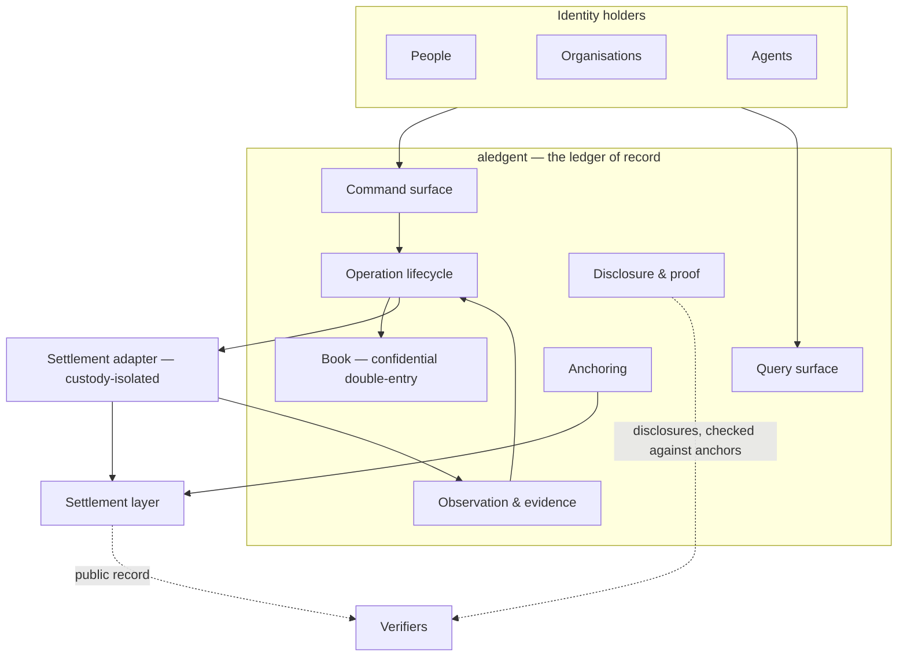
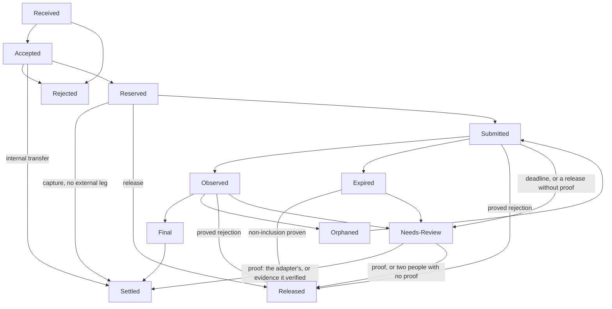

# aledgent — Design Overview

This is a design-level reading of the specification. It covers:

- what aledgent is;
- how it is built;
- what it guarantees;
- what has to be decided before it can be planned.

User stories and acceptance criteria are left out on purpose. §10 summarises them by epic. Identifiers in
`code` point back to `SPEC.md`.

Sections 1–11 name no technology, like the specification. Section 12 is where the plan begins. It is the
only place that names the intended technologies.

---

## 1. What aledgent is

aledgent is a **ledger-of-record service**. A party integrates it to hold and move value for the
identities it serves, or for itself. It is a self-contained product. It knows identities, accounts,
authority and value. It knows nothing about the product they are presented as.

It exists because a ledger of record has to offer seven properties at once. Each existing type of ledger
gives up some of them.

| Property | Public shared ledger | Private database ledger | Hosted accounting engine |
|---|---|---|---|
| Correct under concurrency | yes | only if built | yes |
| Decisions in milliseconds | no | yes | no |
| Privacy | no | yes | not from the engine itself |
| Provable to a third party | yes | no | no |
| External settlement with certain outcomes | yes | no: split lifecycle | no |
| Bounded delegation to agents | no | only if built | no |
| A choice about custody | yes | no | no |

aledgent's answer:

- **private by default;**
- **provable on demand;**
- **connected to exactly one settlement layer through one unambiguous operation lifecycle;**
- **people, organisations and agents as first-class principals.**

Four standing assumptions frame everything else:

- **one operator** per deployment;
- **one settlement layer** per deployment;
- **not a blockchain;**
- **possibly one of many.** Several deployments may share a settlement layer. To each deployment, the
  others are ordinary counterparties.

## 2. Three kinds of fact

Every fact has exactly one home. This separation is the core of the design.

| Kind | Lives | Nature | Examples |
|---|---|---|---|
| **Ledger fact** | In aledgent's book | Private, provable on demand, authoritative. No copy elsewhere is true. | Who owns an account, who may act on it, balances, every entry and its order |
| **Settlement fact** | On the settlement layer | Public, unforgeable, deliberately few | Value moved between aledgent and a counterparty. The book was in state S at time t. |
| **Customer fact** | With the integrating party | Not needed by the ledger. Cannot move value. | What product this is, who the holder is legally, prices, compliance decisions |

> **The trade, stated plainly.** Internal movements never touch the settlement layer. So nobody can
> rebuild a balance from a public record. Instead, aledgent *offers* proof to a chosen party. Anchors
> make a later lie detectable. They do not make it impossible.

## 3. Who interacts with it

| Party | Holds an identity in the book? | Power | Reaches aledgent through |
|---|---|---|---|
| **Identity holder**: a person, an organisation or an agent | Yes | Owner authority over its own accounts. Delegated authority where granted. | Command, query, event and disclosure surfaces |
| **Operator**: whoever runs the deployment | Only for its own value, as an ordinary identity | Operator authority over delegated-custody accounts, bounded by kind | Operator surface, and the settlement adapter it runs |
| **Verifier**: an auditor, a regulator or the counterparty to a disclosure | No | None | Disclosures, and the settlement layer's public record |
| **Settlement counterparty** | No | None | The settlement layer only |
| **Recovery authority**: a party other than the operator | Only for its own value | Co-signs the recovery of an owned-custody account after a delay. Nothing else. | The recovery commands on the operator surface |

The operator and an identity holder differ in **authority and accountability, not in authentication**.
The provability model exists so that others can check the operator's conduct. A *customer* is an
identity holder seen in its commercial relationship with the operator. The design does not treat
customers differently by what they build.

## 4. How it is built

Four rules define the architecture (`REQ-AR-1`–`AR-3`, `AR-7`):

1. **Holders call aledgent. aledgent never calls a holder back to decide an outcome.** Every operation
   reaches a terminal state even when every caller is unavailable.
2. **The settlement adapter executes instructions and submits evidence. It never writes the book and
   never declares an outcome.** aledgent derives every outcome from evidence it has recorded.
3. **Settlement keys live outside the component that holds the book.**
4. **The component that receives commands can be deployed independently of the one that decides them.**
   It never loses a received command while the deciding component is down. A reply is an
   acknowledgement, not an outcome. The caller learns of completion by notification or query.

**Who is responsible for what.** This is normative in the spec and condensed here.

| Responsibility | Where |
|---|---|
| Identities, accounts, ownership, authority, balances, entries, operation state, asset registry, deciding outcomes from evidence, disclosures, what is anchored and when, bearing settlement costs | **aledgent** |
| Signing and submitting external legs. Observing the settlement layer. | **Settlement adapter** |
| The public record of external value movement and of anchors | **Settlement layer** |
| Product, legal identity, permission to transact, prices and fees | **The integrating party** |

## 5. What aledgent needs from its environment

The design relies on exactly four external capabilities. The spec states each one as requirements and
names no supplier. Binding them is the plan's first job. See §12.

| Capability | What it must provide | The hard parts |
|---|---|---|
| **Ledger kernel** `REQ-KER-*` | Unbalanced postings *cannot be expressed*; atomic postings with many entries and many assets; three balance kinds, each readable separately, implemented as partitions of one account or as positions it draws on; never negative under concurrency; append-only; permanent deduplication; exact integers; **concealed amounts**, with balance still enforced; **authority separable from one credential**; atomic composition of postings | Concealment (`REQ-KER-8`) and separable authority (`REQ-KER-9`) are the two most likely to need more than a kernel offers natively. If a gap is closed above the kernel, the assurance level must declare it. |
| **Runtime** `REQ-RT-*` | One durable commit boundary around entries, operation state, evidence and notification enqueue; at-most-once on a client key; deterministic, replayable execution; durable at-least-once delivery; durable scheduled work; private inputs that never enter replicated state; no clock, randomness or network inside the boundary; upgrades that preserve the book | The single commit boundary (`REQ-RT-1`) removes the split-lifecycle failure. Upgrades (`REQ-RT-8`) depend on a proven export and re-import. |
| **Settlement layer** `REQ-SL-*` | Record anchors, ordered by a sequence for each deployment; hold and transfer value under the layer's own coordinates, which carry the operation reference; accept value addressed with an **opaque account reference**, keeping no record per account; expose a **sequenced record readable by position**; hold nothing about any holder; settle between deployments at once, or netted over a bounded window | `REQ-SL-5` gives privacy and removes the cost per operation. It also makes the operator the holder of the value (§8). `REQ-SL-7`–`SL-10` mean the settlement layer must be *built for* aledgent, not just connected to it. |
| **Settlement adapter** `REQ-SA-*` | Declare what it supports; assert it is on the declared network; report only observations; tell apart *executed*, *provably not executed* and *unknown*; answer "what was I asked, what happened, did I report it" from durable state; store an instruction durably before submitting it; observe contiguous ranges completely; hold no authority over any account | Completeness conflicts with recovery. A settlement layer keeps recent history for a bounded window. Skipping is allowed. Skipping silently is not. |

## 6. The domain in one page

**Identity.** A person, an organisation or an agent. Identifiers come from a closed registry. They
contain no personal data. They never encode anything that can change. An identifier is never used to derive an external name (`REQ-ID-5`).

**Ledger account.** Each has exactly one owning identity. An identity may own many. There are four kinds.
They differ only in their negative-balance policy:

- *Customer*: never negative.
- *Treasury*: bounded.
- *Issuance*: the counterparty of all value entering and leaving.
- *Suspense*: reconciled to zero on a cadence.

A ledger account is never deleted. A pooled account is a set of explicit, bounded authority grants. It is
never a shared identifier.

**Asset.** There is one registry. Precision lives only there. Amounts are exact integers of minor units.
aledgent refuses excess precision. It never rounds it.

**Balance kinds.** Each account has three amounts per asset, each readable separately. The plan chooses
how to implement them: as partitions inside the account, or as holding positions the account draws on.

| Kind | Meaning |
|---|---|
| **available** | Spendable now. The only number a spend is checked against, and the same number the holder sees. |
| **reserved** | Committed to one named operation. Deducted the moment the reservation is accepted. May be a derived sum. |
| **encumbered** | Held by a standing rule, not an operation. |
| *total* | Their sum. Shown, never spent. |

**Posting.** The atomic, balanced set of entries. Its *kind* is the authoritative statement of what it
did. Meaning is never recovered by parsing a string. One gapless sequence orders the entries.

**How value enters and leaves the book.** There are only two ways:

- a **settlement leg**: inbound or outbound on the settlement layer;
- **issuance and redemption** by a principal that holds a bounded issuance authority for that asset.

Both are postings against the issuance counterparty. So both show in the trial balance.

## 7. The operation lifecycle

An operation is the unit of intent that a principal submits. The operation record holds its state. The
book holds its effects. The two commit together.

Every non-terminal state also moves to *Needs-Review* past its deadline; the diagram shows only the
main ones. *Needs-Review* resolves in up to three steps. First, the settlement adapter's proof resolves
it with no human. Second, one person can say where the proof is (a block and a transaction), and the
adapter checks it on its own. Third, only if that finds no proof, two different people can agree to
release it, and an incident is raised. A **reversal** is an operation of its own (proposed by one person,
approved by another); the operation it reverses stays *Settled*.

`Received` means aledgent has durably taken in a command but not yet decided it. It has no balance
effect. Its deadline is the decision bound: past it, the operation is an incident and goes to
*Needs-Review*. An inbound arrival that aledgent did not originate enters at *Observed*. The rules that
matter:

1. **Nothing is posted against the outside before the outside is final.** Before that, the only effect
   on the book is a reservation against the payer. So a revised settlement record costs nothing.
2. **Reserve first, always.** No external leg can execute on a path that has not reserved.
3. **A reservation and its capture or release are one object, matched by identity.** An amount given by
   a confirming party never decides what is released.
4. **Evidence, not verdicts.** Anyone may report an event at a coordinate. Nobody may report success.
5. **Final needs two facts:** the settlement layer's finality point has passed, and its record still
   matches.
6. **Silence is not failure.** Nothing is released on a timer. An outcome that cannot be known goes to
   *Needs-Review*. That is a queue with an owner and a service level.
7. **Every non-terminal state has a deadline. Every transition is idempotent. Terminal states absorb.**
8. **Two idempotency keys, never mixed up:** a caller's *client key* and the service's *operation
   reference*.
9. **A command that moves value is acknowledged; the rest are answered.** A transfer, a reservation or a
   withdrawal is acknowledged as `Received` within 50 ms; completing it takes up to 30 s at p99 (19 s is
   the target). Its decision (reserved, settled or refused) follows, and is part of completion. A
   withdrawal completes at the hand-off: final on the settlement layer, and its outcome relayed to the
   requester. What happens after that is outside aledgent. The caller learns of completion by
   notification or query, and never infers it. A command on identities, accounts, credentials,
   authority, recovery or custody, and every operator command, is answered with its decision instead,
   within 1 s at p99 (a proposed number).

## 8. Authority and custody

| Authority | Held by | Over |
|---|---|---|
| **Owner** | The identity, with its own credential | Its own accounts |
| **Delegated** | An agent or a member, with its own credential | Named accounts, within bounds per operation, window, asset or counterparty |
| **Operator** | The operator | Delegated-custody accounts only, split by operation kind |
| **Issuance** | The operator, or an issuer it grants | An asset |
| **Recovery** | A principal other than the operator | Co-signing the reissue of a holder's credential, after a delay |

All five are bounded by how they are built. Each can be revoked, with immediate effect on every derived
credential. Each use is attributed. A credential cannot widen its own scope. An agent is an identity with
its own credential, never a persona under someone else's key.

**Custody mode** is a property of the account. It is either:

- *delegated*: the operator may act; or
- *owned*: only the holder's credentials can act.

V0 ships both. An account may switch between them in place, in either direction. Only the holder's own
credential can trigger the switch that gives the operator power. The reverse switch first requires a
proven holder credential.

**Credentials are a set, not a unit.** An identity holds several credentials. Any of them exercises owner
authority, unless the holder limits it to some accounts. Adding or removing one needs an existing
credential or a completed recovery.

**Recovery** of an owned account needs:

- a *recovery authority* that is not the operator;
- a delay the holder can cancel;
- an audited completion that names every approver.

A holder may also name a successor, who can claim after a longer delay. A holder may also keep a recovery
credential offline, which acts at once. Guardian thresholds and "no recovery" are not offered.

> **What this means, stated plainly.** Value sits in positions on the settlement layer that the operator
> controls (`REQ-SL-5`). So a holder's balance is a claim on the operator. Owned custody removes the
> operator's power to *start* a movement. It does not change who *holds* the value. As specified,
> aledgent's operator is a custodian in both modes. The ways out are deployment topologies, not custody
> modes. See §12.3.

## 9. Privacy, provability, guarantees

**Who sees what.** An account's authority holders see everything about it, including operator actions.
A delegate sees only what its authority covers. The operator sees what it needs to operate, through one
instrumented, justified path. A verifier sees exactly what a disclosure asserts. The public sees that
anchors exist and are ordered. It also sees external movements in aggregate.

**Anchors.** aledgent publishes a commitment to the book's state on the settlement layer. It does this on
a bounded cadence and on demand. The commitment covers every entry up to a stated sequence, and reveals
nothing. An anchor proves **non-revision**. It does not prove correctness or solvency. A revision can go
undetected only in the interval between anchors. Anchoring is never on the critical path.

**Disclosures.** A holder can assert these facts to a chosen recipient:

- at least X was held at time t;
- an operation occurred;
- an amount moved;
- flows over a window met a bound.

The recipient verifies it against an anchor, without asking again. Some disclosures are aledgent's
signature, not a construction anyone can check independently. Such a disclosure must say so.

**The 25 invariants, as six guarantees.** Each invariant names the layer that enforces it. It may not be
enforced at a weaker layer. The first release's assurance level is fixed:

- the kernel or the store enforces the balance, immutability, exactness and coordinate invariants;
- the service enforces deadlines, authority-gated reads, visibility of who acted, and non-widening
  credentials;
- disclosures are signed assertions.

| Guarantee | Enforced by |
|---|---|
| **The book balances.** Debits equal credits per posting and per asset. The whole book sums to zero. | Kernel, store |
| **Nothing is rewritten.** Append-only. Corrections are postings. Terminal states absorb. Transitions are idempotent. | Kernel, store |
| **Value is exact and never negative** for customer accounts, in any layer, at any instant. | Kernel |
| **There is one truth.** One book, one asset registry, one authoritative copy. Stored balances equal the sum of their entries. | Store, service |
| **The book and the settlement layer cannot disagree.** Nothing is posted before final. No outcome is asserted. A coordinate applies once. Reserve before any leg. Capture matches by identity. | Service, store |
| **Authority is the only door.** Nobody sees a fact without authority over it. Every entry is visible to its authority holders, with who acted. No credential widens itself. No personal data in anything permanent. | Credential, store |

**Operating commitments** (`NFR-*`):

- a command that moves value acknowledged within 50 ms at p99, any other command answered with its
  decision within 1 s at p99 (proposed), and every command completed within 30 s at p99 (target 19 s);
- 2.5 million operations a month without redesign;
- balance reads within 5 ms at 150 million entries, under extreme skew;
- no acknowledged operation lost;
- deployable without an outage of the book;
- daily reconciliation on three axes at **zero tolerance**;
- restore drills;
- a conformance suite over every invariant and error.

The three numbers are targets set when the spec was written. It is for the owner to confirm them (`OQ-41`).

## 10. What it does, by epic

| Epic | Capability | V0 |
|---|---|---|
| **A** Identity and accounts | Usable account at once; many per identity; pooled accounts as grants; custody choice and switching; recovery; closing strands nothing | All |
| **B** Internal transfers | Instant, private, one posting; no overdraw under concurrency; multi-leg all-or-nothing | All |
| **C** Reservations | Reserve fast; capture for less; release safely; nothing forgotten; encumbrance | All but encumbrance |
| **D** Inbound | Credited only at finality; completeness visible; no faked credits | All |
| **E** Outbound | Reserve before submit; unknown is never marked failed; shortfalls park and clear themselves; unsupported requests refused up front | All |
| **F** Multi-asset | Segregated assets; exact precision; issuance; conversion | All but conversion |
| **G** Agents | Own credential; bounded grants; instant revocation; window allowances | All but window allowances |
| **H** Querying | One answer per identity; stable paging; balancing statements; nothing hidden from an authority holder | All |
| **I** Privacy and disclosure | Private by default; prove one fact to one party; no personal data anywhere permanent | Privacy yes, disclosures later |
| **J** Provability | Anchoring; revision detection; continuous comparison with the settlement layer | Anchoring and comparison yes |
| **K** Operations and recovery | Resolve through an interface; two-person reversals; restore re-derives the book | All |
| **M** Integration | Notified, not polled; never called back to decide; no need for a balance of your own | All |

Six surfaces deliver this:

- **command**;
- **query**;
- **events**;
- **operator**;
- **disclosure**;
- the internal **settlement-adapter boundary**.

## 11. Scope

**V0** is a deployment with:

- one operator;
- one settlement layer;
- both custody modes, and the switch between them;
- every surface.

Its exit criteria are not features. They are:

- the three reconciliation axes at exactly zero divergence, sustained;
- zero divergence for any initial state loaded.

**Deferred:**

- peer-institution netting;
- owned custody as the *default* of a new account;
- disclosures checkable by construction;
- hiding the transaction graph;
- native asset conversion;
- sub-accounts;
- metered cost sponsorship;
- encumbrance.

**Non-goals:**

- a blockchain;
- a product;
- a workflow engine;
- deciding who a holder is or what anything costs;
- any second value network;
- guardian-threshold recovery;
- an administrative path that moves value outside the command surface;
- any claim that anchoring prevents the operator from cheating.

---

## 12. From the specification to the plan

This section is where the plan starts. It names the intended technologies. The specification never does.

### 12.1 What the plan must bind

| Capability contract | Intended binding | Known gaps the plan must assign an owner to |
|---|---|---|
| Ledger kernel | **CipherClerk** 0.1.x, feature-frozen until a first consumer | No delegated or agent authority. The only authority is possession of an account's key. Encumbrance has no lifecycle. Every shipped proof is a signature, not a checkable construction. No persistence or query layer. Deeper privacy layers are experimental and must not carry real value. |
| Runtime | **VOS** v0.1.0, unreleased, one author | Four application actors per root. Limits on messages, rows and requests. Chain I/O only on local-consistency roots. No transaction across several actors. A state upgrade replaces state from an export. Any replica can read secrets in replicated state. |
| Settlement layer and adapter | **Kreivo** | No anchoring primitive, but a remark path already carries hashed references. The existing extension does not sign, and does not subscribe to events. Four sources contradict each other on block and finality behaviour, and it must be measured. Production runs a newer runtime than the source that was read. |

For each gap, the plan says who builds it, in which repository, and what the fallback is. It never
assumes that a missing capability exists. Evidence and measured bounds are in
the `notes/MEASUREMENTS-*.md` files.

### 12.2 What gates the plan

These are the open questions, grouped by who answers them and what each one blocks. After amendments
0002–0004, **none blocks V0**. Those amendments closed `OQ-7`, `OQ-9`, `OQ-10`, `OQ-13`, `OQ-14` and
`OQ-22`.

| Decide first: the owner | Blocks |
|---|---|
| `OQ-56` What is aledgent optimising for, in one sentence? | Every boundary decision |
| `OQ-58`, `OQ-21` Who owns identity existence? Where does the authority to open identities live? | Identity model, onboarding, the command surface |
| `OQ-12` May a holder's or agent's credential reach aledgent directly? | The whole access model and Epic G |
| `OQ-5` May one pooled account serve identities of different integrating parties? | Authorisation and privacy for pools |
| `OQ-31`, `OQ-33`, `OQ-32` Solvency statement; peer institutions; exposure window | Federation and the provability claim |

| Decide with the plan: engineering | Blocks |
|---|---|
| `OQ-6` Uniqueness domain of the client key | Idempotency design |
| `OQ-11`, `OQ-36` Anchoring cadence; authoritative clock | Anchoring, reporting |
| `OQ-24`, `OQ-25`, `OQ-30` Multi-leg submissions; partial application; multi-asset settlement on day one | Outbound design |
| `OQ-35`, `OQ-51`, `OQ-52` Visible non-terminal states; notification signing; push or poll for agents | Event surface. See parked notes 1 and 2. |
| `OQ-23` Are signed disclosures acceptable for V0? | Kernel binding |
| `OQ-17`, `OQ-41`, `OQ-60` Native conversion; volume commitment; initial-state load as a standing capability | Scope and capacity |

### 12.3 Inputs already absorbed

The four notes parked during review, and the custody analysis, were applied as amendments 0002–0004.
What each became:

| Input | Now in the spec as |
|---|---|
| Independently deployable ingress, core and settlement | `REQ-AR-7`, `REQ-CS-7`, the `Received` state |
| Certainty of completion, never fire-and-forget | `REQ-CS-2`: acknowledgement, not outcome. `REQ-CS-6`: completion by notification or query, no blocking mode. |
| Migrating a ledger whose accounts do not all reconcile | Plan-level: `DEC-14` in `PLAN.md` |
| Switching custody both ways | `REQ-AU-11`–`AU-14`, `US-A7`, in V0 |
| Custody and federation | §1.7 assumption 4, `REQ-SL-6`, the custodian row in §4.3 |
| Recovery model | `REQ-AU-15`–`AU-19`, `US-A8` |
| Credentials as a set | `REQ-AU-20` |

`notes/FIT-VOS-CIPHERCLERK.md` checks how the intended stack fits the spec. The questions it raised for
VOS's maintainers were taken upstream.

### 12.4 Where the work goes next

The order of the work, and what is in progress, is kept in `ROADMAP.md`. The plan's milestones
(`M-0` to `M-3`) and the open questions above are the inputs it is drawn from.
