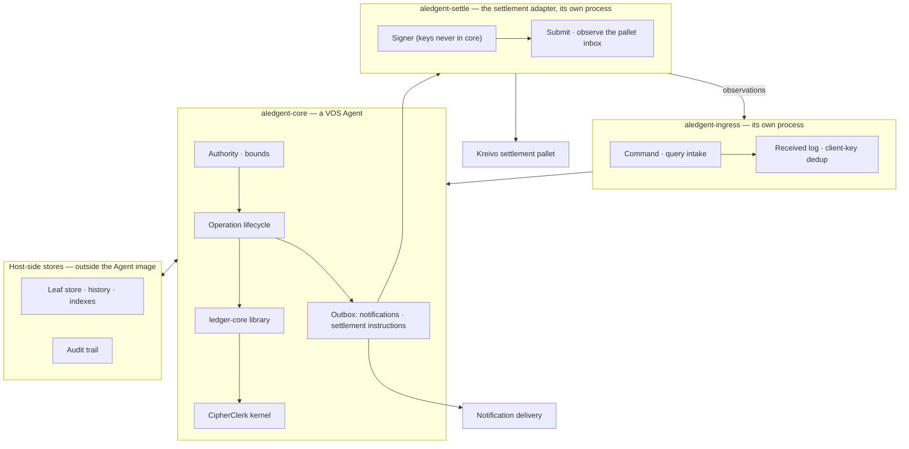
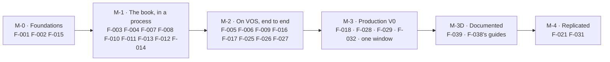

# aledgent — Implementation Plan

This plan says *how*. `SPEC.md` says what and why. If the two disagree, `SPEC.md` wins. Nothing here
changes a requirement. If a technical fact makes a requirement impossible to meet, the plan says so and
points to the amendment that must come first. Every feature, milestone and decision traces to a `US`,
`REQ`, `INV` or `NFR`. Work that traces to nothing is not in this plan.

## 0. How to read this document

| Prefix | Meaning |
|---|---|
| `DEC-*` | A technical decision: what, alternatives, why, cost, reversibility |
| `F-*` | A feature: a bounded unit of work. Spec identifiers name its exit criterion |
| `M-*` | A milestone: a set of features that together make a claim true |
| `RISK-*` | A risk with a mitigation and an owner |
| `DEP-*` | A dependency on an answer we do not have yet: an open question of the spec, or a question to an upstream author. A `DEP` names what is planned in the meantime |

The plan cites three sources of fact: the sources of the bound technologies themselves, the fit analysis
(`notes/FIT-VOS-CIPHERCLERK.md`) and our own measurements (`notes/MEASUREMENTS-*.md`). Every number
here comes from one of those. Where the plan states a limit of a bound technology, the fit-facts report
gives its `file:line`.

Two rules the plan sets itself:

1. **Nothing is assumed into existence.** Each capability the spec needs and the stack lacks has a named
   owner, a home repository, and a fallback that works without the upstream change.
2. **Open questions are not decided here.** A `DEP` plans the option that keeps the others open. It says
   which feature is blocked until the owner rules.

---

## 1. Shape of the system

Four deployable units, all of them ours. The core runs on VOS and the pallet runs on Kreivo:

| Unit | What it is | Why it is separate |
|---|---|---|
| **aledgent-ingress** | Receives commands and queries. Records each command durably as `Received` and forwards it to the core. Serves acknowledgements and queries | `REQ-AR-7`, `REQ-CS-7`: a core redeploy must not lose or refuse commands. Also the only unit that needs to scale with request volume |
| **aledgent-core** | The VOS Agent holding the operation records, the authority model, the reservation model and the kernel. It is the single writer of the book. *From `DEC-22`:* one Shared Agent per shard of accounts, each the single writer of its partitions, and a principals Agent the shards consult. *From `DEC-23`:* also a settlement Agent and an anchor Agent, every one on aledgent's own runtime, with exactly-once streams between them | `REQ-RT-1`: one commit boundary per partition (amendment 0012). One book, held in partitions (`INV-25`) |
| **aledgent-settle** | The settlement adapter. It holds the signer, submits instructions to the pallet, observes the pallet's inbox and submits observations | `REQ-AR-3`, `REQ-SA-8`: keys stay outside the book. Also, VOS extensions are Local-only, which forces chain I/O out of any replicated Agent |
| **settlement pallet** | A FRAME pallet on Kreivo that implements `REQ-SL-1`, `REQ-SL-6`–`SL-10` | Only a settlement layer built for it can meet `REQ-SL-*` |

The **ledger-core library** inside the core is the most important piece. It is `no_std` Rust over
CipherClerk, host-independent. It carries every rule of §5 and §9 that the kernel does not. We write and
test it first, in a plain process, before any VOS binding exists (`DEC-1`).

---

## 2. Decisions

**`DEC-1` The ledger core is a host-independent library.**
*Decision:* everything in §5 of the spec that is not the kernel is one Rust crate, `no_std + alloc`. It
covers:

- identities, accounts and assets;
- authority and bounds;
- the operation lifecycle;
- the reservation model;
- idempotency;
- the audit record shape.

Storage sits behind a trait, with no dependency on VOS. The VOS Agent is a thin binding. *Alternatives:*
write it directly as VOS actors. *Why:* VOS `saga/agents` is unreleased and changes daily. Its actor
model already changed once between `master` and `saga`. Its limits may move. A library keeps our
correctness work clear of that churn and testable on a laptop against the conformance suite (`NFR-14`).
*Cost:* a second abstraction layer, and some duplication of what `clerk-ledger` already shows.
*Reversibility:* high, because the binding is thin by design.
Traces: `REQ-RT-3`, `NFR-14`, every `INV`.

**`DEC-2` Reservations are implemented as holding positions on the settled balance.**
*Decision:* a reservation is a kernel transfer from the payer's account into a holding account for that
operation. Or a pooled holding account keyed by operation reference: `F-004` decides after measurement.
Capture is holding → destination. Release is holding → payer. Capture-for-less is two entries in one
chain. `reserved` is derived as `REQ-BA-6` describes. *Alternatives:* a kernel change for moves between
layers inside one account (asked of upstream, `DEP-4`); or modelling reservations outside the kernel.
*Why:* the kernel's never-negative check then protects the payer at kernel strength (`INV-3`). The
holding account's identity enforces that capture matches the reservation (`INV-14`). The kernel is
unchanged. *Cost:* one holding account per open operation, and "reserved" is a sum. *Reversibility:*
high. If upstream ships a primitive, the library swaps the implementation behind the same interface.
Traces: `REQ-KER-3`, `REQ-BA-1`–`BA-6`, `INV-3`, `INV-14`, Epic C.

**`DEC-3` Delegated, operator and issuance authority live in the library. The kernel key is the core's.**
*Decision:* the core holds every kernel account's `auth_key`. Keys are derived per account from a core
root, so no two accounts share one. The library decides *who may cause an entry*: owner, delegated,
operator, issuance or recovery. It records which authority acted before the core signs the kernel
transfer. *Alternatives:* holders sign kernel transfers with their own keys. Only possible for owned
custody, and only if holders hold Ristretto keys. Or upstream adds delegation to the kernel. *Why:* the
kernel offers no delegation. The spec allows closing that gap above the kernel if the gap is declared
(`REQ-KER-9`, `REQ-AR-6`). *Cost:* the kernel's own record says "the account's key signed". So the
service enforces the attribution the spec requires (`INV-20`, `REQ-AU-7`). *Reversibility:* medium. Owned
custody with holder-held kernel keys is a later hardening step (`F-020`).
Traces: `REQ-KER-9`, `REQ-AU-1`–`AU-20`, `INV-16`, `INV-20`, `INV-22`, Epic G.

**`DEC-4` The book's leaves live outside the Agent image. The Agent holds roots and hot state.**
*Decision:* CipherClerk's composite root and the six sub-tree roots are Agent state (in the compact
construction of `DEC-25`). Account and transfer
leaves, history and indexes live in a host-side store (`SIDE` in §1). Each invocation brings in the
touched leaves as a witnessed batch. The kernel applies over them, and the store applies the resulting
delta after the Agent commits. This is the `clerk-witness` shape. *Alternatives:* the whole book in Agent
state, which fits about 12k accounts under the 4 MiB cap and then fails; or waiting for an upstream state
model. *Why:* `saga` moves the entire Agent state on every invocation and caps it at 4 MiB. A book of
record cannot live there. *Cost:* the leaf store is outside the runtime's commit boundary. So `REQ-RT-1`
is met by construction only if the store is **re-derivable from committed transitions**. The Agent's
committed delta log is the source of truth. The store is a projection that can be rebuilt (`F-006`).
Latency per call rises with witness size. *Reversibility:* medium. This is the biggest structural bet in
the plan.
*Amendment 0023 (2026-10-08, `DEC-26`):* the hot state also holds the writer's code version, its
construction, any scheduled upgrade, and the digest of its upgrade-authority mode with any scheduled
change of mode: about 150 bytes, still bounded.
*Ruling (2026-09-23, #38):* **confirmed. The core stays a VOS Agent.** `F-002` measured the reservation
decision inside a `saga` Agent at 737.8 ms p99 (666.1 ms on `2bb7876`), then 240 ms p99 on the x86-64
recompiler (`notes/MEASUREMENTS-F002.md` §8, §11, §15). The native core that `DEC-1` would allow was the
alternative, and it is not taken. Making the Agent path faster is upstream work that aledgent writes itself
(`DEC-16`, `F-025`).
*Amendment 0007 (2026-09-29):* the 50 ms that these numbers were once measured against was a misreading of
`NFR-1`, which bounds the **acknowledgement** of a command. The reservation decision has no budget of its
own: it is part of **completion** (`NFR-15`: 19 s target, 30 s ceiling, at p99). The measurements are
observations, and all of them sit inside completion.
*Trade-off, stated plainly:* the decision runs in an Agent that is hundreds of times slower than the
kernel alone. That costs headroom and money, not conformance.
*Superseded in part by `DEC-22` (2026-10-03):* once external state reaches Shared Agents, the leaves live in
the Agent's committed maps and the leaf store is a read index.
Traces: `REQ-RT-1`, `REQ-RT-3`, `INV-6`, `INV-25`, `NFR-3`, `NFR-15`. **Depends on `DEP-1`.**

**`DEC-5` Ingress is our own process with a durable received-log, not a VOS ingress route.**
*Decision:* `aledgent-ingress` accepts a command and writes it to a durable log keyed by client key. It
replies `Received` with the operation reference and forwards the command to the core. The core's
acceptance is idempotent on the same key. *Alternatives:* VOS HTTP ingress straight into the Agent.
*Why:* `REQ-AR-7` and `REQ-CS-7` require intake to survive a core restart. VOS ingress is
request/response into the Agent, with a bounded idempotency window (256 results on `master`). *Cost:* one
more process. A reservation is acknowledged at `Received` like a transfer, and forwarded with priority;
its decision follows by query and notification (`REQ-CS-3` as amendment 0007 and the owner's ruling of
`OQ-61` on 2026-09-29 set it). Every other command is answered with its decision, and the account and
security commands always are (`REQ-CS-8`, amendment 0008, ruled 2026-09-30): that reply is bound by
`NFR-16` (1 s at p99, confirmed 2026-10-02), not by `NFR-1`. *Reversibility:* high.
*The answering setting's record (owner, 2026-10-04; amendment 0018 R3):* a
principal's answering setting (`REQ-CS-9`) lives in ingress's store, with the principal that set it and
when, and a log line on every change ([`T-009-18`](features/F-009-ingress-process/tasks.md)). It stays out of the core's audit trail: it changes no
balance and no authority, and the core never sees it.
Traces: `REQ-AR-7`, `REQ-CS-2`, `CS-3`, `CS-6`, `CS-7`, `CS-8`, `CS-9`, `REQ-OP-10`, `OP-11`, `NFR-5`, `NFR-16`.

**`DEC-6` An external ticker drives deadlines until the host has timers.**
*Decision:* `aledgent-ingress` runs a scheduler. It calls the core's `tick` command with the current
time. The core advances deadlines deterministically from that input (`REQ-RT-7`). *Alternatives:* a
custom `AgentRuntime` with the durable timer capability; or waiting for the standard runtime. *Why:* the
standard runtime has no timer API. Even the optional timer capability does not fire on an idle Agent.
*Cost:* the ticker is a liveness dependency. A stalled ticker means stalled deadlines, so the ticker's
own age is an observable (`NFR-11`). *Reversibility:* high. **Depends on `DEP-2`.**
Traces: `REQ-RT-5`, `REQ-OP-5`, `INV-15`.

**`DEC-7` Outbound traffic is an outbox in Agent state, drained by a delivery worker.**
*Decision:* notifications and settlement instructions are appended to an outbox in the core's committed
state, inside `REQ-RT-1`'s boundary. Workers drain it with at-least-once delivery: `aledgent-ingress` for
notifications, `aledgent-settle` for instructions. They record each delivery back as a command.
*Alternatives:* a native VOS extension delivering from inside the Agent: Local-only, unsandboxed, 8 calls
per step. *Why:* the spec forbids losing "did we tell them". The outbox is the durable record, and the
workers are stateless. *Cost:* delivery latency is a polling interval. *Reversibility:* high.
Traces: `REQ-RT-4`, `REQ-EV-1`–`EV-6`, `REQ-SO-5`–`SO-7`, `US-K3`.

**`DEC-8` The settlement adapter is a separate process. It holds the signer and talks to Kreivo through a
light client.**
*Decision:* `aledgent-settle` prepares and submits pallet calls. It signs them with a key that never
leaves it. It observes the pallet's sequenced inbox by storage reads with a cursor. It may use VOS's
substrate extension as a library. The extension already does light-client reads, prepare, submit and a
careful nonce model. Or it may use a direct light-client dependency. Either way, it is outside the core
Agent. *Alternatives:* run it as a VOS Local Agent with the extension. *Why:* `REQ-AR-3`. Extensions are
Local-only, and `saga` removed actor-visible signing. *Cost:* one more process and one more key custody
boundary. *Reversibility:* high.
*Superseded in part (2026-09-24) by `DEC-18`:* the adapter's logic moves into a VOS host extension. Its guarantees (store before submit, replay the same signed bytes, expiry on every transaction, an ordered read at finality) carry over unchanged.
Traces: `REQ-SA-1`–`SA-8`, `REQ-SL-3`, `SL-4`, `NFR-8`, Epics D and E.

**`DEC-9` The pallet is small and holds nothing about holders.**
*Decision:* `pallet-aledgent-settlement` in `frame-contrib`, with:

- `register_instance`;
- `anchor(sequence, root)`;
- `deposit(instance, account_ref, asset, amount)`;
- `withdraw(instance, operation_ref, to, asset, amount)`;
- a sequenced inbox per instance, in storage;
- events keyed by operation reference.

No per-account state, no proof verification, no netting in V0. *Alternatives:* remarks-only anchoring,
with no ordering and pruned bodies; or a general-purpose ledger pallet. *Why:* it directly implements
`REQ-SL-1`, `SL-7`–`SL-10`, and turns observation into a cursor read the adapter can do. *Cost:* a
runtime upgrade on Kreivo, with its review and governance. *Reversibility:* low once deployed. That is
why it is small.
*Superseded for V0 (2026-09-24) by `DEC-17`:* the pallet is built and tested (`F-019`) but does not ship in V0. Its rules port to the contract, and it informs the Spaces pallet later.
Traces: `REQ-SL-1`, `SL-2`, `SL-5`–`SL-10`, `REQ-PR-1`, `INV-19`, Epics D, E, J.

**`DEC-17` V0 settles through an ink! contract on Kreivo. The Spaces pallet comes later, as a change of venue.**
*Decision (owner, 2026-09-24):* the settlement layer's on-chain side in V0 is a `pallet-contracts` (ink!)
contract on Kreivo, uploaded by a community and instantiated through Kreivo's contracts store. It keeps
`DEC-9`'s rules:

- one position per deployment, never per holder;
- deposits carry an account reference;
- every call carries an operation reference and gets its own recorded outcome, applied or refused;
- anchors;
- an ordered inbox.

Kreivo already lets contracts dispatch any `Assets` call and plain balance transfers
(`runtime/kreivo/src/config/contracts/mod.rs`, `CallFilter`), so the contract can hold and move the
deployment's assets. Later the venue moves to the Spaces pallet with a general proof verifier.
That is a change of venue inside one deployment: anchors record
the venue they live in, and the deployment's funds move between two accounts it owns. Reconciliation
adds up both venues during the cutover.
*Open requirement for the Spaces venue (`OQ-68`, amendment 0022 ruling `a0022-q4`, 2026-10-08):* resetting
a Space's anchoring for a re-founded book is desired, analogous to Polkadot's `Paras::set_current_head`
(governance sets a parachain's head; the earlier heads stay in the relay chain's history). On the V0
contract a re-founded book continues the anchor sequence instead (amendment 0022, option (e)), and only
while nothing is bound.
*Amendment 0023 (2026-10-08, `DEC-26`, ruling `a0023-q4`):* an anchor stays a number and an opaque 32-byte
value whose `v3` commitment binds the genesis, the code version, the construction and the authority mode,
so it moves to the Spaces pallet unchanged. Inside the runtime, `pallet-spaces` could also *request* its
deployment's code versions as preimages, which would keep the code history on-chain while requested: a
design item for the pallet, not a promise (amendment 0023, "Toward `pallet-spaces`").
*Alternatives:* ship our pallet (`DEC-9`), or wait for Spaces. *Why:* no runtime upgrade, so no Virto
release or referendum on the V0 path. *Cost:* contract execution costs more than a pallet's, and the
contract needs its own review. *Reversibility:* high. It is the first of several venues.
Traces: `REQ-SL-1`, `SL-2`, `SL-5`–`SL-10`, `REQ-PR-1`, `INV-19`.

**`DEC-18` Settlement runs as a VOS host extension, driven by one call outbox.**
*Decision (owner, 2026-09-24):* agents never talk to the chain. They write **calls** to an outbox, each
with our reference. A VOS host extension drains that outbox after commit and executes the calls against
the current venue, through a light client. It reports one outcome per reference back as observations.
The call envelope is the same for every agent and every venue, so switching from the contract to Spaces
changes the extension, not the agents. The signing keys live in the extension, outside the Agent.
*Alternatives:* the separate adapter process of `DEC-8`. *Why:* one uniform contract between agents and
the chain, and chain I/O and keys where VOS intends them, in native host code, outside any transition.
*Cost:* it depends on VOS draining an Agent's outbox into an extension after commit, which `saga` does
not do yet. Agents can't call extensions, and extensions are node-local. That is upstream work in
`F-025`, designed with @olanod (VOS's maintainer). Until it lands, `services/settle` plays the extension's part against the
same outbox. *Reversibility:* medium.
Traces: `REQ-SA-1`–`SA-8`, `REQ-SO-5`–`SO-8`, `REQ-SL-3`, `SL-4`, `NFR-8`, `REQ-AR-3`.

**`DEC-10` V0 runs the core as a Local Agent with verified backups. Replication is a later milestone.**
*Decision:* one Local Agent. `space backup` runs on a cadence, plus the leaf store's own replication. A
restore drill happens before production (`NFR-10`). *Alternatives:* a Shared Agent, based on Raft, from
day one. *Why:* Shared Agents are not production-qualified on `saga`. They also run under a host-wide
mutex. *Cost:* a single point of failure for writes. Ingress buffering (`DEC-5`) and fast restore reduce
it. `NFR-5`, deploy without an outage of the book, is met by ingress absorbing the restart, not by
replication. *Reversibility:* medium. The acceptance manifests say locality cannot widen from Local to
Shared later. So `M-4` may require a re-genesis with export and re-import (`REQ-RC-3`).
*Superseded in part by `DEC-22` (2026-10-03):* the core goes live as a Shared Agent, with one voter until VOS
has membership change; replicas run as ephemeral container tasks.
Traces: `NFR-4`, `NFR-5`, `NFR-10`, `REQ-RC-3`. **Depends on `DEP-3`.**

**`DEC-11` Privacy posture for V0: amounts as commitments, with the core holding the opening oracle. No
experimental layers.**
*Decision:* CipherClerk L0 semantics, with the core as the oracle, plus viewing keys (L1) for holder-side
disclosure where cheap. No concealment of the graph, metadata or payee. *Alternatives:* the L2 shielded
pool, which hides who paid whom; the L3 metadata and payee layers. *Why:* `REQ-AR-6` and `DEF-4`.
The deeper layers are unaudited. *Cost:* amounts are hidden from storage readers, not from the operator.
The assurance level states this. *Reversibility:* high.
Traces: `REQ-KER-8`, `REQ-PV-*`, `REQ-AR-6`, `DEF-4`.

**`DEC-12` Disclosures are signed assertions in V0. Anchoring uses the kernel's composite root.**
*Decision:* `issue_disclosure` produces CipherClerk's four claim shapes, signed by the core's clerk key.
They are labelled as signed assertions (`REQ-PR-6`). `anchor_checkpoint` publishes the composite root
with a sequence through the pallet; the checkpoint names the root's construction (`DEC-25`, `REQ-PR-10`).
*Alternatives:* STARK proofs of the kernel's state transitions, which
VOS can already produce but which are slow and not yet used for disclosures. *Why:* every proof shipped
so far is a signature. The composite root
and its succinct witness already exist. *Cost:* the honest, weaker claim. *Reversibility:* high.
Traces: `REQ-PR-1`–`PR-10`, `REQ-DS-*`, `INV-19`, Epics I, J.

**`DEC-13` The recovery authority for the first production deployment is a separate service. It has its
own keys and an out-of-band verification runbook.**
*Decision:* a small service, operated by a different team from the core's operators. It holds the
recovery key and exposes only `approve_recovery`. Verification steps are a documented runbook, not code.
Delays: 72 hours for recovery, 30 days for succession. Both are configurable per deployment.
*Alternatives:* an external recovery provider under contract; a second key held by the core's own team
behind a separate approval. The second fails `REQ-AU-15` in spirit. *Why:* `REQ-AU-15`–`AU-17`, and the
owner's ruling. *Cost:* organisational separation to maintain. *Reversibility:* high. The recovery
authority can be replaced by rotating its key, without touching any account.
Traces: `REQ-AU-9`, `AU-15`–`AU-19`, `US-A8`.

**`DEC-14` Migration of an operator's existing book is a strangler by asset and account class, after a read-only
shadow.** *Superseded by `DEC-21` (the owner, 2026-10-02): one window, no shadow, no strangler.* Kept as
written, for the record.
*Decision:*

- First, the existing book is extracted and kept.
- Phase 1 loads opening balances into a shadow deployment. It reconciles daily to zero divergence.
- Phase 2 moves reads over.
- Phase 3 moves writes over, per asset. Clean accounts go first. Divergent accounts go into `Suspense`,
  each with a signed-off disposition.

*Alternatives:* a single cutover on one date; rebuilding history in aledgent by replaying old
operations, which `REQ-RC-4` forbids. *Why:* `REQ-RC-4`, `NFR-9`, parked note 3. *Cost:* a period of
dual operation. *Reversibility:* by
design, until Phase 3.
Traces: `REQ-RC-4`, `NFR-9`, `US-K5`, `US-L*` (withdrawn; carried here).

**`DEC-15` One Rust workspace, one layout.**
*Decision:* this repository is a Rust workspace. Everything we build is Rust, so that the library's types,
the kernel's types and the adapter's types are shared, not re-declared. Layout:

| Path | What | Features |
|---|---|---|
| `crates/ledger-kernel` | The CipherClerk binding and the storage trait | `F-001` |
| `crates/ledger-core` | The host-independent library | `F-003`, `F-004`, `F-007`, `F-008`, `F-010`–`F-014` |
| `crates/conformance` | The conformance suite and the assurance declaration | `F-015` |
| `crates/leaf-store` | The host-side store of leaves, history and indexes | `F-006` |
| `agents/core` | The VOS Agent binding | `F-005` |
| `services/ingress` | The ingress process | `F-009` |
| `services/settle` | The settlement adapter | `F-016` |
| `services/recovery` | The recovery-authority service of `DEC-13`, run by a separate team | `F-012` |
| `crates/authn` | Credential schemes: WebAuthn assertions and registrations, API keys, session tokens | `F-028` |
| `tools/pass-import` | Reads Kreivo `Pass` devices and writes an import file (`polkadot-api`, read-only) | `F-028` |
| `crates/verify` | The verifier for anchors and disclosures, usable without aledgent | `F-017` |
| `spikes/` | Measurement code, never shipped | `F-002` |
| `ops/` | Backup, restore, reconciliation, dashboards | `F-018` |
| `frame-contrib/pallets/aledgent-settlement` | The pallet, in its own repository, tracked here | `F-019` |

*Alternatives:* TypeScript for the two services. *Why:* one type system from kernel to adapter; the
light-client and kernel crates are Rust. *Cost:* a smaller hiring pool than TypeScript.
*Reversibility:* medium.
Traces: `DEC-1`, `DEC-8`, `DEC-9`.

**`DEC-16` What aledgent needs from VOS and CipherClerk, aledgent writes and proposes upstream.**
*Decision:* each capability the binding needs and upstream lacks is written by aledgent. It starts as a
draft in `proposals/`, then becomes a pull request from aledgent's VOS fork (and a CipherClerk fork) to
the upstream branch. The owner opens or approves each one. @olanod agreed to this way of working
on 2026-09-23. *Alternatives:* wait for upstream to schedule the work, or route around it with a
native core (`DEC-1`). *Why:* the cost `F-002` measured is in the runtime, not the library, and the
runtime's author accepts the changes. (It was once framed as a gap to `NFR-1`; amendment 0007 corrected
that: the reservation decision is part of completion, `NFR-15`.) *Cost:* aledgent carries runtime work outside its
own crates, and each change waits on upstream review. A declined change needs its own fallback, recorded
in `F-025`. *Reversibility:* high. Each change stands alone.
*Within JAM (owner, 2026-10-04, agreed with @olanod):* every change aledgent proposes or runs keeps
the runtime within the Gray Paper's Refine host calls (GP 0.8.0 eq. B.6: `gas`, `grow_heap`, `fetch`,
`historical_lookup`, `export`, and `machine` to `expunge`), so one runtime artifact runs off-chain, under a
proof and on JAM. VOS's precompiles outside that set (its BLAKE2b, call 100, and its curve calls, 110 to
114) are parked on the fork, off by default. A program lookup is allowed only as the Gray Paper's
`historical_lookup`, keyed by the preimage's hash; VOS's `vos-native` lookup is keyed by ProgramId and is
parked until it is. aledgent's defaults (the core image, the stress and shard
harnesses, `agents/aledgent-runtime`) are this JAM-compatible profile: no runtime features, the program in
the work and hashed once, curve arithmetic in software. Measured: `notes/MEASUREMENTS-F031.md` §10.
Traces: `DEC-4`, `NFR-15`, `REQ-RT-3`, `REQ-RT-7`.

**`DEC-19` A credential's verifier carries a scheme. V0 ships three: key, passkey and API key. Ingress
verifies them.**
*Decision (owner, 2026-09-30; ruled on its review, 2026-10-02):* the spec's credential is "a key, a device-bound credential, an issued
secret". The plan binds one scheme to each, and a verifier names its scheme:

| Scheme | Proof of possession | Verifier (public material only, `REQ-AU-8`) | Used for |
|---|---|---|---|
| `key` | A Schnorr signature over Ristretto255, CipherClerk's | The 32-byte public key | Reclaim proofs (`REQ-AU-13`), recovery approvals, and every verifier written before this decision |
| `webauthn-es256` | A WebAuthn assertion: ECDSA P-256 with SHA-256 (COSE `-7`) | Credential handle, public key, `rpId`, backup eligibility, the sign count at registration | Holders, through passkeys. Includes the passkeys already registered as Kreivo `Pass` devices |
| `api-key` | A 32-byte secret, drawn by ingress and shown once | The secret's SHA-256 | Services, agents and automation. Scoped, rotatable and revocable like any member of the set |

Verification runs **at ingress**, where every caller is already authenticated (`NFR-7`). A passkey
assertion buys a session: a short-lived token, derived per sign-in, that serves several actions for 15
minutes. Every sign-in moves the passkey's sign count in ingress's durable store, so a replayed or
cloned authenticator's count is refused on any replica. An API key is presented as it is, and never
proves a reclaim (`REQ-AU-13`).

**Relying parties are configuration.** Kreivo accepts a passkey of any `rpId`, deliberately: binding to
one origin would centralise the protocol (Guvenkaya's Pallet Pass review, finding `GUV-2`, an accepted
risk). aledgent is private and binds. Each deployment configures the `rpId`s and origins it accepts, and
only a passkey whose `rpId` is in that set can be registered, signed in with or imported. For example:

| `rpId` | Origins | For |
|---|---|---|
| `example.com` | `https://auth.example.com` (sign-in, through the SDK), `https://api.example.com` (registration at signup) | Every new passkey |
| `api.example.com` | `https://api.example.com` | The passkeys already registered as Kreivo `Pass` devices: sign-in and import only |

**Migration lands through the spec** (amendment 0010). The operator imports passkeys into an identity's
set with `import_credentials` (`REQ-MG-7`), never while one of its accounts is in owned custody
(`REQ-MG-8`). A Kreivo `Pass` account with a passkey is an identity, and that passkey is its primary
credential. An account whose only device is a substrate key is a ledger account: it feeds the opening
load (`REQ-RC-4`), not a credential set.

Ingress authenticates service principals and holder credentials both (`DEP-7`). Both produce the same
authenticated caller as a bearer token does. The core goes on checking, on every command and query,
that the credential is an active member of its identity's set and covers the account
(`REQ-AU-3`, `REQ-AU-20`). So removing a credential still ends its sessions at once. The core checks
a verifier's shape when it joins a set, and still verifies `key` proofs itself.
*Alternatives:* verify passkeys in the core Agent; one scheme for everything; leave passkeys to the
integrating party, which would then call as a service principal. *Why:* the guest already exceeds the
pinned runtime's program limit and installs only where it is raised (`F-005` `NOTES.md`). P-256, JSON and CBOR in it would cost size on every
invocation for a check that has to read a clock and per-deployment origins anyway. Holders in owned
custody must act with their own credential, so a service principal cannot stand in for them
(`REQ-AU-6`). Passkeys are what holders already hold. *Cost:* the core trusts ingress's
check of a passkey proof, including a reclaim proof, as it already trusts ingress's authentication of
every command. A sign-in writes once to ingress's store. A passkey works only from origins under the
`rpId` it was created for (`RISK-10`). *Reversibility:*
high. The scheme is a tag. A scheme added later, `EdDSA` passkeys or substrate keys for example,
is one more tag.
Traces: `REQ-AU-1`, `AU-3`, `AU-4`, `AU-8`, `AU-13`, `AU-20`, `REQ-MG-7`, `MG-8`, `REQ-AG-1`, `REQ-PN-1`, `NFR-7`, `DEP-7`.

**`DEC-20` An asset starts book-only. Its issuance authority binds it to one settlement-layer asset
later, once, at zero divergence, and the layer's metadata stops mattering after that.**
*Decision (owner, 2026-10-02; amendment 0011, R2):*

- **Registration is book-only.** `register_asset` takes the asset, its precision, its kind and the
  reviewed change, as `F-003` built it. The registry is where the precision lives (`REQ-AS-1`). An
  operator's first assets might be a few book-only stable assets, issued and redeemed by an issuing client
  under issuance authority. A book-only asset's external legs are
  refused at submission with `ERR-UnsupportedLeg` (`REQ-AS-7`).
- **The adapter attests, the core decides.** The settlement adapter reads each Kreivo asset its
  configuration maps (`FungibleAssetLocation`, `Here(101)` for `TSTA`, for example) at the finalised head, through the
  light client: `Assets::Asset` (status) and `Assets::Metadata`, from which it takes the `symbol` and
  `decimals` **fields**. The asset's name (a label such as `ABC/2`) is never read, by the owner's ruling. An absent
  `Metadata` entry is "no metadata", never zero decimals. It submits that as an attestation, an
  observation like any other (`INV-11`).
- **Binding** (`bind_asset`, `REQ-AS-8`). A principal with issuance authority over the asset asks for it,
  naming the location, with a justification. The core refuses unless a fresh attestation of that location
  shows a live asset whose `symbol`, normalised, is the asset's id and whose `decimals` are its precision
  (`ERR-UnsupportedLeg`; stale: `ERR-SettlementLayerUnavailable`), the location is free and the asset is
  book-only (`ERR-NotAuthorised`). It then takes the book's outstanding balance of the asset (everything
  outside the issuance counterparty and the opening positions, `INV-5`), marks the asset `Binding`, which
  refuses its issuance and redemption with `ERR-NotAuthorised` so that the number cannot move, and emits
  a **bind call** through the settlement outbox (`DEC-18`), beside anchors: `Bind { asset, amount }`.
- **The contract checks the equality on chain.** `Bind` is a new call of the settlement contract
  (`F-026`). It succeeds only if the asset was never bound before and the contract's own holding of the
  asset on Kreivo equals the position its inbox already accounts for plus `amount`, exactly (a stray
  deposit made before the binding does not block it). It then adds `amount` to the asset's position
  and records a `Bound` entry in its inbox under the call's operation reference; otherwise a refusal
  with the holding it found (`AlreadyBound`, `HoldingMismatch`). The zero-divergence check is therefore made by the layer, at the block that
  records the binding, and is final with it (`REQ-SL-3`). Before asking, the issuer puts that holding
  there: on Kreivo, the asset's issuer mints the book's outstanding amount, or transfers it, to the
  contract's account. A plain transfer records no deposit, so no account is credited twice.
- **Finality.** The adapter reports the `Bound` entry, or the refusal, like every inbox entry. On a final
  `Bound` whose amount is the one the core asked for, the asset is `Bound`: its location is in the
  registry, its position at the binding is recorded as the baseline of `NFR-9`'s third axis
  (`book_positions` starts from it), and its external legs are supported. On a final refusal the asset is
  book-only again, its issuance resumes, and an incident tells the operator what the layer held.
- **After binding** (`REQ-AS-9`). Attestations of a bound asset are recorded and
  otherwise ignored: no hold, no incident, no refusal. `F-029`'s first design held the asset on any
  difference and released it by `reconcile_asset`; both are gone.

*Alternatives:* registering by location, with the precision read from the layer (`F-029`'s first design,
#112), which cannot register an asset before its layer side exists and parsed the name; a deposit to a
reserved account reference as the funding, which would make the core tell a funding deposit from a
holder's; the core comparing the layer's holding it read with the book, which leaves a gap between the
read and the binding. *Why:* the owner's rulings, and an equality that holds at one final block, on the
layer, under one operation reference. *Cost:* a contract change (a new call and a new inbox entry kind),
the adapter's decoding of both; and in-book issuance of a bound asset after its binding is not backed by
the contract until the issuer deposits it (question `k-01`: issuance continues, as `REQ-AS-6` allows). *Reversibility:* a binding
is never undone (`REQ-AS-8`); the mechanism is one more call kind.
Traces: `REQ-AS-1`, `AS-2`, `AS-3`, `AS-6`–`AS-9`, `REQ-SA-1`, `SA-3`, `REQ-SL-3`, `INV-5`, `INV-11`,
`INV-24`, `NFR-9`, `NFR-17`, `US-F5`.

**`DEC-21` One stage, straight to Kreivo: one window, no daily shadow.**
*Decision (owner, 2026-10-02 and 2026-10-03):* the rollout has one stage. It replaces `DEC-14`'s strangler
and the two-stage canary of 2026-10-02 (stage A book-only with the prover, then stage B with the contract
and the adapter).

- **From the first deployment, everything is on.** The core runs as a VOS Agent on aledgent's VOS fork
  (`saga/agents` and our PRs, single node, `DEC-10`), with the prover, its gaps accepted.
  The prover changes no state and no anchor, so it joins online when `F-030` lands if it is not ready by
  the window (question `k-05`).
  The settlement adapter, the settlement contract on Kreivo and hourly anchoring (`REQ-PR-1`) run from the
  first entry. Assets start book-only (`DEC-20`).
- **One window.** The operator's existing book is extracted and kept first.
  The migration is rehearsed on test until two runs give identical results, then run once in production:
  the production cutover is the only window there will ever be (`NFR-17`). It loads opening balances
  (`REQ-RC-4`) at zero divergence. There is no daily shadow load before it and no per-asset
  strangler: every client moves in the window. Rollback is the old ledger, kept read-only, and only
  inside the window.
- **After the window, online only.** Each book-only asset is bound when its Kreivo side is ready
  (`DEC-20`); anchors are on Kreivo from the start, so nothing is re-anchored; a move to a Kreivo Space
  later re-anchors nothing (`F-019`). None needs a window (`NFR-17`).
- **Gate.** The zombienet suite's book-only scenario (register, transact, bind, zero divergence, anchor)
  passes before any release reaches Kreivo (`PLAN.md` §5, release gate). Mainnet setup waits for a
  Kreivo runtime upgrade that carries the subscriptions and the Pass fixes the setup scripts need.
  The window itself opens only once the stress suite passes (`F-032`; §5, stress gate): a go/no-go,
  on the deployment's own hardware and configuration.

*Alternatives:* `DEC-14` (a shadow, then a strangler per asset), which needs dual operation and several
windows; the staged canary (book-only first, the contract and the adapter later), which the owner
declined: it does the prover first and the contract second, and makes stage B a second change of the
deployment's shape. *Why:* the owner's rulings; and a deployment whose shape never changes after its window
is the only one `NFR-17` allows. *Cost:* no period of dual operation to find divergence classes, so each
class needs its signed-off disposition before the window (`RISK-8`); the deployment depends on the
Agent core, which lacks a ported restore (`F-005`) and the prover's integration (`F-030`), and on the
adapter and the contract, from day one; the first window carries every client. *Reversibility:* until the
window closes, by the old ledger; after it, none by design.
Traces: `REQ-RC-4`, `NFR-5`, `NFR-9`, `NFR-17`, `REQ-PR-1`, `REQ-AS-7`, `REQ-AS-8`, `US-K5`, `US-F5`.

**`DEC-22` The core is a Shared Agent per shard of accounts, its state in committed maps, its commands batched.**
*Decision (owner, 2026-10-03, with `OQ-17`; amendment 0012):* the owner's scale target is millions of concurrently active agents. The core as an Agent
decides about 3.5 reservations a second today (284 ms p50 per invocation on the x86-64 recompiler, one
invocation at a time, `notes/MEASUREMENTS-F005.md` §9), against 1.3 ms for the same decision natively. Three
levers, applied in this order and each measured (`F-031`):

**Throughput target** (the owner, 2026-10-03): none committed. The aim is the greatest throughput
achievable today, 10 000 decisions a second to start and a million better; the stress suite measures and
reports it (`NFR-18`).

1. **Batching.** One Linear invocation, and so one Raft entry on a Shared Agent, carries many commands. The
   batch is bounded by a configurable count and by VOS's message, reply and caller-blob limits. Each input
   keeps its own witness and its own result: the batch commits its longest prefix of inputs the Agent
   accepts, and the host drives the rest again one at a time, so a faulty input fails alone (the hybrid
   isolation the owner ruled for the contract's batches in #102).
2. **Cost proportional to touched state.** The kernel's six trees and the service leaves move into
   **committed maps** in the Agent's Linear lane, in the same leaf encodings: CipherClerk's for the kernel,
   `ledger_core::leaves` for the service. A committed map is a sparse Merkle tree kept as storage rows and
   maintained incrementally, byte-compatible with CipherClerk's roots (VOS's `actors/clerk-ledger` does the
   same). An invocation reads and writes only the leaves it touches, and no host builds a witness. On a
   Shared Agent the rows live in VOS's **external state blocks**, so nothing moves or decodes a whole image.
   This supersedes `DEC-4` once external state is available to Shared Agents (`DEP-1`, `DEP-11`): the leaf
   store (`F-006`) becomes a read index rebuilt from the Agents' journals, and the delta ring and the host's
   `archive.bin` retire.
3. **Split by account.** The book's state is held in **partitions** (`REQ-RT-9`): 2¹⁶ of them, the
   partition of a ledger account being the first two bytes of
   `blake2b-256("aledgent/partition/v1" ‖ account id)`. Kernel account ids, transfer ids and the service
   keys of account-scoped kinds carry the partition in their top sixteen bits from `F-031` on, so a later
   split moves subtrees of the committed maps and renames nothing. A **shard** is one Shared Agent holding a
   contiguous range of partitions; one shard holds all of them until measurements justify more.

**The Agents.** Per deployment, in its Space:

| Agent | Actors | State |
|---|---|---|
| `aledgent-book-<n>`, one per shard | `book-kernel` (CipherClerk's six trees; applies balanced postings), `service` (the lifecycle and authority evaluator; decides, then calls `book-kernel` inline), `settlement-outbox` (`DEC-18`'s call envelope, and the credits owed to other shards), `audit` (hash-chained records and anchor checkpoints) | Committed maps in each actor's Linear lane |
| `aledgent-principals`, one | `principals`: identities, credential sets, grants, roles, the registry and the shard directory (partition ranges to shards) | Committed maps; a feed of changes to every shard |

Until VOS's maintainers confirm that an inline call chain commits as one Linear transition,
`service` and `book-kernel` stay one actor, as `agents/core` is today. *Superseded in part by `DEC-23`:*
aledgent's own runtime commits several actors' methods in one Linear transition (composite invocations), so
the split no longer waits for upstream; it waits for a measurement that it pays. The split of the other actors does not
depend on it: each commits its own leaves in the same invocation through the same transition.

**Credits between shards** (`REQ-RT-11`). The debit's commit enqueues the credit in the source shard's
`settlement-outbox`, numbered in sequence per (source shard, destination shard). A relay delivers each
pair's credits in sequence; the destination applies each one once and records the last sequence it applied
per source, so a credit delivered twice applies once and the pair is first-in, first-out. The source trims
what the destination has applied. The relay is a host process until VOS commits an extension outbox under
consensus (`docs/extensions.md`, future work); then it is VOS's. Each shard holds, per asset and per peer
shard, an in-transit position of kind Issuance: the debit credits it in the source shard, the credit debits
it in the destination shard, and the sum over the book is exactly the credits enqueued and not yet applied.
Closure of an account waits for every shard's confirmation that no credit to it is in flight; the
confirmation travels the same ordered path, so it arrives after any credit the shard sent before it.

**Hot accounts** (`REQ-RT-12`). An issuer's escrow, a fee collector or a treasury is held as a pool of
members in different partitions. A debit draws on one member, chosen by the hash of its operation reference,
falling back to a reservation on several members and their capture when no member covers it (the multi-leg
path). Members of an Issuance-kind pool hold no balance check, so their debits commute and never order. The
operator rebalances members with ordinary transfers.

**Principals** (`REQ-AU-3`, `NFR-20`). Ingress authenticates a caller and resolves its authority from
`aledgent-principals`, stamped with that Agent's version, and passes it with the command. Each shard applies
the principals feed through the same exactly-once path as credits, keeps the latest version applied, and
refuses authority older than a revocation it has applied. The feed's delay is the revocation lag.

**Anchors** (`INV-19`, `REQ-RT-14`). The anchoring worker reads each shard's committed roots at one consistent cut
(`DEC-23`, "The consistent cut") and anchors a
commitment over (shard, sequence, roots) for all of them (`REQ-PR-1`). A disclosure proves a fact against its
shard's root and that root against the anchor.

**Replication** (ruled again 2026-10-03). The core goes live as a **Shared** Agent: one voter while VOS lacks
membership change, three once it has it, so no re-genesis is ever needed to replicate (`DEC-10`'s cost
disappears). Replicas run as ephemeral container tasks with no persistent volume: after membership admission, a
replica installs the latest quorum-certified checkpoint and replays the log's tail. That needs the VOS gaps
the fork's `gap/*` branches close (`DEP-11`).

*Bound by `NFR-21` (amendment 0016, ruled 2026-10-04).* Ephemeral horizontal scaling is now a requirement,
not only this decision, and this paragraph is its plan-level realisation. An execution node is a VOS node
running some of the book's Agents, deployed as a container task with no persistent volume.

- **(a) Scale out:** more shards (`F-033`'s online splits move partitions and rename nothing, `REQ-RT-9`),
  and more replicas per shard. Ingress is stateless over its received log (`DEC-5`) and scales by adding
  tasks.
- **(b) Replace:** a fresh replica is admitted by a membership change (`ChangeReplicas`, signed by the
  Space's authority), installs the latest quorum-certified checkpoint from the off-node archive, and
  replays the log's tail. No replica's disk is ever copied or re-attached.
  *The archive (owner, 2026-10-04): an S3 sink first, a stateful archiver later.*
  First, VOS's checkpoint-archive sink and source (`gap/5-checkpoint-archive`) are implemented over S3:
  the voters publish each certified checkpoint and the log segments after it to a bucket, and a fresh
  replica, or a total-loss recovery, fetches them from there, with no peer involved. A stateful archiver,
  a node that keeps the checkpoints and serves them over the network, comes later, as a change behind the
  same sink and source.
- **(c) Lose local storage:** three voters per Agent, two to commit (`NFR-21`'s design value). A command is
  acknowledged or answered with its decision only after its Raft entry commits on two voters. The received
  log behind an acknowledgement at `Received` lives in PostgreSQL, outside every execution node, under the
  database's own replication.
- **Measured** by `F-032`'s stress suite, beside `NFR-18`: admission time at the book's size, resumption
  after the leader's loss, and the decision rate during admission.

*Plan dependency, not a spec weakening.* Two of these are not satisfiable on VOS as released
(`saga/agents`): membership change on a Shared Agent (voter replacement: `gap/2-shared-create` and
`gap/3-change-replicas` on the fork) and portable, quorum-certified checkpoints a new replica installs over
the network or from an archive (`gap/5-checkpoint-archive`, and the common-checkpoint collection and restore
that are still `#[cfg(test)]` upstream). Both are `DEP-11`'s. Until they land, the first production deployment runs
one voter per Agent: it scales out only by adding shards, and meets neither `NFR-21` (b) nor (c). `NFR-21`
is not relaxed for it; `F-021` closes the gap, and `US-K6`'s conformance cases stay pending until it does.

*Alternatives:* a faster single writer (lever 1 and 2 alone), whose ceiling is one serial order of all
commands; a partition per identity, which keeps `REQ-BA-5`'s snapshot per identity and makes a large
organisation a hot spot (question `c-07`); two-phase commit of both sides of every transfer between shards,
which locks the payee and doubles the latency, where the owner chose a debit that is final and a credit
that is guaranteed. *Why:* the rulings, and a design that scales by adding shards. *Cost:* the in-transit
position in every reconciliation; a credit lag (`NFR-19`) and a revocation lag (`NFR-20`); a relay to
operate; pools to rebalance; a sixteen-bit partition in every account-scoped key; and a dependency on VOS
capabilities that are internal or absent as of `saga/agents` `e6f2bb45`: public Shared Create, membership
change, checkpoint install and external state on Shared Agents. *Reversibility:* the number of shards is
configuration; the sixteen-bit partition is in the key layout and costs a re-genesis to change.
Traces: `REQ-RT-1`, `REQ-RT-9`–`RT-12`, `REQ-AU-3`, `REQ-BA-5`, `INV-5`, `INV-9`, `INV-18`, `INV-19`,
`INV-25`, `NFR-9`, `NFR-18`–`NFR-20`. **Depends on `DEP-1`, `DEP-3`, `DEP-11`.**

**`DEC-23` The book is a set of Agents, each with one responsibility, all on aledgent's own runtime.**
*Decision (owner, 2026-10-03; amendment 0014):* `DEC-22`'s shards and principals Agent
are joined by a settlement Agent and an anchor Agent. Every one of them pins **aledgent's runtime**
(`agents/aledgent-runtime`): VOS's standard runtime, plus composite invocations that run several actor
methods in one Linear transition, keep each payer's commands in order, and apply every message between
Agents exactly once. Points the ruling leaves open carry the conservative default and name their question (`r-01` to
`r-11`).

**The Agents.** One Space per deployment. Every Agent is Shared, with one voter at first and three once VOS
has membership change (`c-11`, `DEP-11`); queries go to observers. Every Agent's replicas are ephemeral, as
`DEC-22` ("Replication") sets out, and so `NFR-21` (amendment 0016) binds every Agent here, not only the
shards.

| Agent | Count | Actors | Holds | Decides | Receives (streams) | Sends (streams) |
|---|---|---|---|---|---|---|
| `aledgent-book-<n>` | N, one at first | `book` (the kernel and the service library over committed maps, as `agents/shard` today) | Its partitions' accounts, balances, reservations, operations; the in-transit positions per peer and asset; its outboxes | Every command whose payer is in its partitions (`REQ-RT-10`) | `credit/<peer>` (credits owed to it), `feed` (openings, grants, revocations, the directory), `evidence/<n>` | `credit/<n>` to each peer, `settle/<n>`, `audit/<n>` |
| `aledgent-principals` | 1 | `principals` | Identities, credential sets, grants, roles, revocations; the **directory** (partition ranges to shards, versioned) | Registry commands (`open_identity`, grants, revocations, enrolment) | `audit` acknowledgements | `feed` to every shard, `audit/principals` |
| `aledgent-settlement` | 1 | `settlement` | `DEC-18`'s call envelopes by operation reference, the adapter's observations, asset binds (`DEC-20`) and the shards' shares of a binding | Which observation settles which leg (`REQ-IN-*`, `INV-10`); a binding's amount at a consistent cut (`REQ-AS-8`, `REQ-RT-14`); no keys (`REQ-AR-3`) | `settle/<n>` from every shard, `anchor`, the adapter's observations as commands | `evidence/<n>` to the owning shard, `audit/settlement` |
| `aledgent-anchor` | 1 | `trail`, `anchor` | The one audit trail, with each writer's last sequence (`REQ-AT-2`); each writer's records (roots and stream heads) since the last anchored cut | The latest consistent cut and the root of roots over it (`INV-19`, `REQ-RT-14`): every shard's kernel and service roots and heads, the registry's version, the trail's position | `audit/<writer>` from every writer | `anchor` to the settlement Agent: the anchors (`REQ-PR-1`, hourly) and the cuts a pending binding waits for |

Within an Agent the runtime commits several actors atomically (below), so an Agent may split its actor
where measurement says it pays: the trail and the anchor are two actors of one Agent from the start; a shard
keeps one actor until a split is measured (`r-07`), because its steps would hand data to each other and a
step cannot yet read the previous one's reply ([`T-033-07`](features/F-033-aledgent-runtime/tasks.md)).

**No coordinator Agent.** Two host processes route, and neither holds state the Agents do not:

- **The router is ingress** (`DEC-5`). It authenticates, reads the caller's grant and the directory from the
  principals Agent (a cached read, at most `NFR-20` old), stamps the principals version, maps the payer's
  account to its partition (the top sixteen bits, `DEC-22`) and the partition to its shard, and invokes that
  shard. Registry commands go to the principals Agent, adapter observations to the settlement Agent.
- **The relay** carries streams. It reads each sender's committed outbox (a linearizable query), invokes the
  receiver with one composite whose steps are the messages, each marked with its stream and sequence, and
  invokes the sender with the receiver's applied head so the sender trims. A relay that forgot everything
  resends from the sender's trim point; the receiver's runtime answers each repeat as a duplicate and applies
  nothing twice. This is `DEC-22`'s relay, made general.

**The consistent cut** (amendment 0015, `REQ-RT-14`). With several writers, the book "at an instant" is one
commit per writer, and some choices count a credit twice (the payer before its debit, the payee after its
credit) or lose it. So:

- *Stream heads.* Every shard's round commits, in its `audit/<n>` record, its audit sequence, kernel commit and
  root, the last principals version applied, and per peer the last credit sequence **enqueued** for it, the
  last **applied** from it, and the sequence through which that peer's trim let it **drop** its outbox
  (`shards::cut::Heads`). The principals Agent's record carries its version and a running digest of its feed.
- *The condition.* For every ordered pair (source *i*, destination *j*): `trimmed_i[j] ≤ applied_j[i] ≤
  enqueued_i[j]`, and every shard's principals version is at most the registry's in the cut. The right
  inequality forbids counting a transfer twice; the left keeps every credit in transit listable from its
  source's outbox. The credits `applied_j[i] + 1 ..= enqueued_i[j]` are in transit at the cut; their value is
  in the two shards' in-transit positions, which the roots commit to (one position per shard and peer carries
  both directions, so a pair's two positions hold the credits in transit both ways).
- *Assembly.* The anchor Agent applies every writer's records exactly once and in sequence, keeps them from the
  last anchored cut on, and takes the **greatest consistent cut** at or below the newest: start from the newest
  record of each writer; while a pair breaks the condition, move back the record that is ahead (the destination
  when it applied past the source's record, the source when it dropped past the destination's, a shard whose
  principals version is past the registry's). Every move goes back, and every consistent cut below the start
  stays below the current one; the last anchored cut is consistent; so the search ends at the greatest one and
  never below the last anchor, and nothing waits for the book to be idle. The anchor's leaves are each shard's
  `(shard, audit sequence, commit, root, heads digest)`, then the registry's `(sequence, version, digest)`
  (`shards::anchor`), so a verifier can check the cut from the anchor's inputs. Under load the cut trails the
  newest records by about one relay hop.
- *Binding* (`DEC-20` across shards). The bind command records `Binding` in the registry; the feed carries it
  to every shard, which from that commit refuses the asset's issuance and redemption (`ERR-NotAuthorised`) and,
  in the same commit, reports its issuance member's position as a **share** on `settle/<n>` (its round's
  private input carries that member's opening). The anchor Agent, seeing `Binding` in the registry's records,
  sends on `anchor` each cut it assembles until one has every shard past the change; the settlement Agent, on
  such a cut and a share from every shard, takes the amount as the negation of the shares' sum (equal to the
  holders' balances plus the value in transit at that cut) and emits `Bind { asset, amount }` (`DEC-18`). The
  contract's on-chain equality is unchanged. Issuance a shard decided before it applied `Binding` is in the
  amount; the freeze takes effect shard by shard within the feed's delay (`NFR-20`'s bound, question `gc-05`).
- *Prototype* (`crates/shards`, `F-031`): `Heads` in every `RoundReply`, `cut::Assembler`, `Cluster::anchor` at the
  live cut, `Change::Binding` / `BindingEnded`, `Share`, `Cluster::bind_amount`. The host relays audit records
  with the same faults and lag as credits; `tests/cut.rs` checks every live cut against an independent ledger of
  the credits (no double count, no lost value) under duplication, reordering, dropped heads, lost trims and a
  lagging relay, and a binding's amount against the book once every credit has landed.

**Why a relay, as of `perf/agent-stack`.** VOS documents cross-Agent calls ("durable await, timeout, retry,
and late-reply records", VOS `docs/architecture.md:118-119`), but nothing on the Agent path produces
`YieldReason::Await`; the runtime ABI returns a state and one outcome, and the consensus-committed extension
outbox is future work (`docs/extensions.md:88-92`). `after_commit_merge` messages are not atomic with the
Linear commit (`docs/architecture.md:104-106`), and a Merge lane takes events from the Agent's own replicas
only. What VOS does guarantee is that one Linear transition commits the Agent's rows and its retained reply
together. So a message is committed in its sender's transition and applied in its receiver's; the relay
only moves it, and the runtime, not the relay, makes it exactly once. When VOS commits cross-Agent messages
under consensus, the relay retires and the streams stay as they are.

| Stream | From → to | Carries | Bound |
|---|---|---|---|
| `credit/<n>` | shard n → each peer | Credits owed (`REQ-RT-11`), their trims back | `NFR-19` |
| `feed` | principals → every shard | Openings, grants, revocations, directory versions | `NFR-20` |
| `settle/<n>`, `evidence/<n>` | shard n ⇄ settlement | Instructions after finality (`INV-10`); the evidence that settles their legs | measured |
| `audit/<w>` | every writer → anchor | Audit records in the writer's sequence; its roots at each cut | measured; anchors hourly |
| `anchor` | anchor → settlement | The root of roots to anchor (`REQ-PR-1`) | hourly |

**Scaling.** A shard is a range of partitions; the count of shards is configuration.

- *Adding a shard* creates an empty Agent and moves partitions to it by splits.
- *Splitting online*, one range at a time: (1) the principals Agent records the move at directory version
  v+1, `moving`; (2) the source applies it from `feed`, fences the range (its debits are refused with a
  retryable error) and sends the range's subtrees (whole subtrees of its committed maps at depth sixteen,
  so nothing is renamed) as a numbered `handoff/<n>` stream; (3) the target applies the handoff exactly once
  and reports its roots; (4) the principals Agent flips the range at v+2, ingress routes to the target, and
  the source forwards credits for the moved partitions until every sender's trim has passed the cut. The
  fence is the only unavailability, and only for that range (`r-06`).
- *Hot accounts* are pools (`REQ-RT-12`).
- *The other Agents* do not shard: the principals Agent's state is the registry (small, read-mostly), and
  the settlement and anchor Agents carry per-shard streams whose rate is a shard's own.

**aledgent's runtime.** One program (`agents/aledgent-runtime`), selected per Agent at creation and pinned in
its identity (VOS `vos-agent-sdk/src/model.rs:368-373`), like any custom runtime: it implements the same
management ABI (`docs/architecture.md:79`) and is admitted against the same contract
(`vos/src/agent/package_admission.rs:368-376`). Its engine is VOS's code on the fork
(`aledgent/composite-runtime`, feature `runtime-composite`), because the standard runtime's internals are
crate-private. What it does that the standard runtime does not:

- **(a) One atomic Linear transition across the Agent's own actors.** An invocation may carry a composite:
  a caller blob listing steps, each a Linear method of an installed actor. The primary runs as usual, then
  every step against the state the step before it left. In an **atomic** composite every step applies or
  nothing does, the primary included, and the failure is the invocation's retained outcome. One result,
  one acknowledgement, one exact retry cover the whole composite. This is what an open question to VOS
  asked of it, answered by our own runtime.
- **(b) Programs matched by reference, the work validated once.** A step's identity, schema, method policy
  and installation data come from the directory, matched by reference among blobs the work decoder already
  authenticated; its program is the primary's bytes when the program is the same, the reference the
  runtime bound at its first verified use, or (outside the default) the host's lookup. Nothing is hashed twice in an
  invocation. The binding is made at first use, not at install: `InstallActor` carries the ProgramId and no
  program bytes or reference (`r-05`).
- **(c) Ledger-aware batching.** In an **isolated** composite each step commits or rolls back alone. Each
  step may carry an **order key** (a payer's partition): once a step with that key does not apply, every later
  step with it is deferred, so nothing overtakes a payer's earlier debit (`REQ-RT-10`). A step whose gas the
  invocation no longer has is **deferred**, not run, so a batch never loses its applied prefix to the gas
  cap. Each step may be a numbered **stream** message: the runtime keeps every stream's applied head in its
  own state and applies a message only at head plus one, in the step's own commit; a repeat is a duplicate,
  a gap waits (`REQ-RT-13`, `INV-18`).
- **(d) Deadline-driven ticks** (designed, [`T-033-08`](features/F-033-aledgent-runtime/tasks.md)). The runtime reads the earliest deadline from the book's
  own deadline rows (the runtime holds every lane's rows; this one knows their prefix) and, when the work's
  signed slot has reached it, adds the tick as a step. The ticker of `DEC-6` becomes a heartbeat that carries
  no logic, and `DEP-2` is answered by our runtime.
- **(e) A lean result window** (designed, [`T-033-09`](features/F-033-aledgent-runtime/tasks.md)). A composite's primary may carry "acknowledged through
  k", retiring earlier results in the same transition: one whole-state execution fewer per invocation (each
  `Acknowledge` re-reads and re-writes the whole image).
- **Its rules.** At most 128 steps a composite and 16 an atomic one, and every step ordered or numbered.
- **Its public I/O, optionally lean** (`direct-public-io`, off by default, `r-04`): the by-reference
  commitment only for work a proof consumes. Direct executors read the output window alone and never the
  public-I/O registers (`vos/src/agent/runtime_pvm.rs:109-139`); skipping it saves two hash passes over the
  state image per invocation.

What it cannot change: the host-call allowlist of its contract (calls 9 to 14 for r19, plus 7, 100 and 110
to 114 for the profiles: `pvm/runtime/src/spi.rs:25-29`, checked over the whole program at admission,
`package_admission.rs:484-489`; by default it issues only 9 to 14, `DEC-16`); that actor programs reach it as
availability or by `historical_lookup`; the
actor gas caps (the Agent's `ExecutionLimits`, the host's outer budget); the state image and its 4 MiB; four
caller blobs and 192 KiB a call, 8 KiB of retained reply; 63 live machines; Raft's order on Shared Agents;
and the management ABI itself (`RUNTIME_ABI_ID`, `vos-agent-sdk/src/lib.rs:57`).

**The public-I/O commitment is the runtime's to define.** The guest halts with its output in a0/a1 and a
32-byte commitment in a2 to a5. On the Direct path, the only one current executors admit, the host reads the
output window and nothing else (`vos/src/agent/runtime_pvm.rs:109-139`). On the proof path the host takes the
commitment from the prover's tentative execution, refuses only a zero one
(`vos/src/agent/transition_proof_host.rs:1669`), and binds the work and the transition separately, by
commitments it computes itself over the canonical bytes (`transition_proof_host.rs:1719-1724`;
`vos-agent-sdk/src/proof.rs:387-390`). The proof ties the commitment to the guest's final registers
(`vos/src/zk.rs:40-66`). No host code recomputes it from a fixed formula, and the management ABI does not
name one: `perf/agent-stack` already moved the standard runtime from the byte form to the by-reference form
(`vos-agent-sdk/src/runtime.rs:1213`, `:1238`; `services/agent-runtime/src/lib.rs:45`) without changing any
host. So a custom runtime may define it. What binds it is the verifier: once a verifier recomputes the
commitment from the work and the transition, the formula becomes part of the runtime's contract, and a
runtime that changes it is a new contract. That is a question to VOS's maintainers.

**Security: what the runtime enforces, and what it does not.**

- *Authority.* Every invocation's receipt is verified as the standard runtime verifies it: signature, slot
  window, and the request hash, which binds the composite blob by reference (the work's commitment binds
  metadata and the ordered references, `vos-agent-sdk/src/runtime.rs:300-304`). Each step's method must be
  declared Linear in its own actor's schema and admitted by its own method policy for the primary's origin
  and role claims. A public preflight never authorises a step (it binds one exact work).
- *Lane rules.* Steps are Linear and target only actors installed in this Agent, not suspended; each step's
  non-written lanes must come back unchanged; each step's gas comes out of the invocation's.
- *Exactly once,* at three levels: the invocation (its retained result answers every retry, and no step runs
  again), the stream (heads in the runtime's own state, moved only in the applying step's commit), and the
  payer (order keys).
- *Not the runtime's:* every rule of the book (balances, authority bounds, finality) is the library's, in the
  actor, unchanged. And the runtime cannot tell who wrote a message: a stream step is authorised by the
  receipt of whoever invokes the receiver, which is the relay's principal. A forged credit would be applied;
  it breaks the trial balance across shards, which reconciliation sees (`NFR-9`), but nothing prevents it.
  Messages that carry the sender's commit evidence, checked by the receiver's runtime, need a cross-Agent
  evidence format from VOS (`r-03`).
- *Proofs.* A proof of a transition under this runtime proves the whole composite (steps, stream checks,
  order keys run inside the outer program, and its inner machines are in the Refine trace), against this
  runtime's ProgramId, which the Agent pins. A proof covers one Agent: a credit's provenance chains the
  sender's proof to the receiver's through the stream's sequence, once messages carry the sender's commit.

**Measured** (`F-033`, `features/F-033-aledgent-runtime/NOTES.md`; hosted 2-vCPU runners, the same VOS
commit and profile, `vos-native native-curve`, the profile of 2026-10-03; since the ruling of 2026-10-04 the
default is the JAM-compatible profile, no runtime features, under `DEC-16`). Built that way, our runtime
issues only the Gray Paper's calls 9 to 14, composites included (`notes/MEASUREMENTS-F031.md` §10). The conformance suite through the core Agent in VOS passes
the same 193 cases under VOS's runtime and under ours (none fail; 11 pending by owner, 72 need ports the
Agent target does not offer), and again with batches of eight sent as composites (74 composite
invocations of up to eight inputs). On the plain path our runtime is the standard one: 110.29 M of runtime
gas per reservation against 110.29 M (a difference of 1.3 k), and the same inputs per second within the
runner's noise (18.5 against 18.5 one per invocation; 66 against 67 at 32 with 8 G of actor gas). With
`direct-public-io` the core saves 1.25 M an invocation (its state is 9 KB). Composite batches cost about
21 M of runtime gas a step: a batch of eight takes 288 M of runtime gas as a composite against 138 M as the
actor's own batch, and decides 26 inputs a second against 56. Composites buy isolation, order and
exactly-once below the actor, not throughput; the actor's own batch stays the fast path. On the fleet (16 vCPU, one shard Agent
per core, run 37160680098) the shard Agents decide the same under our runtime as under VOS's (108, 182,
317 and 639 transfers a second on 1, 2, 4 and 8 shards, against 108, 182, 325 and 654), and 120, 200, 339
and 669 with `direct-public-io`, which drops two hash passes over images of 0.7 to 2.9 MB.

**How it plugs into the shards** (`F-031`, #142, #146, #148; the interfaces in
`features/F-031-core-throughput/SHARD-INTERFACES.md`). The shard Agents run under this runtime unchanged:
its plain path is the standard one, so `aledgent-core-host shards` takes its program as `--runtime`. Then,
interface by interface ([`T-033-10`](features/F-033-aledgent-runtime/tasks.md)):

- *Credits* (§3): `Credit.seq`, numbered per (source, destination) from 1 without a gap, is the stream
  sequence of `credit/<source>` at the destination. The runtime's head replaces the shard's
  `applied_from(from)` as the exactly-once check (the actor keeps its own as a second line), and a batch of
  one source's credits becomes one step once a step may carry a range of a stream ([`T-033-06`](features/F-033-aledgent-runtime/tasks.md)). Trims stay
  as they are: the destination's applied head, carried back.
- *The principals feed* (§4): `FeedEntry.version` is the sequence of the stream `feed`; the revocation
  fence (`Refusal::Revoked`) stays the actor's.
- *Orders* (§2): an isolated step per order, keyed by `Command::home()`'s partition, where per-command
  isolation is worth about 21 M of gas a step; the round's own batch stays the fast path.
- *Anchor inputs* (§5): `ShardRoot` per round goes to the anchor Agent as `audit/<n>`.

*Alternatives:* one Agent per deployment with all actors (`DEC-22`'s table), which keeps one serial writer
for registry, settlement and audit work that do not need it; VOS's standard runtime and the actor
enforcing exactly-once itself (the shard prototype today), which every Agent would re-implement; waiting for
VOS's cross-Agent await, which is documented and not implemented. *Why:* the ruling; and a runtime that
enforces order and exactly-once once, below every actor, is smaller to review than four actors that each do.
*Cost:* a runtime program of our own to build, review and upgrade (a runtime upgrade is a management operation
under the runtime producer's key, separate from the transition producer's, `model.rs:368-373`); a VOS fork
branch until upstream takes composite invocations; three more Agents to operate, and a lag per stream. A
step costs its machine's start: about 21 M of gas a step for the 4.34 MB core, against about 110 M for an
invocation of its own. *Reversibility:* high. The standard runtime runs every plain invocation identically,
so an Agent can be re-created on it, and a composite is only ever an extra caller blob.
Traces: `REQ-RT-1`, `REQ-RT-10`, `REQ-RT-11`, `REQ-RT-13`, `REQ-RT-14`, `REQ-AS-8`, `REQ-AT-2`, `REQ-AU-3`,
`REQ-PR-1`, `INV-18`, `INV-19`, `INV-25`, `NFR-9`, `NFR-18`–`NFR-20`. **Depends on `DEP-11`, `DEP-12`.**

**`DEC-25` The book's trees are compact sparse Merkle trees (v2 roots), from genesis.** *Accepted by the
owner on 2026-10-05 (amendment 0019).*
*Decision:* the kernel's six trees and the service tree keep CipherClerk's key space (128 bits, bits read
most significant first) and its leaf contents and leaf hashes, and are hashed as compact sparse Merkle
trees, the Diem/Aptos Jellyfish hashing over a binary radix:

- a subtree holding one leaf is that leaf's node, `H("cipher-clerk/smt/leaf-node/v2" ‖ key ‖ leaf hash)`,
  wherever it stands; an empty subtree is 32 zero bytes (an empty tree's root); anything else is
  `H("cipher-clerk/smt/node/v2" ‖ left ‖ right)`, a one-child internal node above a lone pair included;
- the kernel root is `H("cipher-clerk/state-root/v2" ‖ 0x02 ‖ six sub-roots)`, one hash with the
  construction's version byte; the book root's domain is `aledgent/book-root/v2`;
- the checkpoint names its construction, and the anchor commitment binds it (`REQ-PR-10`):
  `H("aledgent/anchor/v2" ‖ construction ‖ instance ‖ number ‖ entry_sequence ‖ kernel_root)`. A disclosure
  envelope (version 3) carries the construction; the verifier reads it and still checks version-1
  commitments. The anchored value is still 32 bytes (`REQ-PR-2`). Disclosures stay signed claims over the
  kernel root (`DEC-12`, `REQ-PR-6`): no check of a recipient recomputes a tree;
- the Agent's kernel witnesses carry multiproofs whose node entries are opaque (sound because a kernel
  tree never loses a leaf, `INV-2`); the service witness carries them opened, since the service tree
  removes leaves; the wire form is one 51-byte record an entry. Single-key inclusion and non-inclusion
  proofs are sibling lists whose length fixes the position;
- the branch-only stores (`F-006`'s trie, the committed maps) take a removed leaf out of the structure;
  its row stays, emptied (`INV-2` at the row level).

The construction lives in aledgent (`crates/compact-smt`, no_std) and is offered to CipherClerk as patch
0006 (`proposals/cipherclerk/0006-compact-smt.md`, ruled 2026-10-05). CipherClerk's full-depth tree (v1)
is a **supported, documented opt-in** (owner ruling `cs-q04`, 2026-10-05): v2 is the default, and a
deployment may choose v1 at genesis by building every binary, the core host and the core's guest included,
with the feature `smt-v1` (the images' `ROOTS=v1`, `deploy/docker`). v1 is not weaker, only
costlier: 137.9 M of actor gas a reservation against v2's 72.0 M (v2 saves 48 %), with witnesses about
21 % smaller (8.2 KB against 10.4 KB). Each checkpoint names its construction (`REQ-PR-10`), so a
recipient always knows which one a deployment chose; a deployment never mixes the two and changes
construction only by a migration (`REQ-PR-11`, `DEC-26` (e); amendment 0023). Nothing is removed when CipherClerk merges 0006: CI runs the `F-001`
differential under both versions, the root-versioned crates' tests under v1, and the conformance gate
profile from a v1 genesis; `F-006`'s standalone witness (CipherClerk's `SuccinctTransitionWitness`) stays
v1 only. *Alternatives:* keep CipherClerk's full-depth tree, 128 node hashes a path; a Patricia trie that
also skips one-child internal nodes, about one hash fewer a path but with level-committing nodes, a format
of our own. *Why:* under the JAM-compatible default the core's actor gas per reservation falls from
137.9 M to 72.0 M, and its throughput at batch 128 under 8 G from 27.1 to 40.3 reservations a second on an
EPYC 7763; the shard Agents gain 4–7 % (their trees were 7 % of a round) (`notes/MEASUREMENTS-F031.md`
§11). Nothing is anchored yet, so v2 from genesis costs no migration. *Cost:* a reservation's witness is
about 27 % larger (10.4 KB against 8.2 KB); aledgent's roots are not CipherClerk's own (`MemLedger::root`,
`composite_state_root`) until CipherClerk takes 0006; one crate more in the core; keeping v1 supported
costs a version switch in each root-versioned crate and a second run of the suite in CI. *Reversibility:*
high before the first anchor, low after it: a later change is a recomputation from the leaves, a new
construction named, and the old one kept checkable (`REQ-PR-10`).
Traces: `REQ-RT-3`, `REQ-PR-2`, `REQ-PR-3`, `REQ-PR-4`, `REQ-PR-10`, `INV-2`, `INV-19`, `NFR-18`.

**`DEC-26` Code history and upgrades: the code is book state, an upgrade is an input, and every code version
is kept.** *Ruled by the owner on 2026-10-08 (amendment 0023, `a0023-q1` to `a0023-q9`); made independent of
the platform, ruled 2026-10-17 (amendment 0033).* The full text, with the code as verified on `main` at
`a3cb28b`, is `amendments/0023-code-history-and-upgrades.md`. Amendment 0033
(`amendments/0033-code-history-independent-of-the-platform.md`) amends (a), (b), (b′), (d) and (g) and adds
(i) and (j), so that the book can later move from VOS `saga/agents` to VOS `vos-core` by an upgrade, with no
new genesis.
*Decision:*

- **(a) `:code` in hot state.** A **code version** *H* is `blake2b-256` of a canonical manifest
  (`aledgent/code/v1`) that names its **platform** (name and revision, e.g. `vos-saga@c54fc1ff`) and lists,
  for one writer kind, its **code generation** (`generation: u64`) and each artefact that decides a
  transition (`package`, optionally `runtime`, and `native-decide` wherever a host decides natively) with
  its unkeyed `blake2b-256`, length, **identities** on the platform (VOS `ProgramId` today; on `vos-core`
  the ELF's hash, the derived program's hash and the transpiler's version) and **build profile** (target,
  toolchain, `opt-level`, features, source revision, `Cargo.lock` digest), the kernel's identity, the
  constructions it reads and the message formats it accepts and emits (amendment 0033). Every package is
  built with a `GENERATION` constant equal to the manifest's `generation`: a 16-byte record (`ALGGEN01` and a
  little-endian `u64`) in its own ELF section, `.aledgent.generation` (or that section placed first in
  `.rodata` where the platform's program linker keeps only `.rodata`, found by the symbol), exported as
  `ALEDGENT_CODE_GENERATION`; the symbol is that record, defined once by a `ledger-core` macro, and the fence
  reads that very static, so there is no second constant to compare. One reader, `ledger_core::code::generation_of`, reads it in `check-code`
  ([`T-038-25`](features/F-038-ingress-fleet/tasks.md)), which fails the build when it differs, in staging, and in the host's checks at start and
  before a switch. The digest check binds the constant to *H*.
  The replayer is **not** in the manifest: each range's replayer is a separate code-archive entry,
  `replayer/<hex H>`, so a host rebuild is not a code upgrade. **Nothing of the platform is hashed** outside
  the manifest (`REQ-RT-19`): `driver` (the writer's authorised submitter) and `observed_slot` (a
  diagnostic) are the host-local fields of `SPEC.md` §2 **Writer state**, set at founding, never carried by
  a snapshot or a continuation, and never in a root, a log hash, a checkpoint or an anchor. The hot row
  gains `code`, `generation`, `construction`, `upgrade: Option<(H, n)>`, `authority` (the mode's digest) and
  `authority_next`; each ring entry gains the `code` that executed it, covered by the log hash.
  Checkpoints carry `construction` and `code`, and `consistent` uses the checkpoint's own construction.
  **One `v3` for amendments 0022 and 0023** (`a0023-q3`):
  `H("aledgent/anchor/v3" ‖ construction ‖ genesis ‖ code ‖ authority ‖ instance ‖ number ‖ entry_sequence ‖ kernel_root)`,
  still 32 bytes (`a0023-q4`); the shard leaf becomes `aledgent/anchor/shard/v3`. The chainspec names the
  genesis code *H₀*, built with the core at opt-level `s` (`a0023-q9`), the construction and the initial mode.
- **(b) The upgrade.** The operator publishes *H* to the code archive and submits `Upgrade { code: H, from: n }`
  through `CTR-OPS`; ingress and the author host refuse it unless every artefact is fetched and matches; the
  host has staged *H* first (fetched, every digest checked, the manifest's `generation` the writer's plus
  one, and the package's compiled `GENERATION` equal to it); the writer commits `upgrade = Some((H, n))`;
  while it is scheduled the host ends its batches at `n − 1`, so a restore point and a checkpoint land
  there; before input `n` the host takes one operation, `switch(H, n)`, installing only the staged bytes
  (VOS's registry upgrade on `saga`, a compare-and-swap on the old program hash signed with the core's
  package key through the signer, "already switched" read as success; an install into the same instance on
  `vos-core`, the install record checked before and after, and the instance's rows surviving a re-install
  an assumption until the spike shows it; the founding of a continuation across platforms, (j)); input `n` runs under *H* and
  moves `upgrade` into `code` and `generation`. **The switch is symmetric:** before each input the host
  installs the code version the code map names for it (*H* from `n`, or *g* again after a way-out input),
  each install a `switch` signed through the signer, whose grant covers them all. **The artefact check:** at
  start and at every switch the host checks every artefact it runs for the writer (on `saga`, the runtime it
  hands to `Runtime::create` as well as the package) against the code version the code map names for the
  next input, by digest, installs that version where any differs, and refuses to drive the writer only if
  it cannot; the in-book fence cannot see a runtime the host supplies apart from the package. **The fence**
  (`REQ-RT-20`), checked at every input: code takes an input only when its compiled `GENERATION` is the hot
  row's `generation` *g*, or *g* + 1 for an input at or after a scheduled `from`; any other code refuses it
  with nothing written and its number not taken (a new outcome, added as a new call-format version, which
  the continuation's scoped refusal shares; a refused command is audited at the execution node, in its log
  and the audit store, never in the book). A
  missed switch, or a stale package after one, halts the writer instead of running an input under the wrong
  code; on `vos-core`, which has no compare-and-swap and no way for an actor to read its program's hash, the
  fence is the only in-book check. The fence identifies code up to its generation; byte identity within a
  generation is the host's staging check. **The way out:** `RescheduleUpgrade { from: m }` (`m` later than
  its own number) and `CancelUpgrade`, authorised under the mode in force, are the only inputs the fenced
  code takes; every one is decided, the same by code of either generation, refusals included (an
  unauthorised one, or a move not later than its own number, is a recorded refusal that takes its number,
  and the upgrade stays scheduled; amendment 0035); none makes the upgrade take effect (`generation` stays
  *g*), after which the host installs the code the code map names. An input that holds a way out and
  anything else is refused whole as `ERR-MalformedCommand`, nothing of it applied, by every generation
  alike (amendment 0035). Their audit and export command codes are fixed once in *H₀*: `RescheduleUpgrade`
  51, `CancelUpgrade` 52, `SetAuthority` 53, `ProposeUpgrade` 54, `ApproveUpgrade` 55, `ProposeMigration`
  56. The `code-history` gate decides every way-out
  fixture input under each staged *H* and under *g* and requires the same committed state. The code map derives from the `Upgrade`,
  `RescheduleUpgrade` and `CancelUpgrade` inputs alone, and native replay takes each input's generation from
  it. `aledgent_writer_fenced_seconds` alerts past `fence_alert_after` (a deployment setting, default five
  minutes; `NFR-11`). The handler, the fence and the way out must be in *H₀*.
- **(b′) The upgrade-authority mode** (`a0023-q2`). A closed enum: `Single { principal }` (the genesis mode
  today), `ProposeApprove`, `Threshold { members, k }`, each with an optional delay counted in inputs.
  `SetAuthority { mode, from }` is authorised under the mode in force, validated deterministically by the
  writer, cancels pending proposals and leaves a scheduled upgrade standing. The mode is the only authority
  over a writer's code: the host takes `switch` only for an upgrade the writer has committed, and both
  platforms' install authorities (the core's package key on `saga`, the node's admin token on `vos-core`)
  are host keys held through `F-035`, never authorities (`REQ-RT-20`).
- **(c) The code archive.** One S3 object per digest under Object Lock; "kept forever" is an S3 **legal
  hold** (`a0023-q5`) on code, input segments, anchored checkpoints and the chainspec, over the 400-day
  compliance floor. Only a break-glass role may remove a hold, and every use of it alerts. The code map is
  read off the ring entries; `code-map/<writer>` is a convenience copy a restore checks, never trusts.
- **Retrieval: a pluggable `CodeSource`.** Built-in `s3`, `fs` and `https`; `exec` commands; C-ABI plugins,
  loaded by digest and isolated in `aledgent-code-fetch` by default (`a0023-q7`); `kreivo-preimage` in the
  open-source distribution (`a0023-q8`). The fetcher, never the source, checks every artefact's length and
  digest; bytes that do not match are never used.
- **(d) Restore and replay per range, native first.** `roll_forward_agent` splits the archive at the code
  map's boundaries. The book side of every range is replayed natively under the range's generation, read
  from the code map, and needs no platform; the Agent side (re-sending each input and requiring the
  archived log hash) runs each range under its replayer, the host image at `replayer/<hex H>` in the code
  archive, switched by `switch` as the live upgrade did. **The host spec is
  frozen** (`a0023-q6`): call formats are versioned, a change only adds a version, and every host applies
  every earlier version exactly; a range that cannot keep this names a native host build in its manifest,
  with the owner's approval each time. A replayer per range uses that fallback's form for the Agent side
  only, kept beside the code version and not in it, approved for every range on 2026-10-17 (amendment 0033).
- **(e) A construction migration.** `MigrateConstruction { to }` recomputes inner nodes only; the checkpoint
  at its input is a **bridge anchor** that binds both roots. The settlement contract is unchanged.
- **(f) The `code-history` CI gate** replays a fixture archive across every release's boundary, and a
  deployment's archive read-only on each release, on CI and bench runners.
- **(g) Fast and full resync.** Fast: the latest anchor-verified snapshot and the inputs since; full: the
  chainspec and every input. Both reach the same roots. Per-shard warp sync follows from it. **Checkpoints and
  snapshots are rows and leaf chunks** (`REQ-RT-19`): an archived checkpoint, and a snapshot sent to another
  node, hold the writer state of `SPEC.md` §2 (every hot-row field but the host-local `driver` and
  `observed_slot`, the configuration, every record, the unarchived ring, the outbox) as a sorted key-value
  list in aledgent's encoding, plus content-addressed leaf chunks. `agent.state` stays the core host's local
  cache, never archived or sent; checkpoints already written as `agent.state` stay readable by a converter
  that keeps `saga`'s codec. One archive restores onto either runtime.
- **(h) Retention** as `NFR-22` lists it.
- **(i) Per runtime** (amendment 0033). On `saga`: `ProgramId` identities, `switch` is the registry
  compare-and-swap signed with the core's package key through the signer, and the fence backs it. On `vos-core`: ELF, derived-program and transpiler identities,
  the node's default agent program under `platform`, `switch` is an install into the same instance with the
  install record checked before and after, and the fence is the safety. Checkpoints are rows and leaf chunks
  on both.
- **(j) The continuation** (`REQ-RT-21`, amendment 0033). Beside `F-036`'s `StateGenesis`, which stays as it
  is, a second founding envelope, `Continuation { genesis, predecessor, at: n, log_head, writer state at
  n − 1 }`, built from the predecessor's checkpoint at `n − 1` once its committed `inputs` is `n − 1`, and
  checked field by field against it (all but `continued_at = n`, a committed writer-state field the
  founding sets). No founding is made while the next queued input is a way-out input. The founding record
  is written **last**, after every check (staging, no claim at `n`, the predecessor at `n − 1` with
  `upgrade = Some((H, n))` both before and after the build, state equality, roots), and **once**, as the
  claim of input `n`, naming the build attempt and instance that passed; each attempt's instance is recorded
  in a write-once `instance/<…n>/<attempt>` object (never node-local state), its id derived from (claim key,
  attempt) on both runtimes (`saga`: `create_with`'s creation nonce, today a one-byte discriminator; `vos-core`:
  the install's `instance`); a retry by any lease holder reads the latest attempt, adopts its instance if it
  passes the post-checks, and otherwise tears it down and builds attempt + 1 under a fresh name: archived under `claim/<hex blake2b-256(genesis ‖ logical writer ‖ n)>` with a conditional
  create under the archive's Object Lock, before input `n` is sent anywhere. The predecessor's archiver
  creates its own claim at that key before archiving its entry at `n`; both claims are fixed functions of
  (genesis, logical writer, `n`, side) and the inputs before `n`, so a claim that finds its own side's
  identical record resumes and one that finds the other side's has lost; a founding that loses founds
  nothing. The feed routes input `n` and later only to the recorded instance; an instance from a failed or
  abandoned build never receives an input and is torn down by the runbook. Segments name the instance that
  wrote them, and the archive accepts a continuation-side entry at a claimed `n` only if the claim is a
  founding record and the instance is the one recorded for the attempt the record names. Once a founding record
  exists the upgrade is final: a way-out input for the upgrade scheduled from `continued_at` is refused with
  `ERR-InvalidTransition`, fence-style (nothing written, number not taken), by the continuation as the
  authority and by the feed as a fast path; one for a later upgrade is taken as usual. A failed check writes no record; a create that finds the
  same bytes is a resume and succeeds, one that finds different bytes is refused; replay refuses a log with
  two founding records at one `n`; feeding stays with one core through `F-038`'s feed lease and epoch. The
  archive accepts each input number of a **logical writer** once (segments created conditionally, keyed by
  the logical writer, never the Agent instance, and first input, each starting at the last archived input
  plus one), and the feed reads the claim before sending anything numbered `n` or later to the predecessor,
  so a reschedule or cancel in flight from a former lease holder that commits there is never archived or
  acknowledged. Replay refuses a log with both a founding record and a predecessor entry at one `n`. The code map's boundary comes from
  the `Upgrade`; the founding record is evidence replay checks against it. A move to `vos-core` is an `Upgrade`
  whose code version names `vos-core` from `n`, the predecessor fenced at `n`, `Continuation` on `vos-core`,
  and input `n` sent there: no new genesis, no bridge anchor, no change of construction. A continuation onto
  a fresh Agent of the same runtime is how the gate rehearses it before `vos-core` is ready.

*Alternatives:* export and re-import for every upgrade (`F-014`), which is unproven at volume and loses the
history's replayability; keeping one build forever. *Why:* replay (`REQ-RT-3`) is only meaningful if the
book says which code ran each input and that code is still there. *Cost:* about 150 bytes of hot state and
32 bytes a ring entry (+13 %); a code archive kept forever; a frozen call format; a checkpoint format of
aledgent's own, a generation compiled into every package, and a replayer image kept per range (amendment
0033).
*Reversibility:* low once the first upgrade is taken. Traces: `REQ-RT-3`, `REQ-RT-15`–`REQ-RT-21`,
`REQ-PR-10`, `REQ-PR-11`, `REQ-OS-2`, `NFR-22`, `US-K7`.

**`DEC-27` Ingress is a fleet of its own, and each core connects out to it.** *Proposed 2026-10-15; waits
for the owner.* Today ingress and the core are separate processes on one node, and ingress pushes each
command to the core host over a Unix socket that authenticates by the peer's user id. A reboot of that node
on 2026-10-14 (applying a node configuration, 21:36–21:38Z) refused 36 requests with 502 and 504 from the
load balancer, because ingress went down with the node. `NFR-5`, `NFR-17` (no change may need a maintenance
period, an upgrade included) and `NFR-21(b)` (any execution node is replaceable while every command is still
acknowledged within `NFR-1`) forbid that. The shape also does not extend to cores in several regions, each
the writer of its own partitions. *Decision:*

- **(a) Ingress runs apart from every execution node**, as at least two instances in different failure
  domains, holding no state of its own outside its database (the received log, client keys, challenges,
  passkey counters). An ingress release goes out blue/green: the new set is healthy before the old one
  drains, so no request is refused. A core's restart, replacement or loss never takes ingress with it.
- **(b) The acknowledgement needs no core.** Ingress acknowledges a command once it is durable in the
  received log (`NFR-1`, `REQ-CS-2`), whether or not any core is connected. The received log's database is
  the durable copy `NFR-21(c)` counts, so it runs replicated across failure domains. Ingress is its only
  owner: no core reads or writes it.
- **(c) Each core host connects out to ingress** over one long-lived stream, authenticated both ways with
  mutual TLS under the operator's own certificate authority, on a listener for cores only (never the client
  API's). Ingress sends down the stream the commands of the partitions that core writes, in the received
  log's order; the core sends back each reply and decision, which ingress records on the row. A core host
  listens on no network port, as today. A regional core connects to the nearest ingress instance and
  receives only its own partitions.
- **(d) The feed follows the connection, and the core keeps the order.** The core always dials; ingress
  never dials a core, so only ingress needs a stable address. Any ingress instance takes a client's command
  and writes it to the received log. The instance holding a core's stream holds the lease to feed that
  core's partitions: it reads their new rows and sends them down. The core tracks the next sequence it
  expects per partition: it drops a duplicate and holds an early arrival, so ordering comes from the
  received log, never from which stream or instance a command arrived on.
- **(e) A switch reconnects without refusing.** An ingress instance that is leaving sends its cores a
  go-away (as HTTP/2's), and each core reconnects to the stable address and lands on a live instance, which
  takes the lease over. If an instance crashes, the core notices through keepalives within seconds, and
  the lease expires. A command sent on the old stream and not yet answered is sent again by the new feeder
  and dropped by the core if it was already taken. Decisions pause for the reconnect: well under a second
  for a planned switch, a few seconds for a crash. Acknowledgements never pause.
- **(e′) Ingress's reads ride the same stream.** Ingress also reads from the book: a caller's credentials
  and grants from the principals role (the single core Agent today, `aledgent-principals` in the sharded
  profile), cached at most `NFR-20` old, and the queries it serves. Those reads go up the stream the core
  host that holds the principals role (or the queried state) opened, and their answers come back down it,
  as commands do. No core is ever dialed for a read either. *Every instance reads* (the owner's ruling
  of 2026-10-15, option (b)): each region's cores are deployed beside that region's own
  set of ingress instances, which hold the region's partitions, so a core only ever dials its own
  region's instances. Each instance advertises, in ingress's database, an address its region's cores
  reach it at (configured, or detected from its listener): a roster of live instances, renewed every few
  seconds and withdrawn on drain. A core host dials the fleet's stable name as before, takes the roster
  from that greeting, then dials every instance in it directly, over the same mutual TLS, and keeps one
  stream to each; it reads the roster again on every go-away (and ingress sends it down every stream
  when it changes), and drops the streams of instances that left. Every instance then answers credentials,
  ties and queries from the core over its own stream; one with no stream to a core yet answers
  `ERR-DecisionUnavailable` (503 with `Retry-After`) at once, never a request held open. Commands stay
  single-fed: only the feed lease's holder feeds a partition, and the core host binds the lease's
  (signed) epoch to the stream that brought it, so any other stream only reads. When the feeding
  instance goes, the lease moves to an instance that already has a stream: no reconnect on the way.
  Reclaims are unchanged. *Why (b) over a relay between instances (option (a)):* a relay adds an
  ingress-to-ingress trust relationship and a hop on every read, and still leaves the reader depending
  on whichever instance holds the core's one stream; with regional fleets beside their cores, the roster
  adds neither, and the operator's only requirement is the one it already meets, that a region's cores
  reach that region's ingress instances. On one machine the roster is the local instances.
- **(e″) Ingress authenticates while no core answers.** Ingress keeps, in its own database, a durable copy
  of the verifiers it last read from the book for the schemes it checks: an API key's hash (`api-key`) and a
  passkey's public key, credential handle, `rpId` and backup flag (`webauthn-es256`). Public material only
  (`REQ-AU-8`). It refreshes an entry on every read the book answers, as the cache does today, and falls back
  to the copy only when no core answers. A proof is checked against a verifier the book admitted, never
  accepted for its form alone: an unknown API key, or an assertion from a passkey the book never admitted,
  fails as it does today. The copy only lets ingress acknowledge. The core still checks, at decision, that
  the credential is in its identity's set and covers what it asks (`REQ-AU-3`, `REQ-AU-20`), so a credential
  removed while no core answered is acknowledged and then refused under its named condition. No credential
  joins a set while no core answers: that is a decision of the book. The copy also holds `key` verifiers
  (the public key). A `key` proof is not a way to call ingress: it travels inside a command (a reclaim, a
  recovery approval) from a caller already authenticated. A reclaim's proof binds the account's custody
  epoch, which is book state: ingress checks it at the door against the credential's verifier and the
  epoch it reads from the book, and refuses a forged or mismatched proof instead of acknowledging it; with
  no core answering, it cannot read the epoch, so the reclaim (answered with its decision) is answered
  `ERR-DecisionUnavailable` at the door, not checked against the copy. A recovery approval's proof is
  verified by the core only, at decision. The core verifies every proof at decision either way.
  One rule for every scheme: ingress refuses at the door what the book would certainly refuse for the
  credential, as of its last read. Configured service tokens and passkey sessions already authenticate
  without the core.
- **(f) Ingress signs what it forwards.** Each command carries ingress's signature over its received row
  (through the signer, `F-035`), and the core host checks it before the Agent sees the input. mTLS says
  which peer is connected; the signature says the command is the one ingress recorded.
- **(g) A command answered with its decision** (`REQ-CS-8`) waits for the decision on its row. If no core
  decides within `NFR-16` (no core connected, or a handover in progress), ingress answers
  `ERR-DecisionUnavailable` (`REQ-CS-7`). What is forbidden is a 5xx with nothing behind it: no instance
  answering, a bare 502 or 504 from a load balancer. A 503 from ingress carrying the named error is
  allowed (the owner's ruling of 2026-10-15): it keeps HTTP 503, with a `Retry-After` of one
  second, `NFR-16`'s bound and the order of a planned hand-over, so a client retrying with the same client
  key usually finds a core deciding again. A command that moves value is acknowledged and decided once a
  core takes it.
- **(h) Portable by construction.** Nothing here needs a particular provider. Ingress needs a stable
  internal address (a DNS name, a Kubernetes Service, a proxy) and certificates from the operator's CA; a
  core needs outbound access to that address; the database is any PostgreSQL. The drain, the reconnect, the
  leases and the de-duplication live in the binaries, so blue/green is whatever the operator's orchestrator
  does (an ECS deployment, Kubernetes' rolling update with a readiness check and a drain hook, two
  systemd or podman units behind a proxy). Bloque's AWS deployment is one reference; a provider-neutral one
  (Kubernetes, or podman quadlets as the node runs today) ships beside it.
- **(h′) One machine is a supported shape.** Ingress, a core and PostgreSQL on one machine run the same
  binaries and the same protocol: the core connects to ingress locally, over mutual TLS on the loopback
  interface or over a Unix socket with peer credentials (today's link, kept as the same-host transport).
  An ingress release on one machine is a second instance on another port and a local proxy that switches
  to it before the old one drains. What one machine cannot give is surviving its own reboot or the loss of
  its disk; such a deployment states it in its assurance level (`REQ-AR-5`) and does not claim `NFR-21`.
- **(i) The Agent is unchanged.** Commands reach it as the same inputs, and the host's calls into it keep
  their formats (`DEC-26(d)`). The change is in ingress and the core host. The genesis check does not
  verify the host's own binary on a restart with a replica (`F-036`), but the image must carry the genesis
  package and runtime bytes exactly, copied from the pinned image, until `DEC-26`'s upgrades exist.

*Alternatives:* (1) cores read the received log from the database themselves: every core holds database
credentials, could read every command and write a false reply, the schema becomes an interface between two
services, and a regional core pays a cross-continent round trip on every command; (2) ingress pushes to a
port on each core: every core opens an inbound port, and ingress must know where each partition's writer
is; (3) a second ingress on another node pushing to the same core over a Unix socket: impossible across
machines. *Why:* the requirement is that ingress never stops taking commands, and connecting out keeps the
core's surface as small as the Unix socket made it. *Cost:* a stream protocol with leases, go-away and
de-duplication; a signature per command; certificates to issue and rotate; ingress's database becomes the
hand-off point and must be replicated across failure domains. *Reversibility:* medium: the received log
already holds what the stream needs. Traces: `NFR-1`, `NFR-5`, `NFR-16`, `NFR-17`, `NFR-21`, `REQ-AR-7`,
`REQ-CS-2`, `REQ-CS-7`, `REQ-CS-8`, `NFR-7`.

---

## 3. Dependencies: what we are waiting on

| ID | Question | Planned meanwhile | Blocks |
|---|---|---|---|
| `DEP-1` | To VOS's maintainers: will VOS state stay capped and sent whole, or is a state model outside the image planned? | `DEC-4` (roots in, leaves out); measured in `F-002`. *2026-09-23:* an experimental state-block path exists on `saga`; touched-state transport is now `F-025` work | The shape of `F-006`. Nothing before it |
| `DEP-2` | To VOS's maintainers: durable, self-firing timers on the standard runtime, or a custom AgentRuntime? | `DEC-6` external ticker. *2026-10-03:* `DEC-23` answers with our own runtime: deadline-driven ticks ([`T-033-08`](features/F-033-aledgent-runtime/tasks.md)), the ticker a heartbeat | `F-009` finalisation only |
| `DEP-3` | To VOS's maintainers: timeline for a production-qualified Shared Agent; locality seal | `DEC-10` Local + backups | `M-4` |
| `DEP-4` | To CipherClerk's maintainers: a CipherClerk primitive for moves between layers inside one account, or for reservations | `DEC-2` holding positions | Nothing. A later simplification |
| `DEP-5` | *Resolved 2026-09-23:* @olanod confirmed `saga/agents` as the target | — | — |
| `DEP-6` | *Resolved by amendment 0004:* credentials are a set per identity, with optional scope per account (`REQ-AU-20`). | — | — |
| `DEP-7` | `OQ-12`: may a holder's or agent's credential reach aledgent directly? | Ingress authenticates both service principals and holder credentials (the owner, 2026-10-02; amendment 0009 closes `OQ-12`). The switch stays, and deployments turn it on. Passkeys (`F-028`) are holder credentials | `F-003` policy, not code |
| `DEP-8` | `OQ-58`, `OQ-21`: who owns identity existence and the authority to open identities | Resolved by amendment 0009 (`REQ-ID-6`, `REQ-ID-7`, `OQ-64`): `open_identity` only by the identities principal (the operator, or whoever plays that role); `open_account` by the owning identity for itself, or by the identities principal. Amendment 0025: the role is the operator-surface grant `open_identity`, given by the operator alone; a delegated grant over an identity naming `open_account` also opens its customer accounts in delegated custody | `F-003` policy |
| `DEP-9` | `OQ-56`: what aledgent optimises for | The plan optimises for *correctness of the book under all failures, then decision latency* | Every trade-off below assumes this |
| `DEP-10` | `OQ-6`: client-key uniqueness domain | Per (initiating principal, surface); revisited before `M-2` | `F-003` |
| `DEP-11` | The VOS gaps `DEC-22` needs, as of `saga/agents` `e6f2bb45`: public Shared Create, membership change (`ChangeReplicas` on a Shared Agent), checkpoint install over the network and archive, and external state on Shared Agents | Closed on the fork's `gap/*` branches and proposed upstream (`DEC-16`); until then `F-031` runs its levers on the Local core and natively, and the shard prototype in process. The archive is an S3 sink first and a stateful archiver later (owner, 2026-10-04, `DEC-22` (b)) | `DEC-22`'s Shared deployment, `M-4` |
| `DEP-12` | To VOS's maintainers: composite invocations in VOS (one Linear transition across an Agent's actors, ordered and numbered steps), whether a verifier will fix the public-I/O formula per runtime contract, and a cross-Agent evidence format a receiving runtime can check | `DEC-23`'s runtime on the fork branch `aledgent/composite-runtime`; the relay trusted to deliver only committed messages, reconciliation as the check | Nothing for the first deployment; upstreaming, and messages that carry their sender's proof |

---

## 4. Features

Each feature names its exit criterion by spec identifier. If a feature's tests do not name `AC-*` or
`INV-*`, the feature is not done.

### Track A: the ledger core library, without VOS

| ID | Feature | Traces | Exit criterion |
|---|---|---|---|
| `F-001` | **Kernel binding.** Pin CipherClerk. Storage trait for the six sub-trees. `LedgerState` over an in-memory and a file-backed store. Batch apply. Composite root | `REQ-KER-1`–`KER-7`, `KER-10`, `INV-1`, `INV-2`, `INV-4`, `INV-7` | Kernel conformance tests pass in-process. The root matches CipherClerk's reference for the same batch |
| `F-002` | **Measurement spikes.** Kernel cost per posting on the target machine, with and without the curve precompile. Witnessed-leaves invocation size and time at 10k / 100k / 1M accounts. One VOS Local Agent invocation at 1 / 2 / 4 MiB state | `NFR-3`, `NFR-15`, `DEC-4`, `DEP-1` | Numbers recorded in `notes/`. `DEC-4` confirmed or revised |
| `F-003` | **Identities, accounts, assets, authority.** Identity kinds. Credential sets with account scoping. Account kinds and custody mode. Asset registry with precision. The five authority kinds with bounds, expiry and revocation. Principal attribution | `REQ-ID-1`, `ID-2`, `ID-5`, `REQ-LA-1`–`LA-6`, `REQ-AS-1`–`AS-6`, `REQ-AU-1`–`AU-8`, `AU-10`, `REQ-PN-1`, `INV-16`, `INV-22`, `INV-24` | `AC-A1.*`, `AC-A2.*`, `AC-A4.*`, `AC-F1.*`, `AC-F3.1`, `AC-F4.*`, `AC-G1.*`–`G3.*` pass |
| `F-004` | **Reservation model.** Holding positions as in `DEC-2`. Reserve, capture, capture-for-less and release as chains. Derived `reserved`. Concurrent-spend test | `REQ-KER-3`, `REQ-BA-1`–`BA-6`, `REQ-OP-2`, `INV-3`, `INV-14` | `AC-B2.*`, `AC-C1.1`–`C1.3`, `AC-C2.*`, `AC-C3.1` pass. A randomised concurrency test never overdraws |
| `F-007` | **Operation lifecycle.** The twelve states (amendment 0006 withdrew `Reversed`). The closed transition table. Deadlines. Idempotent transitions. `Needs-Review`. Two idempotency keys | `REQ-OP-1`–`OP-11`, `INV-15`, `INV-18`, `INV-21`, `INV-23` | Every transition in §5.6 has a test. A model-checking test shows by enumeration that no other transition is reachable |
| `F-008` | **Internal transfers and multi-leg.** Transfer final on acceptance. Multi-leg all-or-nothing. Batch size limit | `US-B1`, `US-B3`, `REQ-KER-10` | `AC-B1.*`, `AC-B3.*` pass |
| `F-010` | **Evidence and settlement legs.** Observations by coordinate. Two-fact finality. Orphaning. Outbound dispositions. Amount mismatch. Completeness accounting | `REQ-IN-1`–`IN-7`, `REQ-SO-1`–`SO-4`, `INV-10`–`INV-13`, `INV-23` | `AC-D1.*`, `AC-D3.*`, `AC-E1.*` pass against a simulated settlement layer |
| `F-011` | **Queries and statements.** Identity-wide balances from one view. Cursor paging on sequence. Statements that balance. Trial balance. `can_spend` | `REQ-QR-1`–`QR-6`, `REQ-BA-5`, `REQ-PO-2`, `INV-6` | `AC-H1.*`–`H5.*` pass |
| `F-012` | **Custody switching, credentials and recovery.** Credential set per identity with account scoping. `delegate_custody`, `reclaim_custody`. Recovery with delay and cancellation. Successor. Holder-held credential | `REQ-AU-11`–`AU-20`, `US-A7`, `US-A8` | `AC-A5.*`, `AC-A7.*`, `AC-A8.*` pass |
| `F-013` | **Audit trail and operator operations.** Append-only audit records. Resolve in `REQ-RC-5`'s three steps: on the proofs `F-027` reports, with no human; on evidence one authority submits (`submit_evidence`) and `F-027`'s adapter verifies; or, only when it finds no proof, by two distinct principals with an incident. Reversal as its own operation, proposed and approved by two principals with two authorities, and a posting checked to mirror the original exactly. Freeze as an account status. The one instrumented privileged-read path (`REQ-PV-4`). Encumber, which is deferred. Register asset. Grant issuance | `REQ-AT-1`–`AT-3`, `REQ-OS-1`–`OS-4`, `REQ-RC-1`, `RC-2`, `RC-5` | `AC-K1.*`, `AC-K2.*`, `AC-K4.*` pass |
| `F-014` | **Export, import, opening balances.** Full export and re-import with identical observable state. `load_opening_balances` with a zero-divergence gate | `REQ-RC-3`, `RC-4`, `NFR-4`, `US-K5` | `AC-K5.*` pass at 1M entries |
| `F-015` | **Conformance suite.** Exercises every `INV-*` and `ERR-*`. Generates the assurance declaration from the suite | `NFR-14`, `REQ-AR-5`, `AR-6`, `REQ-ER-1` | The suite is the CI gate for the library |

### Track B: the VOS binding and the processes

| ID | Feature | Traces | Exit criterion |
|---|---|---|---|
| `F-005` | **Core Agent binding.** The library inside a `saga` Agent. Commands as `#[msg(linear)]`. State as roots plus hot records. Private inputs for blindings. The outbox in state | `REQ-RT-1`, `RT-3`, `RT-6`, `RT-7` | Library conformance suite passes through the Agent. The reservation path measured, as part of completion (`NFR-15`) |
| `F-025` | **Upstream VOS and CipherClerk work** (`DEC-16`). Acknowledgement and result compaction. Curve precompile on the Agent path. A prepared runtime and actor cache. Touched-state transport. The Authority Agent off the per-invocation path. Compiled Agent execution, designed with @olanod first. CipherClerk: randomness as a parameter, and the entry currency check | `NFR-15`, `REQ-RT-3`, `RT-7` | Each change accepted upstream, or its fallback recorded. The reservation decision re-measured by `F-002`'s method with every accepted change: an observation, not a gate (amendment 0007) |
| `F-006` | **Leaf store and witness path.** Host-side store of leaves, history and indexes. Witnessed batch per invocation. Rebuild-from-transitions proof | `REQ-RT-1`, `INV-6`, `NFR-3`, `DEC-4` | Store rebuilt from the committed delta log matches the live store bit-for-bit. A balance read stays within `NFR-3` at 150M entries |
| `F-009` | **Ingress process.** Durable received-log. Client-key dedup. `Received` acknowledgement for commands that move value. Synchronous path for every other command, account and security commands included (amendment 0008), with `ERR-DecisionUnavailable` when the core cannot decide in time. Ticker for deadlines. Notification delivery worker. Acknowledgement, decided reply and completion measured | `REQ-AR-7`, `REQ-CS-1`–`CS-8`, `REQ-EV-1`–`EV-6`, `REQ-RT-4`, `RT-5`, `NFR-1`, `NFR-5`, `NFR-15`, `NFR-16` | `AC-M2.*`, `AC-M3.*`, `AC-K3.*` pass. A core restart under load loses no command and no notification |
| `F-016` | **Settlement adapter.** Signer. Prepare and submit through a light client. Inbox cursor. Three dispositions. Instruction persisted before submit. Replay after restart | `REQ-SA-1`–`SA-8`, `REQ-SO-5`–`SO-8`, `REQ-SL-3`, `SL-4`, `NFR-8` | `AC-D2.*`, `AC-E1.4`, `AC-E1.5`, `AC-E3.*`, `AC-E4.*` pass against a local Kreivo with the pallet |
| `F-017` | **Anchoring and disclosure.** `anchor_checkpoint` on a cadence and on demand. Signed disclosures. `verify`. Assurance level on every disclosure | `REQ-PR-1`–`PR-10`, `REQ-DS-1`–`DS-5`, `INV-19`, `REQ-AR-5` | `AC-J1.*`, `AC-J3.*`, `AC-I2.*`, `AC-I3.*` pass |
| `F-018` | **Operations.** Backup and verified restore drill. Observability of the six `NFR-11` signals. Daily reconciliation on three axes, with paging. A page on the completion ceiling | `NFR-4`, `NFR-9`, `NFR-10`, `NFR-11`, `NFR-15`, `REQ-OP-8`, `REQ-PR-5` | A restore drill re-derives every balance. The reconciliation job pages on a difference of one minor unit |
| `F-029` | **Book-only assets and their binding** (`DEC-20`). `register_asset` book-only; attestations of Kreivo assets from the adapter, symbol and decimals from their fields; `bind_asset` under issuance authority; the contract's `Bind` call and `Bound` inbox entry; the binding final at zero divergence; the third axis from the binding's baseline; no hold after binding | `REQ-AS-1`–`AS-3`, `AS-6`–`AS-9`, `REQ-SA-1`, `SA-3`, `REQ-SL-3`, `INV-5`, `INV-11`, `INV-24`, `NFR-9` | `AC-F5.*` pass; the zombienet suite registers a book-only asset, moves it, binds it at zero divergence and anchors |
| `F-030` | **Transition proofs on the core Agent** (`DEC-21`). The core host runs VOS's prover extension (`extensions/prover`, `saga/agents`) over the core Agent's transitions and keeps each proof beside the anchor that covers it. Nothing is claimed from a proof until a disclosure construction relies on it (`DEF-3`, `REQ-AR-5`): the assurance declaration says "produced, not relied on" | `REQ-RT-3`, `REQ-AR-5`, `REQ-PR-1` | The core host proves every transition of a zombienet run, and a proof verifies against its transition's public IO |
| `F-031` | **Core throughput and the Shared book** (`DEC-22`, amendment 0012). Lever 1: many commands per invocation, configurable, each input isolated by prefix commit with a singles fallback. Lever 2: the kernel trees and the service leaves in committed maps in the Agent's lanes, same leaf encodings, an invocation reading only touched leaves. Lever 3: account-partitioned keys now; a prototype of two or more shards with the exactly-once credit path and in-transit positions. Each lever measured, before and after | `REQ-RT-1`, `RT-9`–`RT-12`, `INV-5`, `INV-9`, `INV-18`, `INV-19`, `INV-25`, `NFR-18`, `NFR-19` | Each lever's ops/s measured on the x86-64 recompiler and recorded. The conformance suite passes through the Agent over committed maps. The shard prototype passes exactly-once credit, per-payer ordering and zero divergence against one book |
| `F-028` | **Credential schemes** (`DEC-19`). A scheme on every verifier. Passkeys: challenge, assertion, registration, sign count. API keys: issue once, rotate, revoke. Sessions from a passkey; durable sign counts. Accepted relying parties as configuration. Reclaim proofs by passkey. `import_credentials` (amendment 0010). `tools/pass-import`: Kreivo `Pass` accounts to identities with their passkeys, and ledger accounts | `REQ-AU-3`, `AU-4`, `AU-8`, `AU-13`, `AU-20`, `REQ-MG-7`, `MG-8`, `REQ-AG-1`, `REQ-PN-1`, `NFR-7`, `INV-22` | `AC-A5.4`, `AC-A7.4`, `AC-G2.1`, `AC-G2.2` pass with each scheme. `AC-N1.*` pass. An import file from `tools/pass-import` lands, and an imported passkey's assertion authenticates at ingress |
| `F-033` | **aledgent's runtime and the book's Agents** (`DEC-23`, amendment 0014). The runtime: VOS's standard one with composite invocations (atomic and isolated steps over the Agent's own actors, order keys, numbered streams applied exactly once), its rules, an optional lean public I/O; then deadline ticks and a lean result window. The core host's composite batches; the relay over streams; the settlement and anchor Agents; online splits. Measured against VOS's runtime on one hosted runner | `REQ-RT-1`, `RT-10`, `RT-11`, `RT-13`, `REQ-AT-2`, `INV-18`, `INV-19`, `NFR-18`–`NFR-20` | The conformance suite passes through the core Agent under the runtime; its gas and ops/s against the standard runtime's recorded; a property test of streams (duplicates, reordering, gaps) and order keys shows each message once and every payer's commands in order |
| `F-032` | **Stress suite** (an operations requirement before the first production window). A harness that drives ingress with a realistic mix at a planned rate (transfers, purchases with fees, reserve then capture or release, onboarding, a client's issuance, API keys and passkeys, hot accounts), a throwaway deployment with fault injection, a workflow for GitHub-hosted runners and the zombienet fleet, and the batch curve of the core Agent. Targets as multiples of a reference load: 10 × its peak hour sustained, 50 × its peak minute as a burst, 2 × its peak hour for four hours. A throughput design with each step's ceiling (`features/F-032-stress/throughput.md`) | `NFR-1`, `NFR-2`, `NFR-4`, `NFR-5`, `NFR-11`, `NFR-15`, `NFR-16`, `INV-5` | The stress gate of §5: every scenario run and its numbers recorded; the gate itself passes before the window |
| `F-035` | **The key boundary** (guardrail 13, the `M-3` exit's "no key material in the book's process"). `aledgent-signer`: a process that holds every key the operator holds and no book state, on a Unix socket with peer credentials and a token per caller, grants per key and revocation on the next request. Its keys rest in Vault, which it reads itself at start under Vault's AWS IAM auth (no secret in its environment); AWS KMS is an opt-in, per key, for the secp256k1 lane and anchor keys only (owner ruling `key-custody-opt-in-kms`, 2026-10-04). Holders' passkeys (P-256) are theirs, out of its scope. The core host asks it for every kernel key, signature and blinding and passes the Agent the answers, never a key; the adapter signs its lanes and anchors through it. The ingress–core link authenticated by a token and the peer's user id. Supersedes `F-005` NOTES decisions 15–16 and the `KmsSigner` stub | `REQ-AR-3`, `NFR-8`, `REQ-SA-8`, `REQ-AU-8`, `REQ-RT-6` | Signing round trips for every scheme and backend; unauthenticated and ungranted callers refused; online rotation; the book runs over the core Agent with its keys in another process and loads no root |
| `F-036` | **Seeded genesis: aledgent's chainspec** [PENDING AMENDMENT 0022-A1] (`REQ-RC-6`; owner rulings of 2026-10-08: one operator-held verifier for many identities, `seed-history-commitment`, `genesis-chainspec`). The book's first state is defined by a chainspec (identities, delegated accounts, aliases, opening balances with their reconciliation, the operator's grants, the history's root) whose digest genesis carries, and **built natively** with the same library code, as a Substrate chain's genesis state is (`aledgent-core-host build-spec`). The core host builds it in its replica before the Agent's first input, refuses to start unless its roots are the reviewed manifest's, and founds the Agent on them in one invocation (`StateGenesis`); replay and restore rebuild it from the chainspec kept beside the archive. `verify-genesis` executes it chunk by chunk inside the PVM, and the book takes no traffic until it passes (ruling `a0022-q2`). The chainspec's header names its genesis code with amendment 0023's manifest (H₀: package, runtime and the host executable that builds it, with their build profiles), and the core host refuses to build or found the genesis under other binaries. A re-founded book continues the settlement contract's anchor sequence (amendment 0022, option (e)). `F-037` adds a second founding envelope, `Continuation`, beside `StateGenesis`, which founds a writer from a predecessor at input *n* with its log head (`DEC-26` (j), amendment 0033); nothing of `F-036` changes | `REQ-RC-6`, `REQ-RC-4`, `REQ-RT-3`, `DEC-4`, `INV-17`, `NFR-17` | The built genesis equals the book the same records make as commands; a genesis whose roots are not the chainspec's is refused; a restore rebuilds it; `verify-genesis` reaches the same roots; binaries other than the genesis code are refused; the full-size synthetic book builds natively in under a minute (`F-036`) |
| `F-037` | **Code history and upgrades** (`DEC-26`, amendment 0023, ruled 2026-10-08; independent of the platform, amendment 0033, ruled 2026-10-17). The manifest with its platform, identities, optional runtime and code generation; the hot-row and ring-entry fields, with nothing of the platform hashed, and checkpoint `v3`; the one `switch` operation, the fence and its way out; the `Upgrade`, `MigrateConstruction` and `SetAuthority` inputs and the modes; `CodeSource` with `fs`, `s3`, `https`, `exec`, C-ABI plugins (`aledgent-code-fetch`) and, in the open-source distribution, `kreivo-preimage`; checkpoints as rows and leaf chunks; per-range restore, native first, with a replayer per range kept beside each code version, under the frozen call format; the continuation, founded once per input number; snapshots and the per-shard archive; the `code-history` gate; the legal hold and the break-glass role (`features/F-037-code-history/plan.md`). After `F-036` (the chainspec names *H₀* and the initial mode), before `F-021` (warp sync admits a fresh replica) | `REQ-RT-3`, `REQ-RT-15`–`REQ-RT-21`, `REQ-PR-11`, `NFR-22`, `US-K7` | `AC-K7.1`–`AC-K7.20` pass; the `code-history` gate replays a fixture archive across an upgrade, a construction migration and a continuation from genesis, at every input; a fast and a full resync reach the same roots; a checkpoint restores with no VOS crate linked |
| `F-038` | **Ingress fleet and the core stream** (`DEC-27`, proposed). Ingress as at least two instances across failure domains, released blue/green; the acknowledgement on the received log alone; core hosts connecting out over mutual TLS and receiving their partitions' commands in log order; one feeder lease per partition, a go-away drain and de-duplication by sequence; ingress's signature on every forwarded command, checked by the core host; `ERR-DecisionUnavailable` (a 503 with its named body and `Retry-After`) instead of a bare gateway error when no core decides in time; every ingress instance reading from its region's cores over a stream of its own (the roster); a provider-neutral reference deployment beside Bloque's; an operator's deployment guide in the documentation site's Operate section, one page for AWS (the shape Bloque runs, with no Bloque names or accounts) and one for a single machine, each written from what was applied and verified. The Agent and its genesis bytes are unchanged | `NFR-1`, `NFR-5`, `NFR-16`, `NFR-17`, `NFR-21`, `REQ-AR-7`, `REQ-CS-7` | A node reboot, a core restart and an ingress blue/green release, each under the stress suite's load, refuse no request and acknowledge every command within `NFR-1`; no command is decided twice or out of order across a handover; a command answered with its decision gets its decision or `ERR-DecisionUnavailable`, never a 5xx with nothing behind it; a forwarded command without a valid ingress signature never reaches the Agent |
| `F-039` | **Documentation** (`M-3D`, proposed). The documentation site's Concepts, Integrate and Operate sections as `M-3D` lists them, written from `SPEC.md`, `PLAN.md` and what is built, each page citing the identifiers it explains; an error catalogue generated from §10 and kept in sync by CI; the one-machine walkthrough as a CI job. Operator-neutral: no page names an operator's accounts, hosts or internal tools | `NFR-11`, `REQ-AR-5`, §10, every epic | `M-3D`'s gate |

### Track C: the settlement pallet

| ID | Feature | Traces | Exit criterion |
|---|---|---|---|
| `F-026` | **Settlement contract (ink!) for V0** (`DEC-17`). `DEC-9`'s rules as a Kreivo contract: position per deployment, deposits with account references, batched calls with one recorded outcome per reference, anchors, ordered inbox | `REQ-SL-1`, `SL-2`, `SL-5`–`SL-10`, `INV-19` | Contract tests cover every message. It runs on a local Kreivo (zombienet) and on the Kreivo testnet, driven end to end |
| `F-027` | **Settlement extension and call outbox** (`DEC-18`). The uniform call envelope in the core's outbox; a VOS host extension that executes it on the contract through a light client and reports outcomes. `F-016`'s guarantees carried over. The proofs `REQ-RC-5` checks come from here (amendment 0006, 2026-09-29): the contract inbox's finalised entries by operation reference (an execution, a refusal), the canonical checks that make them final, and each signing key's nonce at the finalised head. The core checks them; a reviewer can re-read the same facts through the extension. It also answers step 2 of `REQ-RC-5`: it implements the core's `EvidenceFetch` over the extension, fetching the block and transaction an authority submitted from its own light client, verifying finality and inclusion, and reporting the records it found through its ordinary inputs and then `evidence_checked` | `REQ-SA-1`–`SA-8`, `REQ-SO-5`–`SO-8`, `REQ-RC-5`, `NFR-8` | `AC-D1.*`, `AC-E1.*` pass end to end on zombienet and on the testnet |
| `F-019` | **`pallet-aledgent-settlement`** (*not in V0 since `DEC-17`; the basis for Spaces*). Instances. Anchors by sequence. Deposit by account reference. Withdraw by operation reference. Sequenced inbox. Events. Benchmarks. A runtime upgrade proposal for Kreivo | `REQ-SL-1`, `SL-2`, `SL-5`–`SL-10`, `INV-19` | Pallet tests cover every call. A zombienet run with the adapter completes `AC-D1.*` and `AC-E1.*` end to end |

### Track D: later

| ID | Feature | Traces | Note |
|---|---|---|---|
| `F-020` | Owned custody with holder-held kernel keys | `REQ-AU-6`, `DEC-3` | After `DEP-6` |
| `F-021` | Shared (replicated) core Agent: ephemeral horizontal scaling | `NFR-5`, `NFR-21`, `US-K6`, `DEC-10`, `DEC-22`, `DEC-23` | After `DEP-3`, `DEP-11`. `DEC-22` makes the core Shared from genesis, so no re-genesis: this is now adding voters and ephemeral replicas to every Agent of `DEC-23`, installing from an S3 checkpoint sink first and a stateful archiver later (owner, 2026-10-04, `DEC-22` (b)). Exit: `AC-K6.1`–`AC-K6.3` pass under load, with `NFR-21`'s three measurements recorded |
| `F-022` | Cross-deployment settlement, using the bridge-and-venue model | `REQ-SL-6`, `DEF-1` | After `M-3` |
| `F-023` | Disclosures that can be checked independently | `DEF-3` | Needs a construction and its review |
| `F-024` | Encumbrance under standing rules | `DEF-11`, `US-C5` | When a story needs it |

### Post-freeze work (R-03, owner rulings of 2026-10-05)

R-03 checks every message between the book's Agents against its sender's commit certificate, in `report`
mode (`rq-01`), trims included (`rq-05`, before go-live, [`T-033-15`](features/F-033-aledgent-runtime/tasks.md)). The owner ruled these to follow the
freeze. They are not built, and none of them changes a requirement.

| Task | What | Traces | Ruling | When |
|---|---|---|---|---|
| `T-033-16` | **Re-base a receiver's chain after an incident.** An operator's step, through the receiving Agent's driver, that re-bases its chain of one stream on the sender's certified head at the receiver's applied sequence. It is taken only after the incident's effect is corrected through the command surface, and it is recorded in the audit trail. It moves no value. Without it, a stream that failed in `report` keeps failing | `REQ-RT-13`, `REQ-AT-1`, `REQ-AT-3` | `rq-03` | Post-freeze |
| `T-035-11` | **A metric for the signer's refusals.** The signer exports its refusals (unauthenticated, ungranted, unknown key) to the operations exporter, and a rule pages security. Until then the alarm is a log filter, the deployment's | `NFR-8`, `NFR-11`, `REQ-AU-8` | `rq-06` | Post-freeze |

The cross-host relay must carry the certificates before the book runs on several hosts ([`T-033-17`](features/F-033-aledgent-runtime/tasks.md),
`rq-04`). That is a release gate, not post-freeze work: it binds whenever
the multi-host shape goes live.

---

## 5. Milestones

| Milestone | Claim that becomes true | Gate |
|---|---|---|
| `M-0` Foundations | The kernel is bound and measured. The conformance suite exists and fails | `F-002` numbers recorded. `DEC-4` confirmed or revised |
| `M-1` The book, in a process | Every V0 story except those needing VOS or the settlement layer passes against the library in a plain process | Conformance suite green for Epics A (except A8), B, C, F, G, H, K, and for `INV-1`–`INV-9`, `INV-14`–`INV-18`, `INV-20`–`INV-25` |
| `M-2` On VOS, end to end | A deposit and a withdrawal complete through the settlement contract on a local Kreivo (zombienet) and on the Kreivo testnet, with the core on a Local Agent | `AC-D1.*`, `AC-E1.*`, `AC-J1.*` pass end to end. `NFR-1` (acknowledgement), `NFR-16` (the decided reply) and `NFR-15` (completion) measured |
| `M-3` Production V0 | The first production deployment runs on aledgent, every asset at once, after one window (`DEC-21`). The old book stays readable | Three reconciliation axes at zero divergence for the stated period. `REQ-RC-4` gate met for every asset in the window. `NFR-1` met, `NFR-16` met (1 s at p99, confirmed by amendment 0011), and `NFR-15`'s 30 s ceiling met (its 19 s target tracked; for a withdrawal, to its leg's inclusion, with finality reported apart, amendment 0018). No key material in the book's process, and none readable from a process environment (`NFR-8`): the disclosure key and the key-ring root behind the signer (`F-035`; ruling 2026-09-24 as amended by `key-custody-opt-in-kms`, 2026-10-04: KMS is not required) |
| `M-3D` Documented | An integrator, an operator and an auditor can each do their job from the documentation site alone, with no access to an operator's internal documents or to the code. *Proposed 2026-10-15; waits for the owner* | **Concepts:** a page for each subject a reader must understand, each tracing to its `SPEC.md` identifiers: identities and credentials (the schemes, `DEC-19`, and how a scheme is added), custody modes and authority, operations and their lifecycle, reservations, assets and the settlement layer, anchoring and disclosures, partitions and shards, and what keeps working while the settlement layer is unavailable (`REQ-PR-9`). **Integrate:** every `ERR-*` has a page with its cause and the caller's action; the SDK's flows end to end. **Operate:** `F-038`'s deployment guides (a cloud provider, one machine), a public version of every runbook, upgrades (`F-037`, once built), `NFR-11`'s signals. **Proven:** a walkthrough in CI brings up a fresh one-machine deployment by the guide's own commands and makes a deposit and a transfer through the documented API. The site's strict checks pass, and no page names an operator's accounts or internal hosts |
| `M-4` Replicated | The core survives a node loss without a restore, and scales by adding shards and ephemeral replicas (`DEC-22`, `NFR-21`) | `DEP-3`, `DEP-11` resolved; `F-021`, `F-031` |

**Build order inside each milestone.** Computed from each feature's declared dependencies; a feature
depends only on its own milestone or earlier ones, and no two features wait on each other. Features in
the same step can run in parallel.

| Milestone | Step 1 | Step 2 | Step 3 | Step 4 | Step 5 | Step 6 |
|---|---|---|---|---|---|---|
| M-0 | `F-001` | `F-002`, `F-015` | | | | |
| M-1 | `F-003` | `F-004` | `F-007` | `F-008`, `F-010`, `F-013` | `F-011` | `F-012`, `F-014` |
| M-2 | `F-006`, `F-025`, `F-026` | `F-005` | `F-009` | `F-016`, `F-027` | `F-017` | |
| M-3 | `F-018`, `F-028`, `F-029` | `F-032` | | | | |
| M-3D | `F-039` | `F-038`'s guides | | | | |

A test that needs a later feature closes with that later feature: `AC-A1.3` and the repeat half of
`AC-C2.1` close with `F-007`, `AC-A2.2` with `F-008`, and the pallet's end-to-end run with `F-016`.

**Extracting an operator's existing book** is not a milestone of aledgent. It is a task in the system
being replaced, and it must be done before `M-1`'s opening-balance work has anything to load.

**Release gate (owner, 2026-09-24).** No release reaches the Kreivo testnet or mainnet unless a zombienet end-to-end suite passes first. Zombienet comes before the testnet in every milestone that touches the chain (`M-2` onwards).

**Stress gate (go/no-go before the production window).** The production window (`DEC-21`) opens
only when the stress suite (`F-032`) passes on the production hardware class and configuration, with
the core as production runs it:

1. a greatest sustained rate, with every bound of §11 (`NFR-1`, `NFR-16`, `NFR-15` at p99) held and no
   error, of at least the reference load's peak hour (no NFR sets a throughput target, the owner's ruling
   of 2026-10-03; the rate is reported against 10 000 and 1 000 000 commands a second);
2. the burst (50 × the reference load's peak minute) drained within `NFR-15`'s ceiling by the **sharded
   capacity under test**: many small execution nodes across several hosts, a core per shard (`DEC-22`,
   `F-031`, `NFR-21`), not one core. The burst's multiple and its drain bound apply to the deployment's
   measured sharded capacity; a single core's figure is reported, not gated (the owner, 2026-10-04);
3. faults under load (the core host, PostgreSQL and ingress killed and restarted) losing no acknowledged
   operation (`NFR-4`) and recovering within the stated RTO;
4. a four-hour soak with flat memory;
5. withdrawals settling through the adapter under load on zombienet, each completing within `NFR-15` at
   its leg's inclusion (`Observed`, relayed), with the time to finality and to `Settled` reported apart
   (amendment 0018); binding an asset under load included once `F-029` lands.

The target, and what was measured against it on 2026-10-03, are in `features/F-032-stress/plan.md` §6.
A failed gate is a no-go, not a waiver: the window moves, or the owner rules a lower
target with the numbers in hand.

*Verdict, 2026-10-04 (the core as a VOS Agent on the perf stack, `c54fc1ff`, batching and the
guest levers on, VOS-native at opt-level `s` and JAM-native at opt 3, on the fleet's EPYC, with
[`T-032-12`](features/F-032-stress/tasks.md) to [`T-032-15`](features/F-032-stress/tasks.md)): **no-go**, on three gates of five.*

- **Gate 1 now passes.** The greatest rate with every bound held is **23 commands a second**, above
  the reference load's peak, in both profiles. It was 0 on 2026-10-03.
  - `NFR-1` is 5–11 ms p99 at ½–5 ×, for every caller. The acknowledgement no longer reads the
    core.
  - Capacity is about 35 a second.
- **Faults:** none lost, drained in 4 s.
- **Burst: fails.**
  - One core decides about 35 a second, far below the burst's rate.
  - The stall after the backlog (F18) is fixed ([`T-032-17`](features/F-032-stress/tasks.md)): the backlog drains 409 s after the load
    stops, with nothing lost.
  - *Ruled 2026-10-04:* the burst is judged against the sharded capacity under test, many
    small nodes across several hosts, not one core. One core's 35 a second is reported, not gated.
- **Memory: fails narrowly.**
  - The spikes are gone: 8.7–12.7 GB at the loss check, and per-thread preparations.
  - Over 2 h at 2 × the core host grows only with the book: 0.46 → 0.65 GB with its replica on
    disk, now the default.
  - Whether growth proportional to the book counts as flat is an open question to the owner.
- **Withdrawals: fail, as `NFR-15` stood.**
  - Every one settles once, in 39.1 s p50.
  - Kreivo's inclusion and finality are 37.6 s of that. Mainnet finality alone is 49.5 s p99.
  - *Ruled 2026-10-04 (amendment 0018):* completion ends at the leg's inclusion;
    finality is reported apart. The recorded phases put inclusion about 12.5 s after the request at p50
    (the sum of the phases' medians in `features/F-032-stress/NOTES-withdrawals.md`, not a measured
    p99). The item is judged again on the next run, to `Observed` ([`T-032-21`](features/F-032-stress/tasks.md)).
- Of the four owner questions the run raised, completion at inclusion and the burst's measure are ruled
  (above); a 2 h soak standing for the 4 h, and memory that grows with the book, are still open.

Ordering is by dependency, not by date. No dates are given.

- `M-0` and `M-1` can start now and depend on nobody.
- `M-2` depends on the pallet's review. @olanod answered the first three binding questions on 2026-09-23. `F-005` depends on `F-025`'s compaction change: without it an Agent refuses its 65th invocation.
- `M-3` depends on extracting the operator's existing book, and on the pallet's production deployment.
- `M-3D` depends on `M-3`, and its operator gate on `F-038`'s guides.
- `M-4` depends on `DEP-3`.

---

## 6. Risks

| ID | Risk | Mitigation | Owner |
|---|---|---|---|
| `RISK-1` | VOS `saga/agents` changes its actor model or limits again before `M-2` | `DEC-1`: the library carries all correctness. The binding is thin and rewritten if needed | The maintainers |
| `RISK-2` | The Agent path (`DEC-4`) is too slow for `NFR-3`, `NFR-15` or `NFR-16` | `F-002` measured the reservation decision at 738 ms p99 (666 ms on `2bb7876`), then 240 ms on the x86-64 recompiler. Ruled 2026-09-23: keep `DEC-4` and make it faster upstream (`F-025`). Amendment 0007 (2026-09-29): the decision has no 50 ms budget; it is part of completion, whose ceiling is 30 s at p99, so the risk is now cost and headroom. Amendment 0008 (2026-09-30): account and security commands wait for their decision, so the Agent path's decision time is again on a caller's reply, bounded by `NFR-16` (1 s at p99, confirmed 2026-10-02). 344 ms p99 on the recompiler fits; the interpreter does not, and a decided command queued behind others in the forwarder can miss it. The owner considers the interpreter gone: the recompiler is accepted upstream or in progress there (`F-025`). The native core under `DEC-1` stays available | The maintainers |
| `RISK-3` | CipherClerk API churn. The API is feature-frozen until its first consumer, which is us | Pin by commit. Vendor it if the pin cannot be held. Send patches for the currency check and dead statuses | The maintainers, with VOS's maintainers |
| `RISK-4` | Kreivo governance delays the pallet's runtime upgrade | `F-016` works against a local Kreivo with the pallet from `M-2`. Production timing is an `M-3` gate | The operator |
| `RISK-5` | Single Local Agent loses state | Verified backups on a cadence, a restore drill, ingress buffering, and the leaf store's replication. The delta log is the truth | Ops |
| `RISK-6` | Service-enforced invariants (`INV-15`, `16`, `20`, `22`) regress without anyone noticing | They are in the conformance suite and in the assurance declaration it generates. A regression fails CI | The maintainers |
| `RISK-7` | The ticker (`DEC-6`) stalls and deadlines stop advancing | Ticker age is an `NFR-11` observable, with a page | Ops |
| `RISK-8` | Migration divergences (parked note 3) have no owner | Each divergence class gets a signed-off disposition before `M-3`. `Suspense` is reconciled to zero on a cadence | The operator, with the maintainers |
| `RISK-9` | The recovery authority becomes an operator in practice | `REQ-AU-15`: it can approve recoveries and nothing else. Its key and its team are separate | The operator |
| `RISK-10` | A passkey is bound to the `rpId` it was created for. Existing `Pass` passkeys may have been created for a narrower `rpId` (`api.example.com`) than new ones (`example.com`), and a browser offers them only to pages under that host | The deployment's configuration keeps the narrower `rpId` accepted, with its origin, for the existing passkeys (`DEC-19`). The holder's page runs there for them, or the holder registers a new passkey through the old one, or recovers (`REQ-AU-15`) | The operator |
| `RISK-11` | A book-only asset's Kreivo side is not ready, or not equal, when its binding is wanted; or the layer's metadata changes after it | `DEC-20`: the binding refuses until the layer describes the asset in its own fields and holds exactly the book's outstanding balance, checked by the contract at a final block; nothing changes in the book on a refusal. After the binding, metadata changes are ignored, and a decimals change on the layer would show on the third axis | The operator |
| `RISK-12` | One window carries every client and every asset (`DEC-21`); a divergence class found late has no shadow period to surface in | The existing book extracted first; rehearsals on test until two runs agree; every class signed off before the window; rollback to the read-only old ledger inside the window | The operator, with the maintainers |
| `RISK-13` | `DEC-22` rests on VOS capabilities that are internal or absent as of `e6f2bb45`: public Shared Create, membership change, checkpoint install, external state on Shared Agents (`DEP-11`) | Levers 1 and 2 and the key layout land on the Local core and natively first; the shard prototype runs in process. Each VOS gap is closed on the fork's `gap/*` branches and proposed upstream (`DEC-16`) | The maintainers, with VOS's maintainers |

---

## 7. What to do first

1. `F-001` and `F-015` together: bind the kernel, and write the conformance suite as the first tests.
2. `F-002`: the four measurements. They settle `DEC-4` and give `NFR-2`, `NFR-3` and the reservation's share
   of completion (`NFR-15`) their first real numbers.
3. Take the binding questions to VOS's maintainers. The answers on state, timers and Shared Agents decide
   `F-005`, `F-006` and `F-009`.
4. Extract the operator's existing book, in the system being replaced.
5. No open question blocks V0 any more. `OQ-56`, `OQ-58` and `OQ-12` remain framing questions. The plan
   proceeds under stated assumptions for them (`DEP-7`–`DEP-9`).

The current order of the work is kept in `ROADMAP.md`.

## 8. Traceability

| Spec | Plan |
|---|---|
| Epic A | `F-003`, `F-012`, `F-020`, `F-028` |
| Epic B | `F-008` |
| Epic C | `F-004`, `F-007`, `F-024` |
| Epic D, E | `F-010`, `F-016`, `F-026`, `F-027` |
| Epic F | `F-003`, `F-008`, `F-029` |
| Epic G | `F-003`, `F-028` |
| Epic H | `F-011` |
| Epic I, J | `F-017`, `F-023` |
| Epic K | `F-013`, `F-014`, `F-018`, `F-021` (`US-K6`), `F-037` (`US-K7`) |
| Epic M | `F-009` |
| Epic N | `F-028` |
| `REQ-KER-*` | `F-001`, `F-004`, `DEC-2`, `DEC-3`, `DEC-11` |
| `REQ-RT-*` | `F-005`, `F-006`, `F-009`, `F-031`, `F-037`, `DEC-4`–`DEC-7`, `DEC-22`, `DEC-26` |
| `REQ-SL-*`, `REQ-SA-*` | `F-016`, `F-026`, `F-027`, `DEC-17`, `DEC-18` |
| `REQ-AR-*` | `DEC-5`, `DEC-8`, `F-015` |
| `NFR-*` | `F-002`, `F-018`, `F-021` (`NFR-21`), `F-031`, `DEC-10`, `DEC-22` |
| `REQ-AU-8`, `AU-20`, `NFR-7` (credential schemes), `REQ-MG-7`, `MG-8` | `F-028`, `DEC-19` |
