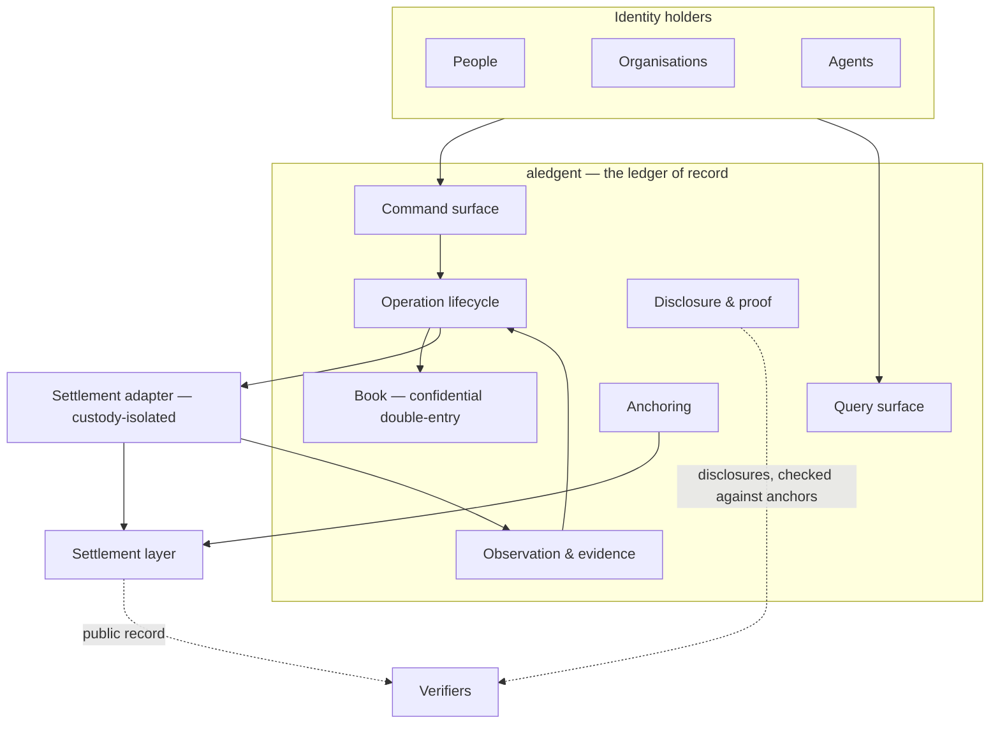

# aledgent — System Specification

## 0. How to read this document

This document specifies aledgent: what it is, what it guarantees, to whom, and under what conditions. It
is normative and self-contained. It does not say how aledgent is built, which technologies implement it,
or why the project exists. Those topics are outside this specification.

### What each section answers

| Section | Question it answers | Read it if you are… |
|---|---|---|
| §1 Purpose and scope | What problem aledgent solves, for whom, and where its boundary is | deciding whether aledgent fits a need |
| §2 Glossary | What each term used normatively means | anyone. Terms are used exactly as defined |
| §3 Parties | Who interacts with aledgent, in which role, with what powers | integrating, operating or auditing it |
| §4 Architecture | How responsibilities are separated, and what aledgent requires of its environment | implementing or reviewing the design |
| §5 Domain model | The objects aledgent holds and the rules that bind them | integrating or implementing |
| §6 User stories | What each party can do, with acceptance criteria | anyone. This is the behaviour, seen from outside |
| §7 Surface contracts | The boundaries other parties build against | integrating |
| §8 Normative behaviour | Every command and query, with pre- and post-conditions | integrating or implementing |
| §9 Invariants | What is true at all times, and which layer keeps it true | implementing. Read it twice |
| §10 Errors | Every named refusal | integrating |
| §11 Non-functional requirements | Latency, durability, privacy and operability bounds | implementing or operating |
| §12–§13 Deferred scope, non-goals | What is out, and why | anyone tempted to add something |
| §14 Open questions | What is undecided, and what each decision blocks | the owner |
| §15 Traceability and release scope | How stories, requirements and invariants map, and what the first release contains | planning |

### Normative language

The key words MUST, MUST NOT, SHOULD, SHOULD NOT and MAY are to be interpreted as described in RFC 2119.
They have that meaning only in:

- numbered requirements;
- invariants;
- contracts;
- acceptance criteria;
- tables marked normative.

Prose, rationale and "Trade-off, stated plainly" callouts explain a decision. They do not bind.

### Identifiers

| Prefix | Meaning |
|---|---|
| `US-*` | User story |
| `AC-*` | Acceptance criterion, scoped to its story |
| `REQ-*` | Normative requirement |
| `CTR-*` | Surface contract (§7) |
| `INV-*` | Invariant that MUST hold at all times |
| `ERR-*` | Named error condition |
| `NFR-*` | Non-functional requirement |
| `OQ-*` | Open question. One that blocks a V0 story or requirement MUST be closed before the V0 freeze, and any other before v1.0.0 |
| `DEF-*` | Explicitly deferred scope |

Identifiers are stable. Every family starts at 1 and is never renumbered. A withdrawn identifier is not
reused. So a gap in a sequence means a withdrawal recorded in an amendment, never an omission.

### The settlement layer

aledgent assumes exactly one external **settlement layer**. It is the network through which value
enters and leaves aledgent, and on which aledgent anchors its state. This document defines the settlement
layer only by the requirements it must satisfy (§4.4). In this text, "the settlement layer" means
whatever satisfies those requirements, never a particular network.

---

## 1. Purpose and scope

### 1.1 The problem

**The domain.** A ledger of record is the system that answers three questions with authority:
who holds what value, what has been committed but not yet concluded, and how every holding came to be.
Everything a financial product does, such as paying, receiving, holding, spending on a card or lending, is
in the end a claim against such a ledger. A product is exactly as trustworthy as the ledger its claims
resolve against.

**The field of application.** Businesses, platforms and, more and more, autonomous agents build financial
products for people and organisations. They do not want to build a ledger of record to do so. A ledger is
a liability to operate, an audit surface, and hard to get right under concurrency. What they need from
a ledger is specific:

1. **Correctness under concurrency.** Two spends against one balance never both succeed when only one is
   covered. Every posting balances. Nothing is lost.
2. **Decisions in milliseconds.** A card network, a checkout or an agent in the middle of a task each
   needs to know whether value is available *now*. The answer must be the same number the holder sees.
3. **Privacy.** Who holds what, and who pays whom, is not public. Other customers and the world cannot
   see it. The operator sees no more of it than necessary.
4. **Provability.** A holder can prove a fact about their holdings to a party they choose. That party can
   verify it without trusting the operator, and can detect if the operator later revises history.
5. **Connectivity with certainty.** Value enters and leaves through an external settlement layer. The
   outcome of every such leg is unambiguous: settled, provably not executed, or explicitly unresolved. It
   is never guessed.
6. **Delegation with bounds.** A holder can let another principal act on an account within limits. That
   principal can be an agent or a member of an organisation. The holder can revoke it within a stated bound
   and later see who acted.
7. **A choice about custody.** A holder can decide whether the operator may act on their behalf. The
   decision is honoured and visible.

**The problem.** Each available kind of ledger gives up some of these. A public shared ledger gives
provability without privacy. It also prices every internal movement as if it were external. A private
database ledger gives privacy and speed. But its correctness and completeness rest entirely on the
operator's word. Connecting it to an external settlement layer also splits one operation's lifecycle
across two systems. A reservation sits in one, an outcome in the other, and a string between them. That
string is where value goes missing. A hosted accounting engine gives balanced postings and nothing
else. No privacy from itself, no proof to a third party, no settlement semantics. And none of
them treats an autonomous agent as a principal with its own authority.

aledgent exists to provide all seven properties in one ledger. It is private by default and provable on
demand, and connects to a single settlement layer through a single, unambiguous operation lifecycle. It is
open to people, organisations and agents alike as first-class principals.

### 1.2 What aledgent is

aledgent is a ledger-of-record service. A party integrates it to hold and move value for the identities it
serves, or for itself. aledgent provides:

- **Identities and accounts.** An identity is a person, an organisation or an agent. It owns one or more
  ledger accounts, each holding balances in one or more assets.
- **Internal movement.** Value moves between any two accounts in one atomic posting. It is final on
  acceptance and touches no external network.
- **Reservations.** Value can be reserved against an account for a named operation, then captured or
  released. The reservation takes its balance effect at the moment it is accepted.
- **External legs.** Value enters and leaves aledgent through the settlement layer. Every outcome of this
  lifecycle is derived from evidence aledgent recorded.
- **Authority.** Who may act on an account, within what bounds and under which custody mode. Delegation to
  agents and members. Revocation within a stated bound. Attribution of every action.
- **Privacy and disclosure.** Ledger facts are private by default. A holder can issue verifiable
  disclosures about them to a recipient they choose.
- **Anchoring.** aledgent periodically commits to the state of its book on the settlement layer. After
  that, it cannot claim to have held a different history.
- **An audit trail and an operator surface**, so that every intervention is an authorised, recorded
  operation.

aledgent does *not* know what product any of this is presented as. A card, a wallet, a payroll run and an
agent's budget are the integrating party's business. aledgent sees identities, accounts, authority and
value.

### 1.3 Three kinds of fact

The design depends on assigning every fact to exactly one of three homes.

**A ledger fact** is a fact about value. It says that an account exists and who may act on it, what it
holds and what it has committed, and every entry that moved it and their order. Ledger facts are
**private by default, provable on demand, and authoritative**. They live in aledgent's book. Nothing
outside aledgent may hold a copy and call it true.

**A settlement fact** is a fact the outside world must be able to check without trusting the operator.
It says either that value moved between aledgent and an external counterparty, or that aledgent's book
was in a particular state at a particular time. Settlement facts live on the settlement layer. They are
**public, unforgeable and deliberately few**. The settlement layer is used for external value movement
and for anchoring, never to execute an internal movement.

**A customer fact** is everything else, such as what product an account is presented as, who a
holder is as a legal person, what a fee or a price is, and what a compliance process decided. Customer
facts live with the integrating party. aledgent does not hold them or need them. Nothing they control can
create, destroy, move or hide value.

> **Trade-off, stated plainly.** Internal movements stay off the settlement layer. So the world cannot
> rebuild a holder's balance by reading a public record. Provability becomes something aledgent *offers*
> to the holder, a verifier or a named counterparty, not something the world simply has. If aledgent
> lies and nobody ever asks it for a proof, the settlement layer alone will not reveal the lie. §4.6
> states exactly what an anchor does and does not establish. §9's invariants make a lie detectable by the
> parties who have a stake in the answer.

### 1.4 Who it is for

Any party that needs to hold and move value for the identities it serves, or for itself:

- a business or platform building a financial product for its users;
- an organisation managing its own treasury and its members' spending;
- a person, directly;
- an autonomous agent, acting for any of the above within the bounds it was granted.

This document does not distinguish parties by what they build. The party that runs aledgent is the
**operator** (§3). When it holds value of its own, the same rules bind it.

### 1.5 In scope

The behaviour of aledgent:

- identities, accounts, assets and the book;
- operations and their lifecycle;
- authority, delegation and custody;
- inbound and outbound legs on the settlement layer;
- anchoring and disclosure;
- the surfaces it exposes;
- its operation and recovery.

### 1.6 Out of scope

- Products, and how value is presented to end users.
- Who a holder is as a legal person, and whether they may transact.
- Prices, quotes and fees.
- Any value network other than the settlement layer.

Value from elsewhere reaches aledgent in one of two ways: through the settlement layer, or by issuance by
a principal holding issuance authority for the asset (§5.3). See §12 (deferred) and §13 (non-goals).

### 1.7 Standing assumptions

1. **One operator.** Exactly one operator runs a deployment of aledgent.
2. **One settlement layer.** A deployment is attached to exactly one settlement layer, which satisfies
   §4.4.
3. **aledgent is not a blockchain.** It does not seek open participation or consensus among operators who
   distrust each other. It aims to be a private ledger whose claims can be checked (§13).
4. **Possibly one of many.** A deployment MAY be one of several attached to the same settlement layer.
   Another deployment is an ordinary settlement counterparty. Nothing in this document treats it
   differently from any other (`REQ-SL-6`).

---

## 2. Glossary

One canonical name per concept. This document uses each term only in the sense given here.

| Term | Definition |
|---|---|
| **aledgent** | The service this document specifies. Also called **the ledger** when the context is the service rather than the book. |
| **Book** | The complete, append-only, double-entry record of every entry aledgent has ever made. A deployment has exactly one book. |
| **Operator** | The party that runs a deployment of aledgent (§3). |
| **Integrating party** | An organisation that integrates aledgent to hold and move value for the identities it serves, or for itself. The operator registers it (`REQ-ID-7`). Like any organisation it holds an identity in the book, and it keeps its own record of the identifiers it serves (`REQ-ID-6`). |
| **Identities principal** | The principal that opens identities (`REQ-ID-6`): the operator, or the principal that plays that role in a deployment. It may also open ledger accounts, for any identity. |
| **Identity** | A principal that can own ledger accounts: a **person**, an **organisation** or an **agent**. |
| **Agent** | An autonomous software principal that acts for another identity, under delegated authority. |
| **Ledger account** | The unit of balance ownership: a container of balances in one or more assets, owned by one identity. Whoever holds authority over it can act on it. |
| **Asset** | A unit of value with a registered identity and a fixed precision. Amounts are integer counts of the asset's minor units. |
| **Book-only asset** | An asset in the registry that is bound to nothing on the settlement layer. Its value enters and leaves by issuance and redemption only (`REQ-AS-7`). |
| **Binding** | The one-time act that ties a book-only asset to its identity on the settlement layer, at zero divergence (`REQ-AS-8`). |
| **Seed** | An initial state committed at a book's genesis by a digest, from which the book's first state is derived before it takes any command (`REQ-RC-6`). It is **sealed** once that state is in place and checked against the commitment. |
| **Alias** | A name for a ledger account, by a source and a name within it: a prior system's identifier, loaded with a seed, or a name the operator registers after genesis, such as a role (`REQ-RC-7`). It names one account for good and carries no personal data (`INV-17`). |
| **Archived identifier** | A prior system's identifier that the initial state deliberately left out. It names no ledger account and never will (`REQ-RC-7`). |
| **Balance kind** | One of three amounts of an account's holding in an asset, each readable separately: **available**, **reserved**, **encumbered**. Their sum is the **total**. Whether the three are partitions of one account or positions the account draws on is an implementation choice. |
| **Available** | Spendable now, without any further decision. |
| **Reserved** | Committed to one identified operation whose outcome is not yet known. Already deducted from available. MAY be derived as the sum of the account's open reservations. |
| **Encumbered** | Restricted by a standing rule on a specific amount, not tied to a single operation: a dispute, a legal hold. |
| **Freeze** | An account status, not a balance kind. A frozen account refuses debits and accepts credits. Its balances do not change: its value stays available, and is not spendable while the freeze lasts (`REQ-LA-7`). |
| **Entry** | One side of one posting: an account, an asset, a direction, an amount, a balance kind. |
| **Posting** | The atomic, balanced set of entries committed together. The unit of atomicity in the book. |
| **Movement** | An account's own view of a posting: direction, counterparty, amount, asset, time, status. Derived from the book, never a separate record. |
| **Operation** | The unit of intent a principal submits. It is one of: transfer, reservation, capture, release, deposit, withdrawal, issuance, redemption, reversal, custody change, credential change, recovery, opening load. One operation causes zero or more postings. |
| **Operation record** | The mutable object carrying one operation's intent, state, deadline, evidence and outcome. Distinct from the book: it causes entries there but never lives inside it. |
| **Reservation** | The act and the record of moving value from available to reserved for a named operation. The reservation *is* the operation's balance effect, taken immediately. |
| **Capture** | Completing a reservation. Value leaves reserved and reaches its destination. MAY be for less than the reserved amount. |
| **Release** | Ending a reservation without a capture. Value returns from reserved to available. |
| **Reversal** | An operation of its own that undoes the postings of a settled operation, with one `Reversal` posting that references them. The operation it reverses stays settled. One principal proposes it and a different principal approves it, each under its own authority. |
| **Issuance / redemption** | Value entering or leaving the book other than through the settlement layer, done by a principal holding issuance authority for the asset. |
| **Partition** | A part of the book's state that commits on its own: every ledger account belongs to exactly one, and everything ordered against that account lives there (`REQ-RT-9`). Partitions hold one book; they do not split it (`INV-25`). |
| **In-transit position** | The book position that holds, per asset, the value of transfers whose payer's partition has committed the debit and whose payee's partition has not yet applied the credit (`REQ-RT-11`). |
| **Consistent cut** | One commit of each of the book's writers, chosen so that no message is applied in it that was not sent in it, and no message in transit in it has been dropped by its sender. Anchors, reconciliation and bindings read the book at one (`REQ-RT-14`). |
| **Execution node** | One running instance of aledgent, with its own local storage, that holds a copy of the state of one or more of the book's writers (`REQ-RT-13`) and takes part in committing it. Execution nodes are interchangeable and disposable: none holds anything that is not also held elsewhere, and none is part of the book's identity (`NFR-21`). |
| **Issuance counterparty** | The named book position that value enters from and leaves to when it crosses aledgent's boundary. Its balance is the negative of all value aledgent holds. |
| **Settlement layer** | The one external network through which value enters and leaves aledgent, and on which anchors are published. Defined by §4.4, never by name. |
| **External leg** | The part of an operation that executes on the settlement layer. It is **inbound** when value arrives, or **outbound** when value departs. |
| **Settlement adapter** | The component that executes outbound legs on the settlement layer and observes it, holding the keys to do so. It submits evidence but never decides outcomes. |
| **Counterparty** | The party on the other side of an external leg. Not a ledger account. |
| **Observation** | A recorded external fact: that a named event happened at a named coordinate on the settlement layer. Evidence, not a verdict. |
| **Coordinate** | The tuple that names an event uniquely and stably within the settlement layer. The deduplication key for observations. |
| **Confirmation** | An observation establishing that an external leg was included on the settlement layer. Not final, not settled. |
| **Finality** | The point after which the settlement layer cannot revise an observation. |
| **Settlement** | The completion of value exchange with a counterparty. Reached only after finality. |
| **Authority** | The right to cause a named class of operation on a named ledger account, within bounds. |
| **Credential** | Whatever proves that its holder has an authority: a key, a device-bound credential, an issued secret. Never a name. |
| **Owner authority** | The authority an identity holds over its own accounts, exercised with its own credential. |
| **Delegated authority** | A scoped, bounded, revocable authority that an identity grants to another principal: an agent, a member. |
| **Operator authority** | The custodial authority the operator holds over accounts in the delegated custody mode. |
| **Recovery authority** | The authority to co-sign the reissue of a holder's credential over an owned-custody account, after a delay. A principal distinct from the operator holds it. |
| **Successor** | A principal the holder names, who may claim the holder's account after a stated delay that the holder can cancel. |
| **Custody mode** | Whether an account is **delegated**, where the operator may act for it, or **owned**, where only the identity's own credential can. |
| **Cost sponsorship** | aledgent bearing any settlement-layer cost an operation incurs, so that no identity holds, funds or is asked about such a cost. |
| **Client key** | A key the caller supplies to make a submission idempotent. It is opaque to aledgent. Nothing but deduplication depends on it. |
| **Operation reference** | The identity of an operation, derived by the service and unique forever. Never supplied by a caller, never parsed, and never carries status. |
| **Anchor** | A commitment published on the settlement layer to a state of the book at a point in time. |
| **Checkpoint** | The book state an anchor commits to. |
| **Code version** | The identity of everything that decides a writer's transitions: a digest of each executable artefact, together with the settings it was built with. Two builds of the same source with different settings are two code versions. It names the platform its artefacts are built for, each artefact's identities on that platform, and its code generation (`REQ-RT-19`, `REQ-RT-20`). What only replays a range, and decides nothing, is not part of it. |
| **Code map** | For each of the book's writers, the ranges of its inputs and the code version that executed each range, derived from the book's own inputs (`REQ-RT-16`). |
| **Code archive** | Where every code version that has executed an input is kept, by its digest (`REQ-RT-17`). |
| **Code generation** | The count of a writer's upgrades: 0 at genesis, and one more after each upgrade. A writer holds the generation of its code in force. Each code version names one generation, and the code that decides its transitions carries that generation in its own bytes (`REQ-RT-20`). |
| **Platform** | The execution environment a writer's code runs on: the runtime that executes it and the software on the execution node that drives it, named with their versions. The capabilities of §4.4 are requirements of a platform. Two platforms that both meet them are interchangeable for the book (`REQ-RT-19`). |
| **Writer state** | Everything a writer has committed after an input. That is its code version and code generation, the construction of its state commitment, its upgrade-authority mode and any scheduled change of it, and any scheduled upgrade. It also includes its configuration and bounds, every record it holds, its counters and log head, its committed inputs not yet archived, the deliveries and notifications it has not yet recorded as made (`REQ-RT-4`), the input number at which it was founded as a continuation, if it was (`REQ-RT-21`), and, for each other writer, the messages it has enqueued, applied, sent and had acknowledged (`REQ-RT-13`, `REQ-RT-14`). Exactly two kinds of field are **host-local** and are not part of it: the identity under which the platform accepts the writer's inputs from the execution node that drives it, and a diagnostic that the platform reports to the writer about an input (such as the slot it observed). No other field is host-local. |
| **Continuation** | A writer founded to take over another writer's sequence at an input number, from the other's writer state and log head, so that the book's inputs and their hash chain go on unbroken (`REQ-RT-21`). |
| **Disclosure** | A statement about ledger facts, addressed to a named recipient. The recipient can verify it without aledgent's continued cooperation, and without learning anything the statement does not assert. |
| **Verifier** | The recipient of a disclosure: an auditor, a regulator, a counterparty. |
| **Assurance level** | The declaration of which §9 invariants a deployment enforces rather than attests. |

---

## 3. Parties

Five kinds of party interact with aledgent. Everything else, such as a product, a workflow, a bank or a
card network, sits on the far side of one of them.

| Party | Who | Holds an identity in the book? | Authority | Interacts through |
|---|---|---|---|---|
| **Identity holder** | A person, an organisation or an agent | Yes | Owner authority over its own accounts. Delegated authority over others' accounts where granted. An agent holds delegated authority only | Command, query and event surfaces (§7.A–C). Disclosure surface as subject (§7.E) |
| **Operator** | The party running the deployment | Only when it holds value of its own, and then as an ordinary organisation identity | Operator authority over delegated-custody accounts, bounded by kind (§5.9). The identities principal's role, unless another principal plays it: it alone opens identities, and it may open accounts (`REQ-ID-6`). The deployment's own configuration, which is its alone (`REQ-ID-7`). The operator surface (§7.D) | Operator surface. The settlement adapter it runs |
| **Verifier** | An auditor, a regulator or a counterparty to a disclosure | No | None | Disclosure surface as recipient (§7.E). The settlement layer's public record |
| **Settlement counterparty** | A party on the settlement layer that sends value to aledgent or receives value from it | No | None | The settlement layer only. Never a surface of aledgent |
| **Recovery authority** | A party, distinct from the operator, that verifies a holder out of band and co-signs recovery of an owned-custody account | Only for value of its own | Recovery authority (`REQ-AU-15`). Never owner, delegated or operator authority | The operator surface's recovery commands (§7.D) |

**The operator and an identity holder differ in authority and accountability, not in authentication.**
Both authenticate with credentials. Two things set the operator apart. (a) It may hold *operator
authority*, a custodial power over accounts whose holders chose delegated custody, and act through the
operator surface. (b) It is the party whose conduct the provability model of §4.6 exists to make
checkable by everyone else. When the operator holds value of its own, it does so as an
identity like any other. The same invariants apply.

**A customer** is an identity holder in its commercial relationship with the operator. This document does
not distinguish customers by what they build or whom they serve. A business integrating aledgent to run a
product, an organisation managing its treasury, a person and an agent are all identity holders. They
differ only in the authority they hold and in whose behalf they act.

**`REQ-PN-1`** Every operation MUST record the principal that initiated it and, where the caller acted for
another, the principal on whose behalf it acted. An operation whose initiating principal cannot be
determined MUST NOT be accepted.

---

## 4. Architecture

### 4.1 Components



Three rules define the architecture. A fourth keeps it deployable:

**`REQ-AR-1`** Identity holders call aledgent. aledgent MUST NOT call a holder back to decide an outcome.
Every operation MUST reach a terminal state even when every caller is unavailable (`REQ-EV-5`).

**`REQ-AR-2`** The settlement adapter submits evidence and executes instructions. It MUST NOT write the
book and MUST NOT declare an outcome. aledgent derives every outcome from evidence it recorded (`INV-11`).

**`REQ-AR-3`** Key material for the settlement layer MUST NOT reside in the component that holds the
book (`NFR-8`). If one process holds both, nothing else in the design can reduce the blast radius.

**`REQ-AR-7`** The component that receives commands MUST be deployable and restartable independently of
the component that decides them. It MUST NOT lose a received command while the deciding component is
unavailable (`REQ-CS-7`, `NFR-5`).

### 4.2 Responsibility allocation

The table below is normative. A capability MUST NOT be implemented at any layer other than the one named.

| Capability | Where | Rationale |
|---|---|---|
| Existence of an identity and its accounts: the authoritative registry | aledgent | Everything else attaches to it (`REQ-ID-7`) |
| Opening identities and accounts | aledgent. An identity only under the identities principal's authority; an account under that principal's, or under the authority of the identity that will own it | The operator is the identities principal unless another principal plays that role (`REQ-ID-6`) |
| Which identity owns an account | aledgent | Ownership is a ledger fact |
| Who may act on an account, and within what limits | aledgent | Authority decides whether value moves |
| Balances of every balance kind, in every asset | aledgent | The only authoritative copy |
| Every entry, its order, and its immutability | aledgent | The book is the record |
| Reservation, capture, release | aledgent | This is where value stops being spendable |
| Operation state, deadlines and outcomes | aledgent | The design exists to prevent splitting this from the book |
| Asset registry, identity and precision | aledgent | One registry. Precision lives in exactly one place |
| Deciding an external leg's outcome from evidence | aledgent | A caller may state what it saw, never what happened |
| Producing disclosures and proofs | aledgent | Only the holder of the facts can attest them |
| Choosing what is anchored, and when | aledgent | Anchoring is a property of the book |
| Bearing settlement-layer costs | aledgent (as sponsor) | No identity holder holds or funds such a cost |
| Signing and submitting an external leg | Settlement adapter | Custody isolation |
| Observing the settlement layer and reporting coordinates | Settlement adapter | Needs network-specific knowledge |
| Public, unforgeable record of external value movement | Settlement layer | Needs a neutral third party |
| Public, unforgeable anchor of book state | Settlement layer | Same |
| How an account is presented, who a holder is as a legal person, whether they may transact, and prices and fees | The integrating party | Customer facts (§1.3) |
| Its own record of the identifiers of the identities and accounts it serves | The integrating party | It maps them to its customer facts. It has no standing on existence (`REQ-ID-6`) |

**Existence and who a holder is are two facts, with two authorities.** aledgent is the authority for an
identity's existence: that it exists, its identifier, its kind and status, and the accounts it owns
(`REQ-ID-7`). The integrating party is the authority for who that identity is as a person or an
organisation, and whether it may transact. Each side keeps the identifiers; neither fact can be read
from the other (`REQ-PV-3`).

### 4.3 Trust model — stated plainly

| Question | Answer |
|---|---|
| Can the operator move a holder's value? | **In delegated custody, yes.** That is what delegated custody means. In owned custody, no. `REQ-AU-5` limits it. `REQ-AU-7` makes every use of it traceable to who did it. `INV-20` makes it visible to the holder. |
| Can the operator change a recorded entry? | **No.** The book is append-only. A correction is a new, compensating posting, and that posting is itself an entry (`INV-2`). |
| Can the operator hide an entry from an account's authority holders? | **No.** Whoever holds authority over an account sees every entry against it (`REQ-QR-4`). |
| Can the operator revise history after the fact? | **Not undetectably.** Anchors commit to book state. Anyone holding an earlier anchor can detect a revision of anchored history (`REQ-PR-4`). Between anchors, at most an hour apart (`REQ-PR-1`), a revision is not detectable. |
| Can the operator create value from nothing? | **Not without it showing.** For every asset, entries sum to zero across the whole book. Any issuance is an entry against the issuance counterparty (`INV-4`, `INV-5`). What the operator can do is *issue*, and the trial balance makes exactly that measurable. |
| Can the settlement adapter move value? | **No.** It can execute an instruction it was given and report what it saw. It cannot create, decide or settle (`INV-11`). |
| What can a verifier check? | Whatever a disclosure asserts, and nothing more. The check needs no further cooperation from aledgent (§7.E, `REQ-PV-6`). |
| What can a holder prove? | That they hold at least an amount. That a given operation occurred. That a given amount moved. Aggregate flow over a window. Each to a recipient they choose (`US-I2`). |
| What can the public see? | The existence and order of anchors. External value movements to and from aledgent, in aggregate. Not accounts, balances or counterparties, and not the amounts of internal movements (`REQ-PV-2`). |
| Who is the custodian? | **In a single deployment, the operator, in both custody modes.** Value sits in positions the operator controls on the settlement layer (`REQ-SL-5`). So a holder's balance is a claim on the operator. Owned custody removes only the operator's power to *initiate*. **In a federation** (§1.7, assumption 4), each deployment's operator is custodian for its own holders. The operator that issues an asset is its issuer. It is not the custodian of value that other deployments hold. |
| Who can violate an invariant? | §9 names the enforcing layer for each. An invariant enforced by the store survives an application bug. One enforced by application code does not. `REQ-AR-4` forbids moving an invariant down to a weaker layer. |

**`REQ-AR-4`** Each invariant in §9 names the layer that enforces it. An implementation MUST NOT satisfy
an invariant at a weaker layer than the one named. In particular, an invariant named as enforced by the
store MUST NOT be downgraded to an application check. Any weakening is a specification amendment.

**`REQ-AR-5`** A deployment MUST declare, in machine-readable form, which invariants of §9 it enforces and
which it only attests. aledgent MUST show this as an **assurance level** on any disclosure it issues.

**`REQ-AR-6`** The first release's assurance level MUST declare every invariant at the layer §9's **V0**
column names, or at a stronger one. Where the V0 column names a weaker layer than the target column, the
difference is recorded by amendment, as `REQ-AR-4` requires. At least, it MUST declare:

- `INV-1`–`INV-4`, `INV-7` and `INV-12` as kernel- or store-enforced;
- `INV-15`, `INV-16`, `INV-20` and `INV-22` as service-enforced;
- every disclosure as a signed assertion (`REQ-PR-6`), until an independently checkable construction
  ships (`DEF-3`).

A later release MAY strengthen any entry. No release may weaken one without an amendment (`REQ-AR-4`).

> **Trade-off, stated plainly.** aledgent stores balances instead of summing entries on every read. That
> is right at the volumes of §11. But it creates a failure class that a sum-on-read ledger cannot have:
> drift between a stored balance and the entries behind it. `INV-6` requires the two to be provably equal.
> `NFR-9` checks this continuously at zero tolerance. The alternative is a read that touches every entry
> of a large account, and that does not meet `NFR-3`.

### 4.4 Capability contracts

aledgent is built from exactly four external capabilities. Nothing in §5–§8 may require more than these.
No requirement in this document names what supplies one.

#### (a) The ledger kernel

**`REQ-KER-1`** The kernel MUST make an unbalanced posting **impossible to represent**. For every posting
and every asset, the sum of debits MUST equal the sum of credits. A single-legged posting MUST NOT be
expressible at all. A code path that rejects it is not enough.

**`REQ-KER-2`** The kernel MUST support an atomically committed posting that spans more than two entries
and more than one asset, balanced independently per asset.

**`REQ-KER-3`** The kernel MUST be able to represent, per account and per asset, three kinds of value that
are each separately readable and that sum to the total:

- value that is **available**;
- value that is **reserved** to one named operation;
- value that is **encumbered** under a standing rule (§5.4).

Every movement among the three MUST be expressed as balanced entries in the book (`INV-1`). The three can
be partitions of one account, or positions the account draws on. That is an implementation choice. Either
MUST satisfy `REQ-BA-1`–`REQ-BA-4`.

**`REQ-KER-4`** For accounts so designated, the kernel MUST enforce that no balance kind's net is ever
negative, at any instant and under any concurrency.

**`REQ-KER-5`** The kernel MUST be append-only. It MUST NOT offer a way to change or delete a committed
entry or posting. A correction MUST be a new posting.

**`REQ-KER-6`** The kernel MUST refuse a posting it has already accepted, keyed on an identity the
submitter supplies. The refusal is permanent and does not expire.

**`REQ-KER-7`** The kernel MUST keep amounts as exact integer counts of an asset's minor units, with a
range that fits the largest holdings in §11 with room to spare. Floating-point MUST NOT touch a monetary
value at any layer.

**`REQ-KER-8`** The kernel MUST conceal entry amounts from any party not entitled to them, and still
enforce `REQ-KER-1` and `REQ-KER-4` over the concealed values.

**`REQ-KER-9`** The kernel MUST support an authority model in which the right to cause an entry against an
account can be separated from possession of one credential. Under that model, owner authority, delegated
authority and operator authority are distinguishable at the point an entry is made. The audit trail
records which one acted. Where the kernel's native model cannot express this, the gap MUST be closed
above the kernel, and `REQ-AU-7` MUST still hold.

**`REQ-KER-10`** The kernel MUST offer atomic, all-or-nothing composition of several postings. A
multi-step operation then either applies completely or not at all. When the debit legs of one composition
are in more than one partition (`REQ-RT-9`), it MUST still apply completely or not at all.

> **Trade-off, stated plainly.** `REQ-KER-8` and `REQ-KER-9` are the two requirements most likely to go
> beyond what a kernel offers natively. Suppose a kernel's only authority is possession of an account's
> credential. Then a custodial operator is forced to hold every holder's credential. The answer to *who
> authorised* then collapses into "the operator, as always". If that gap is closed above the kernel, the
> kernel's own record is weaker than the service's. That is acceptable, and it MUST be declared in the
> assurance level (`REQ-AR-5`). Silently pretending otherwise is not acceptable.

#### (b) The runtime

**`REQ-RT-1`** The runtime MUST provide, for each partition (`REQ-RT-9`), a single durable commit boundary
that encloses:

- the entries of a posting;
- the operation record's state change;
- the evidence that caused it;
- the enqueuing of any notification;
- the enqueuing of every message the commit owes another of the book's writers (`REQ-RT-13`), a credit
  to another partition (`REQ-RT-11`) among them.

Nothing in that set may commit without the rest. When the book has one partition, this is the single
boundary for the whole book.

**`REQ-RT-2`** For an accepted submission keyed on a caller-supplied client key, the runtime MUST
guarantee that:

- it takes effect at most once;
- a repeat returns the original outcome instead of doing new work.

**`REQ-RT-3`** The runtime MUST provide deterministic, replayable execution of the book's state
transitions, so that a third party given the inputs can reproduce the resulting state exactly. The inputs
include the book's genesis and its upgrades; replay executes each input under the code that executed it
(`REQ-RT-17`).

**`REQ-RT-4`** The runtime MUST provide durable, at-least-once delivery of outbound instructions and
notifications, and record each delivery durably. After a restart, storage alone can then answer "did we
tell them?". Ordering is not required. A recipient MUST NOT rely on it (`REQ-EV-2`).

**`REQ-RT-5`** The runtime MUST provide a scheduled-work facility that can act on an operation at a
deadline, survives restart, and keeps the schedule itself durable.

**`REQ-RT-6`** The runtime MUST provide a private-input facility. A private input is a value that takes
part in a computation without entering replicated state, logs, snapshots or any exported record.

**`REQ-RT-7`** Inside the boundary of `REQ-RT-1`, the runtime MUST NOT require aledgent to read a clock,
draw randomness, or perform network input/output. Time, randomness and external results come in as
inputs.

**`REQ-RT-8`** An upgrade of aledgent MUST preserve the book and every balance it implies. Some runtimes
can only replace state by re-creating it from exports. Such a runtime is acceptable only if the export and
re-import of `REQ-RC-3` is first proven at production volume.

**`REQ-RT-9`** **Partitions.** The book's state MAY be held in **partitions**. Each ledger account belongs to
exactly one partition, fixed by a deterministic function of the account's identifier when it is opened.

- Everything that is ordered against an account lives in its partition: its balances in every asset and
  kind, its reservations, and every operation it pays.
- The partition is part of the identifiers of what it holds, so that a change in how many partitions there
  are moves state and never renames it. No identifier changes when the book is re-partitioned.
- Holding the book in partitions does not split it (`INV-25`). The registry, the roles, the trial balance,
  the anchors and the audit trail are the book's, not a partition's.

**`REQ-RT-10`** **Ordering per payer.** Every operation that debits an account, or takes, captures or
releases a reservation on it, MUST be ordered against every other such operation on that account: their
effects are those of some serial order, and each sees the effects of those before it. Operations on
different accounts need no order. A credit needs no order: credits to one account MAY apply in any order.

**`REQ-RT-11`** **A transfer is final when its payer's partition commits it; its credit is guaranteed.** When
the payer and the payee of a transfer, or of a capture, are in different partitions:

- The payer's partition decides the transfer and commits the **debit**. The posting moves the value from
  the payer to the book's **in-transit position** for the asset, and enqueues the credit (`REQ-RT-1`). From
  that commit the transfer is **final**: its operation reaches its terminal state, and nothing undoes it
  except a new operation (`INV-2`, `INV-21`).
- The **credit** MUST then be applied in the payee's partition **exactly once** (`INV-18`), within the bound
  of `NFR-19`. Its posting moves the value from the in-transit position to the payee. It MUST NOT be
  refused: an account that exists can be credited (`INV-9`), and every check the transfer needs is made by
  the payer's partition before the debit commits.
- The in-transit position is part of the book. The trial balance includes it and is exactly zero at every
  commit of every partition (`INV-5`). Its balance for an asset is the sum of the credits enqueued and not
  yet applied.
- The payee's view, its statement and its notification follow the credit, not the debit. The payer's
  follow the debit.

Before a debit commits, the payer's partition checks that the payee exists and can hold the asset. An
account's existence and an asset's registration only ever become true and stay true (`REQ-LA-4`,
`REQ-AS-1`), so a partition MAY check them against a copy of the book's directory that lags behind it: a
lagging copy can refuse a transfer to an account just opened (`ERR-UnknownAccount`), and can never accept a
transfer whose credit will fail. An asset's deprecation and an account's closure take effect in a partition
when its copy shows them; a credit already enqueued still applies (`INV-9`). An account in `Closing` refuses
debits and new transfers to it and still accepts credits in transit; it reaches `Closed` only when every
partition has confirmed that it holds no credit to it in transit.

> **Trade-off, stated plainly.** For up to `NFR-19`'s bound, the value is neither the payer's nor the payee's:
> it is in transit, and both can see that. A payee cannot spend a credit before it applies. "Final" means
> final for the payer and for the book; it does not mean that the payee can already spend it. When payer and
> payee share a partition, both sides commit in one posting, as they always did.

**`REQ-RT-12`** **Pools for hot accounts.** An account whose debits arrive faster than one partition can
order them, such as an issuer's escrow, a fee collector or a treasury, MAY be held as a **pool** of member
positions in several partitions.

- The pool is one ledger account. Its owner, its authority holders, its statement and its balance are the
  account's. Its balance is the sum of its members', read from one consistent view (`REQ-BA-3`).
- Each debit draws on one member, in that member's partition, and is ordered against that member only.
- A debit that the pool's balance covers MUST NOT be refused because no single member covers it. Such a
  debit is served atomically across members, as a composition (`REQ-KER-10`).
- A credit MAY land on any member.
- Moving value between members of one pool is a rebalancing by the operator: an ordinary, posted, audited
  operation (`REQ-AT-3`) that changes no balance of the account.
- An account of kind Issuance has no limit (`REQ-LA-2`). Its debits need no check, so they commute, and its
  pool's members need no balance of their own.

> **Trade-off, stated plainly.** A pool's members can drift apart, so that one runs dry while others hold
> value. Rebalancing keeps them level; it is an operation to run, watch and pay for. A large debit that has
> to gather from several members takes two rounds. `DEF-8` is not reopened: a holder never sees a member,
> and a member is not an account.

**`REQ-RT-13`** **The book's writers and the messages between them.** When the book's state is held by more
than one writer (each partition's (`REQ-RT-9`), the registry of identities, credentials and grants, the
record of settlement instructions and their observations, and the audit trail with its anchors), a message
from one writer to another:

- is enqueued in the sender's commit (`REQ-RT-1`), numbered in sequence per sender, receiver and kind;
- MUST be applied by its receiver **exactly once and in its sequence**: a repeat changes nothing, and a
  message after a gap waits until the gap is filled (`INV-18`);
- is applied inside the receiver's own commit boundary, together with everything it causes there;
- is dropped by its sender only after the receiver has applied it.

A writer decides from its own state and the messages it has applied, never by reading another writer's
state. Each kind's delay, from the sender's commit to the receiver's, is bounded where this specification
bounds it (`NFR-19`, `NFR-20`) and is otherwise measured and reported with `NFR-18`.

> **Trade-off, stated plainly.** Between two writers there is always a delay: the receiver acts on what the
> sender decided some time ago. A partition refuses a revoked grant only once the revocation has reached it
> (`NFR-20`); a settlement instruction leaves only once the settlement record has applied it; the audit trail
> holds a partition's record only once it has arrived. The spec bounds the delays that a holder can feel, and
> the rest are measured.

**`REQ-RT-14`** **A consistent cut.** When the book has more than one writer (`REQ-RT-13`), a **cut** names one
commit of each writer. In the commit it names, each writer's audit record carries its **stream heads**: for each
other writer and each kind of message between them, the last sequence it has enqueued for that writer, the last
it has applied from it, and the last that writer has acknowledged, up to which it has dropped what it sent.

A cut is **consistent** when, for every ordered pair of writers and every kind of message from the first to the
second:

- the receiver's commit in the cut has applied no message that the sender's commit in the cut had not
  enqueued; and
- the sender's commit in the cut still holds every message that the receiver's commit in the cut had not
  applied.

The messages enqueued in a consistent cut and not applied in it are **in transit at the cut**. A credit in
transit is counted once, in the in-transit position (`REQ-RT-11`), and nowhere else.

An anchor (`INV-19`), the second axis of reconciliation (`NFR-9`) and a binding's zero divergence
(`REQ-AS-8`) are each taken at a consistent cut. A cut MUST be decidable from the stream heads alone, and taking
one MUST NOT require any writer to stop, drain, wait or be idle. Of the consistent cuts available, the one used
is the latest, so that a cut trails the writers' newest commits by about one message delay.

> **Trade-off, stated plainly.** A cut is a little behind now: under load, about one message delay (`NFR-19`'s
> order). An anchor therefore commits to a state some seconds old, which hourly anchoring makes immaterial. A
> writer whose audit records stop arriving holds every later cut back to its last record: the trail shows it as
> a gap (`REQ-AT-2`), and the anchor's lag grows until it reaches `NFR-11`'s alert. That is the price of never
> stopping the book to anchor it.

**`REQ-RT-15`** **The active code is book state.** Each of the book's writers (`REQ-RT-13`) MUST hold, in
its committed state, the code version that executes its next input, and the construction of its state
commitment (`REQ-PR-10`). Every checkpoint MUST carry both, and its anchor MUST bind both, so that a
recipient of an anchor knows which code produced the anchored state as well as how it is committed.

**`REQ-RT-16`** **An upgrade is an input.** The code version of a writer MUST change only through an input
in that writer's own sequence: an **upgrade**, which names the new code version by its digest and the
input number from which it applies.

- It is an operator intervention (`REQ-AT-3`) with its own authority (`REQ-OS-1`), attributed, audited and
  visible as `REQ-OS-4` requires. It is authorised under the upgrade-authority mode in force when it is
  decided (`REQ-RT-18`).
- It applies forward only. No input before the named number is executed again, re-interpreted or
  re-decided; every outcome already given stands.
- It MUST be refused, with nothing changed, unless the new code version's artefacts are retrievable and
  match their digests at the time it is taken.
- A change of build settings alone is an upgrade (§2, **Code version**).
- A change of the platform that executes a writer is an upgrade too, and it MAY be made by founding a
  continuation of the writer on the new platform (`REQ-RT-21`). *Amendment 0033.*
- It is made online (`NFR-17`), and it preserves the book in place (`REQ-RT-8`), without an export.
- Where an upgrade changes what the writers exchange (`REQ-RT-13`), each receiver MUST accept the new form
  before any sender emits it.

**`REQ-RT-17`** **Code history.** Every code version that has executed an input of the book MUST be kept,
retrievable by its digest, for as long as the book exists (`NFR-22`). The code map MUST be derivable from
the book's inputs alone. Replay (`REQ-RT-3`) and every restore MUST execute each input under the code
version the code map names for it. Code MAY be retrieved from any source, trusted or not: its bytes MUST
be checked against the digest before they are used, and bytes that do not match MUST NOT be used.

> **Trade-off, stated plainly.** An upgrade is the most powerful thing the operator can do: new code can
> decide differently from the old, including about value. These requirements do not prevent that; they make
> it recorded, attributable and replayable, so that a third party holding the archive can see exactly which
> code decided which input and check it. Guardrail 7 (no administrative path that moves value) still holds
> for every input, because every input is decided by code the book names, but the review of that code is
> the operator's, until the deployment is federated or the code is published and reproducibly built.

**`REQ-RT-18`** **The upgrade-authority mode.** Each writer MUST hold, in its committed state, the **mode**
that decides who may authorise an upgrade (`REQ-RT-16`), a migration of construction (`REQ-PR-11`) and a
change of mode.

- The book's genesis MUST fix the initial mode (in the seed, where there is one, `REQ-RC-6`).
- The mode MUST change only through an input of its own in the writer's sequence. That input names the
  new mode and the input number from which it applies, and it is authorised under the mode in force when
  it is decided. It applies forward only, like an upgrade.
- A new mode MUST be refused, with nothing changed, unless it can be satisfied: every principal it names
  exists and can hold the authority, and every threshold can be met.
- A mode MUST be one that the writer's current code version can enforce. A kind of mode that the current
  code does not know needs an upgrade first.
- A change of mode cancels every upgrade or migration that has been proposed but not yet authorised. An
  upgrade already authorised and scheduled stands: it was authorised under the mode then in force.
- Every checkpoint MUST carry the mode in force, and its anchor MUST bind it (`REQ-RT-15`).

*`REQ-RT-15` to `REQ-RT-18` ruled by the owner on 2026-10-08 (amendment 0023, `a0023-q1`, `a0023-q2`).*

> **Limits, stated plainly.** A mode is only as strong as the code that enforces it: an upgrade authorised
> under the current mode can install code that interprets modes differently from then on. The book records
> it, and replay shows it, but nothing stops it. The mode is held per writer, not in the registry, so
> authority over a writer's code is checked in that writer's own order, with no feed lag (`NFR-20`); a
> deployment-wide change of mode is one input per writer, and the writers may differ until each has applied
> it. The mode names principals; their credentials and revocations still come from the registry's feed, so a
> revoked approver is refused within `NFR-20`'s bound, not at once. A lost key under "one principal" blocks
> upgrades until that principal's credentials are recovered (`REQ-AU-15`). There is no bypass, by design
> (guardrail 7).

**`REQ-RT-19`** **The code history does not depend on the platform.** A book MUST be able to change the
platform its writers run on through upgrades alone, with no new genesis and no export (`REQ-RT-8`). To that
end:

- A code version MUST name the platform it runs on, and list, for each of its artefacts, every identity
  under which that platform knows the artefact, beside the artefact's own digest. An artefact that one
  platform needs and another provides itself MAY be absent from a code version.
- A value that a platform supplies MUST NOT enter anything that a root, a log hash, a checkpoint or an
  anchor covers, except through the code version that names the platform. Such values include the
  platform's clock, its slot or block number, its identities for principals and programs, and its encoding
  of state. The host-local fields of a writer (§2, **Writer state**) are such values. Time enters the book
  only in inputs (`REQ-RT-7`).
- A checkpoint, and every snapshot that is archived or transferred to restore a writer elsewhere, MUST hold
  the writer state (§2) and the book's leaves, in a form that aledgent defines and that no platform defines.
  A copy that an execution node keeps only for itself, to restart faster, need not. A snapshot taken on one
  platform MUST restore a writer on any platform that a later code version of that writer names.
- Replaying the book's state (`REQ-RT-3`) MUST NOT need the platform that executed an input. For every range
  of the code map, the book's transitions MUST be reproducible from the inputs by aledgent's own code,
  under the range's code generation. Where a replay also checks that the platform executed each input as
  archived, the code archive MUST keep, for that range, everything the check needs to run the range as it
  ran (its **replayer**), retrievable by digest and indexed by the range's code version (`REQ-RT-17`). A
  replayer is not part of the code version: replacing it changes no code version.

> **Trade-off, stated plainly.** Keeping the code history free of the platform costs a little now, for a
> move that may never be made. Checkpoints need a format of aledgent's own instead of the runtime's image,
> and every code version carries a list of identities where one would do today. The gain is that a later
> change of runtime is an upgrade, which the book records and replay crosses, instead of a new genesis and a
> second book.

**`REQ-RT-20`** **The switch of code is one step, and the old code fences it.** Each writer holds, in its
writer state, the code generation in force. When an upgrade names code version *H* from input *n*
(`REQ-RT-16`):

- *H* MUST name the generation one more than the writer's. Every upgrade MUST raise the generation, and so
  change the bytes of the code that carries it, even an upgrade made to change only another of its
  artefacts, such as the runtime that executes that code. An upgrade whose code version names another
  generation, or whose code does not carry *H*'s generation in its bytes, MUST be refused with nothing
  changed, when its artefacts are checked (`REQ-RT-16`).
- Before the upgrade is taken, the execution node that drives the writer MUST have fetched *H*'s artefacts
  and checked them against their digests and *H*'s generation. The switch MUST install only those checked
  bytes.
- The code that executes a writer's inputs MUST change from the old code version to *H* in one step, taken
  after input *n* − 1 has committed and before input *n* is executed. A step that fails leaves the old code
  in force, and is retried.
- **The switch is symmetric.** Before each input, the execution node MUST have installed the code version
  that the code map, as derived from the inputs committed so far, names for that input. That is *H* from
  *n* after an upgrade, and the old code version again after a move or cancellation at *n*.
- **The fence.** Code MUST refuse every input unless its own generation equals the writer's generation in
  force, or, for an input numbered at or after a scheduled upgrade's *n*, equals that generation plus one.
  The rule holds at every input, whether or not an upgrade is scheduled. A refused input changes nothing and
  does not take its number, so that the same input runs once the right code is in place. This MUST hold
  whatever the platform checks or does not check when the code changes. Code of *H*'s generation that takes
  input *n* makes *H* and its generation the ones in force, as its first effect, unless input *n* moves or
  cancels the upgrade.
- **The way out.** A scheduled upgrade MAY be moved to a strictly later input, or cancelled, by an input of
  its own, authorised under the upgrade-authority mode in force (`REQ-RT-18`). One that is not so authorised
  MUST be refused with nothing changed. While the old code is fenced, such an input is the only one it
  takes, and it takes its input number like any other input. Such an input at or after *n* MUST be decided
  the same whichever of the two generations decides it: the upgrade does not take effect at that input, and
  the generation in force stays the old one. The execution node then installs the old generation's code
  again before the next input.
- The code map MUST be derived from the upgrade inputs and the inputs that move or cancel them, alone
  (`REQ-RT-17`), so that replay gives every input the generation that decided it.
- **What the fence cannot see.** When it starts, and at every switch, the execution node that drives a writer
  MUST check every artefact it runs for the writer, by digest, against the code version the code map names
  for the next input. Where any differs, it MUST install that code version, and it MUST NOT drive the writer
  with anything else. If it cannot install it, it MUST refuse to drive the writer. This covers any part of
  the code that the platform supplies apart from the code that carries the generation, such as the runtime
  that executes it.
- How long a writer has been fenced MUST be continuously observable (`NFR-11`), and an alert MUST be raised
  when it exceeds a bound that the deployment states.
- The authority that decides an upgrade MUST be the writer's upgrade-authority mode, checked by the writer
  in its own order (`REQ-RT-18`). Whatever authority a platform has to install or replace programs MUST NOT
  by itself authorise an upgrade. The execution node that drives the writer MUST install only the code
  version that the code map names for the next input, so that every install follows from an input the
  writer committed under that mode.

> **Limits, stated plainly.** Someone who holds a platform's own authority to install programs can still
> install other code than the book names. The book cannot stop that. What it guarantees is that every input
> is executed by the code the code map names, or is refused, and that replay under the code map shows any
> input whose archived outcome other code produced. The operator keeps the platform's install authority as
> it keeps its other keys (`NFR-8`). The fence identifies code up to its generation only: two builds of one
> generation look the same to it. That the bytes running are the code version's own is the execution node's
> check, by digest, before the switch and when it starts. That a new code version decides a move or
> cancellation exactly as the old one does is a property of its code. It is checked on fixture inputs before
> the version is staged, and replay shows any deviation. The fence fails closed: a switch that cannot be
> made stops the writer until it is made, or until the upgrade is moved or cancelled.

**`REQ-RT-21`** **A continuation.** A writer MAY be continued by another at input *n*: a **continuation**,
founded from the first writer's writer state (§2) after input *n* − 1, with its log head.

- The continuation MUST be preceded by an upgrade of the first writer that names the continuation's code
  version from input *n* (`REQ-RT-16`). The first writer's own code is never switched to the continuation's,
  so it refuses every input from *n* except a move or cancellation of the upgrade (`REQ-RT-20`), and takes no
  input at all from *n* once a founding record exists.
- The continuation MUST be founded only from a first writer whose last committed input is *n* − 1, and
  whose committed state still schedules, unchanged, the upgrade that names the continuation's code version
  from *n*. The checks made before the continuation is built and those made after it MUST both find so. Its
  writer state when it is founded MUST equal the first writer's after input *n* − 1, field by field. Every
  check of the founding MUST pass before its founding record is written, and every replay checks it again.
  A founding that fails a check writes no record and founds nothing, and the first writer continues.
- A founding MUST NOT be made while the next input queued for the writer moves or cancels the upgrade.
  The founding waits until the first writer has decided that input.
- The founding record MUST be written before input *n* is sent to either writer. The continuation's
  instance MUST be recorded once, in a write-once record of its own beside the founding record. Every retry
  of the founding, by any execution node, MUST read it first and adopt the instance it names. It MUST NOT be
  kept only in one node's own state. Where the platform lets the instance be named, its name MUST be derived from
  the founding record's key. From then on, every input from *n* goes to that instance alone. An instance
  whose founding failed or was abandoned MUST never receive an input. Before it sends an input numbered *n*
  or later to the first writer, the execution node MUST check that no founding record exists at *n*.
- Once founded, the upgrade the continuation was founded for is final. The continuation's writer state
  records the input number it was continued at (§2). An input that moves or cancels the upgrade scheduled
  from that number MUST be refused with `ERR-InvalidTransition`. The refusal changes nothing and does not
  take the input's number, like the fence's, so the upgrade takes effect at the next input that is not
  refused. The continuation's refusal is the authority. The execution node MAY refuse such an input before
  sending it, with the same effect, as a fast path. A refused input, by this rule or by the fence, is
  recorded by the execution node outside the book and is never part of it. A move or cancellation of a
  later upgrade is taken as usual.
- The input number it was continued at is the one field of the continuation's writer state that the first
  writer's state does not have. Equality covers every other field.
- There MUST be at most one continuation of a writer at an input number. Its founding record MUST be written
  once, under a key derived from the book's genesis, the writer and *n*. A write that finds the same record
  there, byte for byte, is a resume of the same founding and succeeds. One that finds a different record
  MUST be refused. A replay MUST refuse a log with two founding records at one *n*. Founding MUST be
  deterministic: the same writer state gives the same founding record. Only one execution node may feed a
  writer's inputs at a time, so that a retried founding cannot run beside the first.
- The archive MUST key a writer's inputs by the **logical writer**, the identity the founding key uses, never
  by the instance that runs it, so that a first writer and its continuation share one sequence of input
  numbers. It MUST accept each input number of a logical writer once: an entry at a number it already holds
  MUST be refused.
- The input number at which an upgrade is scheduled MUST be claimed once, for one writer. The founding
  record is the continuation's claim. The first writer's archive entry at that number MUST be preceded by the
  first writer's claim at the same key. Each side's claim MUST be a fixed function of the book's genesis,
  the logical writer, the input number, the side, and the book's committed inputs before that number. A
  claim that finds the same side's identical claim is a resume and succeeds. One that finds the other side's
  claim has lost and MUST be refused. A founding refused this way founds nothing, and the first writer
  continues.
- The archive MUST accept an entry of a continuation at or after a claimed input number only if the claim
  there is a founding record and the entry comes from the instance recorded beside it.
- A replay MUST refuse a log that holds both a founding record and a first writer's entry at one input
  number.
- The continuation's first input is *n*, and its log entry MUST chain to the log head of input *n* − 1. The
  book keeps its genesis, its construction and its anchor sequence. A continuation is not a new genesis
  (`REQ-RC-6`), not a migration of construction (`REQ-PR-11`), and not an export and import (`REQ-RC-3`).
- The code map is derived from the upgrade inputs (`REQ-RT-17`). The founding record is archived with the
  inputs, as evidence that replay checks against the upgrade that named it.

*`REQ-RT-19` to `REQ-RT-21` ruled by the owner on 2026-10-17 (amendment 0033).*

#### (c) The settlement layer

**`REQ-SL-1`** The settlement layer MUST be able to:

- accept and durably record a commitment of bounded size submitted by aledgent, together with a
  per-deployment **sequence**;
- make the commitment's presence, and its order by that sequence, publicly checkable.

The settlement layer MAY hold only the latest commitment in its current state. An earlier commitment is
then durably recorded in the layer's finalized history, and checking its presence MAY require a reader
that keeps that history; it MUST NOT require aledgent's cooperation (`REQ-PR-4`). This assumes that such
readers are available independently of the operator: parties other than the operator keep the layer's
finalized history. *Amendment 0029.*

> **Trade-off, stated plainly.** A recipient who checks an anchor older than the latest needs a reader of
> the settlement layer that keeps its finalized history, or a read saved earlier; any reader serves the
> latest. A reader that cannot reach that history reports the anchor unreadable, never missing. If the
> only readers that keep the history were the operator's, the check of an older anchor would in practice
> depend on the operator; the assumption above is what rules that out.

**`REQ-SL-2`** The settlement layer MUST be able to:

- hold and transfer value on aledgent's behalf between aledgent and a counterparty;
- report that a transfer occurred at a coordinate that is unique, stable and independently readable.

**`REQ-SL-3`** The settlement layer MUST offer a point after which a recorded fact cannot be revised, and
MUST make that point observable. aledgent MUST gate settlement on it. It MUST NOT approximate that point
with a count of later records.

**`REQ-SL-4`** Some instructions submitted to the settlement layer can expire. aledgent MUST submit those
with an explicit expiry. Non-inclusion then becomes provable, not merely undetermined. Where an
instruction cannot expire, `REQ-OP-9` applies instead.

**`REQ-SL-5`** aledgent MUST NOT require a settlement-layer record per operation, per account, or per
identity. Settlement-layer usage MUST be proportional to external value movement and to anchoring, not to
activity.

**`REQ-SL-6`** Value moving between two deployments attached to the same settlement layer MUST settle
through that layer as an external leg of each. Settlement is either immediate per operation, or netted
over a stated window. A netted arrangement MUST bound the exposure that builds up inside the window. It
MUST reconcile to zero when the window closes (`DEF-1`).

**`REQ-SL-7`** The settlement layer MUST accept value addressed to a deployment together with an **opaque
account reference** that the deployment resolves. It MUST NOT require a record per account.

**`REQ-SL-8`** The settlement layer MUST record every value movement to or from a deployment under a
coordinate that is **native to the settlement layer and stable**. For a movement the deployment
originated, that record MUST carry the deployment's **operation reference**. Each leg's outcome can then
be determined by identity (`REQ-SO-3`, `REQ-IN-1`).

**`REQ-SL-9`** The settlement layer MUST expose the movements and anchors concerning a deployment as a
**sequenced record readable by position**. Observation completeness (`REQ-SA-7`) is then a read over a
contiguous range, and does not depend on a subscription.

**`REQ-SL-10`** For a deployment, the settlement layer MUST hold nothing beyond its identity and
settlement positions, its anchors, and the sequenced record of `REQ-SL-9`. In particular, it holds no
balance, account or identity of any holder.

> **Trade-off, stated plainly.** `REQ-SL-5` removes per-operation cost and any throughput ceiling the
> settlement layer imposes. It also removes something real. With no record per holder on a public
> network, nobody can rebuild a holder's balance from that network alone. aledgent offers provability
> (§4.6). It is not read off the settlement layer. `REQ-SL-7` is how a counterparty addresses one specific
> account when sending value in.

#### (d) The settlement adapter

The settlement adapter is the one component of aledgent that touches the settlement layer. It holds the
keys. It holds no authority over any account.

**`REQ-SA-1`** The adapter MUST declare which operations it supports for which assets, in a form aledgent
can check before accepting an operation. aledgent MUST refuse an unsupported operation at submission, not
at execution.

**`REQ-SA-2`** At start-up, the adapter MUST assert that the network it is connected to is the settlement
layer the deployment declares. It MUST fail closed on a mismatch.

**`REQ-SA-3`** The adapter MUST report an outcome only as an observation. An observation is a named event
at a named coordinate, with the network's own error text where one exists. The adapter MUST NOT report a
status that aledgent did not derive (`INV-11`).

**`REQ-SA-4`** The adapter MUST distinguish three dispositions, and aledgent MUST act differently on each:

- **executed**: evidence exists;
- **provably not executed**: the instruction can no longer take effect;
- **unknown**: neither has been established.

The adapter MUST NOT collapse "unknown" into either of the others.

**`REQ-SA-5`** The adapter MUST be able to state three things from durable state alone, at any later
time: what it was asked to do, what the network did, and whether it told aledgent. All three MUST survive
a restart.

**`REQ-SA-6`** The adapter MUST persist the exact instruction it submits before it submits it. Recovery
then replays that instruction instead of producing a second one with the same intent.

**`REQ-SA-7`** Observation of value arriving MUST be complete over a contiguous range. The adapter MUST NOT
advance past a range it did not read successfully. It MUST record any range it was forced to skip as an
explicit gap that the operator can see.

**`REQ-SA-8`** The adapter MUST hold no authority over a ledger account and MUST NOT be able to cause an
entry. Its credentials MUST be scoped to submitting evidence and executing the instructions it was given.

**`REQ-SA-9`** When the settlement layer changes its rules, the adapter MUST decide whether it can keep
serving from what an instruction it submits must carry under the new rules. That means the version of the
instruction format the layer declares, the parts every instruction must carry and the types of their data,
and the type of each call the adapter submits, all as the layer itself describes them. A version number of
the layer's rules alone MUST NOT decide it, either way. Before it signs the first instruction under rules it
has not served before, the adapter MUST have the settlement layer itself confirm that an instruction it
built and signed under them is valid, and it refuses to serve until the layer does. An operator MAY name in
configuration the format to use for a set of rules. The layer's confirmation is still required.

> **Trade-off, stated plainly.** `REQ-SA-7` conflicts with recovery. A settlement layer keeps recent
> history only for a bounded window. An observer that falls behind that window cannot read what it
> missed. The only way forward is to skip. Sometimes losing records is the only way forward. Losing them
> silently never is. `REQ-SA-7` allows the skip but requires a visible mark of it. `REQ-IN-5` requires the
> gap to be reconciled from an archive afterwards.

### 4.5 Privacy model

**`REQ-PV-1`** Ledger facts are private by default. Every read MUST be authorised against an authority
over the specific account or identity whose facts are read. No ledger fact can be read without
authentication.

**`REQ-PV-2`** Who sees what:

| Party | Sees |
|---|---|
| **An account's authority holders** | Everything about that account: balances in all layers, every entry, every operation, and every counterparty aledgent knows |
| **The owning identity** | All of the above, across all of its accounts |
| **A principal holding authority over another identity's accounts** | Those accounts, only as far as the authority reaches. Never the rest of that identity's facts |
| **A settlement counterparty** | Only what its external leg necessarily reveals on the settlement layer |
| **The operator** | What it needs to operate, subject to `REQ-PV-4`. Every access is traceable to who did it (`REQ-PV-5`) |
| **A verifier** | Exactly what a disclosure asserts (§7.E) |
| **The public** | The existence and order of anchors, and external value movements to and from aledgent in aggregate. Nothing about an identity, an account, a balance, an internal movement, or a counterparty pair |

**`REQ-PV-3`** Personal data MUST NOT appear in any identifier, in any anchored value, or in any
disclosure that does not explicitly assert it.

**`REQ-PV-4`** A privileged read path is one that bypasses the authority checks of `REQ-PV-1`. Such a
path MUST be issued by exactly one instrumented mechanism. It MUST record the acting principal and a
justification. The number of distinct places that use the mechanism MUST be asserted against a committed
expected value. A new place then fails a build.

**`REQ-PV-5`** Every access to a ledger fact MUST be traceable to a principal and a request. An access
that cannot be attributed MUST be refused.

**`REQ-PV-6`** A disclosure MUST reveal only what it asserts. Producing a disclosure MUST NOT require
giving the recipient any ability to read anything else, now or later.

**`REQ-PV-7`** aledgent MUST NOT rely on the secrecy of an identifier for any security property.
Identifiers are assumed to leak.

> **Trade-off, stated plainly.** Privacy and support pull against each other, and good intentions do not
> fix that. Under `REQ-PV-4` and `REQ-PV-5`, every legitimate support action becomes a designed, named,
> audited operation. It is no longer a query someone already knew how to write. Support gets slower
> before it gets safer. That is the intended order.

### 4.6 Provability model

**`REQ-PR-1`** aledgent MUST anchor the state of its book on the settlement layer **every hour**, and on
demand. The anchored value commits to every entry recorded up to that point, and to nothing else. An hour
is therefore the longest window in which a revision cannot be detected (`REQ-PR-3`). An on-demand anchor
MUST be taken on either of two triggers: when the operator asks for one, with a justification
(`anchor_checkpoint`, `REQ-OS-1`); and when a disclosure is requested whose assertion concerns entries
that no final anchor covers yet. That disclosure is then issued against the new anchor, once it is final
(`REQ-DS-2`, `REQ-PR-8`).

**`REQ-PR-2`** An anchor MUST NOT reveal any account, identity, amount, counterparty or asset.

**`REQ-PR-3`** An anchor establishes exactly this: aledgent held a particular book state at a particular
time, and it cannot later claim to have held a different one. It establishes **nothing** about whether
that state was correct, whether the value it records exists, or whether the operator is solvent.

**`REQ-PR-4`** Given an anchor and a disclosure, a recipient MUST be able to check that the disclosed
facts are consistent with the anchored state, without needing aledgent's cooperation at verification
time.

**`REQ-PR-5`** aledgent MUST be able to prove that the value it records as held on the settlement layer
matches what the settlement layer says it holds. aledgent MUST perform that comparison continuously. A
divergence is an incident, not a report.

**`REQ-PR-6`** A proof can be a signed assertion by aledgent, not a construction a recipient can check
independently. In that case, the disclosure itself and the assurance level MUST say so. A signed
assertion is evidence of aledgent's claim, not of its truth.

> **Trade-off, stated plainly.** `REQ-PR-3` is deliberately modest, because the alternative is a claim
> that cannot be supported. An anchor plus a disclosure proves consistency with what aledgent committed
> to. It does not prove solvency, and no anchoring scheme does. A venue that checks that two parties'
> books cancel is checking **consistency, not solvency**. It would be false to tell holders that anchoring
> makes the operator unable to cheat. `OQ-31` asks what, if anything, is committed to on top of anchoring
> to make a solvency statement possible at all.

---

## 5. Domain model

The types below use a schematic notation, not an implementation language. **Names bind** where a requirement
says so. Widths, numeric types and syntax do not bind: `Count` means "a count". No invariant in §9 implies a
representation.

### 5.1 Identity

```
Identity {
    id:       IdentityId
    kind:     Person | Organisation | Agent
    status:   Active | Restricted | Closed
    acts_for: Option<IdentityId>   // agents only — see REQ-AG-1
}
```

**`REQ-ID-1`** Every identifier aledgent mints:

- MUST come from a closed registry of kinds.
- MUST have a fixed number of parts for its kind.
- MUST be validated both when it is minted and when it is parsed.
- MUST NOT contain personal data.
- MUST be immutable once minted.

A parser MUST NOT read a part of an identifier by its position without first validating the identifier's kind.

**`REQ-ID-2`** An identifier MUST NOT encode how its subject authenticates, which environment it lives in, or
any other property that can change during the subject's life. Those are properties of a credential or of a
deployment, not of the identity.

**`REQ-ID-5`** An identity's identifier MUST NOT be an input when deriving any address on the settlement layer
or any other long-lived external name. This way an identity can be merged, renamed or moved without changing
what the outside world holds.

**`REQ-ID-6`** Identities MUST be opened only by the **identities principal**: the operator, or the
principal that plays that role in a deployment. The role is an operator authority of its own kind,
`open_identity` (`REQ-OS-1`), granted alone: only the operator grants and revokes it, with a
justification, and the operator keeps it while another principal holds it. At most one principal besides
the operator holds it at a time: granting it to another revokes it from the holder in the same operation.
An opening under the role MAY carry the opener's own justification as pass-through data (`REQ-PO-5`).
A ledger account is opened by the identities principal, for any identity; by the identity that will own
it: an identity MAY open further accounts of its own, under its own authority (`US-A2`); or by a
principal holding a delegated grant over that identity that names `open_account`. Such a grant is made
by the identity itself or by the identities principal, is never narrowed into another grant over an
identity, and opens only customer accounts in delegated custody for that identity; no other grant names
`open_account` (§5.9). It reaches no account by itself. It MAY also name the operation kinds its holder
delegates over that identity's accounts in delegated custody: its holder grants delegated authority over
such an account only as a narrowing of it, never wider in kind or bound, and its revocation stops every
grant made under it (`REQ-AU-3`, `REQ-AU-4`). The identities principal MAY grant delegated authority over
an account in delegated custody of an identity it manages (`REQ-AU-20`) directly. A book founded from a
seed (`REQ-RC-6`) carries these grants for the identities and accounts it loads, as grants of the seed.
The authority to open identities is split by kind, attributed and audited, like every operator authority
(`REQ-OS-1`, `REQ-AU-7`, `REQ-AT-1`). *Amendment 0025.* An integrating party keeps
its own record of the identifiers of the identities and ledger accounts it serves, and maps them to its
customer facts (§1.3). aledgent does not hold or need that record, and nothing in it decides whether an
identity or an account exists (`REQ-ID-7`).

**`REQ-ID-7`** aledgent is its own authority for identity: its book is the authoritative registry of which
identities and ledger accounts exist (§4.2). The integrating party remains the authority for who a holder
is (§4.2, §13). A deployment is not permissionless. Most operations are carried out by the principals they
concern, under their own authority (§5.9). The operations that configure the deployment itself are the
operator's alone, and no grant can give them to another principal: registering an integrating party, and
deciding which identity providers the deployment accepts and on what terms. Registering an integrating
party is an operator operation (§7.D): it records the party's identifier and the principals tied to it.
Only the operator ties a principal to a party, when it registers the party or later, and a principal is
tied to at most one party; tying it to a second is refused with `ERR-NotAuthorised`. A principal tied to
none, such as the operator's own, is a client-key domain by itself (`REQ-OP-10`). Which identity providers
the deployment accepts, and on what terms, is the deployment's configuration, set by the operator alone.

**`REQ-ID-8`** **An identity without a credential.** An identity MAY be opened with an empty credential
set, only by a principal holding the operator's authority to open identities (`REQ-ID-6`, `REQ-OS-1`). Any
other principal that opens an identity MUST give it a first credential.

While an identity's set is empty:

- every account it owns MUST be in delegated custody. Opening an owned-custody account for it, or
  changing one of its accounts to owned custody, MUST be refused with `ERR-NotAuthorised` (`REQ-AU-6`,
  `REQ-AU-13`);
- no one exercises owner authority over its accounts. They are operated under operator authority and
  under the authorities granted over them (`REQ-AU-5`, §5.9);
- its first credential joins the set only by enrolment (`REQ-AU-22`), by import (`REQ-MG-7`), or by a
  completed recovery.

An identity opened with a credential, or whose set has ever held one, never returns to an empty set
(`REQ-AU-20`).

### 5.2 Ledger account

```
LedgerAccount {
    id:          AccountId
    owner:       IdentityId
    kind:        Customer | Treasury | Issuance | Suspense
    custody:     Delegated | Owned
    status:      Active | Frozen | Closing | Closed
    opened_at:   Time
}
```

**`REQ-LA-1`** A ledger account has exactly one owning identity. An identity MAY own many accounts.

**`REQ-LA-2`** `kind` sets the negative-balance policy and nothing else:

- **Customer** MUST NOT be negative in any balance kind, in any asset, at any instant.
- **Treasury** MAY be negative up to a declared limit per asset.
- **Issuance** has no limit. It is the counterparty whenever value enters or leaves the book.
- **Suspense** holds value whose correct destination is not yet known. It MUST be reconciled to zero on a
  stated cadence.

**`REQ-LA-3`** Authority over an account is separate from ownership of it (§5.9). More than one principal MAY
hold authority over one account.

**`REQ-LA-4`** A ledger account MUST NOT be deleted. An account can close only when its balances are zero in
every asset and every balance kind, or after an explicit, posted operation moves them to a named destination.

**`REQ-LA-5`** aledgent MUST NOT assume, require or record how an account is presented. An identity owns an
account, and it is used under authority. How many products, cards, handles or addresses present it is not a
ledger fact.

**`REQ-LA-6`** When many identities draw on one account, in a pooled or omnibus arrangement, that arrangement
MUST be expressed as explicit, bounded authority that each drawing identity holds over the account (§5.9). It
is never a shared identifier or a shared credential.

> **Trade-off, stated plainly.** `REQ-LA-6` turns a pooled account into a set of authority grants. That is
> more to administer than one shared address. But it is the only form in which "who drew on the pool, and
> within what limit" is a ledger fact, and not a note in someone else's system. `OQ-5` asks whether the
> drawing identities of one pool may belong to different integrating parties, and what that means for
> `REQ-PV-2`.

**`REQ-LA-7`** A **freeze** is a status of the account, not a balance kind. A frozen account MUST refuse
every operation that debits it, with `ERR-AccountFrozen`, and MUST accept credits (`INV-9`). Freezing and
unfreezing move no value: the account's balances do not change, and its value stays `available`. A
restriction on a specific amount is an encumbrance (§5.4), not a freeze.

### 5.3 Asset

```
Asset {
    id:         AssetId         // closed registry, case-normalised at the boundary
    precision:  Count           // minor units per unit; lives here and nowhere else
    kind:       Fiat | Stable | Native | Other
    status:     Active | Deprecated
    binding:    BookOnly | Binding | Bound(SettlementAsset)   // REQ-AS-7, REQ-AS-8
}
```

**`REQ-AS-1`** There MUST be exactly one asset registry. Precision MUST be recorded there. It MUST NOT be
derivable from, or carried by, an asset's name, an account, a settlement-layer configuration or a caller's
input.

**`REQ-AS-2`** Adding or changing an asset MUST be a reviewed, recorded change, never a side effect at
runtime. The settlement layer's view of an asset MUST be checked against the registry when the asset is
bound (`REQ-AS-8`), and a mismatch MUST refuse the binding, never become a silent divergence. After the
binding, the registry is the only authority on the asset (`REQ-AS-9`).

**`REQ-AS-3`** Asset identity MUST be normalised at every boundary. Two spellings of one asset MUST NOT be
able to exist as two assets.

**`REQ-AS-4`** An amount MUST be an exact integer count of minor units of a named asset, from the caller's
boundary to the book and back. There MUST be exactly one conversion between a human-readable decimal and minor
units, at exactly one boundary. That conversion MUST NOT round. Excess precision from a caller is rejected,
not truncated.

**`REQ-AS-5`** *Withdrawn by amendment 0012 (`OQ-17` closed): aledgent does not convert between assets (§13).
The identifier is not reused.*

**`REQ-AS-6`** Issuance and redemption of an asset means value entering or leaving the book other than through
the settlement layer. They MUST be possible only under an **issuance authority** for that asset (§5.9), held
by the operator or by an identity the operator granted it to. Every issuance and redemption is a posting
against the issuance counterparty, visible in the trial balance (`INV-5`).

**`REQ-AS-7`** **Book-only assets.** An asset is registered book-only: in the registry, with its
precision, and bound to nothing on the settlement layer. Its value enters and leaves the book only by
issuance and redemption (`REQ-AS-6`), and moves inside it like any other asset's. An external leg in a
book-only asset MUST be refused at submission with `ERR-UnsupportedLeg` (`REQ-SA-1`).

**`REQ-AS-8`** **Binding.** A book-only asset MAY be bound to the settlement layer, once, after its
registration, by a principal holding issuance authority for it (§5.9). Binding is a reviewed, recorded
change with a justification and an audit record (`REQ-AT-1`), and is visible to every authority holder of
the asset (`REQ-OS-4`). It names the asset's identity on the settlement layer. It succeeds only if all of
these hold:

- the settlement layer describes an asset there, live, whose symbol, normalised (`REQ-AS-3`), is the
  asset's id, and whose precision is the registry's. Both are read from the layer's own fields for them.
  A name or any other text is never parsed for either. A layer that describes no asset there, or
  describes it otherwise, refuses the binding with `ERR-UnsupportedLeg`;
- no other asset is bound, or being bound, to the same identity on the layer (`REQ-AS-3`), and this
  asset is book-only. Otherwise `ERR-NotAuthorised`;
- **zero divergence:** what the settlement layer holds for aledgent in the asset equals, to the minor
  unit, the book's outstanding balance of the asset, which is the negation of what the issuance
  counterparty holds in it (`INV-5`). The equality MUST be established by the settlement layer, at the
  point it records the binding, and become final there (`REQ-SL-3`). A binding that does not establish
  it is refused, and the asset stays book-only.

When the book is held in partitions (`REQ-RT-9`), the asset's `Binding` state reaches every partition as a
message from the registry (`REQ-RT-13`). Each partition refuses the asset's issuance and redemption from the
commit in which it applies that state, and in that commit reports its issuance counterparty's position in the
asset. The outstanding balance is taken at the latest consistent cut (`REQ-RT-14`) in which every partition has
applied the state, and is the negation of the sum of those positions: equal, to the minor unit, to the sum of
every holder's balance in the asset at that cut plus the value in transit at it. The binding asks the
settlement layer to hold that amount.

> **Trade-off, stated plainly.** Between the registry recording `Binding` and the last partition applying it,
> the partitions that have not yet applied it can still issue and redeem. Those operations are decided, final
> and included in the amount: nothing is lost and nothing is counted twice. But "issuance is refused while the
> asset is `Binding`" takes effect partition by partition, within `NFR-20`'s bound, as a revocation does.

From the request until the binding is final or refused, the asset is `Binding`. While it is `Binding`,
issuance and redemption of the asset are refused with `ERR-NotAuthorised`, so that the outstanding balance
the settlement layer is checking cannot move. A refused binding returns the asset to book-only. Once the
binding is final, the asset is `Bound`: external legs in it are supported as the adapter declares
(`REQ-SA-1`); issuance and redemption go on under issuance authority, as for any asset (`REQ-AS-6`);
and the settlement layer's holding in it is reconciled with the book on `NFR-9`'s third axis from that
point, the binding's amount its starting position. A binding is never undone.

**`REQ-AS-9`** **After binding.** Once an asset is bound, its record in the registry MUST NOT change
because the settlement layer's description of the asset changed. Such a change is ignored: it holds
nothing, refuses nothing, and is not a divergence. The precision stays the registry's (`REQ-AS-1`).

### 5.4 Balance kinds

Each account and asset has three separately readable amounts: **available**, **reserved** and **encumbered**.
The **total** is their sum. How they are implemented is not fixed (`REQ-KER-3`). A freeze is not one of them:
it is a status of the account (`REQ-LA-7`).

**`REQ-BA-1`** Movement among the three kinds MUST be expressed as ordinary entries. It is then visible in the
book and subject to `INV-1`.

**`REQ-BA-2`** `available` is the only number used to decide a spend. Every surface that shows a balance MUST
show `available` and MUST label `total` as total.

**`REQ-BA-3`** The number shown to a holder and the number a spend is checked against MUST be the same number,
read from the same view. Two numbers that can disagree cause a known class of double-spend. aledgent MUST NOT
reproduce that design.

**`REQ-BA-4`** A reservation MUST reduce `available` at the instant it is accepted, in the same atomic step as
the check that there was enough. A reservation whose balance effect is delayed is not a reservation.

**`REQ-BA-5`** aledgent MUST answer a balance read for an identity, across all its accounts and assets, as one
query. A caller MUST NOT need to query each account separately. Each account's balances MUST come from one
consistent view of that account (`REQ-BA-3`). Value moving between two of the identity's own accounts in
different partitions (`REQ-RT-11`) MUST be shown as in transit, never as missing or counted twice.

**`REQ-BA-6`** `reserved` MAY be a derived number, the sum of the account's open reservations, provided it is
read from the same consistent view as `available` (`REQ-BA-3`, `REQ-QR-2`).

### 5.5 Entries and postings

```
Entry {
    account:   AccountId
    asset:     AssetId
    kind:      Available | Reserved | Encumbered
    direction: Debit | Credit
    amount:    Amount        // strictly positive
}

Posting {
    id:        PostingId
    kind:      Reserve | Capture | Release | Transfer | Issue | Redeem
             | Conversion | Encumber | Disencumber | Reversal | Opening
    entries:   [Entry]       // at least two
    operation: OperationRef
    sequence:  Sequence      // globally monotonic
    at:        Time
}
```

**`REQ-PO-1`** A posting's `kind` is the authoritative statement of what the posting did. A posting's meaning
MUST NOT be recoverable by parsing any string. No identifier may carry lifecycle state.

**`REQ-PO-2`** Entries MUST be ordered by a global, monotonic, gapless sequence. Every paged read of entries
MUST page on that sequence. Paging on time is unsafe, because different entries can share the same time.

**`REQ-PO-3`** A reversal MUST reference the posting it reverses. It MUST be complete, not partial. There MUST
be at most one reversal per posting. Only a reversal operation (§5.6) appends a `Reversal` posting. A
correction that is not a complete reversal is a reversal followed by a new operation (`US-K4`).

**`REQ-PO-4`** Structured facts that a decision branches on MUST be recorded as structured fields. Opaque
pass-through data MAY be unstructured, and MUST NOT be branched on.

**`REQ-PO-5`** **Pass-through data.** A command that submits an operation MAY carry pass-through data: one
JSON value, encoded in UTF-8, of at most 1 KiB. So MAY `open_identity` and `open_account` (amendment
0025). aledgent records it with the operation and never branches on
it (`REQ-PO-4`).

- **It is part of the request.** A repeat under the same client key with different pass-through data is a
  different request, refused with `ERR-ClientKeyReused` (`REQ-OP-10`).
- **It comes back to its owner.** It is echoed in the command's reply, whether acknowledgement or decision;
  in `operation(reference)`; in every notification of the operation's transitions (`REQ-EV-1`); and in the
  operation's movements (`REQ-QR-1`). It is shown only to principals of the integrating party whose
  principal submitted it (`REQ-ID-7`). A principal tied to no party is its own party here.
- **Nobody else sees it.** It is not in a credit notification to another party (`REQ-EV-9`), in a movement
  read by another party, in a disclosure, or in an anchored value (`INV-17`).
- **Over the bound, or not one JSON value,** the command is refused and nothing is taken in. It fails
  closed, as any command whose shape is not one aledgent accepts, with `ERR-MalformedCommand` (`REQ-ER-3`).
- **It is part of the operation's record.** An export carries it, and an import restores it (`REQ-RC-3`).

The caller MUST NOT put personal data in it. aledgent cannot check this and does not try. Because it
anchors none of it and shows it to no other party, a caller that does is exposed only to itself.

### 5.6 Operations and their lifecycle

```
Operation {
    reference:      OperationReference   // service-derived, permanently unique
    client_key:     Option<ClientKey>    // caller-supplied, opaque
    kind:           OperationKind
    initiator:      PrincipalRef
    on_behalf_of:   Option<PrincipalRef>
    state:          OperationState
    deadline:       Time
    evidence:       [Observation]
    outcome:        Option<Outcome>
}
```

States: `Received`, `Accepted`, `Reserved`, `Submitted`, `Observed`, `Final`, `Settled`, `Released`,
`Rejected`, `Expired`, `Orphaned`, `Needs-Review`. The transitions below are normative. No other transition
exists.

| From | To | When |
|---|---|---|
| `Received` | `Accepted` or `Rejected` | The deciding component takes the command. This MUST happen within a stated bound (`REQ-CS-7`), which is `Received`'s deadline |
| `Accepted` | `Rejected` | Refused before any balance effect |
| `Accepted` | `Settled` | The operation has no external leg and needs no reservation. An internal transfer is final on acceptance. A reversal operation settles when a principal other than its proposer approves it (`REQ-OS-3`) |
| `Accepted` | `Reserved` | The reservation is posted (`REQ-BA-4`) |
| `Reserved` | `Settled` | Captured, with no external leg |
| `Reserved` | `Released` | Released, with no external leg, or with one that provably cannot execute: non-inclusion proven, or a proved rejection (`REQ-OP-9`) |
| `Reserved` | `Submitted` | The instruction is durably handed to the settlement adapter (`REQ-SO-2`) |
| `Submitted` | `Observed` | A provisional observation names the leg |
| `Submitted` | `Expired` | The instruction's explicit expiry has passed with no observation (`REQ-SL-4`) |
| `Submitted`, `Observed` | `Released` | A proved rejection: a final observation shows that the settlement layer refused the leg, so it cannot take effect (`REQ-OP-9`) |
| `Observed` | `Final` | The settlement layer's finality point has passed the observation, and the canonical record still matches (`REQ-IN-3`) |
| `Observed` | `Orphaned` | The canonical record no longer matches (`REQ-IN-4`) |
| `Orphaned` | `Submitted` | The same instruction can still be included. It is watched again until it is included or it expires |
| `Orphaned` | `Released` | It was an inbound arrival, so aledgent originated nothing, and the observation is withdrawn. Or an outbound leg meets a proved rejection (`REQ-OP-9`) |
| `Final` | `Settled` | The settling posting is appended |
| `Expired` | `Released` | Non-inclusion is proven (`REQ-SL-4`), or a proved rejection (`REQ-OP-9`) |
| `Received`, `Accepted`, `Final` | `Needs-Review` | The operation's deadline has passed (`REQ-OP-5`). For `Received`, that deadline is the bound of `REQ-CS-7`, and passing it is also an incident |
| `Reserved`, `Submitted`, `Observed`, `Orphaned` | `Needs-Review` | The operation's deadline has passed, and its outcome is neither established nor provably impossible (`REQ-OP-5`, `REQ-OP-6`). Or a release was requested while an external leg may still execute, without proof that it cannot, and was refused with `ERR-ReleaseUnsafe` (`REQ-OP-9`). The refusal and the move are recorded together. This edge moves no value |
| `Expired` | `Needs-Review` | Non-inclusion cannot be proven (`REQ-OP-9`), or either condition of the row above |
| `Needs-Review` | `Settled` or `Released` | Resolved in up to three steps (`REQ-RC-5`): on the settlement adapter's proof alone, with no human; on evidence one authority submits and the adapter verifies on its own; or, only when the adapter finds no proof in that evidence, a release that two distinct principals agree on, which raises an incident. Settling an external leg always needs the proof: two principals only release (`INV-10`). A human step carries a justification (`REQ-AT-3`) |

An inbound arrival that aledgent did not originate enters at `Observed`. Earlier states do not apply to it.
`Received` is the state of a command that was durably taken in but not yet decided. It has no balance
effect. Its deadline is the bound of `REQ-CS-7`: a `Received` operation past it is an incident, and moves to
`Needs-Review`. An operation's kind, as set in §8.1, decides whether it reserves at all. A transfer does not.
A reservation does. An outbound leg always does (`REQ-SO-1`).

A **proved rejection** is a final observation that the settlement layer refused an external leg's
instruction, where the settlement layer also shows that the transaction carrying the instruction was
included, so the instruction cannot take effect by any other route. It is the "provably not executed"
disposition of `REQ-SA-4`. It releases the reservation at once, with no review (`REQ-OP-9`).

A **reversal** is an operation of its own. Proposing it takes it to `Accepted`, with a deadline. Approval by
a principal other than its proposer settles it, with one `Reversal` posting that references the postings it
reverses (`REQ-PO-3`, `REQ-OS-3`). The operation it reverses stays `Settled`: no state follows a terminal one
(`INV-21`). If value must be returned from an operation that an operator resolved out of `Needs-Review`,
that too is a reversal operation.

The book effects below are normative.

| State | Posting appended |
|---|---|
| `Received`, `Accepted` | none |
| `Reserved` | `Reserve`: debit available, credit reserved |
| `Submitted`, `Observed`, `Final`, `Expired`, `Orphaned` | **none** |
| `Settled` | Exactly one of these. `Transfer`, with no reservation: debit and credit available. `Capture`: debit reserved, credit the destination account. `Redeem`, for an outbound leg: debit reserved, credit the issuance counterparty. `Issue`, for an inbound leg: debit the issuance counterparty, credit the destination. `Reversal`, for a reversal operation: the mirror of the postings it reverses |
| `Released`, `Rejected` | If a reservation exists, `Release`: debit reserved, credit available. Otherwise none |
| `Needs-Review` | none. The value stays reserved |

**`REQ-OP-1`** **For an external leg, no entry is written against the issuance counterparty before `Final`.**
Before that, there is only a reservation against the payer's own account. So a revision of the settlement
layer's record costs nothing. An `Orphaned` operation needs no reversal, because nothing was posted.

**`REQ-OP-2`** A reservation and its release or capture are **the same object, matched by identity**. A
capture MUST NOT take its amount from a confirming caller. When an external leg executed for an amount that
differs from the reservation, that MUST be a named, detected condition (`ERR-AmountMismatch`) with the
difference posted explicitly. It is never a conflict that leaves a silent residue.

**`REQ-OP-3`** Every transition MUST be idempotent on the tuple (operation, from state, to state, evidence). A
repeated transition MUST be a no-op, never a second state change.

**`REQ-OP-4`** `Settled`, `Released` and `Rejected` are terminal. A terminal operation MUST NOT
transition. Every operation kind MUST reach the same set of terminal states. A terminal state MUST NOT differ
by operation kind.

**`REQ-OP-5`** Every non-terminal state MUST carry a deadline, and an operator path past it. Past its
deadline, an operation MUST move to `Needs-Review`, where an operator resolves it through an authenticated,
audited interface (`resolve_operation`, `REQ-RC-1`). An operation without a deadline MUST NOT be acceptable.
A terminal state carries no deadline. `Needs-Review`'s own deadline is its review service level
(`REQ-OP-6`): past it, the operation stays in `Needs-Review` and is escalated.

**`REQ-OP-6`** Absence of evidence is not evidence of failure. aledgent MUST NOT fail, release or retry an
operation on silence alone. `Needs-Review` is the correct state for an operation whose outcome cannot be
established. It acts as terminal until a human resolves it. It MUST be reachable, delivered to a queue with an
owner and a service level, and visible on a dashboard.

**`REQ-OP-7`** aledgent MUST show `Needs-Review` and every other non-terminal state to its callers as an
explicit outcome that is non-refunding and non-terminal. A caller MUST NOT be able to read an ambiguous reply
as success.

**`REQ-OP-12`** Callers MUST see at least these three non-terminal states, by notification (`REQ-EV-1`,
`REQ-EV-7`) and by query; `Received` is also the acknowledgement's state (`REQ-CS-2`). For each, aledgent
states what has and has not happened, and the caller is expected to act as the table says.

| State | Its plain name | What has happened, and what has not | What the caller is expected to do |
|---|---|---|---|
| `Received` | accepted | The command is durably held (`REQ-CS-2`). Nothing is decided, and no balance has changed | Wait for the decision. Do not act on the operation: no capture, release or submission. A retry under the same client key is safe and changes nothing |
| `Reserved` | reserved | The value is held for this operation and is no longer available to spend (`REQ-BA-4`). Nothing has reached its destination | Proceed: capture or release it, or hand off its external leg. Do not treat it as a payment made |
| `Final` | confirmed | The settlement layer's finality point has passed the external leg's observation, and the canonical record still matches (`REQ-IN-3`): the leg can no longer be revised. The settling posting is not yet appended, so the operation is not yet `Settled` | Treat the external leg as executed and irreversible. Do not release it, or submit again on it. Wait for `Settled`, which follows |

"Accepted" here means acknowledged, not the state `Accepted` of the table above. "Confirmed" here is
the plain name for finality having passed, the state `Final`. It is not a confirmation in §2's sense: that
is what `Observed` records, and it can still be withdrawn (`REQ-IN-7`). Every other transition is pushed
too (`REQ-EV-1`), and every state stays visible by query (`REQ-OP-7`); this table states what a caller is
expected to do for these three only.

**`REQ-OP-8`** The metric that MUST be operationally visible is the **age of the oldest non-terminal
operation**.

**`REQ-OP-9`** A reservation MUST NOT be released on a timer alone, nor on a request alone. Every release
of a reservation that has an external leg MUST be backed by proof that the external instruction can no
longer take effect: proof of non-inclusion (`REQ-SL-4`), or a proved rejection (§5.6). Where that proof
exists, the reservation MUST be released at once, with no manual step. A release requested without it, while
the external leg may still execute, MUST be refused with `ERR-ReleaseUnsafe`, and the operation moves to
`Needs-Review` (`AC-C3.2`); that move releases nothing. If the settlement layer can provide neither proof,
expiry MUST lead to `Needs-Review`. A reservation with no external leg is released on request. The one
release without proof is the third step of `REQ-RC-5`. The settlement adapter must first have checked
submitted evidence and found no proof in it. Then two distinct principals must agree, and an incident is
raised.

> **Trade-off, stated plainly.** `REQ-OP-9` means some reservations wait until a human clears them.
> Holders experience this as stuck money. The alternative is worse, and it has a name. Releasing early,
> while the external instruction may still execute, is a double-spend. This specification keeps the
> safety. It requires the queue, the owner and the service level that make "stuck" a bounded condition.

**`REQ-OP-10`** Idempotency uses **two distinct keys that MUST NOT be conflated**. The first is a
caller-facing **client key**. Its uniqueness domain is the **integrating party**: it is unique within
(integrating party, surface, key), where the integrating party is the one the initiating principal belongs
to, or the principal itself, where it belongs to none (`REQ-ID-7`). It never expires, and it is stored with the canonical response. The second is a
service-derived **operation reference**. It is permanently unique across the whole deployment. Callers never
supply it, and nothing parses it. A client key MUST NOT be able to collide with another integrating party's
key. Within one integrating party, the request a key identifies includes its initiating principal: the same
key from another of its principals is a different request. A repeat of the same key with a different
request MUST be refused (`ERR-ClientKeyReused`); from another principal of the same integrating party it is
refused too, and never answered with the first principal's reply. Such a collision counts as an integration
failure of the integrating party, which keeps its principals' keys apart.

**`REQ-OP-11`** Idempotency MUST be mandatory on every value-moving submission, and it MUST fail closed. If a
caller supplies no key, aledgent MUST derive one from the semantic identity of the request and **return it**.
A key MUST NOT contain a timestamp or any other value that changes between retries.

### 5.7 External legs: observation, confirmation, finality, settlement

```
Observation {
    coordinate:  Coordinate     // unique and stable within the settlement layer
    kind:        EventKind
    payload:     Evidence
    observed_at: Time
    finality:    Provisional | Final
}
```

**`REQ-IN-1`** An observation is identified by its **coordinate**, and aledgent MUST deduplicate on the
coordinate. It MUST NOT deduplicate on a hash of the submitted instruction. That hash stays the same when an
instruction is re-included, so a re-included instruction would be counted twice.

**`REQ-IN-2`** A caller, including the settlement adapter, MAY state that an event occurred at a coordinate.
It MUST NOT state that an operation succeeded, failed or settled. **aledgent derives the status.**

**`REQ-IN-3`** Promotion to `Final` requires **two independent facts**. First, the settlement layer's finality
point has passed the observation's position. Second, its canonical record at that position still matches what
was observed. Neither fact is enough alone. The second one catches an observation recorded before a fork
resolved.

**`REQ-IN-4`** A provisional observation MUST be re-verified on every later observation cycle until it is
`Final`. On a mismatch, the operation becomes `Orphaned`.

**`REQ-IN-5`** aledgent MUST monitor observation **completeness**, not only observation. A periodic re-scan
MUST compare what the settlement layer recorded with what aledgent ingested. A difference MUST raise an
incident.

**`REQ-IN-6`** When two sources can observe the same external event, exactly one of them MUST be authoritative
for aledgent's book. A second source MAY corroborate and MUST NOT write.

**`REQ-IN-7`** `Confirmed`, `Final` and `Settled` are three distinct conditions. They MUST NOT be conflated in
any surface, status vocabulary or timestamp.

### 5.8 Outbound legs

**`REQ-SO-1`** An outbound leg MUST NOT be executable on any path that has not reserved first. There MUST be
exactly one route from intent to external execution, and it MUST pass through the reservation.

**`REQ-SO-2`** aledgent MUST assemble its own external instructions. The composition submitted to the
settlement layer MUST be aledgent's. A caller never submits a composite external instruction: a multi-leg
submission is internal (`REQ-CS-10`).

**`REQ-SO-3`** When several legs share one external instruction, each leg's outcome MUST be determinable on
its own from the settlement layer's own record, by identity and not by position. The failure reason reported
MUST be the settlement layer's own reason, never a placeholder.

**`REQ-SO-4`** An outbound operation whose destination outcome is unknown MUST resolve as non-terminal, never
as failed. A failure tells aledgent to release. Releasing value that is sitting on the settlement layer is
wrong twice.

### 5.9 Authority

```
Authority {
    principal:  PrincipalRef
    account:    AccountId | Asset (for issuance authority) | IdentityId (to open its accounts)
    grants:     [OperationKind]
    bounds:     Bounds          // per-operation, per-window, per-asset, per-counterparty
    expires:    Option<Time>
    revoked:    Option<Time>
}
```

**`REQ-AU-1`** An operation MUST be refused unless its initiating principal holds an authority that covers its
kind, its account and its bounds. Authorisation MUST fail closed: an authority that cannot be evaluated counts
as absent.

**`REQ-AU-2`** Authority is **scoped and bounded by construction**. A grant that names an account but sets no
bound on what may be done with it MUST NOT be expressible.

**`REQ-AU-3`** Revocation MUST take effect for every credential derived from the revoked authority,
including credentials already issued, within the bound of `NFR-20`, measured from the revocation's commit. A
revocation that waits for an expiry is not a revocation. The bound MUST be declared in the assurance level
(`REQ-AR-5`).

> **Trade-off, stated plainly.** For up to `NFR-20`'s bound after a revocation commits, the revoked authority
> can still be used. What it can do in that time is bounded by the grant itself, because every grant has a
> bound (`REQ-AU-2`). A holder who revokes an agent mid-spend should expect the agent's last operations
> inside the bound to stand (amendment 0012).

**`REQ-AU-4`** A credential MUST NOT be able to change its own kind or widen its own scope. Narrowing MUST be
permitted. Widening MUST be structurally impossible, not merely checked.

**`REQ-AU-5`** Operator authority MUST be bounded. It MUST NOT be a single capability that can do anything to
any account. It MUST be split by operation kind. It MUST be usable only against accounts in delegated custody.
A grant over every account in delegated custody MUST NOT cover an account the operator's own identity owns:
such an account is reached only by a grant that names it. *Amendment 0025, clause R3 (ruling `au4-q2`).*
The bound MUST be enforced where the authority is checked, not declared in configuration.

**`REQ-AU-6`** Custody mode is a property of the account. In **owned** custody, no operator authority exists
over the account, and aledgent MUST NOT be able to move its value. In **delegated** custody, the operator can
move it, under `REQ-AU-5`.

**`REQ-AU-7`** Every use of authority MUST record which authority was used and by which principal. The
authority is one of: owner, delegated, operator or issuance. "The operator acted" MUST be distinguishable from
"the holder acted".

**`REQ-AU-8`** A credential MUST NOT appear in a log, a URL, a query string, an error message or a default in
source code. A deployment MUST fail to start rather than fall back to a default credential.

**`REQ-AU-9`** Every deployment that offers owned custody MUST have a way to recover authority over an
owned-custody account. That recovery MUST be one of the mechanisms of `REQ-AU-15`–`REQ-AU-18`. If the operator
can use a recovery mechanism alone, it is operator authority under another name. It MUST NOT be presented as
owned custody. The holder MUST be shown which mechanisms apply to their account before they choose owned
custody.

**`REQ-AU-15`** **Recovery authority.** A deployment MUST designate a recovery authority, held by a principal
distinct from the operator. A recovery MUST require that principal's approval. The operator alone MUST NOT be
able to complete a recovery. The recovery authority alone MUST NOT be able to move value or act on an account
outside a recovery.

**`REQ-AU-16`** **Delay and cancellation.** Every recovery and every succession MUST have a stated delay
before it takes effect. During that delay the holder can cancel it with an existing credential, through
`cancel_recovery`. Only that cancels it: ordinary use of a credential does not. The pending
recovery MUST be visible to every authority holder of the account (`INV-20`). Completion MUST be an audited
operation, attributed to every principal that approved it (`REQ-AT-1`, `REQ-AU-7`).

**`REQ-AU-17`** **Successor.** A holder MAY name a successor, using their own credential. After a stated
delay, the successor MAY claim the account, under `REQ-AU-16`. Naming and claiming are audited. A claim gives
owner authority to the successor and ends the previous holder's owner authority. A claim also revokes the
delegated authorities the previous holder granted over the account; the successor grants again. A recovery,
by contrast, keeps them (`REQ-AU-14`).

**`REQ-AU-18`** **Holder-held recovery credential.** A deployment MAY let a holder register an extra
credential, kept away from their everyday devices. Presenting it counts as owner authority and has no delay.
It is a convenience, never the only recovery mechanism.

**`REQ-AU-19`** Guardian-threshold recovery is NOT offered. In that model a holder chooses a set of
principals, and a certain number of them have to agree. A recovery model that no holder can administer is not
a recovery model.

**`REQ-AU-20`** **Credentials are a set, not a unit.** An identity holds a set of credentials. Each credential
belongs to exactly one identity. Owner authority over any account the identity owns MAY be exercised by any
credential in the set. The exception: the holder MAY limit a credential to a subset of their accounts. Adding
or removing a credential MUST require an existing credential of the set, or a completed recovery (`REQ-AU-15`,
`REQ-AU-16`). A credential MAY also be added by an import (`REQ-MG-7`), and the first credential of an
empty set by enrolment (`REQ-AU-22`). The identities principal MAY also add a credential to the set of an
identity it manages, acting for it: an identity that is not the operator, not an agent, and holds no
account in owned custody. It authorises the addition only: a credential that proves possession is
proven by its own ceremony, and a holder-held recovery credential is never added this way. The
addition is attributed to the identities principal's authority and to the identity it acted for
(`REQ-AU-7`). *Amendment 0025, clause R2 (ruling `pk-register`).* The challenge of a ceremony that adds
a credential MAY name the identity whose set it is for; a proof over a challenge that names one identity
MUST then be refused with `ERR-CredentialInvalid` for any other identity's set, and a challenge that names
none serves any set. *Amendment 0027.* An identity's set is empty only from an opening under `REQ-ID-8`
until its first credential joins. Removing the identity's last credential MUST be refused with `ERR-NotAuthorised`: outside a
recovery, a holder cannot lock themselves out. A recovery reissues credentials into the set. A holder-held recovery credential (`REQ-AU-18`) is
a member of the set, marked as such. Where a credential is stored, such as a device, a key file or a hardware
token, is not a ledger fact.

**`REQ-AU-21`** A credential held by an identity holder or by an agent MAY reach aledgent directly, as a
service principal's may. Every call, whoever holds its credential, enters through the one component that
receives commands and queries (`REQ-AR-7`) and is authenticated there (`NFR-7`, `REQ-AU-1`). There is no
other way in.

**`REQ-AU-22`** **Enrolment.** An identity whose credential set is empty (`REQ-ID-8`) gains its first
credential through an enrolment, in two steps.

1. **The opener authorises it.** A principal holding the operator's authority to enrol opens an enrolment
   for the identity, with a justification (`REQ-OS-1`). It states which kinds of credential the
   enrolment accepts, among those the deployment accepts, and the accounts the credential will be scoped
   to, if not all the identity's accounts. aledgent returns an **enrolment secret**, shown once and never
   again (`REQ-AU-8`). The integrating party hands it to the holder through its own client, after
   establishing who the holder is: that is the integrating party's authority, not aledgent's (§4.2).
2. **The holder completes it.** From their own device, the holder presents the enrolment secret and a
   proof of possession of the new credential, over a challenge aledgent issued for this enrolment. This
   step authenticates by what it carries. The holder needs no other credential.

On completion the credential joins the set, marked as enrolled, with the scope the enrolment stated. The
completion is attributed to the opener's authority and to the new credential (`REQ-AU-7`), audited
(`REQ-AT-1`), notified to the opener (`REQ-EV-1`) and visible to every authority holder of the identity's
accounts (`INV-20`, `REQ-OS-4`).

**Limits.**

- An enrolment is single-use. It expires at a time the deployment states, no later than one hour after
  it opens. An expired, used or cancelled enrolment completes nothing.
- An identity has at most one open enrolment. Opening another cancels the first.
- Each enrolment allows a bounded number of failed completions, stated by the deployment. Past it, the
  enrolment is cancelled.
- Opening or completing an enrolment MUST be refused with `ERR-NotAuthorised` once the identity's set
  holds any credential. From then on, credentials are added as `REQ-AU-20` says.
- A secret-shaped credential that aledgent itself draws is not enrolled: enrolment carries only
  credentials whose holder proves possession of a key aledgent never sees.
- The opener MAY cancel an open enrolment.
- An enrolled credential proves nothing about custody by being enrolled. Before it takes an account into
  owned custody, it MUST be proven to work (`REQ-AU-13`).

A refusal names `ERR-NotAuthorised` (no authority, a set not empty, an identity not active),
`ERR-CredentialInvalid` (a secret or proof that does not verify, a credential of a kind the enrolment does
not accept, an expired, used or cancelled enrolment) or `ERR-JustificationRequired`.

*Trade-off, stated plainly.* The first credential carries the trust of the enrolment's opener, as an
imported one carries the import's (`REQ-MG-8`). aledgent proves that whoever completed the enrolment holds
the credential. It cannot prove that this person is the holder the integrating party meant: the
integrating party is the authority for that, and the enrolment's record names who opened it.

**`REQ-AU-10`** Issuance authority (`REQ-AS-6`) is authority over an asset, not over an account. It MUST be
bounded like any other authority, per window and per asset. It MUST be revocable. Every use of it MUST be
traceable to who did it (`REQ-AU-7`).

**`REQ-AU-11`** An account MAY change custody mode after opening, in either direction, without being closed
and reopened. The change is an operation. It is:

- idempotent on a client key (`REQ-OP-11`);
- attributed (`REQ-AU-7`);
- audited (`REQ-AT-1`);
- visible to every authority holder of the account (`INV-20`).

**`REQ-AU-12`** **Owned → delegated** gives the operator a power it did not have. It MUST be initiated with
the holder's own credential and MUST NOT be initiable by the operator.

**`REQ-AU-13`** **Delegated → owned** removes operator authority. Before the change takes effect, it MUST
require that a holder credential exists and has been proven to work. Operations already reserved run to a
terminal state under the authority that started them (`REQ-OP-9`). A standing encumbrance placed under
operator authority MUST be lifted before the change takes effect, or carried over explicitly with the holder's
consent.

**`REQ-AU-14`** A custody-mode change does not affect delegated authorities that the holder granted, such as
agents and members.

### 5.10 Anchoring and checkpoints

**`REQ-PR-7`** A checkpoint MUST commit to every entry up to and including a stated sequence, and to nothing
else. This makes "what was anchored" unambiguous.

**`REQ-PR-8`** For every anchor, aledgent MUST record whether its publication reached finality. An anchor that
was submitted but not observed as final MUST NOT be cited as establishing anything.

**`REQ-PR-9`** Anchoring MUST NOT be on the critical path of any holder's operation. An anchoring outage
reduces provability. It MUST NOT reduce availability.

**`REQ-PR-10`** Every checkpoint MUST name the construction of the state commitment it carries, and its
anchor MUST bind that name, so that a recipient checking a disclosure against an anchor knows which
construction a proof against the anchored state uses. A change of construction MUST NOT make an earlier
anchor uncheckable: aledgent MUST keep the means to check a proof against every construction it has
anchored in. *Ruled by the owner on 2026-10-05 (amendment 0019).*

**`REQ-PR-11`** **A change of construction is a migration.** The construction of the state commitment MAY
change only through an input of its own, made by a code version that knows both constructions. The
migration MUST be deterministic: the same state in the old construction always gives the same state in the
new. It changes no leaf, no balance and no identifier. The checkpoint at the migration's input MUST carry
the root in both constructions, and its anchor MUST bind both, so that the earlier anchors and the later
ones are linked by one anchored fact. Every checkpoint before it names the old construction, every one
after it the new. *Ruled by the owner on 2026-10-08 (amendment 0023).*

### 5.11 Audit trail

**`REQ-AT-1`** Each of these MUST produce an audit record that names the principal, the time, the subject, and
the justification where one is required:

- every value-moving operation;
- every authority change;
- every privileged read;
- every operator intervention;
- every disclosure.

**`REQ-AT-2`** The audit trail MUST be append-only. It MUST be retained separately from the service's
operational storage (`NFR-6`). Then a compromise of the service cannot silently erase the evidence of it.

When the book has more than one writer (`REQ-RT-13`), each writer's audit records reach the one audit trail
as messages, in that writer's sequence. The trail records, for every writer, the last sequence it holds, so
that a record not yet arrived is a visible gap, never a silent one. Each writer's record of a commit carries
its stream heads at that commit (`REQ-RT-14`).

**`REQ-AT-3`** An operator intervention MUST be a first-class, authenticated, audited operation with its own
authority. Direct changes to storage MUST NOT be a recovery mechanism. A control that seems to enforce
something but does not is worse than no control, because it passes review.

### 5.12 Migration

**`REQ-MG-7`** **Credential import.** A deployment that brings holders from a prior system MAY import their
existing credentials into their identities' sets. A holder then keeps proving possession with what they
already hold.

- An import is an operator operation (`REQ-OS-1`). It has its own authority, a required justification and
  an audit record (`REQ-AT-1`), and it is attributed to the operator (`REQ-AU-7`).
- It carries public material only, never a secret (`REQ-AU-8`).
- Each imported credential becomes a member of the identity's set (`REQ-AU-20`), marked as imported. It has
  the scope the import states, which MUST name only accounts the identity owns.
- The deployment MUST declare which credentials it accepts for import. Any other credential MUST be refused
  with `ERR-CredentialInvalid`. So MUST a credential already in the set.
- The import MUST be visible to every authority holder of the identity's accounts (`INV-20`, `REQ-OS-4`).

**`REQ-MG-8`** An import MUST NOT give the operator a power it does not already hold.

- It MUST be refused with `ERR-NotAuthorised` while any account of the identity is in owned custody
  (`REQ-AU-6`, `REQ-AU-9`).
- An imported credential proves nothing by being imported. Before it takes an account into owned custody,
  it MUST be proven to work, like any other credential (`REQ-AU-13`).

*Trade-off, stated plainly.* An imported credential carries the trust of the import. In the same way, the
first credential the operator gives an identity at `open_identity` carries the trust of the opening. Only the
holder's proof that it works (`REQ-AU-13`) shows that the holder holds it, not the operator.

`REQ-MG-1` to `REQ-MG-6` were withdrawn and are not reused:

| ID | Withdrawn by | What survives of it |
|---|---|---|
| `REQ-MG-1` | Amendment 0001 | The initial-state load (`REQ-RC-4`) |
| `REQ-MG-2` | Amendment 0001 | — |
| `REQ-MG-3` | Amendment 0001 | The initial-state load (`REQ-RC-4`) |
| `REQ-MG-4` | Amendment 0001 | — |
| `REQ-MG-5` | Amendment 0001 | Export and re-import (`REQ-RC-3`) |
| `REQ-MG-6` | Amendment 0001 | — |

---

## 6. User stories

Each story has acceptance criteria in Given/When/Then form. Stories are the unit of traceability.
Every story below traces to at least one requirement, invariant or error (§15).

### Epic A — Identity and account lifecycle

**`US-A1`** — As an **identity holder**, I get a usable ledger account at once. I do not wait for anything
external, and I do not need to hold any external balance.
- `AC-A1.1` Given a valid identity, When I open an account, Then by the time the response returns it
  exists, is addressable and can be credited (`REQ-LA-1`, `INV-9`).
- `AC-A1.2` Given I hold no balance on the settlement layer, Then no cost is shown to me at any point
  (`REQ-SN-1`).
- `AC-A1.3` Given I repeat with the same client key, Then I get the same account, not a second one
  (`REQ-OP-11`, `ERR-ClientKeyReused`).
- `AC-A1.4` Given an account exists, When value arrives for it, Then it is credited. There is no state in
  which an account exists but cannot be credited (`INV-9`).

**`US-A2`** — As an **identity holder**, I hold several accounts under one identity. I open the further
ones myself, under my own authority, and I move value between them instantly.
- `AC-A2.1` Given one identity, When I open a second account under my own authority, Then both are
  distinct and separately addressable (`REQ-LA-1`, `REQ-ID-6`).
- `AC-A2.2` Given two of my accounts, When I transfer between them, Then it is one posting and is final
  when accepted (`INV-1`, `REQ-OP-1`).

**`US-A4`** — As an **organisation**, I control one account that many identities draw on. This
arrangement is modelled, not improvised.
- `AC-A4.1` Given a pooled arrangement, Then each drawing identity holds an explicit, bounded authority
  over the account (`REQ-LA-6`, `REQ-AU-2`).
- `AC-A4.2` Given no such authority, When a drawing is attempted, Then it is refused with
  `ERR-NotAuthorised`. It is never allowed through with only a log entry.

**`US-A5`** — As an **identity holder**, I choose whether the operator can act for my account. I can see
the answer, and it is honoured.
- `AC-A5.1` Given owned custody, Then no operator authority exists over the account, and aledgent cannot
  move its value (`REQ-AU-6`, `INV-20`).
- `AC-A5.2` Given delegated custody, Then every operator action on my account is recorded as an operator
  action and is visible to me (`REQ-AU-7`).
- `AC-A5.3` Given I choose owned custody, Then I am shown which recovery mechanisms apply to the account
  before the choice takes effect (`REQ-AU-9`).
- `AC-A5.4` Given several credentials of mine, When any one of them acts on an owned account it is not
  scoped away from, Then my owner authority is what acts. And When I add or remove a credential without an
  existing credential or a completed recovery, Then it is refused with `ERR-NotAuthorised` (`REQ-AU-20`).

**`US-A6`** — As an **identity holder**, closing an account never leaves value stranded.
- `AC-A6.1` Given a non-zero balance, When closure is attempted, Then it fails with `ERR-AccountNotEmpty`
  (`REQ-LA-4`).
- `AC-A6.2` Given a balance is moved out, Then it moves by posting to a named destination (`INV-2`).

**`US-A7`** — As an **identity holder**, I move my account from self-custody to delegated custody and back.
Only I can trigger the direction that gives the operator power.
- `AC-A7.1` Given an owned account, When I delegate custody with my own credential, Then operator
  authority exists after that, and the change is recorded as mine (`REQ-AU-11`, `REQ-AU-12`).
- `AC-A7.2` Given an owned account, When the operator tries to delegate its custody, Then it is refused
  with `ERR-NotAuthorised` (`REQ-AU-12`).
- `AC-A7.3` Given a delegated account and a proven holder credential, When I reclaim custody, Then no
  operator authority remains. In-flight operations finish under the authority that started them. Any
  encumbrance the operator placed was lifted, or carried over with my consent (`REQ-AU-13`).
- `AC-A7.4` Given a delegated account and no working holder credential, When I reclaim custody, Then it is
  refused with `ERR-CredentialInvalid` (`REQ-AU-13`).
- `AC-A7.5` Given agents I have granted authority to, When custody changes, Then their grants do not
  change (`REQ-AU-14`).

**`US-A8`** — As an **identity holder** who has lost my credential, I recover my owned-custody account
through a party that is not the operator. This happens after a delay during which I could cancel it.
- `AC-A8.1` Given a recovery started for my account, Then it cannot complete without the recovery
  authority's approval. The operator alone cannot complete it (`REQ-AU-15`).
- `AC-A8.2` Given a pending recovery, Then it is visible on my account. Presenting my existing credential to
  `cancel_recovery` before the delay ends cancels it. Using my credential for anything else does not
  (`REQ-AU-16`, `INV-20`).
- `AC-A8.3` Given the delay has ended and the recovery authority has approved, Then a new credential is
  issued to me and the previous one stops working. The audit trail names every approving principal
  (`REQ-AU-16`, `REQ-AT-1`).
- `AC-A8.4` Given a recovery attempted before the delay has ended, Then completion is refused with
  `ERR-RecoveryNotElapsed` (`REQ-AU-16`).
- `AC-A8.5` Given I named a successor, When the successor claims after the delay and I did not cancel, Then
  the successor holds owner authority and I no longer do (`REQ-AU-17`).
- `AC-A8.6` Given I registered a holder-held recovery credential, When I present it, Then it acts as my
  owner authority at once, with no delay (`REQ-AU-18`).

**`US-A9`** — As an **identity holder** brought in without a credential, I enrol my first credential from
my own device, through the integrating party's client.
- `AC-A9.1` Given a principal with the operator's authority to open identities, When it opens an identity
  with no credential, Then the identity exists with an empty set. Given any other principal, Then the
  opening without a credential is refused with `ERR-NotAuthorised` (`REQ-ID-8`).
- `AC-A9.2` Given an identity with an empty set, When an owned-custody account is opened for it, or one of
  its accounts is changed to owned custody, Then it is refused with `ERR-NotAuthorised` (`REQ-ID-8`).
- `AC-A9.3` Given an open enrolment, When I present its secret and a valid proof of possession over its
  challenge, Then my credential is a member of the set, marked enrolled, with the stated scope. The
  enrolment is closed, and the completion is attributed, audited, notified to the opener and shown to
  every authority holder (`REQ-AU-22`, `REQ-AT-1`, `INV-20`).
- `AC-A9.4` Given an enrolment that is expired, used or cancelled, or a wrong secret or proof, When I
  complete it, Then it is refused with `ERR-CredentialInvalid` and the set is unchanged. Given failed
  completions past the deployment's limit, Then the enrolment is cancelled (`REQ-AU-22`).
- `AC-A9.5` Given an identity whose set holds a credential, When an enrolment is opened or completed for
  it, Then it is refused with `ERR-NotAuthorised` (`REQ-AU-22`, `REQ-AU-20`).
- `AC-A9.6` Given an enrolled credential, When it reclaims custody, Then the reclaim needs its proof that
  it works, as for any other credential (`REQ-AU-13`, `REQ-AU-22`).

### Epic B — Internal transfers

**`US-B1`** — As an **identity holder**, I move value to another account instantly and privately. No
external network is involved.
- `AC-B1.1` Given enough available balance, When I transfer, Then my account is debited and the payee's
  credited by postings that each balance: one posting when both accounts are in one partition, otherwise
  the debit, final when accepted, and the credit, applied within `NFR-19`'s bound (`REQ-RT-11`, `REQ-OP-1`,
  `INV-1`).
- `AC-B1.2` Given not enough available balance, Then it fails with `ERR-InsufficientAvailable` and nothing
  changes (`REQ-LA-2`, `INV-3`).
- `AC-B1.3` Given the transfer happens, Then the settlement layer is not touched and no cost is incurred
  (`REQ-SL-5`).
- `AC-B1.4` Given a zero amount, Then it fails with `ERR-ZeroAmount`. It does not silently succeed or
  silently fail.

**`US-B2`** — As a **caller**, concurrent spends against one account can never overdraw it.
- `AC-B2.1` Given many concurrent spends that total more than the balance, Then exactly as many succeed as
  the balance covers. The final balance is not negative (`INV-3`, `REQ-KER-4`).
- `AC-B2.2` Given the check succeeds, Then the reduction of available is atomic with the check
  (`REQ-BA-4`).

**`US-B3`** — As a **caller**, I submit several transfers as one unit and know whether the unit applied.
- `AC-B3.1` Given a multi-leg submission, Then either every leg applies or none does (`REQ-KER-10`).
- `AC-B3.2` Given legs that debit the same account and asset, Then their amounts are added together for
  the availability check (`REQ-BA-4`).
- `AC-B3.3` Given the submission exceeds the published maximum, Then it is refused at submission with
  `ERR-BatchTooLarge`, and nothing is taken in (`REQ-CS-10`).
- `AC-B3.4` Given I read `limits()`, Then it states the most legs one submission may carry. Given a
  submission of exactly that many legs, Then it is taken in (`REQ-CS-10`).

### Epic C — Reservations, capture and release

**`US-C1`** — As a **caller authorising a spend**, I reserve funds. My request is acknowledged at once,
and the decision follows fast enough for a payment network.
- `AC-C1.1` Given an authorisation from a principal acknowledged at `Received` (the default,
  `REQ-CS-9`), When I reserve, Then the reply acknowledges the request at `Received` with its operation
  reference, as for every command that moves value (`REQ-CS-8`, `NFR-1`). The
  decision, `Reserved` or `Rejected` with the refusal named, follows by query and by notification, not
  after any external event. Once `Reserved`, available has fallen by the amount, in the same step that
  decided it (`REQ-BA-4`, `REQ-CS-3`, `NFR-15`).
- `AC-C1.2` Given the reservation succeeds, Then no later read shows that value as spendable
  (`REQ-BA-3`).
- `AC-C1.3` Given not enough available balance, Then the decision is a refusal. Refusal is also the
  default when the decision cannot be made (`REQ-AU-1`).

**`US-C2`** — As a **caller**, I capture a reservation for the cleared amount. This may be less than I
reserved.
- `AC-C2.1` Given a capture at or below the reserved amount, Then the difference returns to available in
  the same posting. A repeat is a no-op that returns the original outcome (`REQ-OP-2`, `REQ-OP-3`).
- `AC-C2.2` Given a capture above the reserved amount, Then it fails with `ERR-AmountMismatch` and nothing
  changes (`REQ-OP-2`).

**`US-C3`** — As a **caller**, I release a reservation I will not capture.
- `AC-C3.1` Given a release, Then value returns to available in one posting (`REQ-OP-1`).
- `AC-C3.2` Given the underlying external leg may still execute, Then release is refused and the operation
  moves to `Needs-Review` (`REQ-OP-9`).

**`US-C4`** — As the **operator**, no reservation is lost or forgotten.
- `AC-C4.1` Given a reservation past its deadline, Then it appears in a queue with an owner and a service
  level (`REQ-OP-5`, `REQ-OP-6`).
- `AC-C4.2` Given any point in time, Then the age of the oldest non-terminal operation can be observed
  (`REQ-OP-8`).

**`US-C5`** — As the **operator**, I encumber value under a standing rule, and it does not look like a
spend.
- `AC-C5.1` Given an encumbrance, Then available falls and total does not. The encumbrance can be told
  apart from a reservation (`REQ-BA-1`).
- `AC-C5.2` Given an encumbrance, Then no operation deadline applies to it, and there is no automatic
  release (`REQ-BA-1`).

**`US-C6`** — As a **caller that reserves**, I know at any moment, and on a schedule, exactly what I hold
reserved, per holder and asset.
- `AC-C6.1` Given open reservations I made on several accounts and assets, When I read my open
  reservations, Then I get, per (account, asset), their count, their sum and their earliest and latest
  deadline, and each one itemised with its reference, amount and deadline, all from one view that names
  its position (`REQ-QR-7`, `REQ-QR-2`).
- `AC-C6.2` Given a reservation captured, released, or expired and released, Then it is not in the
  answer of any view that includes that closing (`REQ-QR-7`).
- `AC-C6.3` Given reservations another principal made on an account I hold no authority over, Then they
  are not in my answer, and their amounts are not in my aggregate (`REQ-QR-7`, `REQ-QR-4`).
- `AC-C6.4` Given I registered a report cadence, When a period closes, Then I receive one report for it,
  delivered at least once under one identity, carrying the same aggregate a query at its view would
  return, and the latest final anchor (`REQ-EV-8`, `REQ-EV-3`).

### Epic D — Inbound from the settlement layer

**`US-D1`** — As an **identity holder**, value sent to me from outside appears in my balance once it
cannot be taken back.
- `AC-D1.1` Given an inbound arrival observed provisionally, Then nothing is credited (`REQ-OP-1`).
- `AC-D1.2` Given the arrival reaches finality, and the settlement layer's record at that position still
  matches, Then it is credited in one posting (`REQ-IN-3`).
- `AC-D1.3` Given the record no longer matches, Then the operation is `Orphaned` and no reversal is needed
  (`REQ-IN-4`).
- `AC-D1.4` Given an arrival for an account aledgent tracks, Then it is credited whether or not aledgent
  started anything (`REQ-IN-1`).

**`US-D2`** — As the **operator**, I can tell whether the ledger saw everything the settlement layer
recorded.
- `AC-D2.1` Given any window, Then a comparison of the settlement layer's records with ingested
  observations is available. Any difference is an incident (`REQ-IN-5`, `NFR-9`).
- `AC-D2.2` Given a range that could not be read, Then it is recorded as an explicit gap, not silently
  skipped (`REQ-SA-7`).

**`US-D3`** — As a **caller**, I cannot make aledgent believe a credit happened.
- `AC-D3.1` Given a submitted observation, Then aledgent works out the status itself and ignores any
  status the submitter claims (`REQ-IN-2`, `INV-11`).
- `AC-D3.2` Given the same coordinate twice, Then it is applied once (`REQ-IN-1`, `INV-12`).
- `AC-D3.3` Given two sources observe one event, Then exactly one of them writes (`REQ-IN-6`).

### Epic E — Outbound to the settlement layer

**`US-E1`** — As an **identity holder**, I send value to a counterparty on the settlement layer. The amount
that leaves my balance and the amount that leaves aledgent are the same.
- `AC-E1.1` Given a withdrawal, Then value is reserved before anything is submitted (`REQ-SO-1`, `INV-13`).
- `AC-E1.2` Given execution succeeds, Then value leaves reserved only at finality (`REQ-OP-1`, `REQ-IN-3`).
- `AC-E1.3` Given the executed amount differs from the reserved amount, Then it is `ERR-AmountMismatch`,
  and the difference is posted explicitly (`REQ-OP-2`).
- `AC-E1.4` Given execution is refused before it could take effect, Then value returns to available
  (`REQ-SA-4`).
- `AC-E1.5` Given the outcome is unknown, Then the operation is non-terminal and no release happens
  (`REQ-SO-4`, `REQ-OP-6`).

**`US-E3`** — As the **operator**, a settlement-layer cost or liquidity shortfall is a named condition
that clears itself. It is not a failure.
- `AC-E3.1` Given an external leg cannot proceed because liquidity is lacking, Then the operation parks and
  no value is released. One alert is raised per affected position, not per operation (`REQ-SA-4`,
  `REQ-SN-2`).
- `AC-E3.2` Given liquidity is restored, Then parked operations resume without an operator acting
  (`REQ-SN-2`).
- `AC-E3.3` Given an operation partially executed, Then it MUST NOT park. It moves to `Needs-Review`
  (`REQ-OP-6`).

**`US-E4`** — As a **caller**, I learn that the settlement layer cannot do what I asked before I have
committed anything.
- `AC-E4.1` Given an operation or asset the settlement adapter does not support, Then it is refused at
  submission with `ERR-UnsupportedLeg` (`REQ-SA-1`).
- `AC-E4.2` Given an adapter whose connected network is not the declared settlement layer, Then the
  adapter refuses to serve (`REQ-SA-2`).
- `AC-E4.3` Given a change to the settlement layer's rules that leaves what an instruction must carry
  unchanged, Then the adapter keeps serving, with no new release or configuration (`REQ-SA-9`).
- `AC-E4.4` Given a change that alters what an instruction must carry, or an instruction the layer does not
  confirm as valid, Then the adapter refuses to serve until it has a format the layer confirms
  (`REQ-SA-9`).

### Epic F — Multi-asset

**`US-F1`** — As an **identity holder**, I hold several assets in one account.
- `AC-F1.1` Given several assets, Then balances are kept separate per asset and never mixed (`INV-4`).
- `AC-F1.2` Given an unregistered asset, Then any operation naming it fails with `ERR-UnknownAsset`
  (`REQ-AS-1`).

**`US-F2`** — *Withdrawn by amendment 0012 (`OQ-17` closed): a conversion is a redemption and an issuance by
the integrating party (§13). The identifier is not reused.*

**`US-F3`** — As a **caller**, precision is never lost.
- `AC-F3.1` Given an amount with more precision than the asset has, Then it is refused with
  `ERR-PrecisionExceeded`, not rounded. Every amount at every boundary is an exact integer count of minor
  units (`REQ-AS-4`, `INV-7`).

**`US-F4`** — As an **issuer**, I bring value into the book against my own reserve, and this is visible.
- `AC-F4.1` Given issuance authority for an asset, When I issue, Then the destination is credited in one
  posting against the issuance counterparty. The trial balance still sums to zero (`REQ-AS-6`,
  `INV-5`).
- `AC-F4.2` Given no issuance authority for the asset, Then issuance fails with `ERR-NotAuthorised`
  (`REQ-AU-10`).
- `AC-F4.3` Given a redemption, Then value leaves available and is posted against the issuance
  counterparty (`REQ-AS-6`).

**`US-F5`** — As an **issuer**, I move an asset I issued in the book onto the settlement layer, without a
window and without a difference.
- `AC-F5.1` Given a book-only asset, Then an external leg in it is refused at submission with
  `ERR-UnsupportedLeg`, and issuance in it works (`REQ-AS-7`).
- `AC-F5.2` Given a binding whose settlement-layer asset is missing, not live, or has another symbol or
  precision in its own fields, Then it is refused with `ERR-UnsupportedLeg`. A name is never read
  (`REQ-AS-8`).
- `AC-F5.3` Given a binding where the settlement layer's holding differs from the book's outstanding
  balance by one minor unit, Then it is refused, and the asset stays book-only with its issuance
  authority (`REQ-AS-8`).
- `AC-F5.4` Given a binding at zero divergence, Then while it is pending the asset's issuance and
  redemption are refused with `ERR-NotAuthorised`; and When it is final, Then the asset is bound, its
  external legs are supported, and `NFR-9`'s third axis finds no difference (`REQ-AS-8`, `NFR-9`).
- `AC-F5.5` Given a bound asset, When the settlement layer's description of it changes, Then nothing in
  the book changes, and nothing is held or refused (`REQ-AS-9`).

### Epic G — Agent principals

**`US-G1`** — As an **identity holder**, I grant an agent authority to act on my account within bounds I
set.
- `AC-G1.1` Given a grant, Then it names the permitted operations and at least one bound. A grant with no
  bound cannot be expressed (`REQ-AU-2`, `REQ-AG-1`).
- `AC-G1.2` Given the agent acts within its bounds, Then it succeeds. The audit trail records the action
  as the agent's, on my behalf, and separate from mine (`REQ-PN-1`, `REQ-AU-7`, `REQ-AT-1`).
- `AC-G1.3` Given the agent exceeds a bound, Then it fails with `ERR-BoundExceeded` and nothing changes
  (`REQ-AG-2`).

**`US-G2`** — As an **agent**, I hold my own credential and do not impersonate my principal.
- `AC-G2.1` Given an agent, Then it has its own identity and its own credential (`REQ-AG-1`).
- `AC-G2.2` Given an agent's credential, Then it cannot widen its own scope (`REQ-AU-4`).

**`US-G3`** — As an **identity holder**, I revoke an agent completely, within a stated bound.
- `AC-G3.1` Given a revocation, Then every credential derived from the revoked authority stops working
  within the bound of `NFR-20` (`REQ-AU-3`).
- `AC-G3.2` Given an operation already reserved, Then revocation does not release it. The operation runs
  to a terminal state (`REQ-OP-9`).

**`US-G4`** — As an **organisation**, I delegate a spending allowance over a window to an agent.
- `AC-G4.1` Given a window allowance, Then aledgent enforces it and refuses the operation that would
  exceed it (`REQ-AG-2`).
- `AC-G4.2` Given an operation is released or reversed, Then the allowance it used is restored
  (`REQ-AG-3`).

### Epic H — Querying

**`US-H1`** — As an **identity holder**, I see what I hold across everything I own, in one answer.
- `AC-H1.1` Given an identity, Then balances across all its accounts and assets are returned as one result
  (`REQ-BA-5`).
- `AC-H1.2` Given the result, Then `available` and `total` are both present, each with its own label. Both
  come from one consistent view (`REQ-BA-2`, `REQ-QR-2`).

**`US-H2`** — As an **identity holder**, I list my movements with filters and pages, and the paging is
stable.
- `AC-H2.1` Given a movement list, Then it pages on the entry sequence, not on time (`REQ-PO-2`).
- `AC-H2.2` Given a filter by account, asset, direction, counterparty or time range, Then aledgent applies
  it (`REQ-QR-1`).
- `AC-H2.3` Given a movement, Then its status comes from its posting kind, never from parsing a string
  (`REQ-PO-1`).

**`US-H3`** — As an **identity holder or verifier**, I get a statement for a period, and it balances.
- `AC-H3.1` Given a period, Then opening balance plus movements equals closing balance exactly (`INV-6`).
- `AC-H3.2` Given the same period is requested twice, Then the statement is identical (`REQ-QR-2`).

**`US-H4`** — As a **caller**, a query never changes anything.
- `AC-H4.1` Given any query, Then it has no effect on any ledger fact (`REQ-QR-3`).

**`US-H5`** — As an **account's authority holder**, nothing about that account is hidden from me.
- `AC-H5.1` Given any entry against the account, Then I can see it, including one made under operator
  authority (`REQ-QR-4`, `INV-20`).

### Epic I — Privacy and disclosure

**`US-I1`** — As an **identity holder**, nobody without authority over my accounts can see what I hold or
who I transact with.
- `AC-I1.1` Given the public record, Then it reveals no account, identity, balance, counterparty or
  internal movement (`REQ-PV-2`, `REQ-PR-2`).
- `AC-I1.2` Given any read of a ledger fact, Then it is authorised against an authority over that fact's
  subject. A principal with no such authority can reach nothing of mine (`REQ-PV-1`, `INV-16`).

**`US-I2`** — As an **identity holder**, I prove a fact about my holdings to a party I choose, and nothing
else.
- `AC-I2.1` Given a disclosure, Then the recipient can verify it without aledgent's cooperation at
  verification time (`REQ-PR-4`).
- `AC-I2.2` Given a disclosure, Then it reveals only the fact asserted. It grants no capability to read
  anything else, now or later (`REQ-PV-6`).
- `AC-I2.3` Given the disclosure is a signed assertion and not a construction that can be checked
  independently, Then it says so (`REQ-PR-6`).

**`US-I3`** — As a **verifier**, I verify a subject's position for a period without gaining the ability to
read their account.
- `AC-I3.1` Given a scoped disclosure, Then I can check it against an anchor (`REQ-PR-4`).
- `AC-I3.2` Given the subject's account, Then I cannot read it (`REQ-PV-6`).
- `AC-I3.3` Given a disclosure, Then it carries the deployment's assurance level (`REQ-AR-5`).

**`US-I4`** — As an **identity holder**, my personal data is not in anything permanent.
- `AC-I4.1` Given any identifier or anchored value, Then it contains no personal data (`REQ-PV-3`,
  `INV-17`).
- `AC-I4.2` Given an erasure request, Then meeting it does not require rewriting an identifier that other
  systems hold (`REQ-ID-1`).

### Epic J — Provability and anchoring

**`US-J1`** — As the **operator**, I commit to the state of the book so that I cannot rewrite it later.
- `AC-J1.1` Given a bounded interval, Then a checkpoint is anchored (`REQ-PR-1`).
- `AC-J1.2` Given an anchor, Then it commits to every entry up to and including a stated sequence, and to
  nothing else (`REQ-PR-7`).
- `AC-J1.3` Given an anchor whose publication did not reach finality, Then it establishes nothing and is
  not cited (`REQ-PR-8`).
- `AC-J1.4` Given anchoring is unavailable, Then holders' operations continue (`REQ-PR-9`).
- `AC-J1.5` Given a checkpoint a disclosure rests on, Then it names the construction of its state
  commitment, and its anchor binds that name: the same checkpoint with another construction named does not
  match the anchor (`REQ-PR-10`).

**`US-J2`** — As **anyone holding an earlier anchor**, I detect a later revision of the history it
covered.
- `AC-J2.1` Given a revision of anchored history, Then a holder of the earlier anchor can detect it without
  the operator's cooperation (`REQ-PR-4`).
- `AC-J2.2` Given the interval between anchors, Then a revision inside it cannot be detected this way, and
  this is stated (`REQ-PR-3`).

**`US-J3`** — As the **operator**, I know that the book's record of what aledgent holds on the settlement
layer is compared continuously with what the settlement layer itself says.
- `AC-J3.1` Given any day, Then the comparison has run and its result is recorded (`REQ-PR-5`, `NFR-9`).
- `AC-J3.2` Given a difference of one minor unit, Then it is detected. Tolerance is zero (`NFR-9`).

### Epic K — Operations and recovery

**`US-K1`** — As the **operator**, I resolve an operation whose outcome cannot be established. I do this
through an interface, and a record is kept.
- `AC-K1.1` Given a `Needs-Review` operation, Then I can resolve it through an authenticated, audited
  operation (`REQ-AT-3`, `REQ-RC-1`).
- `AC-K1.2` Given a resolution, Then it records who acted and why. No direct change to storage was needed
  or possible (`REQ-AT-1`, `REQ-AT-3`).
- `AC-K1.3` Given a `Needs-Review` operation with an external leg, When one operator resolves it to
  `Released` without proof that the leg did not and cannot take effect, or to `Settled` without a final
  record that names the operation, Then the resolution is refused and the operation stays in
  `Needs-Review` (`REQ-RC-5`).
- `AC-K1.4` Given a `Needs-Review` operation, When the settlement adapter reports records that prove its
  outcome, Then aledgent resolves it on that proof at once, with no human: `Settled` on a final record
  naming it, `Released` on a proved rejection or proven non-inclusion, or on an inbound arrival's record
  withdrawn from the canonical chain (`REQ-RC-5` step 1).
- `AC-K1.5` Given a `Needs-Review` operation the adapter could not prove on its own, When one authority
  submits evidence, meaning a block and a transaction hash, Then nothing moves until the adapter has
  fetched and verified that evidence on its own. If the evidence proves the outcome, aledgent applies it
  with no second principal. The submission is audited like any operator action (`REQ-RC-5` step 2,
  `REQ-AT-3`).
- `AC-K1.6` Given a `Needs-Review` operation whose submitted evidence the adapter checked and found no
  proof in, When a principal proposes releasing it without proof, Then nothing moves until a second,
  distinct principal agrees. Then it is released and an incident is raised. The same principal twice is
  `ERR-ApprovalRequired`. Before the adapter found no proof, the proposal is `ERR-EvidenceInsufficient`.
  A settlement of an external leg without proof is never made (`REQ-RC-5` step 3, `INV-10`).

**`US-K2`** — As the **operator**, reversing a finalised movement is possible, rare and never automatic.
- `AC-K2.1` Given a finalised posting, When a reversal is proposed, Then it needs deliberate human
  approval and raises an incident (`REQ-RC-2`).
- `AC-K2.2` Given a reversal, Then it is a new posting that references the original. It is never a
  mutation (`INV-2`, `REQ-PO-3`).
- `AC-K2.3` Given a reversal whose posting does not mirror the reversed postings exactly and whole,
  Then it is refused, whoever approved it (`REQ-RC-5`, `REQ-PO-3`).

**`US-K3`** — As the **operator**, after a restart I can answer "did we tell them?" from storage alone.
- `AC-K3.1` Given a restart, Then for every operation the record states what was attempted, what happened,
  and whether every party owed a notification received one (`REQ-RT-4`, `REQ-SA-5`).
- `AC-K3.2` Given an undelivered notification, Then it is redelivered under one identity (`REQ-EV-3`).

**`US-K4`** — As the **operator**, a correction to the book is itself a value-moving operation.
- `AC-K4.1` Given a correction, Then it is submitted through the ordinary command surface, with idempotency
  and authority (`REQ-OP-11`, `REQ-AU-1`).
- `AC-K4.2` Given a correction, Then it is a posting and is subject to every invariant in §9 (`INV-1`,
  `INV-2`).

**`US-K5`** — As the **operator**, after a restore the book re-derives from its entries.
- `AC-K5.1` Given a restore from backup, Then every balance can be re-derived from entries alone. No
  acknowledged or decided operation is missing (`INV-6`, `NFR-4`, `NFR-10`).
- `AC-K5.2` Given an export and a re-import, Then the observable state is identical (`REQ-RC-3`).

**`US-K6`** — As the **operator**, I add capacity, replace any execution node, or lose one, without an outage
of the book and without losing an operation.
- `AC-K6.1` Given a deployment under load, When I add execution nodes, Then its capacity grows with no
  change to the book, to any identifier in it or to any operation. Every balance is unchanged, and every
  command is acknowledged, answered and completed within its bound (`NFR-21` (a), `NFR-17`, `NFR-18`).
- `AC-K6.2` Given a deployment under load, When I replace any execution node with a new one that starts
  with no local state, Then the new node is admitted online and brought up to date. No operation that was
  acknowledged or answered with its decision is missing, and every command is acknowledged, answered and
  completed within its bound (`NFR-21` (b), `NFR-4`, `NFR-5`).
- `AC-K6.3` Given a deployment under load, When the local storage of any single execution node is
  destroyed at an arbitrary instant, Then no operation that was acknowledged or answered with its decision
  is missing, every balance re-derives from entries alone, and no restore from backup was needed
  (`NFR-21` (c), `NFR-4`, `INV-6`).

**`US-K7`** — As the **operator**, I upgrade aledgent's code online, and anyone I give the book's archive
can still replay all of it, under the code that ran each part.
- `AC-K7.1` Given an upgrade naming code version *H* from input *n*, When it is taken, Then every input
  before *n* keeps its outcome, every input from *n* runs under *H*, and the next checkpoint and its
  anchor name *H* (`REQ-RT-15`, `REQ-RT-16`).
- `AC-K7.2` Given an upgrade naming a version whose artefacts no source returns, or returns with another
  digest, Then it is refused and the code does not change (`REQ-RT-16`, `REQ-RT-17`).
- `AC-K7.3` Given an archived history that spans upgrades, When it is replayed from genesis under its code
  map, Then every writer reaches, at every input, the roots and the log it archived (`REQ-RT-3`,
  `REQ-RT-17`).
- `AC-K7.4` Given a migration of construction at input *n*, Then checkpoints before *n* name the old
  construction and after it the new, the checkpoint at *n* carries both roots, and a proof against any
  anchor of either side checks (`REQ-PR-10`, `REQ-PR-11`).
- `AC-K7.5` Given a new node, When it is brought up to date from the latest anchor-verified snapshot and
  the inputs since, or from genesis and every input, Then it reaches the same roots (`NFR-21` (b),
  `REQ-RT-17`).
- `AC-K7.6` Given two builds of the same source with different build settings, Then they are two code
  versions with two digests, and moving between them is an upgrade (`REQ-RT-16`).
- `AC-K7.7` Given a book whose genesis fixes the mode "one principal", When that principal changes the
  mode to "a proposer and a different approver", Then every later upgrade needs both, and the change is in
  the audit trail and in the next anchor (`REQ-RT-18`).
- `AC-K7.8` Given a mode change that is not authorised under the mode in force, or that names a principal
  who does not exist, Then it is refused and the mode does not change (`REQ-RT-18`).
- `AC-K7.9` Given an upgrade naming code version *H* from input *n*, When input *n* reaches a writer whose
  code is not of *H*'s code generation, Then it is refused, nothing changes, its number is not taken, and
  once the code is switched the same input runs under *H* (`REQ-RT-20`).
- `AC-K7.10` Given a writer continued at input *n*, Then the book keeps its genesis and its construction,
  input *n*'s log entry chains to input *n* − 1's, the first writer takes no input from *n* once the
  founding record exists, and a replay from genesis crosses the boundary and reaches the archived roots and
  log at every input (`REQ-RT-21`, `REQ-RT-17`).
- `AC-K7.11` Given a checkpoint, When a writer is restored from it under a code version that names a
  different platform than the one it was taken on, and the inputs after it are replayed, Then the writer
  reaches the checkpoint's roots and every archived root after it (`REQ-RT-19`).
- `AC-K7.12` Given a writer fenced at input *n*, When an input that moves the upgrade to a later input or
  cancels it, authorised under the mode in force, reaches it, Then the old code takes it as input *n*; and
  When the writer stays fenced longer than the deployment's bound, Then an alert is raised (`REQ-RT-20`).
- `AC-K7.13` Given an upgrade made to change only the runtime that executes a writer's code, Then the new
  code version still raises the code generation and carries it in its code's bytes, a writer whose switch
  was missed refuses input *n*, and an execution node whose runtime is not the one the current range's code
  version names refuses to drive the writer (`REQ-RT-20`).
- `AC-K7.14` Given a continuation founded at input *n*, When a second founding at the same *n* with a
  different record is attempted, Then it is refused and nothing is founded; When a founding's writer state
  differs from the first writer's after *n* − 1 in any field that is not host-local, Then no record is
  written, nothing is founded, and a corrected founding can still be made; When a founding is retried after
  a crash and finds its own record, byte for byte, Then it resumes; When the next queued input moves or
  cancels the upgrade, Then no founding is made until the first writer has decided it; When a founding
  record exists, Then an input that moves or cancels the upgrade it was founded for is refused with
  `ERR-InvalidTransition`, its number is not taken, and the next input runs as *n* under *H*, while one
  that moves or cancels a later upgrade is taken; and When a log holds two founding records at one *n*, Then
  its replay is refused (`REQ-RT-21`).
- `AC-K7.15` Given a range whose replayer the code archive holds, When the platform's execution of that
  range is checked with it, Then every input reaches its archived log hash; and When that replayer is
  replaced, Then no code version changes (`REQ-RT-19`).
- `AC-K7.16` Given a writer whose generation in force is *g* + 1 after an upgrade, When code of generation
  *g* is installed again and an input reaches it, Then the input is refused and nothing changes; and Given
  an upgrade whose code version names a generation other than the writer's plus one, Then it is refused
  and nothing changes (`REQ-RT-20`).
- `AC-K7.17` Given an upgrade scheduled from input *n*, When an input that moves or cancels it is not
  authorised under the mode in force, Then it is refused, nothing changes, and the upgrade stays scheduled
  (`REQ-RT-20`, `REQ-RT-18`).
- `AC-K7.18` Given an upgrade scheduled from input *n* and an authorised input that moves or cancels it,
  arriving as input *n*, When it is decided by the old code, and When it is decided by the new code because
  the switch was already made, Then both commit the same outcome: the upgrade does not take effect at *n*
  and the generation stays the old one; and a replay assigns every input the generation the code map,
  read from the inputs alone, names (`REQ-RT-20`, `REQ-RT-17`).
- `AC-K7.19` Given a logical writer whose input *n* is archived, When a second entry numbered *n* reaches
  the archive, Then it is refused; and Given an upgrade scheduled from *n*, When a move or cancellation
  committed at the first writer and a continuation's founding both claim *n*, Then whichever claims first
  stands and the other is refused, whether the first writer's entry reaches the archive before or after the
  continuation's first segment; When an entry at *n* reaches the archive from a continuation instance that
  is not the one recorded beside the founding record, or at an *n* whose claim is not a founding record,
  Then it is refused; and a log holding both is refused by replay (`REQ-RT-21`).
- `AC-K7.20` Given a founding being made for an upgrade scheduled from *n*, When a move or cancellation of
  that upgrade commits at the first writer before the founding's checks, before or after the build, have
  passed, Then no founding record is written, nothing is founded, and the first writer continues
  (`REQ-RT-21`).

### Epic N — Migration

**`US-N1`** — As the **operator**, I bring holders across from a prior system with the credentials they
already hold, so that they do not enrol again.
- `AC-N1.1` Given a credential's public material from the prior system, of a kind the deployment accepts,
  When I import it into the holder's identity with a justification, Then it is a member of the identity's
  set, marked as imported. The import is audited, attributed to me, and shown to the identity's authority
  holders (`REQ-MG-7`, `REQ-AT-1`, `INV-20`).
- `AC-N1.2` Given a credential of a kind the deployment does not accept, or one already in the set, When I
  import it, Then the import is refused with `ERR-CredentialInvalid` and nothing changes (`REQ-MG-7`).
- `AC-N1.3` Given an identity with an account in owned custody, When I import into its set, Then the import
  is refused with `ERR-NotAuthorised` (`REQ-MG-8`).
- `AC-N1.4` Given an imported credential, When the holder reclaims custody with it, Then the reclaim needs
  the credential's proof that it works, as for any other credential (`REQ-AU-13`, `REQ-MG-8`).

**`US-N2`** — As the **operator**, I start a book from a sealed seed of the prior system's identities,
accounts, aliases, balances and grants, so that the migration takes minutes and not hours.
- `AC-N2.1` Given a genesis that commits a seed, When the book is founded, Then its first state is the one
  the commands its records stand for would have made, and it is sealed (`REQ-RC-6`).
- `AC-N2.2` Given a seeded book that is not sealed, When any command is submitted, Then it is refused
  with `ERR-InitialStateNotSealed` and nothing changes (`REQ-RC-6`).
- `AC-N2.3` Given a part that is not the committed one at its position, or one already applied, When I
  apply it, Then it takes no effect: a part already applied answers as it did (`REQ-RC-6`, `INV-18`).
- `AC-N2.4` Given a seeded book, When its first state is derived again from the seed, or a seeding in
  parts is interrupted and resumed, Then the book is the same (`REQ-RC-6`, `REQ-RT-3`).
- `AC-N2.5` Given a seed whose opening balances do not reconcile with every required source, When I apply
  it, Then it is refused before any part takes effect (`REQ-RC-4`, `REQ-RC-6`).

### Epic M — Integration

**`US-M2`** — As an **integrating party**, I am told what happened without polling.
- `AC-M2.1` Given a terminal outcome, Then a notification is delivered at least once. It carries the
  operation reference and can be deduplicated (`REQ-EV-1`, `REQ-EV-3`).
- `AC-M2.2` Given notifications for one operation, Then arrival order is not guaranteed. Each one carries
  enough to be understood on its own (`REQ-EV-2`).
- `AC-M2.3` Given a notification, Then the recipient can verify its authenticity, and it cannot be
  replayed (`REQ-EV-4`).
- `AC-M2.4` Given a notification, Then it names the latest anchor that was final when its transition
  was recorded, or says that none was. Every delivery of it names the same one (`REQ-EV-1`, `REQ-EV-3`).

**`US-M3`** — As an **integrating party**, aledgent never calls me to decide an outcome.
- `AC-M3.1` Given an operation, Then aledgent reaches its outcome and a terminal state without a
  synchronous call into any caller (`REQ-EV-5`).

**`US-M4`** — As an **integrating party**, I never need to hold a balance of my own to know what my users
hold.
- `AC-M4.1` Given any account, Then the authoritative balance is aledgent's. Any copy I keep is a cache
  with no standing (`INV-8`).

**`US-M5`** — As an **integrating party**, when I change an identity, an account, a credential, an
authority or custody, the reply tells me whether the change was made. I do not wait for a notification to
know it.
- `AC-M5.1` Given an account or security command (`REQ-CS-8`), When I send it, Then the reply carries its
  decision: the result, or the refusal named. It is never `Received`. If the decision cannot be made in
  time, the reply is `ERR-DecisionUnavailable`, and a retry with the same client key returns the decision
  (`REQ-CS-7`, `NFR-16`).

**`US-M6`** — As an **integrating party** that must answer its own caller at once, I have my principal's
transfers and reservations answered with their decision.
- `AC-M6.1` Given my principal's answering setting says "decided", When it reserves or transfers, Then
  the reply carries the decision: `Reserved` or the transfer's terminal state, or the refusal named. It
  is never `Received` (`REQ-CS-9`, `NFR-16`).
- `AC-M6.2` Given the decision is not made within the setting's wait, Then the reply is
  `ERR-DecisionUnavailable`. The command is decided later, its decision is notified, and a retry with the
  same client key returns it (`REQ-CS-9`, `REQ-CS-7`, `REQ-EV-1`).
- `AC-M6.3` Given no setting, Then my principal's transfers and reservations are acknowledged at
  `Received`. Given the setting changes, Then a command taken in before the change is answered, and
  re-answered, as it was taken in (`REQ-CS-9`).
- `AC-M6.4` Given a setting whose wait exceeds the bound of `REQ-CS-7`, When I set it, Then it is refused
  with `ERR-NotAuthorised` and the setting is unchanged (`REQ-CS-9`).

**`US-M7`** — As an **integrating party**, I learn when value lands in an account I serve, whoever moved it.
- `AC-M7.1` Given a transfer, a capture, an issuance or a reversal that credits an account another principal
  serves, Then that account's serving principal receives a credit notification for it. The notification
  carries the account, asset, amount, posting kind, operation reference and latest final anchor
  (`REQ-EV-9`).
- `AC-M7.2` Given a release of a reservation, or an opening, Then no credit notification is sent
  (`REQ-EV-9`).
- `AC-M7.3` Given a credit to an account the requester also serves, Then the requester receives the
  transition notification and the credit notification, each with its own identity, and a redelivery of
  either carries the same identity (`REQ-EV-9`, `REQ-EV-3`).
- `AC-M7.4` Given an account its own identity opened, Then its credit notifications reach the principal
  that opened that identity (`REQ-EV-9`).

**`US-M8`** — As an **integrating party**, my own reference for an operation comes back with it everywhere I
read it.
- `AC-M8.1` Given a command with pass-through data, Then its reply, `operation(reference)`, every
  notification of its transitions and its movements carry the same data (`REQ-PO-5`).
- `AC-M8.2` Given a repeat under the same client key with different pass-through data, Then it is refused
  with `ERR-ClientKeyReused` (`REQ-PO-5`, `REQ-OP-10`).
- `AC-M8.3` Given pass-through data over 1 KiB, or not one JSON value, Then the command is refused with
  `ERR-MalformedCommand` and nothing is taken in (`REQ-PO-5`, `REQ-ER-3`).
- `AC-M8.4` Given another party's principal that reads a movement of the operation, or receives its credit
  notification, Then the pass-through data is not in what it reads (`REQ-PO-5`, `REQ-EV-9`).

---

## 7. Surface contracts

Six surfaces, specified by meaning and fields. Wire formats, transports and encodings do not bind.

### 7.A `CTR-CMD` — the command surface

Who: any authorised principal.

**`REQ-CS-1`** Every command MUST carry:

- the operation kind;
- the initiating principal;
- the principal it acts for, where that is different;
- the accounts and assets it touches;
- exact minor-unit amounts;
- a client key.

**`REQ-CS-2`** A command MUST return synchronously, with its **operation reference** and the operation's
state at that moment. For a command acknowledged at `Received` (`REQ-CS-8`), that state is `Received`, and
the reply is an **acknowledgement**, not an outcome. For a command answered with its decision, the reply
is that decision: the state the command reached, or its refusal named (`REQ-CS-4`). A reply MUST NOT wait
on the settlement layer.

**`REQ-CS-8`** Every command is answered in exactly one of two ways:

- **Acknowledged at `Received`.** The commands that move value between ledger accounts, or out of them:
  `transfer`, `reserve`, and a withdrawal, that is a reservation that carries its outbound leg
  (`REQ-SO-1`). The reply is `Received`, with the operation reference, within `NFR-1`. The decision
  follows by query and notification (`REQ-CS-3`). The one exception is `REQ-CS-9`.
- **Answered with its decision.** Every other command (`OQ-63`, closed by the owner on 2026-10-02: `capture`, `release`, `issue` and `redeem` stay answered with their decision). The reply carries the decision within
  `NFR-16`: the command's result, or its refusal named. It MUST NOT be `Received`.

The account and security commands MUST always be answered with their decision. They are the commands that
open identities; open or close ledger accounts; register or remove credentials; grant or revoke authority,
issuance authority and operator authority included; initiate, cancel or complete a recovery; name a
successor or claim a succession; change custody; and every command of the operator surface (`CTR-OPS`).
Only an amendment may move a command from one way to the other.

The answering setting of `REQ-CS-9` does not move a command from one way to the other. It chooses, per
principal, which of the two ways that principal's `transfer` and `reserve` are answered.

**`REQ-CS-9`** **Answered with the decision, per principal.** A principal's `transfer` and `reserve`
commands MAY be answered with their decision instead of acknowledged at `Received`. This is the
principal's **answering setting**.

- **Who sets it.** The principal itself, or another principal of the integrating party it is tied to
  (`REQ-ID-7`). A principal tied to no party sets its own. Setting it is an account and security
  command: it is answered with its decision and attributed (`REQ-CS-8`, `REQ-AU-7`). The setting is kept
  with the principal that set it and when, and every change is logged. It is not a record of the audit
  trail (`REQ-AT-1`): it moves no value, changes no balance and grants or revokes no authority. *Ruled by
  the owner on 2026-10-04 (amendment 0018).*
- **Default.** Acknowledged at `Received`.
- **What it covers.** `transfer` and `reserve`, and nothing else. A withdrawal stays acknowledged.
- **The wait.** The setting states how long the reply may wait for the decision. That wait MUST NOT
  exceed the bound `REQ-CS-7` sets for every command answered with its decision. Unless the setting
  states a shorter one, it is `NFR-16`'s.
- **Past the wait.** The reply is `ERR-DecisionUnavailable`. The command is kept and decided like any
  other (`REQ-CS-7`). Its decision reaches the principal by notification and by query (`REQ-EV-1`,
  `REQ-CS-6`), and a retry under the same client key returns it.
- **A command keeps the way it was taken in.** A change of the setting applies to commands taken in
  after it. A command taken in before is answered, and re-answered on a retry, as it was taken in.
- **No other effect.** The setting changes when the reply carries the decision, not the decision. The
  operation, its states, its postings, its deadline and its notifications are those of `REQ-CS-3` and
  §5.6, whichever way it was answered.

*Trade-off, stated plainly.* A principal answered with its decision holds a request open while the
decision is made. A decision that misses the wait is still made, after the principal's caller was told it
was not. An integrating party that sets this MUST be ready to act on a late decision: to release a
reservation it already told its caller was declined, for example.

**`REQ-CS-10`** **Multi-leg submissions.** A `transfer` MAY carry several legs. It is one operation and one
unit: every leg applies or none does (`REQ-KER-10`, `AC-B3.1`). "Atomic" covers that one submission, and
nothing across submissions.

- **The maximum is published.** The deployment declares the most legs one submission may carry, and
  publishes it on the query surface (`limits()`, §8.2). A submission over it is refused at submission with
  `ERR-BatchTooLarge`, and nothing is taken in (`AC-B3.3`).
- **aledgent does not split.** A caller with more legs than the maximum divides them into submissions
  within it. Each is a separate operation with its own client key, atomic on its own. aledgent makes no
  promise across them: one may apply and another be refused.
- **Internal only.** A multi-leg submission moves value between ledger accounts. An outbound leg is always
  submitted on its own, and only aledgent composes what goes to the settlement layer (`REQ-SO-2`).

**`REQ-CS-3`** A command that reserves MUST be acknowledged like every command that moves value,
unless its principal's answering setting says otherwise (`REQ-CS-9`): its reply is `Received`, with its
operation reference (`REQ-CS-2`, `REQ-CS-8`, `NFR-1`). Its decision,
`Reserved` or a refusal, MUST reach the caller asynchronously, through the channel every outcome uses:
`operation(reference)` and the requester's notification (`REQ-CS-6`, `REQ-EV-1`). The reservation reduces
`available` in the same atomic step that decides it (`REQ-BA-4`). The decision is part of the command's
completion (`NFR-15`); it has no budget of its own. Any command refused after its acknowledgement MUST be
recorded as `Received → Rejected` with the refusal named in its notification. A repeat of the same
request under the same client key MUST return that refusal.

**`REQ-CS-6`** A caller learns that an operation completed by notification (`CTR-EVT`), its primary
contract (`REQ-EV-7`), or by query (`operation(reference)`), to recover or to confirm. It never infers
completion from the acknowledgement. A reply whose state is not terminal MUST be labelled non-terminal
(`REQ-OP-7`). There is no blocking "wait until terminal" reply. A command answered with its decision
(`REQ-CS-8`) waits for that decision and for nothing else: never for the settlement layer or any other
external event.

**`REQ-CS-7`** A `Received` command MUST survive the unavailability of the deciding component. Once that
component returns, the command MUST be decided within a stated bound (`REQ-AR-7`). That bound is `Received`'s
deadline (§5.6). A command answered with its decision (`REQ-CS-8`) that cannot be decided in time MAY be
answered with `ERR-DecisionUnavailable`, and MUST NOT be answered `Received` instead; the command is kept,
and a retry with the same client key returns its decision.

**`REQ-CS-4`** A refusal MUST name a condition from §10. A refusal MUST NOT be expressible as a success
body carrying an error. An automated test MUST check the runtime shape of a refusal against its published
description. The test fails the build if they disagree.

**`REQ-CS-5`** The command surface MUST NOT offer:

- arbitrary posting;
- arbitrary state mutation;
- deletion of an entry;
- rewriting of history;
- an unbounded query.

These are the specific temptations that make a private ledger unverifiable.

### 7.B `CTR-QRY` — the query surface

**`REQ-QR-1`** Queries MUST support:

- balances by account and by identity, across assets;
- movements filtered by account, asset, direction, counterparty and time range;
- a statement for a period;
- an operation by reference;
- an asset registry listing;
- open reservations, by account and by the principal that made them, aggregated per (account, asset)
  and itemised (`REQ-QR-7`).

**`REQ-QR-2`** A query MUST be answered from a single consistent view. It is unsafe for a caller to
combine two reads into one answer. That MUST NOT be the only way to get a fact.

**`REQ-QR-3`** Queries MUST be free of side effects.

**`REQ-QR-4`** A holder of authority over an account MUST be able to see every entry against it, and
which authority made each one. This includes entries made under operator authority.

**`REQ-QR-5`** Paged queries MUST use a cursor over the entry sequence. They MUST NOT use an offset. They
MUST be stable under concurrent writes.

**`REQ-QR-6`** The query surface MUST NOT require a caller to know a settlement-layer address, a
coordinate or any other external concept in order to read their own facts.

**`REQ-QR-7`** **Open reservations.** A caller MUST be able to read the reservations that are open now, in
one consistent view (`REQ-QR-2`):

- **Selected by** account, by identity, or by the principal that made them; optionally by asset; and,
  for the principal that made them, optionally only those whose deadline falls before a stated time.
- **Aggregated** per (account, asset): how many are open, the sum reserved, and the earliest and latest
  deadline.
- **Itemised**, paged by cursor (`REQ-QR-5`): each open reservation's operation reference, account,
  asset, amount, deadline, the principal that made it, and its client key where that principal is the
  caller.
- **The view's position.** The answer names the last entry its view includes, so that a later movement,
  notification or report can be placed before or after it.
- **Who sees what.** A principal sees the reservations it made. A holder of authority over an account
  sees every reservation against it (`REQ-QR-4`). Nothing else.
- **Bounded.** A request MUST state its subject. An unbounded one is refused with `ERR-QueryUnbounded`
  (`REQ-CS-5`).

"Open" means `Reserved`, `Submitted`, `Observed`, `Orphaned` or `Expired`: the value is held. An
operation in `Needs-Review` with its value still held is open, and the answer says it is under review.

### 7.C `CTR-EVT` — the event and notification surface

**`REQ-EV-1`** aledgent MUST emit a notification on every state transition of an operation (§5.6),
terminal or not, `Received → Accepted` and `Received → Rejected` included: every state a caller can query
is also pushed to it (`REQ-EV-7`, `REQ-OP-12`). A notification MUST carry: the operation reference; the state; the outcome, where terminal; and the named
error condition, where refused. A notification MUST also carry the latest anchor whose publication had reached finality when the
transition was recorded (`REQ-PR-8`): its number, the last entry it commits to (`REQ-PR-7`), and its
coordinate on the settlement layer. Where no anchor was final yet, it says so. What it carries is fixed
when the transition is recorded, so that a redelivery carries the same body (`REQ-EV-3`).

**`REQ-EV-2`** Delivery is at-least-once and unordered. Each notification MUST be understandable on its
own. It MUST NOT require the previous notification to have arrived.

**`REQ-EV-3`** Every notification MUST carry a stable identity: derived from (operation, transition) for
a notification of a transition, from (operation, posting, credited account) for a credit notification
(`REQ-EV-9`), and from (recipient, period) for a reservation report (`REQ-EV-8`). This makes a redelivery
recognisable. A notification identity MUST NOT contain a timestamp or anything else
that varies between attempts.

**`REQ-EV-4`** aledgent relays each notification to the destination its recipient registered. A recipient
registers its destination, and the secret it shares with aledgent, through the command surface (§7.A),
under its own authority, and replaces either the same way. A notification MUST be authenticatable by its
recipient and MUST NOT be replayable. It is authenticated by a message authentication code over its body,
keyed with a secret that aledgent shares with that recipient alone. The body carries the notification's
identity (`REQ-EV-3`), so a replay is recognised as one and changes nothing. aledgent does not sign
notifications: it holds no signing credential for them, per recipient or otherwise. The shared secret is
the only credential a notification involves, and `REQ-AU-8` binds it. If a recipient has registered no
destination, or shares no secret, delivery MUST fail. Delivery never proceeds unauthenticated.

**`REQ-EV-5`** aledgent MUST NOT make a synchronous call into a caller as part of reaching an outcome.
Every operation MUST reach a terminal state even when every caller is unavailable.

**`REQ-EV-6`** Delivery MUST be recorded durably. Undelivered notifications MUST be visible with their
age.

**`REQ-EV-7`** Every kind of principal MUST have a push contract. A person, an organisation, an agent
and an integrating party's service principals all receive their notifications pushed to their destination
(`REQ-EV-1`, `REQ-EV-4`). Polling is not an acceptable primary contract for any kind of principal: it
would put the system under load with no policy to absorb it. A query of one operation
(`operation(reference)`) remains available to recover or to confirm an outcome. It is never the way a
caller is expected to learn of one.

**`REQ-EV-8`** **Reservation reports.** A recipient (`REQ-EV-4`) MAY register a cadence at which it
receives a **reservation report**: the aggregate of `REQ-QR-7` for the reservations its principal made, at
one consistent view.

- The cadence is the recipient's to choose, between one hour and one day. It registers, changes and
  removes it through the command surface, under its own authority, like its destination.
- A report carries: the period it closes; the view's position (`REQ-QR-7`); the aggregate per (account,
  asset); and the latest final anchor, as every notification does (`REQ-EV-1`).
- A report is delivered and authenticated like every notification (`REQ-EV-2`, `REQ-EV-4`, `REQ-EV-6`).
  Its identity derives from (recipient, period), never from a time of attempt (`REQ-EV-3`).
- A report is a summary, not an outcome. A caller still learns each outcome from its operation's
  notifications (`REQ-EV-7`). A report never replaces one, and a missed report is recovered by the query
  of `REQ-QR-7`.

**`REQ-EV-9`** **Credit notifications.** When a posting credits a ledger account's `available` balance with
value from outside the account, aledgent MUST notify the account's **serving principal**.

- **Which postings.** `Transfer` (each credited leg), `Capture` (the destination), `Issue` (the destination,
  an inbound arrival's included) and `Reversal` (each account it credits). Not `Release`, which returns the
  account's own reservation, and not `Opening` (`REQ-RC-4`).
- **The serving principal** of an account is the principal that opened it (`REQ-ID-6`). For an account its
  own identity opened, it is the principal that opened that identity. The notification reaches that
  principal's registered destination (`REQ-EV-4`), and so its integrating party (`REQ-ID-7`).
- **What it carries.** The credited account; the asset; the amount credited; the posting kind; the
  operation reference and the operation's state when the posting was appended; and the latest final
  anchor, as every notification does (`REQ-EV-1`). The counterparty is shown only as far as a movement of
  that account shows it to the serving principal (`REQ-QR-4`). Pass-through data only if the serving
  principal's party is the requester's (`REQ-PO-5`).
- **Its identity** derives from (operation, posting, credited account) (`REQ-EV-3`).
- **Also to the requester.** A serving principal that is also the requester, or of the requester's party,
  receives both the transition notification and the credit notification. Each has its own identity, and
  neither replaces the other.
- **Delivery** is as for every notification: at least once, unordered, authenticated, recorded (`REQ-EV-2`,
  `REQ-EV-4`, `REQ-EV-6`). A serving principal with no destination is parked like any other recipient. A
  credit notification is never a condition of the credit.

### 7.D `CTR-OPS` — the operator surface

**`REQ-OS-1`** Every operator capability MUST be an explicit operation with its own authority, its own
audit record and a required justification. There MUST be no "all of the above" operator capability.

**`REQ-OS-2`** The operator surface MUST include at least:

- resolve a `Needs-Review` operation, and submit evidence of its outcome for the settlement adapter to
  verify (`REQ-RC-5`);
- propose and approve a reversal;
- freeze and unfreeze an account;
- register an asset;
- bind a book-only asset to the settlement layer, under issuance authority for it (`REQ-AS-8`);
- register an integrating party, and tie a principal to it (`REQ-ID-7`);
- grant and revoke the identities principal's role (`REQ-ID-6`);
- grant and revoke issuance authority;
- declare the settlement adapter's supported operations;
- initiate and complete a recovery, where completing it needs the recovery authority's approval
  (`REQ-AU-15`);
- import credentials into an identity's set (`REQ-MG-7`);
- open and cancel an enrolment (`REQ-AU-22`);
- upgrade the code of a writer, and migrate the construction of the state commitment (`REQ-RT-16`,
  `REQ-PR-11`);
- change the upgrade-authority mode (`REQ-RT-18`);
- from the release that ships `US-C5`, place and lift an encumbrance.

**`REQ-OS-3`** Approval of a reversal MUST require a different principal from the one that proposed it. Each
of the two MUST hold its own reversal authority on this surface (`REQ-OS-1`): one to propose, one to approve.
The two approvers are two principals with two authorities. Two checks by one principal are not two
approvers. Their approval is necessary and not sufficient: the reversal MUST also pass the check of
`REQ-RC-5`, which neither of them can override.

**`REQ-OS-4`** Every operator action MUST be visible to the affected account's authority holders
(`REQ-QR-4`).

### 7.E `CTR-DSC` — the disclosure and proof surface

**`REQ-DS-1`** aledgent MUST be able to issue, at minimum, disclosures that assert:

- an account holds at least an amount of an asset at a time;
- a named operation occurred;
- a named operation moved a stated amount;
- flows in or out of a subject over a window meet a stated bound.

**`REQ-DS-2`** A disclosure MUST name:

- its subject;
- its recipient;
- its assertion;
- the checkpoint it is anchored against;
- the assurance level (`REQ-AR-5`).

**`REQ-DS-3`** A disclosure MUST be verifiable by its recipient without aledgent taking part when it is
verified (`REQ-PR-4`).

**`REQ-DS-4`** aledgent MUST refuse to issue a disclosure that it can determine locally to be false.

**`REQ-DS-5`** Issuing a disclosure MUST be authorised by the subject or by an authority the subject
granted. The exception is where a legal obligation applies. In that case the disclosure MUST still be
recorded in the audit trail (`REQ-AT-1`).

### 7.F `CTR-SET` — the settlement adapter boundary

The boundary between aledgent and its settlement adapter, in both directions. It is internal to the
deployment. It is stated here because `INV-11` and `INV-13` depend on it.

**`REQ-SI-1`** An inbound submission from the adapter carries:

- the observation coordinate;
- the event kind;
- the settlement layer's own payload, including its error text where there is one;
- the finality status **as observed**, never as asserted.

**`REQ-SI-2`** aledgent MUST accept an observation for an event it did not originate. It MUST NOT
require a correlator it created in order to ingest one. Inbound value from a counterparty has no such
correlator.

**`REQ-SI-3`** Where aledgent originated the operation, the submission MUST carry aledgent's operation
reference. Where it cannot, aledgent MUST still be able to associate the observation by coordinate.

**`REQ-SI-4`** An observation MUST be rejected if its coordinate has been seen before (`INV-12`). The
rejection MUST be distinguishable from a failure.

**`REQ-SI-5`** aledgent MUST return to the submitter the outcome it derived, including "ignored",
"already applied" and "not associated". This way the adapter learns the ledger's verdict.

**`REQ-SO-5`** An outbound instruction to the adapter carries:

- the operation reference;
- the asset and exact minor-unit amount;
- the destination;
- the expiry (`REQ-SL-4`);
- the fact that a reservation exists.

**`REQ-SO-6`** The adapter MUST acknowledge receipt durably before aledgent considers the instruction
submitted. It MUST report back only observations (`REQ-SA-3`).

**`REQ-SO-7`** aledgent MUST be able to reissue an instruction after a restart. The adapter MUST replay
the same instruction, not produce a second one with the same intent (`REQ-SA-6`).

**`REQ-SO-8`** aledgent MUST NOT expose the settlement layer's ordering, sequencing or scheduling
concerns on any other surface. Those belong to the adapter.

### 7.G Cross-cutting obligations

These bind every surface above, not just one.

**`REQ-SN-1`** No holder-facing flow may present:

- a settlement-layer cost;
- a fee estimate;
- a funding step;
- a prompt to hold a balance in a fee asset.

aledgent bears settlement-layer costs.

**`REQ-SN-2`** A liquidity or cost shortfall MUST be a named, parked, self-clearing condition with:

- an alert per affected position;
- an owner;
- an automatic resume when the shortfall clears.

It MUST NOT be a failure, and it MUST NOT be silent. The position that funds settlement-layer costs MUST
have a balance invariant with an alarm.

**`REQ-AG-1`** An agent is an identity with its own credential, acting for a named principal. An agent
MUST NOT act under its principal's credential.

**`REQ-AG-2`** Every delegated authority MUST carry at least one bound that aledgent enforces at the
moment of the operation. The kinds of bound are: per operation, per window, per asset and per
counterparty. Exceeding a bound is `ERR-BoundExceeded`.

**`REQ-AG-3`** If an operation that consumed a bound is later released, expired or reversed, the bound
MUST be restored.

**`REQ-AG-4`** An integrating party holds the credentials of its own agents. It MAY delegate authority to
one of them for a specific task, a purchase for example, under the bounds of `REQ-AG-2`. The agent still
acts under its own credential, never under the integrating party's (`REQ-AG-1`).

**`REQ-RC-1`** Every non-terminal state MUST have an operator resolution path reachable through `CTR-OPS`.
Past its deadline, an operation moves to `Needs-Review`, where `resolve_operation` applies (`REQ-OP-5`).

**`REQ-RC-2`** Reversal of a finalised posting is a reversal operation (§5.6). It MUST require deliberate
human approval by a principal other than its proposer (`REQ-OS-3`), MUST raise an incident, and MUST NOT be
automated. An automated reverser that is wrong does more harm than a human one
that is slow.

**`REQ-RC-3`** aledgent MUST be able to export its complete state and re-import it, producing identical
observable state. This capability MUST be proven at production volume before an upgrade relies on it
(`REQ-RT-8`).

**`REQ-RC-4`** An initial state is the opening balances of accounts that existed before a deployment.
Loading it MUST be:

- one `Opening` posting per (account, asset), against a named opening position;
- reconciled to zero divergence against every independent source before it is loaded.

It MUST NOT replay historical operations as if they were new.

**`REQ-RC-5`** Resolving `Needs-Review` and approving a reversal are **authority-based and
check-based**. Each human step needs its principal's own authority (`REQ-OS-1`, `REQ-OS-3`). A
`Needs-Review` operation is resolved in up to three steps. Humans decide without mechanical proof only
in the last one:

1. **The settlement adapter decides on its own.** Whenever the records the adapter reported prove the
   outcome, aledgent MUST apply it at once, with no human:
   - `Settled` on a final record of the settlement layer that names the operation's own reference;
   - `Released` on proof that the external leg did not and cannot take effect. That proof is a proved
     rejection (§5.6), or non-inclusion proven (`REQ-SL-4`) with the signing key's nonce showing that
     no transaction carrying the instruction was included. For an inbound arrival, it is the arrival's
     record withdrawn from the canonical chain.
2. **One authority submits evidence.** The adapter may fail to prove the outcome on its own, for example
   because it missed blocks. Then a principal with the resolution authority MAY submit where the proof
   is: the settlement layer's block and transaction hash (`submit_evidence`). The adapter MUST fetch that
   transaction and verify it against the settlement layer on its own. aledgent then applies the outcome
   the verified records prove, as in step 1. The submitter's word proves nothing, and one authority is
   enough, because the proof decides. An operator MAY also cite a record, or non-inclusion, that the
   adapter has already verified (`resolve_operation`). That citation is held to the same proof.
3. **Two principals, only without proof.** The adapter may check submitted evidence and still be unable
   to prove the outcome. Then a release MUST have two distinct principals agree, each holding its own
   resolution authority: one proposes, and a different one agrees (maker-checker). The release MUST raise
   an incident. This is the only path by which humans decide without mechanical proof, and it only
   releases. Two principals MUST NOT capture or settle without proof: that would book an entry before the
   external leg is final, which breaks `INV-10`. Under `INV-11`, the evidence this release is derived
   from is the adapter's finding of no proof, both principals' justifications and the incident.

An operation with no external leg needs no proof, because nothing outside the book can take effect. One
principal releases it.

A reversal MUST pass a check that no principal, and no pair of principals, can override: its `Reversal`
posting mirrors the postings it reverses exactly and whole (`REQ-PO-3`). Where the reversed operation has
an external leg, that leg is subject to the proof of step 1.

A resolution that none of the three steps allows MUST be refused, and so must a reversal that fails its
check. The operation stays where it is: in `Needs-Review`, or `Accepted` for a reversal awaiting
approval.

**`REQ-RC-6`** **A seeded genesis.** A deployment MAY start its book from a **seed**: an initial state
committed at genesis, instead of loaded after it one command at a time.

- A seed holds identities, ledger accounts in delegated custody, aliases, opening balances with their
  reconciliation, and grants. Each record MUST be one that a command could have made, and the book's first
  state MUST be the one those commands would make: under the operator's authority, attributed to it
  (`REQ-AU-7`), with the same checks.
- Genesis MUST commit to the whole seed by one digest. The book's first state is **derived** from the seed,
  not reached by executing commands: two derivations from the same seed and the same deployment MUST give
  the same book, and a derivation that any record makes fail founds nothing.
- The opening balances MUST pass the reconciliation of `REQ-RC-4` before the book is founded, and post as
  `REQ-RC-4` requires: one `Opening` per (account, asset), against the asset's opening position.
- Until the first state is in place and checked against the commitment, aledgent MUST refuse every command
  with `ERR-InitialStateNotSealed`. Where the first state is derived outside the book's own execution, the
  check MUST include a second derivation inside it, record by record from the seed, that reaches the same
  state; no command is taken before that passes. This is the window of `NFR-17`. Once sealed, the book
  behaves as a book founded without a seed.
- Where a seed is applied in parts, each part MUST be checked against the commitment before anything of it
  takes effect, MUST take effect at most once, and a part that any record of it makes fail takes no effect
  at all; an interrupted application resumes at the first part not applied.
- A seed MUST be applied only to the book whose genesis committed it. No command gives a book that is
  already live a seed: after genesis, the only initial-state load is that of `REQ-RC-4`.
- Replaying the book derives its first state from the seed again and applies every input after it: the
  same book (`REQ-RT-3`).
- A seed MAY commit to the prior system's history by a digest of it alone. That history is not replayed
  (`REQ-RC-4`), and no history record becomes an input of the book. Anyone holding a record and its proof
  of inclusion can check it against the commitment without aledgent.
- An alias maps a prior system's identifier to a ledger account. It carries no personal data (`INV-17`),
  and aledgent keeps only a digest of the identifier.

*Trade-off, stated plainly.* A seed moves the trust of the initial state to whoever built and reconciled
it, as `REQ-RC-4` already does for opening balances: aledgent checks that what it applies is what genesis
committed, and that each record is one a command could have made. It does not check that the prior
system's figures are right.

**`REQ-RC-7`** **Aliases after genesis, and archived identifiers.** *Amendment 0024.*

- The operator MAY name a ledger account by an alias after genesis (`register_alias`), with a
  justification, under its own policy authority: no grant gives it. An alias names one account, for good:
  one that already exists is never re-pointed or registered again, and is refused with `ERR-NotAuthorised`.
  It is attributed and audited like any operator command (`REQ-AT-1`), and aledgent keeps only a digest of
  its source and name (`INV-17`).
- `alias(source, name)` returns the account an alias names to a principal that can reach that account
  (`INV-16`). To anyone else, as for an alias that does not exist, it is `ERR-UnknownAccount`.
- `grants(account)` returns every authority grant whose subject is the account, live and revoked, with who
  granted it, when, its terms and bounds. It is the operator's, and the account owner's.
- `account(account)` returns the account as the book holds it: its owning identity, kind, custody mode,
  status and when it was opened. It is answered to a principal that reaches the account (`INV-16`), to the
  operator, to the identities principal (`REQ-ID-6`), and to a principal holding a live grant over the
  account's owning identity, with a credential not limited to accounts (`REQ-AU-20`). To anyone else, as for
  an account that does not exist, it is `ERR-UnknownAccount`. *Amendment 0028.*
- `grants(identity)` returns the authority grants whose subject is the identity, live and revoked, with
  who granted each, when, its terms, its bounds and its parent. The identity itself, the operator and the
  identities principal (`REQ-ID-6`) get every one, as an account's owner gets `grants(account)`; any other
  principal gets the ones it holds. A principal that holds none, and a credential limited to accounts
  (`REQ-AU-20`), is refused with `ERR-NotAuthorised`. *Amendment 0026.*
- A deployment MAY name prior-system identifiers that its initial state deliberately left out (**archived
  identifiers**), as a list fixed with its genesis and checked against a digest. A request that names one
  (in its path, its parameters or its body) MUST be refused with `ERR-IdentifierArchived`, for good: it is
  never answered as unknown, never resolves to an account, and no alias is registered for it. Nothing of
  such a request is taken in.

*Trade-off, stated plainly.* `ERR-IdentifierArchived` tells any authenticated caller that the identifier
existed and was left behind on purpose. That is the intent: a caller holding an old identifier learns to
open a new one instead of retrying. The list holds identifiers only, never personal data (`INV-17`).

---

## 8. Normative behaviour

Behavioural contracts only. Names are examples. Pre- and post-conditions bind. Every command is subject
to:

- `REQ-AU-1` (authority);
- `REQ-OP-10` and `REQ-OP-11` (idempotency);
- `REQ-PN-1` (attribution);
- `REQ-CS-4` (refusals).

### 8.1 Commands

| Command | Pre-conditions | Post-conditions |
|---|---|---|
| `open_identity` | Kind stated. For an agent, the identity it acts for. A first credential, unless the opener holds the operator's authority to open identities, which MAY open it with an empty set (`REQ-ID-8`) | Identity exists (`REQ-AG-1` for agents). Its set holds the first credential, or is empty. Otherwise `ERR-NotAuthorised` or `ERR-CredentialInvalid` |
| `open_account` | Identity active; kind and custody stated. Opened by the identities principal, by the identity itself, or under a delegated grant over the identity naming `open_account`, which opens a customer account in delegated custody only (`REQ-ID-6`). Owned custody only for an identity whose credential set is not empty (`REQ-ID-8`) | Account exists, is addressable and can be credited at once (`INV-9`). A repeat with the same client key returns the same account |
| `close_account` | All balances zero, in every asset and balance kind | Account `Closed`, never deleted (`REQ-LA-4`). Otherwise `ERR-AccountNotEmpty` |
| `grant_authority` | Grantor holds the authority being granted, or owns the account. At least one bound stated. A grant over an identity is delegated, names `open_account` (and MAY name the kinds its holder delegates over that identity's accounts), and is made by the identity or the identities principal; a grant over an account MAY narrow one over its owner (`REQ-ID-6`) | Authority exists, is bounded and can be revoked (`REQ-AU-2`). Otherwise `ERR-UnboundedGrant` |
| `delegate_custody` | Account owned. Started with the holder's own credential | Custody `Delegated`. Operator authority exists after that (`REQ-AU-12`). Otherwise `ERR-NotAuthorised` |
| `reclaim_custody` | Account delegated. Holder credential proven | Custody `Owned`. No operator authority remains. In-flight operations finish (`REQ-AU-13`). Otherwise `ERR-CredentialInvalid` |
| `initiate_recovery` | Account owned. Requested by the holder out of band, or by the recovery authority | Pending recovery recorded with its delay, and visible to authority holders (`REQ-AU-16`) |
| `cancel_recovery` | A pending recovery. The holder's existing credential | Recovery cancelled and audited |
| `complete_recovery` | Delay elapsed. Recovery authority approved | New holder credential issued; the old one stops working. Attributed to every approver (`REQ-AU-15`, `REQ-AU-16`). Otherwise `ERR-RecoveryNotElapsed` or `ERR-NotAuthorised` |
| `name_successor` / `claim_succession` | Holder credential. Then the delay elapsed without cancellation | Successor recorded. On claim, owner authority passes to the successor (`REQ-AU-17`) |
| `register_credential` / `remove_credential` | An existing credential of the identity, or a completed recovery. `register_credential` also by the identities principal acting for an identity it manages (`REQ-AU-20`, amendment 0025 R2) | The identity's credential set changes. Its scope to accounts MAY be stated (`REQ-AU-20`). Otherwise `ERR-NotAuthorised` |
| `import_credentials` | Operator authority for imports; a justification; the identity active, and none of its accounts in owned custody; each credential's public material of a kind the deployment accepts, not already in the set, scoped within the identity's accounts | Each credential a member of the set, marked imported. Audit record. Shown to every authority holder (`REQ-MG-7`, `REQ-MG-8`). Otherwise `ERR-NotAuthorised`, `ERR-CredentialInvalid` or `ERR-JustificationRequired` |
| `open_enrolment` / `cancel_enrolment` | Operator authority to enrol; a justification; the identity active, with an empty credential set; accepted credential kinds among the deployment's | An enrolment open until it expires, with its secret returned once; or cancelled. Audit record (`REQ-AU-22`). Otherwise `ERR-NotAuthorised` or `ERR-JustificationRequired` |
| `complete_enrolment` | An open enrolment's secret; a proof of possession of a credential of an accepted kind, over the enrolment's challenge | The credential a member of the set, marked enrolled, with the enrolment's scope. The enrolment closed. Attributed, audited, notified and shown to every authority holder (`REQ-AU-22`). Otherwise `ERR-CredentialInvalid` or `ERR-NotAuthorised` |
| `set_answering` | The principal itself, or another principal of its integrating party. A wait within the bound of `REQ-CS-7` | The principal's `transfer` and `reserve` taken in from now on are answered as the setting says (`REQ-CS-9`). Otherwise `ERR-NotAuthorised` |
| `set_report_cadence` | The recipient's own authority; a cadence between one hour and one day, or none | Reservation reports delivered at that cadence from the next period, or no longer (`REQ-EV-8`) |
| `revoke_authority` | Authority exists | Authority and every credential derived from it stop immediately (`REQ-AU-3`) |
| `transfer` | Both accounts active; available ≥ amount; asset registered | One posting, final on acceptance. Available reduced atomically (`INV-1`, `INV-3`) |
| `reserve` | Account active; available ≥ amount | `Reserve` posting; available reduced. Operation `Reserved` with a deadline (`REQ-OP-5`) |
| `capture` | Operation `Reserved` or `Final`; amount ≤ reserved | `Capture` posting. Any difference returns to available (`REQ-OP-2`). Otherwise `ERR-AmountMismatch` |
| `release` | A reservation of this operation is open. With an external leg: proof that it cannot take effect, by non-inclusion or a proved rejection | `Release` posting; operation terminal (`REQ-OP-9`). Otherwise `ERR-ReleaseUnsafe`; where the external leg may still execute, the operation moves to `Needs-Review`, and no value moves (`AC-C3.2`) |
| `encumber` / `disencumber` | Operator authority; account active | Value moves between available and encumbered as a posting (`REQ-BA-1`) |
| `issue` | Issuance authority for the asset, within its bounds | `Issue` posting against the issuance counterparty. Trial balance unchanged (`REQ-AS-6`, `INV-5`) |
| `redeem` | Issuance authority for the asset; available ≥ amount | `Redeem` posting against the issuance counterparty (`REQ-AS-6`) |
| `submit_outbound` | A reservation exists for this operation; the adapter declares support | Instruction handed to the adapter with an expiry. Operation `Submitted` (`REQ-SO-1`, `REQ-SA-1`). Otherwise `ERR-UnsupportedLeg` |
| `record_observation` | Coordinate not seen before | Observation stored. aledgent derives the resulting state (`REQ-IN-2`); a proved rejection releases at once (`REQ-OP-9`). A duplicate coordinate is `ERR-ObservationDuplicate` |
| `resolve_operation` | Operation `Needs-Review`; operator authority; justification supplied; a proof the settlement adapter verified (`REQ-RC-5` steps 1 and 2), or, once the adapter found no proof in submitted evidence, a release that a second, distinct principal agrees to (step 3) | Operation `Settled` or `Released`; audit record written (`REQ-AT-3`). Without the proof: `ERR-ReleaseUnsafe` for a release, `ERR-EvidenceInsufficient` for a settlement, and the operation stays in `Needs-Review`. In step 3 the first principal's proposal moves nothing. The second principal's agreement releases the operation and raises an incident. The same principal twice is `ERR-ApprovalRequired` |
| `submit_evidence` | Operation `Needs-Review` with an external leg; resolution authority; justification supplied; a block and a transaction hash of the settlement layer | Audit record written (`REQ-AT-3`). Nothing moves. The settlement adapter fetches and verifies the evidence on its own. If it proves the outcome, aledgent applies it (`REQ-RC-5` step 2). If not, step 3 is open |
| `propose_reversal` / `approve_reversal` | Posting final. A proposer and a different approver, each holding its own reversal authority; a justification; the check of `REQ-RC-5` | A reversal operation: `Accepted` with a deadline when proposed, `Settled` with one `Reversal` posting that mirrors and references the reversed postings when approved. The reversed operation stays `Settled`. Incident raised (`REQ-RC-2`, `REQ-OS-3`, `REQ-PO-3`). An approval by the proposer is `ERR-ApprovalRequired`; a posting that fails the check is `ERR-EvidenceInsufficient` |
| `issue_disclosure` | The subject authorises it, or a legal obligation applies. The assertion is locally true | Disclosure issued, verifiable against a checkpoint (`REQ-DS-3`, `REQ-DS-4`) |
| `anchor_checkpoint` | Entries exist since the last checkpoint | Checkpoint committed and submitted. Cited only once final (`REQ-PR-8`) |
| `register_asset` | Operator authority; reviewed change | Asset registered with exactly one precision, book-only (`REQ-AS-1`, `REQ-AS-7`) |
| `bind_asset` | Issuance authority for the asset; a justification; the asset book-only; its identity on the settlement layer named | Asset `Binding`; the settlement layer asked to record the binding against the book's outstanding balance. Once that is final, `Bound` (`REQ-AS-8`). Otherwise `ERR-NotAuthorised`, `ERR-UnsupportedLeg`, `ERR-SettlementLayerUnavailable` or `ERR-JustificationRequired`; a binding the layer refuses returns the asset to book-only |
| `register_integrating_party` | Operator authority; a justification; a party identifier not registered before; principals tied to no party | Party registered with its principals (`REQ-ID-7`). Audit record. Otherwise `ERR-NotAuthorised` or `ERR-JustificationRequired` |
| `register_alias` | Operator authority; a justification; the account held and not closed; an alias not registered before; a name that is not an archived identifier | The alias names the account, for good (`REQ-RC-7`). Audit record. Otherwise `ERR-NotAuthorised`, `ERR-UnknownAccount`, `ERR-AccountClosed`, `ERR-IdentifierArchived` or `ERR-JustificationRequired` |
| `tie_principal` | Operator authority; a justification; the party registered; the principal tied to no party | Principal tied to the party; from then on its client keys are the party's (`REQ-OP-10`). Otherwise `ERR-NotAuthorised` |
| `load_opening_balances` | Operator authority; reconciliation to zero divergence recorded | One `Opening` posting per (account, asset) (`REQ-RC-4`) |

**Operation kinds.** A command that submits an operation names its kind (§2):

| Kind | Commands |
|---|---|
| transfer | `transfer` |
| reservation, capture, release | `reserve`, `capture`, `release` |
| withdrawal, deposit | `submit_outbound` (an outbound leg); an inbound arrival, through `record_observation` |
| issuance, redemption | `issue`, `redeem` |
| reversal | `propose_reversal` / `approve_reversal` |
| custody change | `delegate_custody`, `reclaim_custody` |
| credential change | `register_credential` / `remove_credential`, `import_credentials`, `open_enrolment` / `cancel_enrolment` / `complete_enrolment` |
| recovery | `initiate_recovery`, `cancel_recovery`, `complete_recovery`, `name_successor` / `claim_succession` |
| opening load | `load_opening_balances` |

The other commands open identities and accounts, manage authority and the asset registry, issue
disclosures, anchor checkpoints, or resolve an existing operation. They submit no operation of their own.
`encumber` and `disencumber` serve `US-C5`, beyond V0 (`DEF-11`): the release that ships it names their kind.

### 8.2 Queries

| Query | Behaviour |
|---|---|
| `balances(subject, [asset])` | Available, reserved, encumbered and total, per asset, from one consistent view. Subject MAY be an account or an identity (`REQ-BA-5`, `REQ-QR-2`) |
| `movements(subject, filters, cursor)` | Movements in sequence order, paged by cursor. Status comes from the posting kind (`REQ-PO-1`, `REQ-QR-5`) |
| `statement(subject, period)` | Opening, movements, closing. It balances exactly (`INV-6`) |
| `operation(reference)` | State, deadline, evidence, outcome, and the named error condition where refused |
| `assets()` | The registry: identity, precision, kind, status (`REQ-AS-1`) |
| `limits()` | What this deployment accepts in one command: the most legs of a multi-leg submission, and the largest pass-through data (`REQ-CS-10`, `REQ-PO-5`) |
| `open_reservations(subject, [asset], [before], cursor)` | Open reservations of an account, an identity, or the calling principal: aggregated per (account, asset) and itemised, from one consistent view that names its position. Only what the caller may see (`REQ-QR-7`, `REQ-QR-4`) |
| `trial_balance([asset])` | Sum of all entries per asset. It is exactly zero (`INV-5`) |
| `verify(disclosure)` | Whether a disclosure is consistent with a checkpoint (`REQ-DS-3`) |
| `assurance()` | Which invariants this deployment enforces rather than attests (`REQ-AR-5`) |
| `can_spend(account, asset, amount)` | No side effects. Returns a reason on refusal, never a bare boolean (`REQ-QR-3`) |
| `alias(source, name)` | The account the alias names, to a principal that reaches it; `ERR-UnknownAccount` otherwise; `ERR-IdentifierArchived` for an archived identifier (`REQ-RC-7`) |
| `grants(account)` | Every grant over the account, live and revoked: grantor, holder, terms, bounds, when granted and revoked. The operator's and the owner's (`REQ-RC-7`) |
| `account(account)` | The account's owner, kind, custody, status and opening time. To whoever reaches it, the operator, the identities principal, and a holder of a live grant over its owner; `ERR-UnknownAccount` otherwise (`REQ-RC-7`, amendment 0028) |
| `grants(identity)` | The grants over the identity, live and revoked: grantor, holder, terms, bounds, parent, when granted and revoked. Every one to the identity itself, the operator and the identities principal; a holder's own to any other principal; `ERR-NotAuthorised` to a principal that holds none (`REQ-RC-7`, amendment 0026) |

---

## 9. Invariants

Each invariant names the layer that MUST enforce it. `REQ-AR-4` forbids satisfying one at a weaker layer.
The **Enforced by** column is the target. The **V0** column is where the first release enforces the invariant
(`REQ-AR-6`). Where V0 names a weaker layer than the target, an amendment records it, as `REQ-AR-4` requires
(amendment 0006 names `INV-15`, `INV-16` and `INV-22`). The layers are:

- **Store**: the enforcement survives any application change.
- **Kernel**: the accounting core makes a violation impossible to express.
- **Service**: aledgent's own logic.
- **Credential**: a cryptographic property, not a check.

| ID | Invariant | Enforced by | V0 |
|---|---|---|---|
| `INV-1` | For every posting and every asset, debits equal credits. A single-legged posting cannot be expressed. | Kernel | Kernel |
| `INV-2` | The book is append-only. No committed entry or posting is ever changed or deleted. A correction is a new posting. | Kernel + store | Kernel + store |
| `INV-3` | A `Customer` account is never negative, in any asset or balance kind, at any instant, under any concurrency. | Kernel | Kernel |
| `INV-4` | Assets are kept separate within an account. No operation mixes the balances of two assets. | Kernel | Kernel |
| `INV-5` | Across the whole book, the signed sum of all entries for each asset is exactly zero. | Store (continuously checked) | Store (continuously checked) |
| `INV-6` | Every stored balance equals the sum of the entries that produced it. It can be re-derived from entries alone. | Store + service | Store + service |
| `INV-7` | Every monetary amount is an exact integer count of a registered asset's minor units, at every boundary. | Store + type | Store + type |
| `INV-8` | There is exactly one authoritative copy of every ledger fact, and it belongs to aledgent. | Service | Service |
| `INV-9` | An account that exists can be credited. No state exists in which an account exists and an inbound credit to it is discarded. | Service | Service |
| `INV-10` | No entry is written against the issuance counterparty for an external leg before that leg is final. | Service | Service |
| `INV-11` | No caller can assert an operation's outcome. aledgent derives every outcome from evidence it recorded. | Service | Service |
| `INV-12` | An observation coordinate is applied at most once, permanently. | Store | Store |
| `INV-13` | No external leg can execute on a path that has not reserved first. | Service | Service |
| `INV-14` | A reservation and its capture or release are the same object, matched by identity. An amount supplied by a confirming party never decides what is released. | Service | Service |
| `INV-15` | No non-terminal operation exists without a deadline and a resolution path the operator can reach. Past its deadline, that path is `Needs-Review`. | Store + service | Service |
| `INV-16` | A principal cannot reach any ledger fact it holds no authority over. | Store | Service |
| `INV-17` | No identifier and no anchored value contains personal data. | Store + build gate | Store + build gate |
| `INV-18` | Every state transition is idempotent on (operation, from-state, to-state, evidence). | Store | Store |
| `INV-19` | An anchor commits, at one consistent cut (`REQ-RT-14`), to every entry up to and including the cut's commit of each partition (`REQ-RT-9`), to the registry of identities, credentials and grants at the cut's version, to the audit trail up to the cut's sequence of each writer (`REQ-RT-13`), and to each writer's stream heads at the cut, and to nothing else. | Service | Service |
| `INV-20` | Every entry against an account is visible to that account's authority holders. The authority that caused it is recorded. | Service | Service |
| `INV-21` | Terminal operation states are absorbing. An operation never leaves a terminal state. | Store | Store |
| `INV-22` | A credential cannot widen its own scope or change its own kind. | Credential | Service |
| `INV-23` | A refusal by the accounting core is never, on its own, a terminal outcome for an operation whose external leg can be observed independently. | Service | Service |
| `INV-24` | There is exactly one asset registry. An asset's precision is recorded only there. | Store | Store |
| `INV-25` | A deployment has exactly one book. It is not split by asset, by account kind or by integrating party. Holding its state in partitions of accounts (`REQ-RT-9`) does not split it: one registry, one trial balance, one sequence of anchors. | Architecture | Architecture |

`INV-10`, `INV-11`, `INV-12`, `INV-13`, `INV-14` and `INV-23` exist together so that the settlement layer
and the book can never disagree about whether value moved:

- an outer success cannot be read as an inner one (`INV-11`);
- a release cannot be keyed on an amount instead of an identity (`INV-14`);
- an external leg cannot bypass the book (`INV-13`);
- an accounting refusal cannot be recorded as an external failure (`INV-23`).

---

## 10. Errors

| ID | Condition |
|---|---|
| `ERR-NotAuthorised` | The initiating principal holds no authority that covers this operation, account, asset or bound |
| `ERR-AuthorityRevoked` | The authority relied on has been revoked |
| `ERR-CredentialInvalid` | The credential presented is invalid, expired, or of the wrong kind |
| `ERR-RecoveryNotElapsed` | A recovery or succession was completed before its delay elapsed (`REQ-AU-16`) |
| `ERR-UnboundedGrant` | An authority grant was submitted without a bound (`REQ-AU-2`) |
| `ERR-BoundExceeded` | The operation would exceed a bound on the authority used |
| `ERR-UnknownAccount` | No such ledger account exists, or this principal cannot reach it |
| `ERR-AccountFrozen` | The account is frozen |
| `ERR-AccountClosed` | The account is closed |
| `ERR-AccountNotEmpty` | Closure attempted with a non-zero balance (`REQ-LA-4`) |
| `ERR-IdentityRestricted` | The owning identity is not allowed to transact |
| `ERR-UnknownAsset` | The asset is not in the registry (`REQ-AS-1`) |
| `ERR-AssetDeprecated` | The asset is registered but no longer accepts new operations |
| `ERR-PrecisionExceeded` | The amount has more precision than the asset (`REQ-AS-4`) |
| `ERR-ZeroAmount` | A zero amount was submitted where a movement was intended |
| `ERR-InsufficientAvailable` | The available balance does not cover the operation (`INV-3`) |
| `ERR-AmountMismatch` | A capture, or an observed external execution, differs from the reservation it belongs to (`INV-14`) |
| `ERR-ReleaseUnsafe` | A release was attempted while the external leg could still execute (`REQ-OP-9`) |
| `ERR-OperationTerminal` | The operation has already reached a terminal state (`INV-21`) |
| `ERR-InvalidTransition` | The requested state transition is not permitted (§5.6) |
| `ERR-UnknownOperation` | No operation with this reference |
| `ERR-DeadlineRequired` | A non-terminal operation was submitted without a deadline (`INV-15`) |
| `ERR-ClientKeyReused` | The same client key was submitted with a different request (`REQ-OP-10`) |
| `ERR-BatchTooLarge` | A multi-leg submission is larger than the declared maximum |
| `ERR-UnsupportedLeg` | The settlement adapter does not support this operation or asset (`REQ-SA-1`) |
| `ERR-SettlementLayerUnavailable` | The settlement adapter cannot be reached, or refuses to serve (`REQ-SA-2`) |
| `ERR-DecisionUnavailable` | The command cannot be decided now. Only a command answered with its decision gets it (`REQ-CS-8`). The command is kept; retrying with the same client key is safe and returns its decision (`REQ-CS-7`) |
| `ERR-ObservationDuplicate` | An observation with this coordinate has already been applied (`INV-12`) |
| `ERR-ObservationUnassociated` | An observation is valid but relates to no operation aledgent holds |
| `ERR-EvidenceInsufficient` | The evidence supplied does not establish the outcome claimed (`INV-11`) |
| `ERR-JustificationRequired` | An operator action was submitted without a justification |
| `ERR-ApprovalRequired` | A reversal, or a release without proof (`REQ-RC-5` step 3), was submitted without a second, distinct principal approving it (`REQ-OS-3`) |
| `ERR-DisclosureUnsupported` | aledgent cannot make the assertion requested |
| `ERR-DisclosureFalse` | aledgent can determine locally that the assertion is false (`REQ-DS-4`) |
| `ERR-NotDisclosable` | The subject has not authorised this disclosure, and no legal obligation applies |
| `ERR-AnchorNotFinal` | An anchor was cited whose publication has not reached finality (`REQ-PR-8`) |
| `ERR-QueryUnbounded` | A query was submitted without bounds that aledgent can serve (`REQ-CS-5`) |
| `ERR-MalformedCommand` | The request does not have a shape aledgent accepts: a field unknown or of the wrong type, a field a command requires and lacks, a value that does not parse, or a body over its bound (`REQ-ER-3`) |
| `ERR-InitialStateNotSealed` | The initial state committed at the book's genesis is not yet in place and checked, and the book takes no command until it is sealed (`REQ-RC-6`) |
| `ERR-IdentifierArchived` | The identifier is one a prior system issued that the book's initial state deliberately left out: it names no ledger account and never will (`REQ-RC-7`) |
| `ERR-Internal` | An unexpected fault inside aledgent. No detail is returned to the caller, and an incident is raised (`REQ-ER-2`) |

**`REQ-ER-1`** This list is closed. A condition not named here MUST NOT be returned. A condition MUST NOT
be conveyed as a successful response carrying an error. The runtime shape of every error MUST be
verified against its published description by a test. The test fails the build if they disagree.

**`REQ-ER-2`** A fault inside aledgent, including a fault of the accounting core or of its binding, MUST be
returned as `ERR-Internal`, with no detail, and MUST raise an incident. It MUST NOT be returned as a condition
about the caller, such as `ERR-NotAuthorised` or `ERR-InsufficientAvailable`.

**`REQ-ER-3`** A command whose shape aledgent does not accept MUST be refused with `ERR-MalformedCommand`,
and nothing is taken in. That covers every shape fault of a command, on the command surface, the operator
surface and the settlement adapter's submissions: a field unknown or missing, a field of the wrong type, a
body that is not the JSON the command takes, an identifier, encoding or enumerated value that does not
parse, a list that must not be empty and is, a header that does not parse, a client key outside its bounds,
pass-through data over its bound (`REQ-PO-5`), and a body over the bound the deployment takes for that
command. Two things are not shape faults, and keep their own conditions:

- **A value that parses but is not acceptable.** Excess precision is `ERR-PrecisionExceeded`, a reference to
  an account or operation aledgent does not hold is `ERR-UnknownAccount` or `ERR-UnknownOperation`, and a
  multi-leg submission over the published maximum is `ERR-BatchTooLarge` (`REQ-CS-10`).
- **A proof of possession that does not verify, or does not decode,** is `ERR-CredentialInvalid`. So is
  anything sent to the routes that authenticate by what their body carries: they deny by default (`NFR-7`).

A read's shape is held to the same rule. A read, on the query surface or the operator surface, whose shape
aledgent does not accept MUST be refused with `ERR-MalformedCommand`, and nothing is read. A shape fault is
found before anything is read, as it is for a command. It is: a parameter the route does not know, or one
that is repeated; a value that does not parse into the type of its parameter, where any value made of digits
is a count; an enumerated value outside its set; an account, identity or operation identifier, in a
parameter or in the path, that does not parse; an asset symbol that is not 2 to 12 ASCII letters and digits;
an alias source that cannot be one; and a cursor that is not hex. A parameter that is **missing**, or bounds
that **conflict**, are not shape faults. They keep `ERR-QueryUnbounded` (`REQ-CS-5`): no subject, or two; no
page size, or one outside 1 to 1000, however large; half a time range, or one reversed; a cursor issued for
other filters; a statement without its account, asset, `from` or `to`; a statement period over its bound; an
`as_of` the book has not reached. A value that parses but names nothing the caller may read keeps the
condition for that (`ERR-UnknownAccount`, `ERR-UnknownAsset`, `ERR-UnknownOperation`, `ERR-NotAuthorised`).
One read keeps a condition of its own: a disclosure to verify that is missing, or is not hex, is
`ERR-DisclosureUnsupported`, because aledgent cannot make the assertion. This paragraph is about reads. It
changes nothing for commands. *Ruled by the owner on 2026-10-17 (amendment 0032).*

A shape refusal names no field and quotes nothing the caller sent (`REQ-AU-8`).

---

## 11. Non-functional requirements

The numeric targets in `NFR-1`–`NFR-3`, `NFR-15` and `NFR-16` bind from the first release in which they
can be measured on the deployed host. Until then they are design targets. A plan MUST NOT relax them
silently.
Latency has three numbers and no fourth. A command that moves value is acknowledged within `NFR-1`. Every
other command is answered with its decision within `NFR-16` (`REQ-CS-8`). Every command completes within
`NFR-15`. Deciding a reservation is part of its completion; it has no budget of its own.
For a command with an external leg, completion ends at the leg's inclusion; the settlement layer's
finality after it is measured and reported, not bounded (`NFR-15`).
Losing an execution node is not a restore. `NFR-21` keeps the book whole and online through the loss of
any one node; a restore (`NFR-4`, `NFR-10`) is for the loss of a quorum, or of the whole deployment.

| ID | Requirement |
|---|---|
| `NFR-1` | aledgent MUST acknowledge a command that moves value (`REQ-CS-8`: a transfer, a reservation, a withdrawal) within 50 ms at p99, measured inside aledgent: take it in durably and return its operation reference and the state `Received` (`REQ-CS-2`). Its decision is part of completion (`REQ-CS-3`, `NFR-15`). A command answered with its decision is bound by `NFR-16`, not by this requirement. A transfer or reservation of a principal answered with its decision (`REQ-CS-9`) is bound by `NFR-16`, not by this requirement. |
| `NFR-2` | aledgent MUST sustain, without redesign, 2.5 million operations a month and the postings and entries they imply. That is about five million postings and fifteen million entries. |
| `NFR-3` | A balance read MUST complete within 5 ms at p99 at 150 million entries. This includes an account holding a large fraction of them. The distribution of entries across accounts MUST be assumed to be extremely skewed. |
| `NFR-4` | No operation that aledgent has acknowledged, or answered with its decision, may be lost. Backups MUST exist and MUST be restorable. A restore MUST re-derive every balance from entries alone (`INV-6`). |
| `NFR-5` | aledgent MUST be deployable without an outage of the book. |
| `NFR-6` | The audit trail MUST be retained independently of operational storage, for at least as long as the longest applicable regulatory retention period. It MUST be queryable during that period. |
| `NFR-7` | There MUST be no unauthenticated route to any ledger fact. Every route MUST be covered by a default-deny mechanism. A missing check on a new route then fails closed. |
| `NFR-8` | No single process may be able to move value without bound. Settlement-layer key material MUST be held in a boundary that is separate from the book and can be audited separately. It MUST NOT be readable from a process environment. It MUST NOT appear in any log, URL or error. |
| `NFR-9` | Reconciliation MUST run at least daily on three axes. First: per (account, asset), against every independent source. Second: the per-asset trial balance, which MUST be exactly zero, and the in-transit position of each asset, which MUST equal the credits in transit at a consistent cut (`REQ-RT-11`, `REQ-RT-14`). Third: the book against the settlement layer's view of what aledgent holds. The resolution MUST be one minor unit and the tolerance MUST be exactly zero. A failure MUST page a human, never open a ticket. |
| `NFR-10` | A restore-from-backup drill MUST be run before production use and at a stated cadence. It MUST reproduce the book and re-derive every balance. |
| `NFR-11` | The following MUST be continuously observable: age of the oldest non-terminal operation; observation completeness; count and age of undelivered notifications; anchor lag; reconciliation outcome per axis; and liquidity of every position that funds settlement-layer costs. |
| `NFR-14` | A conformance suite MUST exercise every invariant in §9 and every error in §10 before production use. It MUST be re-run against every deployment's declared assurance level (`REQ-AR-5`). |
| `NFR-15` | A command MUST complete within **30 s at p99**, measured inside aledgent from its acknowledgement, or from its arrival for a command answered with its decision (`REQ-CS-8`). It completes when its operation reaches the state the command asks for, or is refused: `Reserved` for a reservation, `Observed` for a command with an external leg, and a terminal state for every other command. For a command with an external leg, completion ends at **inclusion**: the leg is included on the settlement layer, the operation has reached `Observed` (a confirmation, §2), and that state has been relayed to the requester (`REQ-EV-1`). If the operation reaches a terminal state without its leg being included, it completes there. Inclusion is not finality (`REQ-IN-7`): nothing is posted against the issuance counterparty before the leg is final (`INV-10`), and the operation goes on to `Final` and `Settled`. The time from inclusion to the **hand-off** (the leg final on the settlement layer, the operation at its terminal state, and the outcome relayed to the requester) is not bounded by this requirement: most of it is the settlement layer's finality, which aledgent cannot shorten. It is measured and reported on every release with `NFR-18`, split into the settlement layer's time to finality and aledgent's time from finality to the relayed outcome. Whatever follows the hand-off is outside aledgent. That includes any further movement of the value beyond the settlement layer, and the requester's own processing. An operation in `Needs-Review` before it completes has not completed. 30 s is the ceiling: alerts and conformance breach on it. The target is **19 s at p99**: it is tracked, and missing it is not a breach. *Completion to inclusion ruled by the owner on 2026-10-04 (amendment 0018).* |
| `NFR-16` | aledgent MUST answer a command that is answered with its decision (`REQ-CS-8`) within **1 s at p99**, measured inside aledgent from the command's arrival to the reply that carries its decision. A reply of `ERR-DecisionUnavailable` (`REQ-CS-7`) is measured the same way and counts against this bound. This includes a transfer or reservation of a principal answered with its decision (`REQ-CS-9`). *Confirmed by the owner on 2026-10-02 (amendment 0011, R5).* |
| `NFR-17` | **One window.** The load of a deployment's initial state (`REQ-RC-4`) is the only period in which aledgent MAY refuse or defer holder operations for maintenance. After it closes, no change to the deployment MAY need such a period: not binding an asset to the settlement layer (`REQ-AS-8`), not starting or moving anchoring, not moving the deployment to another place on the settlement layer, not an upgrade (`NFR-5`). Each is made online, with every balance unchanged, and every operation either decided as usual or refused under its own named condition (§10). A change that cannot be made this way is not made. |
| `NFR-18` | **Throughput, measured.** aledgent's sustained decision rate MUST be measured by the stress suite on every release and reported with the mix of commands and the number of concurrent principals it was measured at. The design MUST scale by adding partitions (`REQ-RT-9`), not by a faster single writer. *No target figure is stated (the owner, 2026-10-03): the aim is the greatest throughput achievable, for a deployment whose principals include millions of concurrently active agents.* |
| `NFR-19` | **Credit lag.** The credit of a transfer between partitions MUST be applied within **2 s at p99** of its debit's commit (`REQ-RT-11`). *Proposed; waits for the owner (amendment 0012).* |
| `NFR-20` | **Revocation lag.** A revocation MUST take effect within **1 s at p99** of its commit (`REQ-AU-3`). *Proposed; waits for the owner (amendment 0012).* |
| `NFR-21` | **Ephemeral horizontal scaling.** aledgent runs on execution nodes that can be added, replaced and lost without an outage of the book. (a) **Scale out.** aledgent's capacity MUST be increasable by adding execution nodes, with no change to the book, to any identifier in it or to any operation, and online as `NFR-17` requires: every balance unchanged, and every operation decided as usual or refused under its own named condition (§10). (b) **Replace.** Any execution node MUST be replaceable by a new one that starts with no local state. The new node is admitted online and brought up to date from the nodes already serving and from the deployment's durable copies, with no operation that aledgent has acknowledged or answered with its decision lost (`NFR-4`) and no outage of the book (`NFR-5`): while a node is admitted, and after one is lost, every command is still acknowledged within `NFR-1` or answered within `NFR-16`, and completes within `NFR-15`. (c) **Lose local storage.** The loss of the local storage of any single execution node, at any instant, MUST NOT lose an operation that aledgent has acknowledged or answered with its decision. An operation is therefore acknowledged or answered only once the record it rests on (the command taken in, or the commit that decided it) is durable on a **quorum** of the nodes that hold that record: at least two of them, and a majority. *Bounds, measured rather than committed (the owner, 2026-10-04).* Each deployment states how many nodes hold each writer's state and its quorum; the design value is three and two. The stress suite measures, and reports on every release with `NFR-18`: the time to admit a new node and bring it up to date at the book's size (design value: 15 minutes at `NFR-2`'s volume); the time a writer takes to resume deciding after losing the node that orders its commands (design value: 10 s); and the decision rate while a node is admitted. Missing a design value is reported, not a breach; `NFR-1`, `NFR-15` and `NFR-16` still bind throughout. *Ruled by the owner on 2026-10-04 (amendment 0016).* |
| `NFR-22` | **Retention of what replay needs.** For as long as the book exists, aledgent MUST keep: its genesis (and any seed it committed, `REQ-RC-6`); every input of every writer, in order, with its reply; every code version in the code map (`REQ-RT-17`); every checkpoint an anchor bound, with the anchor's record (`REQ-PR-8`); and the audit trail (`NFR-6`). Everything else MAY be pruned once it is re-derivable from these: snapshots of a writer's state other than the latest one an anchor verified, indexes, the projections a node keeps to answer reads, proofs and witnesses. No proof is needed to bring a node up to date: state is re-derived from inputs, or taken from a snapshot and checked against an anchor. *Ruled by the owner on 2026-10-08 (amendment 0023).* |

> **Trade-off, stated plainly.** `NFR-21` (c) puts a round trip between execution nodes inside every
> acknowledgement and every decided answer: `NFR-1` and `NFR-16` are spent partly on it. A node's local
> storage is a cache, so a new node starts by copying its writer's state from the others, and the book's size
> sets how long that takes. And a quorum of two out of three tolerates the loss of one node at a time, not two:
> losing a quorum is a restore (`NFR-10`), with the outage that implies.

---

## 12. Deferred scope

| ID | Item | Why deferred |
|---|---|---|
| `DEF-1` | Settlement with peer institutions that run their own private ledgers, and the netting venue that reconciles them. | A first deployment has one operator. Keeping the mechanism possible costs nothing (`REQ-SL-2`). The arrangement does not exist yet. See `OQ-32`, `OQ-33`. |
| `DEF-2` | Owned custody as the **default** mode of a new account. V0 ships both modes and the switch between them (`US-A5`, `US-A7`). The integrating party chooses which mode a new account starts in. Delegated is the initial default. | Making owned the default assumes a recovery model that every holder can use (`REQ-AU-9`). See `OQ-13`, `OQ-14`. |
| `DEF-3` | Disclosures verifiable by a construction, not by aledgent's signature. | `REQ-PR-6` requires the weaker posture to be declared, not hidden. See `OQ-23`. |
| `DEF-4` | Hiding the transaction graph and counterparty identity from a party that can observe the book's storage. V0 hides amounts and access. It does not hide that an account was touched. | Each further layer of hiding carries maturity and audit risk out of proportion to V0. See `OQ-22`. |
| `DEF-8` | Sub-account structures under a ledger account. | `REQ-LA-1` and `REQ-LA-6` cover the known cases without them. |
| `DEF-10` | Covering settlement-layer costs from a metered allowance instead of a funded position. | `REQ-SN-2` requires the position and its alarm. The allowance model changes the economics, not the requirement. |
| `DEF-11` | Encumbrance under standing rules (`US-C5`). | The three-layer model is fixed now (`REQ-KER-3`), so it costs nothing later. No V0 story needs it. |

---

## 13. Non-goals

- **aledgent is not a blockchain.** It does not aim for open participation, permissionless verification,
  or consensus among operators who distrust each other. It aims to be a private ledger whose claims can
  be checked. Where the two conflict, this specification chooses the second.
- **aledgent is not a product.** It has no notion of a card, a wallet, a bank handle or a checkout. How an
  account is presented is the integrating party's business (`REQ-LA-5`).
- **aledgent is not a workflow engine.** Workflows call it. It never takes part in one. It does not
  pause, does not hold a resumption token, and does not call a caller back to decide anything
  (`REQ-EV-5`).
- **aledgent does not decide who a holder is, whether they may transact, or what anything costs.**
  Identity verification, compliance and pricing belong to the integrating party. aledgent refuses an
  operation whose principal lacks authority. It records what it was told to move. It holds nothing in custody but value: no documents, no personal records, no product
  state.
- **aledgent does not convert between assets.** A conversion is a redemption of one asset and an issuance of
  another, each an operation of its own, under its own authority (`REQ-AS-6`). aledgent offers no atomicity
  between them, and no rate (amendment 0012, `OQ-17`).
- **aledgent reaches exactly one settlement layer.** Banks, card networks and other value networks sit on
  the far side of an integrating party or of the settlement layer. Value from them enters the book by
  issuance (`REQ-AS-6`) or through the settlement layer. It never enters through a second adapter.
- **aledgent will not offer an administrative path that moves value outside the ordinary command
  surface.** No support-tier override, no direct storage repair, no "fix it with one write". Every
  correction is an operation that is authorised, bounded and posted (`REQ-AT-3`, `US-K4`). Someone with a
  good reason will ask for this again. The answer stays the same. Once that path exists, `INV-2`,
  `INV-20` and the whole trust model of §4.3 are false, and nobody outside the operator can tell.
- **aledgent does not claim that anchoring prevents the operator from cheating.** It prevents the
  operator from *revising* what it committed to. That is a smaller claim, and a true one. The larger
  claim must not be made (`REQ-PR-3`).

---

## 14. Open questions

A question that blocks a V0 story or requirement MUST be closed before V0's spec freeze. Any other
MUST be closed before v1.0.0.

| ID | Question | Blocks |
|---|---|---|
| `OQ-5` | May the identities that draw on one pooled account (`REQ-LA-6`) belong to different integrating parties? If so, what does each party see of the pool (`REQ-PV-2`)? | `REQ-LA-6`, `REQ-PV-2`, §7 |
| `OQ-6` | *Closed by amendment 0009:* the client key's uniqueness domain is the integrating party, and it never expires. The same key from two principals of one integrating party is refused, and counts as an integration failure (`REQ-OP-10`). | — |
| `OQ-7` | *Closed by amendment 0002:* coordinates are native to the settlement layer and carry the operation reference (`REQ-SL-8`). | — |
| `OQ-9` | *Closed by amendment 0002:* by an opaque account reference the deployment resolves (`REQ-SL-7`). | — |
| `OQ-10` | *Closed by amendment 0002:* positions, anchors and the sequenced record, and nothing about any holder (`REQ-SL-10`). | — |
| `OQ-11` | *Closed by amendment 0009:* anchoring is hourly, and on demand when the operator asks or when a disclosure concerns entries that no final anchor covers yet (`REQ-PR-1`). | — |
| `OQ-12` | *Closed by amendment 0009:* yes. Holder and agent credentials may reach aledgent directly, and everything enters through the one authenticated entry (`REQ-AU-21`). | — |
| `OQ-13` | *Closed by amendments 0002 and 0004.* An account may change custody mode after opening (`REQ-AU-11`). There is no single unit of owned custody. An identity holds a set of credentials. Any of them exercises owner authority, unless it is scoped to some accounts (`REQ-AU-20`). | — |
| `OQ-14` | *Closed by amendment 0003.* Recovery uses a recovery authority that is not the operator, a successor after a delay, and an optional recovery credential the holder keeps (`REQ-AU-15`–`REQ-AU-18`). Guardian thresholds and "no recovery" are not offered (`REQ-AU-19`, `REQ-AU-9`). Each deployment chooses who its recovery authority is. | — |
| `OQ-17` | *Closed by amendment 0012:* conversion is not an aledgent operation. It is a redemption and an issuance by the integrating party, two operations, with no atomicity between them (§13). | — |
| `OQ-21` | *Closed by amendment 0009:* the identities principal opens identities, and is the operator unless another principal plays that role; accounts are also opened by the identity that owns them (`REQ-ID-6`, `OQ-64`). The integrating party keeps its own record of the identifiers it serves, and holds its own agents' credentials (`REQ-AG-4`). | — |
| `OQ-22` | *Closed by amendment 0002 by `REQ-AR-6`.* | — |
| `OQ-23` | For V0, is a disclosure that is aledgent's signed assertion acceptable, with an independently checkable construction deferred? | `REQ-PR-6`, `REQ-DS-3`, `DEF-3` |
| `OQ-24` | *Closed by amendment 0020:* yes. A multi-leg submission is a caller-facing `transfer`, atomic as one unit; its maximum is declared by the deployment and published (`limits()`); a caller splits anything larger into separate submissions (`REQ-CS-10`). | — |
| `OQ-25` | Is a multi-leg operation atomic on the book even when it cannot be atomic on the settlement layer? What does aledgent record when the settlement layer applies some legs and not others? | `REQ-KER-10`, `REQ-SO-3` |
| `OQ-30` | Must external settlement work in more than one asset from day one? | `REQ-SL-2`, Epic E |
| `OQ-31` | Is there anything on top of anchoring, such as a reserve attestation or a prefunding commitment, that would let the operator make a solvency statement instead of a consistency one? | `REQ-PR-3`, §4.6 |
| `OQ-32` | If settlement with a peer is periodic, what is the window? What limits the credit exposure that builds up inside it? | `DEF-1` |
| `OQ-33` | Is a peer-institution arrangement in scope at all for V0? | `DEF-1` |
| `OQ-35` | *Closed by amendment 0009:* at least `Received` (accepted), `Reserved` and `Final` (confirmed), each with what the caller is expected to do (`REQ-OP-12`). Every other transition is pushed as well (`OQ-67`). | — |
| `OQ-36` | Which clock is authoritative for an operation's timestamps: aledgent's, the runtime's, or the settlement layer's? May a derived timestamp be earlier than its own batch? | `REQ-PO-2`, `NFR-11`, `US-H3` |
| `OQ-41` | Is `NFR-2`'s volume the right commitment, and what growth assumption is behind it? | `NFR-2`, `NFR-3` |
| `OQ-51` | *Closed by amendment 0009:* aledgent relays to the destination the caller supplies, authenticated by a code over the body under a secret shared with each recipient, and signs nothing (`REQ-EV-4`). The recipient registers both through the command surface (`OQ-66`). | — |
| `OQ-52` | *Closed by amendment 0009:* every kind of principal needs a push contract; polling is not an acceptable primary contract (`REQ-EV-7`). | — |
| `OQ-56` | What is aledgent optimising for, in one sentence? Without an answer, every boundary argument is a matter of taste, because there is no criterion to settle it. | Every boundary and scope decision |
| `OQ-58` | *Closed by amendment 0009:* aledgent is its own authority for identity and the authoritative registry of existence; the integrating party is the authority for who a holder is (`REQ-ID-7`, §4.2). It is not permissionless: the deployment's own configuration is the operator's alone. What registering an integrating party records was `OQ-65`, closed by amendment 0011. | — |
| `OQ-60` | Is the initial-state load (`REQ-RC-4`) a one-time operator action? Or is it a standing capability that an integrating party may use to bring its own book across? | `REQ-RC-4`, `US-K5` |
| `OQ-61` | *Closed by amendment 0007:* a command that reserves is acknowledged at `Received` within `NFR-1`'s bound, like every other command. Its decision, reserved or refused, reaches the caller by query and notification (`REQ-CS-3`, `AC-C1.1`). | — |
| `OQ-62` | *Closed by amendment 0006:* without mechanical proof, two distinct principals may only release a `Needs-Review` operation, never capture it, because capturing would book an entry before the external leg is final (`REQ-RC-5` step 3, `INV-10`). | — |
| `OQ-63` | *Closed by the owner's rulings of 2026-10-02 (`d-oq63`, `f-oq63`):* `capture`, `release`, `issue` and `redeem` are answered with their decision, not acknowledged at `Received` (`REQ-CS-8`, `NFR-16`). | — |
| `OQ-64` | *Closed by amendment 0009:* identities are opened only by the identities principal, the operator or whoever plays that role; ledger accounts by the identities principal and by the identity itself, for its own further accounts (`REQ-ID-6`, `US-A2`). | — |
| `OQ-65` | *Closed by amendment 0011:* the operator registers an integrating party with the principals tied to it, and ties principals to it later; a principal belongs to at most one party, and one tied to none is its own client-key domain (`REQ-ID-7`, `REQ-OP-10`). | — |
| `OQ-66` | *Closed by amendment 0009:* the recipient registers its notification destination and the secret it shares with aledgent through the command surface, and replaces them the same way (`REQ-EV-4`). | — |
| `OQ-67` | *Closed by amendment 0009:* every state transition is pushed (`REQ-EV-1`). | — |
| `OQ-68` | *Open requirement (amendment 0022, ruling `a0022-q4`):* a re-founded book continues its venue's anchor sequence where it stands, which works only while no value is bound there. Resetting a venue's anchoring for a re-founded book, by the venue's own governance, is desired of a later venue, as a relay chain's governance sets a parachain's current head: the earlier book's anchors stay where they are, and the new book's anchors start afresh. Not required of V0's venue. | `REQ-PR-1`, `REQ-PR-3`, `INV-19` |


Identifiers missing from this table were withdrawn before the first freeze. They are not reused.

---

## 15. Traceability and release scope

Every story maps to at least one requirement, invariant or error. Work that traces to nothing here is
invalid. This specification MUST NOT contain a requirement that serves no story.

| Epic | Stories | Principal requirements | Key invariants |
|---|---|---|---|
| A — Identity and accounts | `US-A1`, `US-A2`, `US-A4`–`US-A9` | `REQ-ID-*`, `REQ-LA-*`, `REQ-AU-5`, `REQ-AU-6`, `REQ-AU-8`, `REQ-AU-9`, `REQ-AU-11`–`REQ-AU-20`, `REQ-AU-22`, `REQ-SN-1` | `INV-9`, `INV-16`, `INV-17`, `INV-20` |
| B — Internal transfers | `US-B1`–`US-B3` | `REQ-KER-1`, `REQ-KER-10`, `REQ-BA-4`, `REQ-SL-5`, `REQ-CS-10` | `INV-1`, `INV-3`, `INV-25` |
| C — Reservations | `US-C1`–`US-C6` | `REQ-BA-1`–`REQ-BA-4`, `REQ-OP-2`, `REQ-OP-5`, `REQ-OP-9`, `REQ-QR-7`, `REQ-EV-8` | `INV-14`, `INV-15`, `INV-21` |
| D — Inbound | `US-D1`–`US-D3` | `REQ-IN-1`–`REQ-IN-7`, `REQ-SA-7`, `REQ-SI-*` | `INV-10`, `INV-11`, `INV-12` |
| E — Outbound | `US-E1`, `US-E3`, `US-E4` | `REQ-SO-1`–`REQ-SO-8`, `REQ-SA-1`–`REQ-SA-9`, `REQ-SL-2`–`REQ-SL-4`, `REQ-SL-6`–`REQ-SL-10`, `REQ-SN-2` | `INV-10`, `INV-13`, `INV-23` |
| F — Multi-asset | `US-F1`–`US-F5` | `REQ-AS-1`–`REQ-AS-9`, `REQ-AU-10`, `REQ-KER-2` | `INV-4`, `INV-5`, `INV-7`, `INV-24` |
| G — Agents | `US-G1`–`US-G4` | `REQ-AG-1`–`REQ-AG-4`, `REQ-AU-1`–`REQ-AU-4`, `REQ-AU-7`, `REQ-AU-21`, `REQ-EV-7` | `INV-22` |
| H — Querying | `US-H1`–`US-H5` | `REQ-QR-1`–`REQ-QR-7`, `REQ-BA-5`, `REQ-PO-1`–`REQ-PO-5` | `INV-6`, `INV-20` |
| I — Privacy and disclosure | `US-I1`–`US-I4` | `REQ-PV-1`–`REQ-PV-7`, `REQ-DS-1`–`REQ-DS-5` | `INV-16`, `INV-17` |
| J — Provability | `US-J1`–`US-J3` | `REQ-PR-1`–`REQ-PR-11`, `REQ-AR-5`, `REQ-SL-1`, `REQ-SL-5` | `INV-5`, `INV-19` |
| K — Operations and recovery | `US-K1`–`US-K7` | `REQ-RC-1`–`REQ-RC-5`, `REQ-AT-1`–`REQ-AT-3`, `REQ-OS-1`–`REQ-OS-4`, `REQ-RT-15`–`REQ-RT-21`, `NFR-22` | `INV-2`, `INV-15`, `INV-18` |
| M — Integration | `US-M2`–`US-M8` | `REQ-EV-1`–`REQ-EV-9`, `REQ-CS-1`–`REQ-CS-10`, `REQ-PO-5` | `INV-8` |
| N — Migration | `US-N1`, `US-N2` | `REQ-MG-7`, `REQ-MG-8`, `REQ-RC-4`, `REQ-RC-6`, `REQ-RC-7` | `INV-17`, `INV-18`, `INV-20`, `INV-22` |

Cross-cutting requirements serve every epic, not just one: `REQ-AR-1`–`REQ-AR-7`, `REQ-PN-1`, `REQ-OP-1`, `REQ-OP-3`, `REQ-OP-4`, `REQ-OP-6`–`REQ-OP-8`, `REQ-OP-10`–`REQ-OP-12`,
`REQ-ER-1`, `REQ-ER-2`, and the runtime and kernel capability contracts `REQ-RT-*` and `REQ-KER-*`. Every story
depends on these, and no story names them individually. Epic L is withdrawn. Its identifier is not
reused.

### Release scope

**V0 is the first release. It is a deployment with one operator, one settlement layer, both custody
modes and the switch between them, and every surface of §7.** It is not the release that delivers every
property in this document.

| Epic | V0 | Beyond V0 |
|---|---|---|
| A — Identity and accounts | `US-A1`, `US-A2`, `US-A4`–`US-A9` | — |
| B — Internal transfers | `US-B1`–`US-B3` | — |
| C — Reservations | `US-C1`–`US-C4`, `US-C6` | `US-C5` (encumbrance — `DEF-11`) |
| D — Inbound | `US-D1`–`US-D3` | — |
| E — Outbound | `US-E1`, `US-E3`, `US-E4` | — |
| F — Multi-asset | `US-F1`, `US-F3`–`US-F5` | — |
| G — Agents | `US-G1`–`US-G3` | `US-G4` (window allowances) |
| H — Querying | `US-H1`–`US-H5` | — |
| I — Privacy and disclosure | `US-I1`, `US-I4` | `US-I2`, `US-I3` (disclosures — `DEF-3`) |
| J — Provability | `US-J1`, `US-J3` | `US-J2` (third-party detection of revision) |
| K — Operations and recovery | `US-K1`–`US-K7` | — |
| M — Integration | `US-M2`–`US-M8` | — |
| N — Migration | `US-N1`, `US-N2` | — |

A requirement, invariant or error that serves only a beyond-V0 story does not bind V0. Three exceptions
bind V0 even though their stories do not:

- `REQ-PR-1` and `REQ-PR-7`, so that anchoring starts from the first entry, not from the first
  disclosure;
- `REQ-RC-3`, so that an upgrade path exists before it is needed;
- `REQ-AR-5`, so that no claim goes beyond what V0 enforces.

**V0's exit criteria are `NFR-9`'s three reconciliation axes at exactly zero divergence, sustained, and
`REQ-RC-4`'s zero-divergence rule for any initial state.** Nothing else in this document may be traded
against them.
