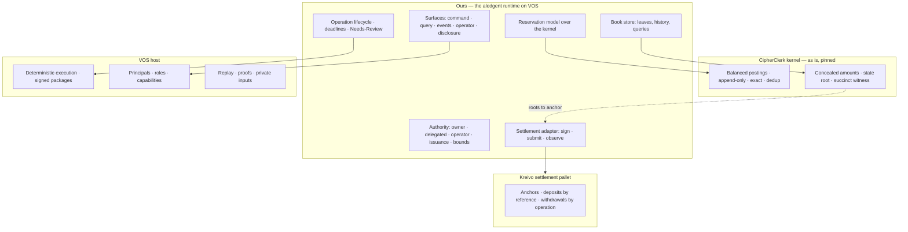

<!--
Copyright (c) 2026 Pagos Cube LLC
SPDX-License-Identifier: CC-BY-4.0
-->

---
name: aledgent — fit of VOS + CipherClerk + a Kreivo pallet against the specification
status: informative plan input — not part of SPEC.md
date: 2026-09-21
sources: VOS saga/agents @ 7bae926 (2026-09-21); VOS main @ d237827; CipherClerk @ e9a7b08; SPEC.md v0.2.0
---

# Fit analysis — what the stack already gives us, and what is ours to build

The question: with **CipherClerk** as the kernel, **VOS** as the host, **our runtime on top of VOS**, and
**a pallet on Kreivo** for settlement, how much of the specification is already satisfied, and what is
on our side? The answer is organised by the things the owner wants kept — the capability contracts and
the invariants — and only then by epic.

Legend: **●** satisfied as-is · **◐** partly, needs work on our side · **○** ours to build ·
**↑** needs an upstream change · **▲** belongs in the Kreivo pallet.

---

## 1. Verdict

1. **The kernel is the strongest piece.** CipherClerk satisfies the core accounting invariants at the
   layer the spec demands: balanced postings that cannot be expressed unbalanced, append-only state,
   exact amounts, permanent deduplication, atomic chains, concealed amounts, a committed state root, and
   succinct witnesses for anchoring. Seven of the ten kernel requirements hold as-is.
2. **Three kernel gaps are structural, not cosmetic.** There is no way to reserve against a settled
   balance (the spec's central reservation model does not map), no authority other than possession of
   the debited account's key, and no lifecycle for the third balance layer.
3. **VOS gives determinism, signed packages, authenticated principals, replay and proofs — and is not
   yet a place a book of record can live.** On `saga/agents` an Agent's **entire state, storage rows
   included, is capped at 4 MiB and transported whole on every invocation**. That is roughly twelve
   thousand accounts with no history. There are also no durable timers on the standard runtime, no
   outbound notifications, no cross-Agent calls in the new ABI, no actor-visible signing, and replicated
   (Shared) Agents are not production-qualified.
4. **The existing `clerk-*` actors are a reference, not a base.** They were not ported to the Agent
   model, apply one transfer per call, are operator-gated, have no operation records and no chain
   linkage, and `clerk-bridge` depends on a signing call the new branch removed.
5. **A Kreivo pallet is the right home for settlement and resolves three open questions at once**
   (`OQ-7`, `OQ-9`, `OQ-10`): native coordinates, addressing one account without a per-account chain
   record, and what stays checkable on chain.
6. **Net: the invariants can be kept, but four of them only above the kernel**, which the spec requires
   us to declare in the assurance level (`REQ-AR-4`, `REQ-AR-5`). Nothing in the stack delivers a user
   story end to end today; the stack delivers *mechanisms*, and every surface of §7 is ours.

---

## 2. The kernel contract — `REQ-KER-*` against CipherClerk

| Req | Fit | What exists | What is ours / upstream |
|---|---|---|---|
| `KER-1` unbalanced unrepresentable | ● | Zero-sum over Pedersen points per (currency, layer); a one-legged transfer cannot balance | — |
| `KER-2` multi-entry, multi-asset atomic | ● | 2..N entries; one transfer spans currencies, balanced per currency | — |
| `KER-3` three balance layers, movement between them as entries | **↑ / ○** | Three layers exist, but zero-sum is **per layer**: a transfer cannot move value between layers of one account. The third layer has no lifecycle | See §5. Either model layers with counter-accounts (ours) or ask upstream for an intra-account layer move |
| `KER-4` never negative under concurrency | ◐ | Per touched layer, for flagged accounts, by requiring the oracle to open the net. Holds for the settled layer | The check never sees an outstanding pending amount, so *available* is not kernel-enforced (§5) |
| `KER-5` append-only | ● | Voids are new mirror transfers; nothing mutates | — |
| `KER-6` permanent dedup on a submitter key | ● | `external_id`, 32 bytes, plus transfer-id uniqueness; committed into the state root | Scope is backend-defined; ours to scope per deployment |
| `KER-7` exact integers | ● | `u64` values inside commitments; no floats anywhere | Range is `u64` minor units — enough for every asset at 6 decimals; confirm for 12-decimal assets |
| `KER-8` concealed amounts with balance still enforced | ● / ◐ | Amounts are always commitments; L1 moves the opening from the host to the holder's viewing key | At L0 the host oracle holds every opening, so amounts are concealed from storage readers, not from the operator. Deeper layers are experimental and must not carry real value |
| `KER-9` authority separable from one credential | **○** | None. One signature per distinct debited account against that account's key. No delegation, no operator, no agent | Entirely ours, above the kernel. Must be declared in the assurance level |
| `KER-10` atomic composition of postings | ● | Linked chains with staged overlay and all-or-nothing commit | — |

Other kernel facts the plan must carry: currency on an entry is never checked against the account's
currency (honest construction only — an upstream fix worth asking for); five status codes are dead; the
flat Merkle helper duplicates odd leaves; every shipped "proof" is a signature; an auditor key sees
incoming flows only; there is no persistence and no query layer by design.

## 3. The runtime contract — `REQ-RT-*` against VOS (`saga/agents`)

| Req | Fit | What exists | What is ours / upstream |
|---|---|---|---|
| `RT-1` one commit boundary for entries + operation state + evidence + notification enqueue | ◐ | Within one Agent every actor's change in a slice commits as **one whole-state image** — multi-actor atomicity is free | Only if the book, the operation records and the outbox all live in **one Agent**, which collides with the 4 MiB cap. There is no cross-Agent call in the new ABI to enqueue anything outward |
| `RT-2` at-most-once on a client key | ◐ | Mutating ingress requires an idempotency key; exact retries recover the original result | The retained window is finite (256 results on main); permanent dedup must be ours, anchored on the kernel's `external_id` |
| `RT-3` deterministic, replayable execution | ● | The design centre of VOS: fresh machine per invocation, explicit inputs, proofs over execution | — |
| `RT-4` durable at-least-once delivery, recorded | **○** | No push surface at all: no webhooks, no streaming, no pub/sub reachable from actors. Only egress is a native extension | Ours: an outbox in Agent state plus a delivery extension, which is Local-only, unsandboxed, 8 calls × 64 KiB per step, and rejected under proof |
| `RT-5` durable scheduled work | **↑ / ○** | `sleep` is an alias for yield. saga has a durable timer subsystem, but only as an optional capability of a **custom AgentRuntime**, and nothing fires a due schedule on an idle Agent | Either we own a custom AgentRuntime (this is what "our runtime on top of VOS" would literally mean), or an external ticker calls in. Deadlines (`INV-15`) depend on this |
| `RT-6` private inputs outside replicated state | ● | Private ingress and producer-side witness stores keep plaintext out of logs, snapshots and state | Actor-visible device signing was removed on saga, so keys must live in the adapter, which the spec wants anyway |
| `RT-7` no clock, randomness or network inside the boundary | ● | Enforced by construction | The kernel wants blindings supplied from outside; that supply path is ours |
| `RT-8` upgrades preserve the book | ◐ | Signed upgrade transitions preserve state identity; schema fingerprints fail closed | No state-migration hook. A schema change means export and re-import, which is exactly what `REQ-RC-3` demands we prove at volume |

**The constraint that dominates the plan.** `MAX_RUNTIME_STATE_BYTES = 4 MiB` bounds the whole Agent
state, rows included, and every invocation ships that state in and out. A book of a hundred thousand
accounts does not fit, and cost scales with total state rather than with the transaction. Two ways
forward, both real work:

- **Commitments in, leaves out.** Keep only roots and hot records in Agent state; keep the leaves in a
  host-side store; bring *witnessed leaves* into each invocation. CipherClerk's succinct transition
  witness and VOS's `clerk-witness` crate exist for exactly this shape. The cost: the leaf store sits
  outside the runtime's commit boundary, so `REQ-RT-1` has to be re-argued (the store must be
  re-derivable from committed transitions).
- **Ask upstream** for paged or out-of-image state. This is the single most valuable upstream request.

Also open on the branch, by its own status documents: replicated (Shared) Agents, multi-node
replication, backup and restore, and every latency and throughput budget. Shared Agents currently run
under one host-wide mutex. No per-invocation latency has ever been measured, so `NFR-1` (50 ms) is
unverified against this host.

## 4. The settlement contracts — `REQ-SL-*`, `REQ-SA-*` against Kreivo and the substrate extension

| Req | Fit | What exists | What is ours / pallet |
|---|---|---|---|
| `SL-1` record a bounded commitment publicly | **▲** | Only `remark_with_event`, already used for hashed references. No ordering, no verification, bodies pruned | An **anchor** call in the pallet: `(instance, sequence, root)` stored and ordered |
| `SL-2` hold and transfer value with stable coordinates | ◐ ▲ | The assets pallet moves value; coordinates today are reconstructed from extrinsic hash plus a suffix | The pallet emits events keyed by **operation reference**, making coordinates native (`OQ-7`) |
| `SL-3` observable finality | ● | Relay-chain finality; the extension exposes best-block and finalized | Measured behaviour has four contradictory sources — must be measured |
| `SL-4` instructions that can expire | ● | Mortal transactions; the extension requires them for automatic nonces | — |
| `SL-5` no record per operation, account or identity | ● ▲ | Nothing forces one | The pallet must hold **no per-account state** — only per-instance positions and anchors |
| `SA-1` declare support | ○ | — | Ours |
| `SA-2` assert the declared network | ● | The extension reports genesis hash; chain specs are pinned | Ours to check at start |
| `SA-3` report only observations | ○ | The extension returns the transaction's own events | Ours: the adapter's vocabulary |
| `SA-4` executed / provably not / unknown | ◐ | The extension has an explicit *nonce uncertain* state and mortal eras | Ours to map onto the three dispositions |
| `SA-5`, `SA-6` durable record; persist before submit | ◐ | Prepared payloads and outcomes are part of the extension's snapshot; replays return the original | Ours to make it the adapter's contract |
| `SA-7` complete observation over contiguous ranges | **○** | **No event subscription exists.** Only polled storage reads | Ours, or upstream. A pallet that keeps a **sequenced inbox in storage** turns observation into a storage read with a cursor — which the extension *can* do |
| `SA-8` adapter holds no account authority; keys isolated | ◐ | The extension never holds keys; signing is external | Ours: a signer outside the Agent. Extensions are Local-only, which forces the adapter onto a Local Agent even if the book is replicated |

## 5. The reservation problem, precisely

The spec's model is: `available`, `reserved`, `encumbered` inside one account; a reservation debits
available and credits reserved atomically with the sufficiency check; capture and release are entries.

The kernel cannot express that:

- Zero-sum is enforced per (currency, **layer**). Debiting one layer and crediting another in the same
  account does not balance in either layer.
- A pending transfer debits the payer's *pending* layer. For an account that must not go negative, that
  layer is checked on its own and the reservation is rejected.
- The settled-layer check never reads the pending layer. A second spend sees the full settled balance.
  **There is no native atomic `available = settled − reserved`.**

What works today, with the kernel unchanged: **model a reservation as a transfer on the settled layer
into a holding account**, one per operation or pooled with the operation reference as the key. Capture
is holding → destination; release is holding → payer; all three are ordinary balanced postings, the
never-negative check on the payer is the kernel's own, and the pair can be chained atomically. `INV-3`
and `INV-14` then hold at kernel strength. The cost: "reserved" becomes a derived number (the sum of a
holder's open holdings), and the spec's wording in `REQ-KER-3` and §5.4 — layers inside one account,
moved by entries — needs an amendment, or an upstream change to the kernel.

## 6. The invariants — who keeps each one in this stack

| Invariant | Spec layer | In this stack | Matches? |
|---|---|---|---|
| `INV-1` postings balance | Kernel | CipherClerk | ● |
| `INV-2` append-only | Kernel + store | CipherClerk; ours for the store | ● |
| `INV-3` never negative | Kernel | CipherClerk on the settled layer, **given §5's holding-account model** | ● with amendment |
| `INV-4` assets segregated | Kernel | Per-currency zero-sum ●; entry-vs-account currency unchecked | ◐ ↑ |
| `INV-5` book sums to zero | Store | Follows from `INV-1` plus an issuance account; the continuous check is ours | ◐ |
| `INV-6` stored balance = sum of entries | Store + service | The kernel maintains rolling balances; re-derivation and reconciliation are ours | ◐ |
| `INV-7` exact integers | Store + type | CipherClerk | ● |
| `INV-8` one authoritative copy | Service | Ours | ○ |
| `INV-9` an existing account can be credited | Service | Accounts are created off-chain by the registrar — no external wait | ● |
| `INV-10`–`INV-14`, `INV-23` book and settlement cannot disagree | Service / store | Entirely ours: the operation lifecycle. `INV-12` (coordinate once) maps onto the kernel's `external_id` and is then **kernel-strength** | ○ (one ●) |
| `INV-15` deadline on every non-terminal operation | Store + service | Ours, and blocked on timers (`RT-5`) | ○ ↑ |
| `INV-16` no fact without authority | Store | VOS authenticates a stable principal; the per-account decision is ours | ◐ |
| `INV-17` no personal data in identifiers or anchors | Store + build | Kernel ids are random 16 bytes ●; the rest is ours | ◐ |
| `INV-18` idempotent transitions | Store | Ours, on top of kernel dedup | ◐ |
| `INV-19` anchor commits to a stated sequence | Service | The composite root exists ●; sequence binding and publication are ours + pallet | ◐ ▲ |
| `INV-20` every entry visible with who acted | Service | Ours. The kernel records only that *the account's key* signed | ○ |
| `INV-21` terminal states absorb | Store | Ours | ○ |
| `INV-22` credentials cannot widen themselves | Credential | VOS roles delegate strictly downward ◐; bounded grants are ours | ◐ |
| `INV-24` one asset registry | Store | Ours (the kernel's currency is a bare number) | ○ |
| `INV-25` one book | Architecture | One journal per ledger actor ●, **if** the book fits one Agent (§3) | ◐ |

Four invariants hold only above the kernel in this stack: `INV-15`, `INV-16`, `INV-20`, `INV-22`. The
spec allows that, and requires it to be **declared**, not hidden.

## 7. The epics — what arrives for free

| Epic | From the stack | Ours |
|---|---|---|
| **A** Identity and accounts | Registrar-gated account creation; instant, no chain | Identities, ownership, custody mode, pooled grants, closing rules |
| **B** Internal transfers | The whole accounting core: balanced, atomic, never negative, chains | The command surface; batching (the existing actor takes one transfer per call) |
| **C** Reservations | Nothing usable natively (§5) | The holding-account model; deadlines; the review queue |
| **D** Inbound | Finality reads; mortal eras | Observation, completeness, the whole evidence model ▲ |
| **E** Outbound | Two-stage prepare/submit with a careful nonce model | Reserve-first, signing, dispositions, parking on shortfall ▲ |
| **F** Multi-asset | Multi-currency postings; exchange in one transfer | Asset registry; issuance authority (the kernel's issuer flag is never read) |
| **G** Agents | A stable authenticated principal per call | Every part of bounded, revocable, attributable delegation |
| **H** Querying | By-key reads; a per-account history helper that is not on the storage trait | Everything: identity-wide balances, paging, statements |
| **I** Privacy and disclosure | Commitments, viewing keys, four disclosure claim shapes — as **signatures** | Read authorisation; honest labelling of signed disclosures |
| **J** Provability | Composite root; succinct witnesses; STARK proofs of execution | Anchoring cadence; the pallet ▲; comparison with the settlement layer |
| **K** Operations and recovery | Replay; signed upgrades; offline backup on main | The operator surface, audit trail, reversals, export and re-import |
| **M** Integration | Self-describing schemas per node | Notifications (no push exists); never-call-back is natural here |

## 8. The Kreivo settlement pallet — a proposed remit

Keep it small. The spec's rule is that settlement facts are *deliberately few*.

| Call / storage | Serves | Note |
|---|---|---|
| `register_instance` | Federation, custody topology | One entry per aledgent deployment; holds its settlement position key(s). Makes other instances ordinary counterparties |
| `anchor(instance, sequence, root)` | `REQ-SL-1`, `REQ-PR-1`, `INV-19` | Stored, ordered, event-emitting. Reveals nothing but a root and a sequence |
| `deposit(instance, account_ref, asset, amount)` | `US-D1`, **`OQ-9`** | Value moves into the instance's position; `account_ref` is an opaque reference the instance resolves. No per-account chain state |
| `withdraw(instance, operation_ref, to, asset, amount)` | `REQ-SO-3`, **`OQ-7`** | Event keyed by operation reference: per-leg outcome by identity, never by position in a batch |
| Sequenced inbox in storage | **`REQ-SA-7`** | Lets the adapter observe with a cursor over storage instead of an event subscription the host does not have |
| *Not in V0:* proof verification on chain; per-account balances; netting between instances | `DEF-1`, `DEF-3` | A STARK verifier pallet is a large, separate project |

This also fixes what stays checkable on chain (`OQ-10`): per-instance positions, the anchor sequence,
and the inbox — and nothing about any holder.

## 9. Who builds what

**Ours (the aledgent runtime).** All six surfaces; the operation lifecycle and its records; the
authority model with bounds and revocation; the reservation model; the asset registry; the book's leaf
store, history and query layer; the outbox and delivery; the audit trail; the settlement adapter and its
signer; reconciliation; export and re-import.

**Upstream asks, in order of value.**

1. VOS — state that is not bounded by, or transported with, a 4 MiB image.
2. VOS — durable timers that fire on an idle Agent, on the standard runtime.
3. VOS — a cross-Agent call in the new ABI, and an extension route usable from replicated Agents.
4. CipherClerk — an intra-account layer move, or a first-class reservation primitive; and check an
   entry's currency against its account's.
5. VOS substrate extension — an event or storage-change subscription.
6. CipherClerk — delegated authority is *not* an ask: keep it above the kernel.

**The pallet.** §8, in `frame-contrib`, deployed to Kreivo.

**Not reusable as-is.** `clerk-ledger`, `clerk-bridge`, `clerk-settle`: unported to the Agent model,
single currency hard-coded in the bridge, a viewing-key secret held in replicated state, one transfer
per call. They remain the best worked example of the kernel under VOS, and `clerk-witness` is directly
reusable.

## 10. Consequences for the specification

Candidates for the second amendment, alongside the parked notes:

- `REQ-KER-3` and §5.4: state reservation as a **property** (value committed to one operation is not
  spendable, atomically with the check) rather than as layers inside one account, so that a
  holding-account realisation is conformant.
- `REQ-RT-5` and `INV-15`: unchanged, but flagged as the requirement most at risk from the host.
- `REQ-AR-5`: the first assurance level must declare authority, visibility and deadlines as
  service-enforced.
- `NFR-1`, `NFR-3`: unverified against this host until a dispatch has been measured.

## 11. Measure before planning further

1. One mutating invocation on a Local Agent at realistic state size: latency and the cost of whole-state
   transport.
2. The kernel in the target machine with and without the curve precompile (the estimate is ten to
   twenty million cycles per transfer without it).
3. A witnessed-leaves invocation: size and time for a transfer touching two accounts in a tree of a
   hundred thousand.
4. Kreivo finality and inclusion under load, from the adapter's point of view.
